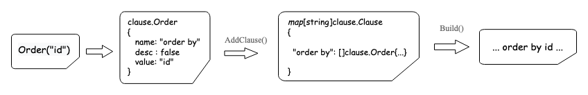

GORM对外提供的是一个DB结构体，维护了所有需要的参数，在链式编程中进行传递，每次点操作都会拷贝成一个新的DB返回。

```
// DB GORM DB definition
type DB struct {
   *Config                   // dbconn的基本配置
   Error        error        // 链式语法中透传的error信息
   RowsAffected int64        // 影响行数
   Statement    *Statement   // 执行语句
   clone        int          // 链式语法中被克隆次数（点的次数）
}
```

# SQL生成

SQL生成本质是将Go代码转换成可执行的SQL语句的过程：

```
// Golang                          // SQL
db.Where('id=1').Find(&a)    =>    select * from a where id = 1 
```

在Gorm中将SQL的拼装过程主要分成 Chain Method 与 Finisher Method:


Find()就是一个Finisher Method，直接决定了该SQL是哪种执行类型（select、update...）。而Where、Order、Limit等都是Chain Method，决定了此次SQL的一些约束条件。

对于Chain Method都会保存在DB.Statement.Clauses结构下，后续由Finisher Method触发统一生成完整的SQL保存在DB.Statement.SQL下用于后续执行。我们以Order()为例，其解析过程如下图：


