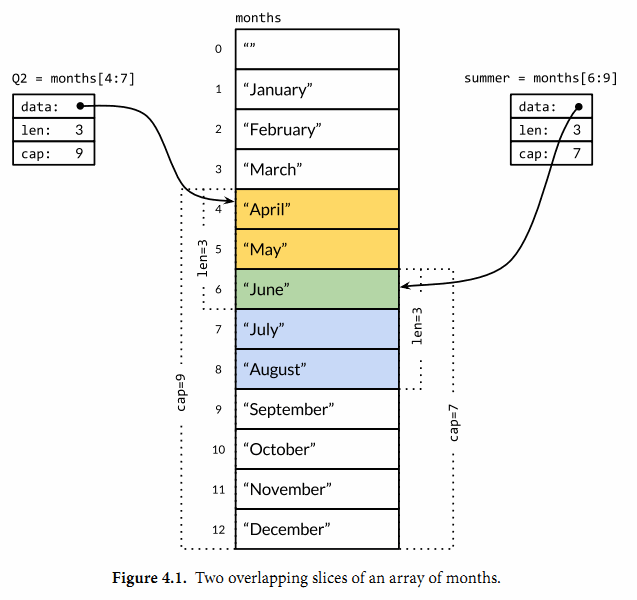

Slice（切片）代表变长的序列，序列中每个元素都有相同的类型。

一个slice类型一般写作[]T，其中T代表slice中元素的类型。

数组和slice之间有着紧密的联系。一个slice是一个轻量级的数据结构，提供了访问数组子序列（或者全部）元素的功能，slice的底层引用一个数组对象。

slice是一个引用类型，由三个部分构成：指针、长度和容量。

指针指向第一个slice元素对应的底层数组元素的地址，要注意的是slice的第一个元素并不一定就是数组的第一个元素。长度对应slice中元素的数目，长度不能超过容量；**容量一般是从slice的开始位置到底层数据的结尾位置**。

内置的len和cap函数分别返回slice的长度和容量。

多个slice之间可以共享底层的数据，并且引用的数组部分区间可能重叠。



反转数组：

```
// reverse reverses a slice of ints in place.
func reverse(s []int) {
    for i, j := 0, len(s)-1; i < j; i, j = i+1, j-1 {
        s[i], s[j] = s[j], s[i]
    }
}
```

slice之间不能比较，因此我们不能使用==操作符来判断两个slice是否含有全部相等元素。

**由于slice没有实现==运算符，因此不能作为map对象的key，而数组对象可以。**

# 切片的定义

切片的声明：

```
var name []T
```

```
func main() {
	// 声明切片类型
	var a []string              //声明一个字符串切片
	var b = []int{}             //声明一个整型切片并初始化
	var c = []bool{false, true} //声明一个布尔切片并初始化
	var d = []bool{false, true} //声明一个布尔切片并初始化
	fmt.Println(a)              //[]
	fmt.Println(b)              //[]
	fmt.Println(c)              //[false true]
	fmt.Println(a == nil)       //true
	fmt.Println(b == nil)       //false
	fmt.Println(c == nil)       //false
	// fmt.Println(c == d)   //切片是引用类型，不支持直接比较，只能和nil比较
}
```

# 切片表达式

切片的底层就是一个数组，所以我们可以基于数组通过切片表达式得到切片。

切片表达式中的low和high表示一个索引范围（左闭右开）。

容量等于得到的切片从low开始的底层数组的容量。

```
func main() {
	a := [5]int{1, 2, 3, 4, 5}
	s := a[1:3]  // s := a[low:high]
	fmt.Printf("s:%v len(s):%v cap(s):%v\n", s, len(s), cap(s))
}
// s:[2 3] len(s):2 cap(s):4
```

```
a[2:]  // 等同于 a[2:len(a)]
a[:3]  // 等同于 a[0:3]
a[:]   // 等同于 a[0:len(a)]
```

**注意：**

对切片再执行切片表达式时（切片再切片），high的上限边界是切片的容量cap(a)，而不是长度。

如果索引在运行时超出范围，就会发生运行时panic。

```
func main() {
	a := [5]int{1, 2, 3, 4, 5}
	s := a[1:3]  // s := a[low:high]
	fmt.Printf("s:%v len(s):%v cap(s):%v\n", s, len(s), cap(s))
	s2 := s[3:4]  // 索引的上限是cap(s)而不是len(s)
	fmt.Printf("s2:%v len(s2):%v cap(s2):%v\n", s2, len(s2), cap(s2))
}
```

输出：

```
s:[2 3] len(s):2 cap(s):4
s2:[5] len(s2):1 cap(s2):1
```

完整切片表达式

对于数组，指向数组的指针，或切片a(**注意不能是字符串**)支持完整切片表达式：

```
a[low : high : max]
```

表示切片容量的最右侧为max索引

```
func main() {
	a := [5]int{1, 2, 3, 4, 5}
	t := a[1:3:5]
	fmt.Printf("t:%v len(t):%v cap(t):%v\n", t, len(t), cap(t))
}

// t:[2 3] len(t):2 cap(t):4
```

# 使用make创建切片

**内置的make函数创建一个指定元素类型、长度和容量的slice**。容量部分可以省略，在这种情况下，容量将等于长度。

```
slice := make([]T, len)
slice := make([]T, len, cap) // same as make([]T, cap)[:len]
```

在底层，make创建了一个匿名的数组变量，然后返回一个slice；只有通过返回的slice才能引用底层匿名的数组变量。在第一种语句中，slice是整个数组的view。在第二个语句中，slice只引用了底层数组的前len个元素，但是容量将包含整个的数组。额外的元素是留给未来的增长用的。

注意：make指定len后，初始化的切片中包含len个元素，它们的值为默认值

```
func main() {
	dm := make([]int, 8)
	fmt.Println(dm)
}
//[0 0 0 0 0 0 0 0]
```

希望减少扩容次数应该通过指定cap来实现：

`dm := make([]int, 0, 100)`

make和new的区别：

- new(T) 为每个新的类型T分配一片内存，初始化为 0 并且返回类型为*T的内存地址：这种方法 **返回一个指向类型为 T，值为 0 的地址的指针**，它适用于值类型如数组和结构体；它相当于 &T{}。
- make(T) **返回一个类型为 T 的初始值**，它只适用于3种内建的引用类型：切片、map 和 channel。

创建m*n的切片数组：

```
    visited := make([][]bool, m)
    for i := 0; i < m; i++ {
        visited[i] = make([]bool, n)
    }
```

## 切片比较

切片之间是不能比较的，我们不能使用==操作符来判断两个切片是否含有全部相等元素。 切片唯一合法的比较操作是和nil比较。 一个nil值的切片并没有底层数组，一个nil值的切片的长度和容量都是0。但是我们不能说一个长度和容量都是0的切片一定是nil，例如下面的示例：

```
var s1 []int         //len(s1)=0;cap(s1)=0;s1==nil
s2 := []int{}        //len(s2)=0;cap(s2)=0;s2!=nil
s3 := make([]int, 0) //len(s3)=0;cap(s3)=0;s3!=nil
```

所以要判断一个切片是否是空的，要是用len(s) == 0来判断，不应该使用s == nil来判断。

## 切片的赋值拷贝

下面的代码中演示了拷贝前后两个变量共享底层数组，对一个切片的修改会影响另一个切片的内容，这点需要特别注意。

```
func main() {
	s1 := make([]int, 3) //[0 0 0]
	s2 := s1             //将s1直接赋值给s2，s1和s2共用一个底层数组
	s2[0] = 100
	fmt.Println(s1) //[100 0 0]
	fmt.Println(s2) //[100 0 0]
}
```

## 深拷贝

调用copy函数：`copy(dst,src)`

```
v1 := []int{1,2,3,4,5,6}
v2 := make([]int,5)
copy(v2,v1[0:5])
```

# append函数

内置的append函数用于向slice追加元素：

```
var runes []rune
for _, r := range "Hello, 世界" {
    runes = append(runes, r)
}
fmt.Printf("%q\n", runes) // "['H' 'e' 'l' 'l' 'o' ',' ' ' '世' '界']"
```

在循环中使用append函数构建一个由九个rune字符构成的slice。

**注意：**通过var声明的零值切片可以在append()函数直接使用，无需初始化。

```
var s []int
s = append(s, 1, 2, 3)
```

# 切片扩容策略

```
newcap := old.cap
doublecap := newcap + newcap
if cap > doublecap {
	newcap = cap
} else {
	if old.len < 1024 {
		newcap = doublecap
	} else {
		// Check 0 < newcap to detect overflow
		// and prevent an infinite loop.
		for 0 < newcap && newcap < cap {
			newcap += newcap / 4
		}
		// Set newcap to the requested cap when
		// the newcap calculation overflowed.
		if newcap <= 0 {
			newcap = cap
		}
	}
}
```

- 首先判断，如果新申请容量（cap）大于2倍的旧容量（old.cap），最终容量（newcap）就是新申请的容量（cap）。
- 否则判断，如果旧切片的长度小于1024，则最终容量(newcap)就是旧容量(old.cap)的两倍，即（newcap=doublecap），
- 否则判断，如果旧切片长度大于等于1024，则最终容量（newcap）从旧容量（old.cap）开始循环增加原来的1/4，即（newcap=old.cap,for {newcap += newcap/4}）直到最终容量（newcap）大于等于新申请的容量(cap)，即（newcap >= cap）
- 如果最终容量（cap）计算值溢出，则最终容量（cap）就是新申请容量（cap）。

## 使用copy()函数复制切片

Go语言内建的copy()函数可以迅速地将一个切片的数据复制到另外一个切片空间中

demo：

`copy(destSlice, srcSlice []T)`

```
func main() {
	// copy()复制切片
	a := []int{1, 2, 3, 4, 5}
	c := make([]int, 5, 5)
	copy(c, a)     //使用copy()函数将切片a中的元素复制到切片c
	fmt.Println(a) //[1 2 3 4 5]
	fmt.Println(c) //[1 2 3 4 5]
	c[0] = 1000
	fmt.Println(a) //[1 2 3 4 5]
	fmt.Println(c) //[1000 2 3 4 5]
}
```

## 从切片中删除元素

Go语言中并没有删除切片元素的专用方法，我们可以使用切片本身的特性来删除元素。 代码如下：

```
func main() {
	// 从切片中删除元素
	a := []int{30, 31, 32, 33, 34, 35, 36, 37}
	// 要删除索引为2的元素
	a = append(a[:2], a[3:]...)
	fmt.Println(a) //[30 31 33 34 35 36 37]
    
}
```

要从切片a中删除索引为index的元素，操作方法是：

`a = append(a[:index], a[index+1:]...)`

`...`：将切片元素展开

或者

`a = a[:i+copy(a[i:], a[i+1:])]`

## 剪切或删除可能引起的内存泄漏

需要特别注意的是。如果切片a中的元素是一个指针类型或包含指针字段的结构体类型（需要被垃圾回收），上面剪切和删除的示例代码会存在一个潜在的内存泄漏问题：一些具有值的元素仍被切片a引用，因此无法被垃圾回收机制回收掉。下面的代码可以解决这个问题。

剪切：

```
copy(a[i:], a[j:])
for k, n := len(a)-j+i, len(a); k < n; k++ {
	a[k] = nil // 或类型T的零值
}
a = a[:len(a)-j+i]
```

删除：

```
copy(a[i:], a[i+1:])
a[len(a)-1] = nil // 或类型T的零值
a = a[:len(a)-1]
```
