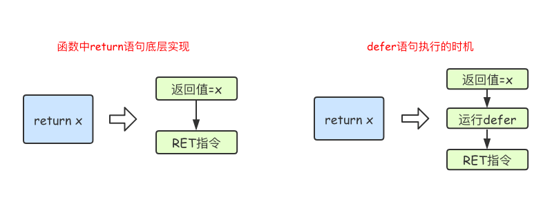

Go语言中的defer语句会将其后面跟随的语句进行延迟处理。**在****defer****归属的函数即将返回时，将延迟处理的语句按****defer****定义的逆序进行执行。**

**发生panic后，会首先执行所有的defer语句，然后执行panic语句。**

```
func main() {
	fmt.Println("start")
	defer fmt.Println(1)
	defer fmt.Println(2)
	defer fmt.Println(3)
	fmt.Println("end")
}
```

```
start
end
3
2
1
```

由于defer语句延迟调用的特性，所以defer语句能非常方便的处理资源释放问题。比如：资源清理、文件关闭、解锁及记录时间等。

```
var i int 
func unlockDefer(l *sync.Mutex) {
    l.lock()
    defer l.Unlock()
    i = rand.Int()
}
func unlockDirect(l *sync.Mutex) {
    l.lock()
    i = rand.Int()
    l.Unlock()
}
```

# defer执行时机

在Go语言的函数中return语句在底层并不是原子操作，它分为给返回值赋值和RET指令两步。而defer语句执行的时机就在返回值赋值操作后，RET指令执行前。具体如下图所示：



# 预计算参数

Go 语言中所有的函数调用都是传值的，虽然 defer 是关键字，但是也继承了这个特性。假设我们想要计算 main 函数运行的时间，可能会写出以下的代码：

```
func main() {
	startedAt := time.Now()
	defer fmt.Println(time.Since(startedAt))
	
	time.Sleep(time.Second)
}

$ go run main.go
0s
```

然而上述代码的运行结果并不符合预期，我们会发现调用 defer 关键字会立刻拷贝函数中引用的外部参数，所以 time.Since(startedAt) 的结果不是在 main 函数退出之前计算的，而是在 defer 关键字调用时计算的，最终导致上述代码输出 0s。

想要解决这个问题，只需要向 defer 关键字传入匿名函数：

```
func main() {
	startedAt := time.Now()
	defer func() { fmt.Println(time.Since(startedAt)) }()
	
	time.Sleep(time.Second)
}

$ go run main.go
1s
```

虽然调用 defer 关键字时也使用值传递，但是因为拷贝的是函数指针，所以 time.Since(startedAt) 会在 main 函数返回前调用并打印出符合预期的结果。

# demo

```
// 无名返回值
// return后，返回值赋值为5
// defer操作改变x，不改变返回值
// 返回值为5
func f1() int {
	x := 5
	defer func() {
		x++
	}()
	return x
}

// 有名返回值
// return 将x赋值为5，然后defer将x+1
// 返回值为6
func f2() (x int) {
	defer func() {
		x++
	}()
	return 5
}

// 有名返回值
// 将y赋值为5，defer修改x
// 返回值为5
func f3() (y int) {
	x := 5
	defer func() {
		x++
	}()
	return x
}

// x赋值为5，x参数传递给defer的匿名函数
// 值类型，对x的修改不影响x
// 返回值为5
func f4() (x int) {
	defer func(x int) {
		x++
	}(x)
	return 5
}

//传一个指针到匿名函数中
// x首先赋值为5，然后传递x的地址给defer的匿名函数
// 匿名函数修改x的值
// 返回值为6
func f5() (x int) {    
    defer func(x *int) {        
        (*x)++    
    }(&x)    
    return 5
}
func main() {
	fmt.Println(f1())
	fmt.Println(f2())
	fmt.Println(f3())
	fmt.Println(f4())
    fmt.Println(f5())
}
```

对于`return x`

```
x = ...
调用defer函数
RET
```

对于匿名返回值：

```
func f() int {
    x := 10
    return x
}
// 等价于
// func f() (y int)  创建匿名返回值y
// y = x 将x的值拷贝给y
// return y  
```

面试题：

```
func calc(index string, a, b int) int {
	ret := a + b
	fmt.Println(index, a, b, ret)
	return ret
}

func main() {
	x := 1
	y := 2
    // defer定义时就确定参数，因此cal("A",x,y)定义时就执行了
	defer calc("AA", x, calc("A", x, y))
	x = 10
	defer calc("BB", x, calc("B", x, y))
	y = 20
}
```

输出：

```
A 1 2 3
B 10 2 12  
BB 10 12 22
AA 1 3 4   
```
