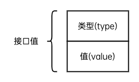
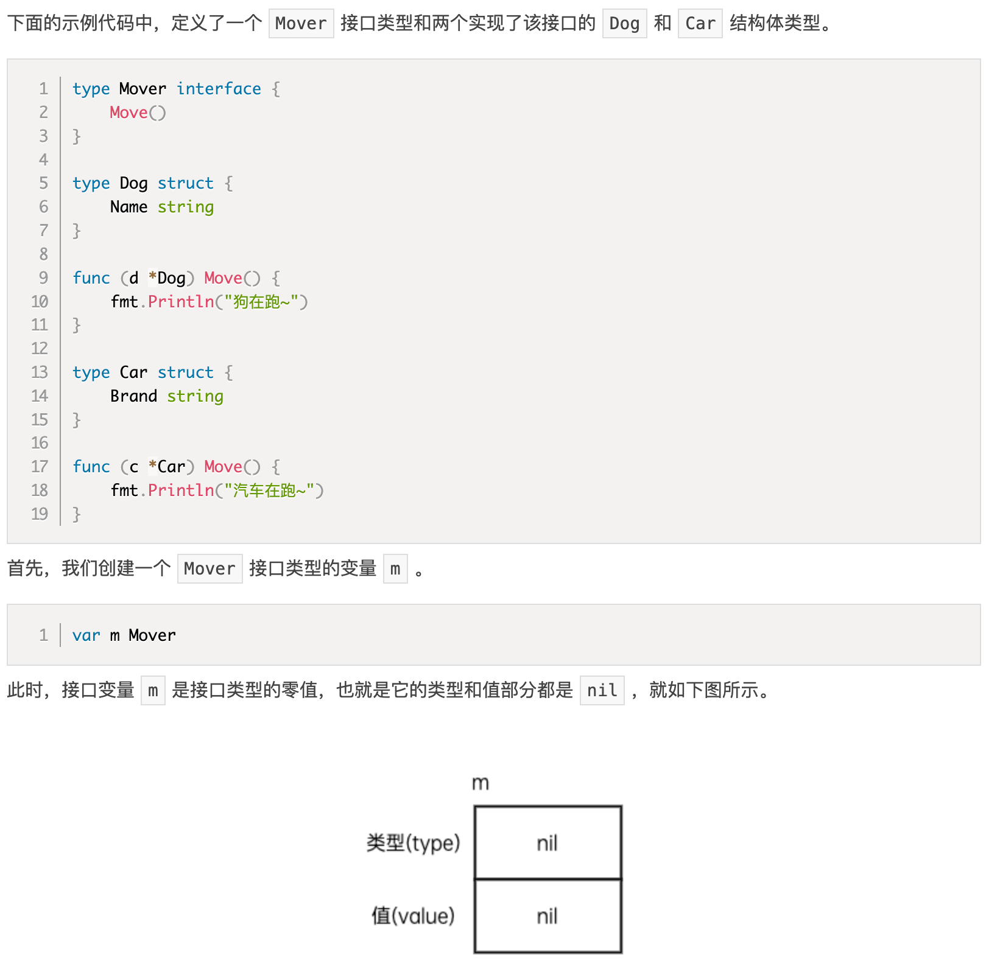
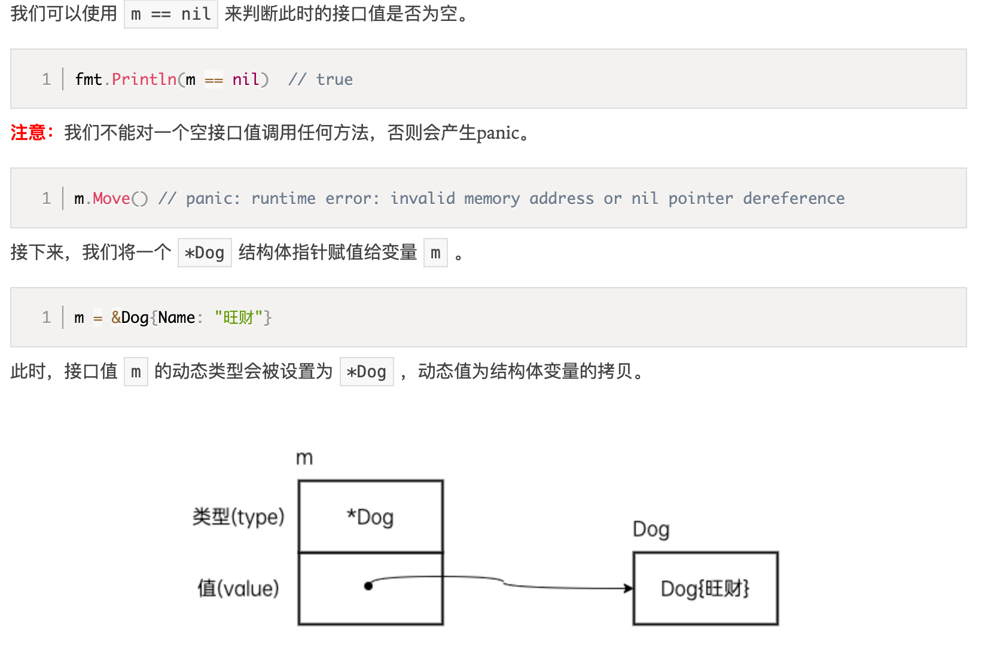
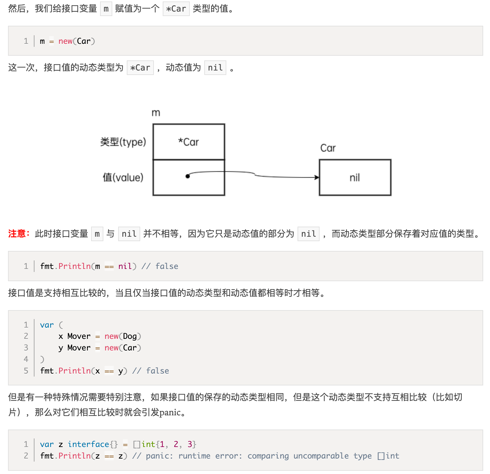

# 接口类型

接口是一种由程序员来定义的类型，一个接口类型是一组方法的集合，它规定了需要实现的所有方法。

对比结构体，使用接口类型时更关注它能做什么而不是它是什么。

## 接口的定义

每个接口由若干个方法签名组成，它的定义格式如下：

```
type 接口类型名 interface {
    方法名1(参数列表1)	返回值列表1
    方法名2(参数列表2) 返回值列表2
    ...
}
```

- 接口类型名：在命名时一般会在名称后加er，如Writer，Closer等
- 参数列表和返回值列表中的参数变量名可以省略

demo：

```
type Writer interface {
    Write([]byte) error
}
```

## 实现接口的条件

在Go语言中，只要一个类型实现来接口的所有方法，就称它实现了这个接口。

demo：

```
type Singer interface {
    Sing()
}
type Bird struct {}
// Bird实现了Singer接口
func (b Bird) Sing() {
    fmt.Println("jiu jiu jiu")
}
```

# 值接收者和指针接收者

如果方法的接收者是值类型，无论调用者是对象还是对象指针，修改的都是对象的副本，不影响调用者；如果方法的接收者是指针类型，则调用者修改的是指针指向的对象本身。

使用指针作为方法的接收者的理由：

- 方法能够修改接收者指向的值。
- 避免在每次调用方法时复制该值，在值的类型为大型结构体时，这样做会更加高效。

是使用值接收者还是指针接收者，不是由该方法是否修改了调用者（也就是接收者）来决定，而是应该基于该类型的本质。

如果类型具备“原始的本质”，也就是说它的成员都是由 Go 语言里内置的原始类型，如字符串，整型值等，那就定义值接收者类型的方法。像内置的引用类型，如 slice，map，interface，channel，这些类型比较特殊，声明他们的时候，实际上是创建了一个 header， 对于他们也是直接定义值接收者类型的方法。这样，调用函数时，是直接 copy 了这些类型的 header，而 header 本身就是为复制设计的。

如果类型具备非原始的本质，不能被安全地复制，这种类型总是应该被共享，那就定义指针接收者的方法。比如 go 源码里的文件结构体（struct File）就不应该被复制，应该只有一份实体。

如果实现了接收者是值类型的方法，会隐含地也实现了接收者是指针类型的方法。

## 值接收者实现接口

demo

```
type Mover interface {
	Move()
}
type Dog struct{}

func (d Dog) Move() {
	fmt.Println("move")
}
func main() {
	var m Mover
	d1 := &Dog{}
	d2 := Dog{}
	m = d1
	m.Move()
	m = d2
	m.Move()
}
```

无论是结构体类型还是结构体指针都可以赋值给该接口变量（Go语言由对指针求值的语法糖）

## 指针接收者实现接口

```
# command-line-arguments
./main.go:19:4: cannot use d2 (type Dog) as type Mover in assignment:
        Dog does not implement Mover (Move method has pointer receiver)
```

Mover无法接收d2结构体类型的赋值。

**此时实现Mover接口的是*Dog类型**

# 接口组合

接口和接口之间可以通过互相嵌套形成新的接口类型：

```
// src/io/io.go

type Reader interface {
	Read(p []byte) (n int, err error)
}

type Writer interface {
	Write(p []byte) (n int, err error)
}

type Closer interface {
	Close() error
}

// ReadWriter 是组合Reader接口和Writer接口形成的新接口类型
type ReadWriter interface {
	Reader
	Writer
}

// ReadCloser 是组合Reader接口和Closer接口形成的新接口类型
type ReadCloser interface {
	Reader
	Closer
}

// WriteCloser 是组合Writer接口和Closer接口形成的新接口类型
type WriteCloser interface {
	Writer
	Closer
}
```

# 空接口

空接口是没有定义任何方法的接口类型，因此任何类型都可以视为实现了空接口，空接口类型的变量可以存储任何类型的值（类似java Object的作用）。

使用空接口时不必使用type关键字声明

```
var x interface{}
```

## 空接口的应用

作为函数参数

```
func show(a interface{}) {
    fmt.Printf("type:%T value:%v\n", a, a)
}
```

作为map的值

```
// 空接口作为map值
	var studentInfo = make(map[string]interface{})
	studentInfo["name"] = "啊对对对"
	studentInfo["age"] = 18
	studentInfo["married"] = false
	fmt.Println(studentInfo)
```

# 接口值

接口值除了记录具体值之外，还要记录这个值属于的类型



demo：




