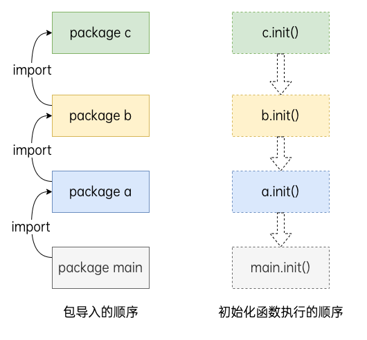
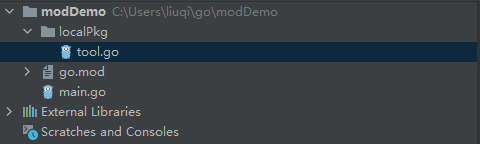

# Package

一般来说，一个文件夹可以作为 package，同一个 package 内部变量、类型、方法等定义可以相互看到。

比如我们新建一个文件 calc.go， main.go 平级，分别定义 add 和 main 方法。

```
// calc.go
package main

func add(num1 int, num2 int) int {
	return num1 + num2
}
```

```
// main.go
package main

import "fmt"

func main() {
	fmt.Println(add(3, 5)) // 8
}
```

运行 go run main.go，会报错，add 未定义：

`./main.go:6:14: undefined: add`

因为 go run main.go 仅编译 main.go 一个文件，所以命令需要换成

`go run main.go calc.go`

Go 语言也有 Public 和 Private 的概念，粒度是包。如果类型/接口/方法/函数/字段的首字母大写，则是 Public 的，对其他 package 可见，如果首字母小写，则是 Private 的，对其他 package 不可见。

import格式：`import importname "path/to/package"`

省略importname时，默认为引入的包名

批量引入：

```
import (
    "fmt"
  	"net/http"
    "os"
)
```

设置别名：`import f "fmt"`

如果引入一个包的时候为其设置了一个特殊_作为包名，那么这个包的引入方式就称为匿名引入。一个包被匿名引入的目的主要是为了加载这个包，从而使得这个包中的资源得以初始化。 被匿名引入的包中的init函数将被执行并且仅执行一遍。

`import _ "github.com/go-sql-driver/mysql"`

匿名引入的包与其他方式导入的包一样都会被编译到可执行文件中。

Go语言中不允许引入包却不在代码中使用这个包的内容，如果引入了未使用的包则会触发编译错误(通过使用_作为包的别名import不会报错)。

init初始化函数：

```
func init(){	
    ...
}
```

一个包的初始化过程是按照代码中引入的顺序来进行的，所有在该包中声明的init函数都将被串行调用并且仅调用执行一次。每一个包初始化的时候都是先执行依赖的包中声明的init函数再执行当前包中声明的init函数。确保在程序的main函数开始执行时所有的依赖包都已初始化完成。



每一个包的初始化是先从初始化包级别变量开始的。例如从下面的示例中我们就可以看出包级别变量的初始化会先于init初始化函数。

```
package main

import "fmt"

var x int8 = 10

const pi = 3.14

func init() {
  fmt.Println("x:", x)
	fmt.Println("pi:", pi)
	sayHi()
}

func sayHi() {
	fmt.Println("Hello World!")
}

func main() {
	fmt.Println("你好，世界！")
}
```

```
x: 10
pi: 3.14
Hello World!
你好，世界！
```

# Module

Go Modules 是 Go 1.11 版本之后引入的，Go 1.11 之前使用 $GOPATH 机制。Go Modules 可以算作是较为完善的包管理工具。同时支持代理，国内也能享受高速的第三方包镜像服务。

没有Go module时：

- SET GOROOT GOPATH
- $GOPATH: src pkg bin
- go get -u 下载，更新代码
- vendor管理依赖

go module相关命令

|   |   |
|---|---|
|命令|介绍|
|go mod init|初始化项目依赖，生成go.mod文件|
|go mod download|根据go.mod文件下载依赖|
|go mod tidy|比对项目文件中引入的依赖与go.mod进行比对|
|go mod graph|输出依赖关系图|
|go mod edit|编辑go.mod文件|
|go mod vendor|将项目的所有依赖导出至vendor目录|
|go mod verify|检验一个依赖包是否被篡改过|
|go mod why|解释为什么需要某个依赖|

**“module” 和 “package” 这两个术语并不是等价的，是 “集合” 跟 “元素” 的关系，“模块” 包含 “包”，“包” 属于 “模块”，一个 “模块” 是零个、一个或多个 “包” 的集合。**

在一个空文件夹下，初始化一个 Module

```
$ go mod init example
go: creating new go.mod: module example
```

此时，在当前文件夹下生成了go.mod，这个文件记录当前模块的模块名以及所有依赖包的版本。

接着，我们在当前目录下新建文件 main.go，添加如下代码：

```
package main

import (
	"fmt"

	"rsc.io/quote"
)

func main() {
	fmt.Println(quote.Hello())  // Ahoy, world!
}
```

运行 `go mod tidy`

运行 `go mod download`，将会触发第三方包 rsc.io/quote的下载，具体的版本信息也记录在了go.mod中：

```
module modDemo

go 1.16

require rsc.io/quote v1.5.2
```

## 使用本地包



以当前项目为根路径（modDemo）

```
import (
	"fmt"
	"modDemo/localPkg"
	"rsc.io/quote"
)

func main() {
	fmt.Println(quote.Hello()) // Ahoy, world!
	fmt.Println(localPkg.KEY)
}
```

go.mod 是启用了 Go moduels 的项目所必须的最重要的文件，它描述了当前项目（也就是当前模块）的元信息，每一行都以一个动词开头，目前有以下 5 个动词:

- module：用于定义当前项目的模块路径。
- go：用于设置预期的 Go 版本。
- require：用于设置一个特定的模块版本。
- exclude：用于从使用中排除一个特定的模块版本。
- replace：用于将一个模块版本替换为另外一个模块版本。
