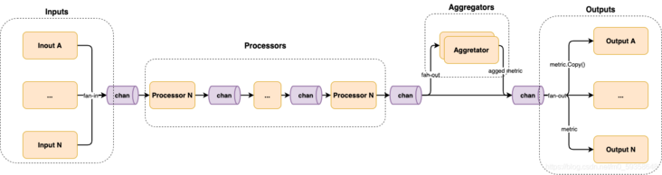

metric：度量，监控指标

telegraf：收集、处理、聚集、输出metrics的代理程序。

四种独立插件：

- 输入插件：从系统、服务或第三方API收集metrics
- 处理插件：transform decorate filter metrics
- 聚集插件：mean max min等
- 输出插件：向xxx输出metrics

Telegraf 是 InfluxData 公司开源的一款十分流行的指标采集软件，在 GiHub 已有上万 Star。其借助社区的力量，拥有了多达 200 余种采集插件以及 40 余种导出插件，几乎覆盖了所有的监控项，例如机器监控、服务监控甚至是硬件监控。

# Pipeline 并发编程

在 Go 中，Pipeline 并发编程模式是一种常用的并发编程模式。简单来说，其整体上是由一系列阶段（stage），每个 stage 由一组运行着相同函数的 goroutine 组成，且各个 stage 之间由 channel 相互连接。

在每个阶段中，goroutine 负责以下事宜：  

1. 通过入口 channel，接收上游 stage 产生的数据。
2. 处理数据，例如格式转换、数据过滤聚合等。
3. 通过出口 channel，发送处理后的数据到下游 stage。

其中，每个 stage 都同时拥有一个或多个出口、入口 channel，除了第一个和最后一个 stage，其分别只有出口 channel 和入口 channel。



可以看到，其整体上采用的就是 pipeline 并发编程模式，我们简单介绍下它的运作机制：  

- 第一个 stage 为 Inputs，每个 input 生成一个 goroutine，各自采集数据并扇入（fan-in）到 channel 中。
- 第二个 stage 为 Processors，每个 processor 生成一个 goroutine，并按顺序彼此用 channel 连接。
- 第三个 stage 为 Aggregators，每个 aggregator 生成一个 goroutine，并消费 Processors 产生的数据，并扇出（fan-out）到各个 aggregator。
- 最后一个 stage 为 Outputs，每个 output 生成一个 goroutine，并消费由 Processors 或 Aggregators 产生的数据，并扇出到各个 output。

扇入（fan-in）：多个函数输出数据到一个 channel，并由某个函数读取该 channel 直到其被关闭。  

扇出（fan-out）：多个函数读取同一个 channel 直到其被关闭。

# input plugin

```
package simple

// simple.go

import (
    "github.com/influxdata/telegraf"
    "github.com/influxdata/telegraf/plugins/inputs"
)

// 待收集对象的结构体定义
type Simple struct {
    Ok  bool            `toml:"ok"`
    Log telegraf.Logger `toml:"-"`
}

// 返回插件的描述
func (s *Simple) Description() string {
    return "a demo plugin"
}

// 默认的配置
func (s *Simple) SampleConfig() string {
    return `
      ## Indicate if everything is fine
      ok = true
    `
}

// Init is for setup, and validating config.
// 初始化 验证config
func (s *Simple) Init() error {
    return nil
}

// 收集数据函数，将数据添加到acc中
func (s *Simple) Gather(acc telegraf.Accumulator) error {
    if s.Ok {
        acc.AddFields("state", map[string]interface{}{"value": "pretty good"}, nil)
    } else {
        acc.AddFields("state", map[string]interface{}{"value": "not great"}, nil)
    }

    return nil
}

// 在all.go里注册一个新的input插件
func init() {
    inputs.Add("simple", func() telegraf.Input { return &Simple{} })
}
```

# processor plugin

```
package printer

// printer.go

import (
    "fmt"

    "github.com/influxdata/telegraf"
    "github.com/influxdata/telegraf/plugins/processors"
)

type Printer struct {
    Log telegraf.Logger `toml:"-"`
}

var sampleConfig = `
`

func (p *Printer) SampleConfig() string {
    return sampleConfig
}

func (p *Printer) Description() string {
    return "Print all metrics that pass through this filter."
}

// Init is for setup, and validating config.
func (p *Printer) Init() error {
    return nil
}


func (p *Printer) Apply(in ...telegraf.Metric) []telegraf.Metric {
    for _, metric := range in {
        fmt.Println(metric.String())
    }
    return in
}

func init() {
    processors.Add("printer", func() telegraf.Processor {
        return &Printer{}
    })
}
```

# NAT连接上报插件优化记录

一、最初方案
最开始的设计方案是Gather方法中，tail插件读取文件，将行数据作为输入，写到outputs.nat_track，nat_track插件获取telegraf input插件传来的数组，取出日志行，然后按照逗号分割成输出数据，创建metric，写入DataChannel。outputs插件Init时，创建几个后台的线程，基于生产者消费者模型，从DataChannel读取数据，向Kafka写数据。
存在的问题：
1. 插件每次执行的时间过长，插件interval为5s，但是压测时，执行时间可达十几秒
定位：
1. 猜测可能是日志文件过大，影响tail插件的性能。于是改为方案二

二、方案二
将功能放到一个input插件中完成。Init时创建Kafka的生产者消费者线程。Gather时读取文件，并调用os truncate方法将文件清空。将文件中合法的行作为输入，写到DataChannel，Kafka的线程读取DataChannel，Kafka线程解析字符串，生成Metric并发送到Kafka。
问题：
1. Channel的总大小为10w，由于处理速度跟不上日志产生的速度，input插件会阻塞在写入DataChannel的过程，导致input插件执行速度过慢。
2. 部分日志转换为metric时延在30s以上时，速度太慢无法被安全部分使用，无法关联。
解决：
增大ChannelSize到20w，50w。
引入的问题：
处理速度慢于数据产生速度，压测时间增长时，metric堆积，导致OOM。
解决：
重新调整ChannelSize为10w，且丢掉时延太大的metric。

问题：
当压测时间过长时，metric堆积，日志文件读取阻塞，导致一直在处理旧的session日志，且一旦超时，后面的session日志全会超时，需要处理

三、方案三
由于方案二在压测时长高于1min时关联率过低，需要优化。
优化点：
1. input插件解耦：初始化时启动三个后台协程，一个实时tail文件，解析最新的行为metric并发送到DataChannel，一个读取DataChannel并发送到Kafka。
2. 协程数可配置：通过配置文件确定读取文件解析日志的协程数量，以及发送Kafka协程的数量
3. Input插件仅统计上个interval处理的日志数，以及DataChannel剩余的metric数量
4. 当发现读取到的session日志超时时，立即跳转到文件的末尾，忽略部分日志。

四、关联率不达标定位
1. 原因1：日志的时间戳不准，安全团队采集的nat建联时间和nat网关记录的建连时间不是同一个时间，存在偏差，匹配的区间是[-1s, +2s]，如果时间差超过该区间，就无法匹配上。且CPS较大时，关联率100%，较小时出现了该问题，关联率99%。
2. 原因2：input插件temp变量为临时变量，多个go协程使用该变量临时存储数据，可能会互相覆盖。
3. 原因3：CPS过高时，采集日志和Kafka上报数据的速度跟不上，部分日志会被丢弃。
4. 原因4：两侧采集日志使用不同机器，手动部署的时间，双方NTP服务器不一致，时钟存在偏差。kafka里使用时间来做匹配，误差范围是4s，时钟差距过大时关联率过低。

# 主流程

```
proc main():
    # 加载配置
    config = LoadConfig()
    
    # 初始化插件
    InitPlugins(config)

    # Output 插件链接初始化, 类似 influxDB/MySQL 是需要链接到对端服务器的
    # 这里也只在全局做了一次初始化，实际写入数据时链接出错, 还是要自己根据实际情况处理
    ConnectOutputs(config.Outputs)

    # 定义消息流, 每个 Queue 都有生产者和消费者
    # 在 Go 里用 channel 实现，我们还是用 MessageQueue 表含义, 按生产者命名
    # 数据流 input --> MQInput --> MQProcessor --> MQAggregator --> output
    MessageQueue MQInput
    MessageQueue MQProcessor
    MessageQueue MQAggregator

    # ServiceInput 插件: 
    #   需要启动一个后台并行服务的 Input 插件, 如 statsd, 会启动一个 statsd server
    #   Input 插件的进一步延伸, 需要实现除 Init 外所有接口 + Start() + Stop()
    StartServiceInputs(config.Inputs, MQInput)

    # Input 插件: 数据来源, 主要从数据源中获取需要的数据, 并转化成 telegraf 要求的标准协议样式
    go StartInputs(config, MQInput)

    # Processor 插件: 主要做数据预处理/变换等
    go StartProcessors(config, MQInput, MQProcessor)

    # Aggregator 插件: 数据聚合计算，如求最大/最小/出现次数/平均值等
    go StartAggregators(config, MQProcessor, MQAggregator)

    # Output 插件: 将上述处理过的数据，写到目标地址中，可以是文件/数据库/屏幕等
    go StartOutputs(config, MQAggregator)

    # 阻塞到上述 goroutines 都退了
    block until all coroutine exited

    # 与 ConnectOutputs 对应，关闭 Output 插件的链接
    CloseOutputs(config)

```

# 子流程

## InitPlugins 插件初始化

```
proc InitPlugins( config ):
    foreach input in config.Inputs:
        call input.Init() if has Init()
        exit on error
    
    foreach processor in config.Processors:
        call processor.Init() if has Init()
        exit on error
    
    foreach aggregator in config.Aggregators:
        call aggregator.Init() if has Init()
        exit on error
    
    foreach output in config.Outputs:
        call output.Init() if has Init()
        exit on error
```

## ConnectOutputs Output 插件链接初始化

```
proc ConnectOutputs(config):
    foreach output in config.Outputs:
        call output.Connect()
        sleep 15s on error
        retry call output.Connect()
        exit on error
```

## StartServiceInput service 插件启动

```
proc StartServiecInputs(config, MQInput):
    foreach input in config.Inputs:
        if input is instance of ServiceInput:
            # Start 接口是 ServiceInput 插件必须实现的接口
            call input.Start(MQInput)
        else:
            continue

# ServiceInput 插件的初始化函数, 不一定非要处理 MQInput, 有需要时保存
proc ServiceInput.Start(MQInput):
    bind MQInput if needed

# 如果有需要, 可以直接在后台服务中往消息队列写入指标
# 因为 ServiceInput 也是一种特殊的 Input 插件, 所以也可以不立即写, 先本地缓存/聚合,
# 等 telegraf 调用插件 Gather 时再写入。
proc ServiceInput.BackgroundEventProcess():
    write telegraf.Metric to MQInput
```

## go StartInputs() 启动 Input 插件

```
proc go StartInputs(config, MQInput):
    foreach input in config.Inputs:
        # 每个 Input 插件起单独的 goroutine
        go RunInput(input)
    block until all RunInput exit 
    StopServiceInput()
    close MQInput

proc go RunInput(input, MQInput):
    # 定时器, 每 Interval 秒执行一次 
    loop every input.Interval:
        # Gather 是 Input 插件必须实现的接口, 上传数据到 telegraf.Accumulator
        input.Gather(MQInput)
    until exit signal recvd
    exit

# 数据收集
proc Input.Gather(MQInput):
    foreach metric in cache:
        covert metric to telegraf.Metric
        write telegraf.Metric to MQInput
    reset cache
    exit
```

## go StartProcessors() 启动数据预处理插件

```
proc go StartProcessors(config, MQInput, MQProcessor):
    # 对 MQInput 内的每个消息, 都用 Apply 接口处理, 处理完写入 MQProcessor 队列供后续处理
    # 如果 MQInput 里没有消息, 则读取操作会阻塞到 MQInput 有新消息到达或者 MQInput 被关闭
    loop read metrics from MQInput:
        foreach processor in config.Processors:
            # Apply 是每个 processor 插件必须实现的接口, 实现对指标的预处理(如改名等)
            metrics = processor.Apply(metrics)
        for metric in metrics:
            write metric to MQProcessor
    until MQInput closed
    close MQProcessor
```

## go StartAggregators() 启动数据聚合插件

```
proc go StartAggregators( config, MQProcessor, MQAggregator ):
    # 启动 goroutine 给每个聚合插件喂指标数据
    go run AggregatorAddMetric( config, MQProcessor )
    # 临时消息队列, 汇聚各个聚合插件的输出
    MessageQueue MQTmp
    # 聚合插件指标周期性的将指标写入消息队列
    go run AggregatorRunPeriodPush( config, MQTmp )
    # 从 MQTmp 取数据再次使用 Processor 处理后转发到 MQAggregator
    loop read metric from MQTmp:
        foreach processor in config.Processors:
            metric = processor.Apply( metric )
        write metric to MQAggregator
    unitl MQTmp closed

    # 阻塞, 一直到上述所有 goroutine 退出
    wait until AggregatorAddMetric and AggregatorPushMetric exit

# 将从 Processor 读来的指标发给每个聚合插件
# 某个指标只要任何一个聚合插件返回需要丢弃, 则丢弃该指标, 否则原样塞到消息队列继续处理
proc go AggregatorAddMetric( config, MQProcessor ):
    loop read metrics from MQProcessor:
        needDropMeric = false
        foreach aggregator in config.Aggregators:
            # Add 接口是每个聚合插件需要实现的接口功能, 完成指标计算
            needDrop = aggregator.Add( metric )
            if needDrop is true:
                needDropMetric = true
        if needDropMetric:
            drop( metric )
    until MQProcessor closed

# 针对每个聚合插件, 启动一个周期性的定时器
proc go AggregatorRunPeriodPush( config, MQTmp ):
    foreach aggregator in config.Aggregators:
        go runPeriodPush( aggregator, MQTmp )
    wait until all runPeriodPush exit
    # 等生产者 PeriodPush 都推出后, 关闭 MQTmp
    close MQTmp

# 针对每次加进来的瞬间指标进行聚合计算
# 比如计算最小值/最大值/平均值/... 
proc Aggregator.Add( metric ):
    calculate min/max/average/... 
    save new value to aggregator.data
    return true if drop the original metric else return false

# 周期性的将指标推送到临时聚合消息队列 MQTmp
proc Aggregator.Push( aggregator, MQTmp ):
    loop every aggregator.Period:
        write aggregator.data to MQTmp
        reset aggregator.data
    until main process exit
```

## go StartOutputs() 启动数据输出插件

```
proc go StartOuputs( config, MQAggregator ):
    # 每个 Input 插件起单独的定时器 goroutine
    foreach output in config.Outputs:    
        go RunOutput( output )
    # 读消息并写到每个 output 的 buffer 里
    loop read metrics from MQAggregator:
        foreach output in config.Outputs:
            output.WriteBuffer( metrics )
    until MQAggregator closed

    block until all RunOutput exit

proc go RunOutput( output ):
    # 定时器, 每 Interval 秒执行一次
    # 将 output buffer 内的数据批量写入对端
    loop every output.Interval:
        output.Write() output buffer to remote
        reset output.Buffer
    until exit signal recvd
    exit
```

## CloseOutputs() 进行清理

```
proc go CloseOutputs( config ):
    foreach output in config.Outputs:
        # Close 接口是每个输出插件必须实现的接口, 需要清理资源, 或者优雅结束
        output.Close()
```
