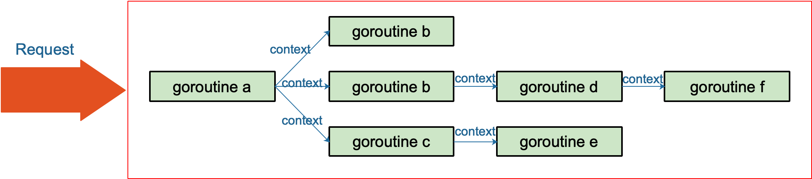
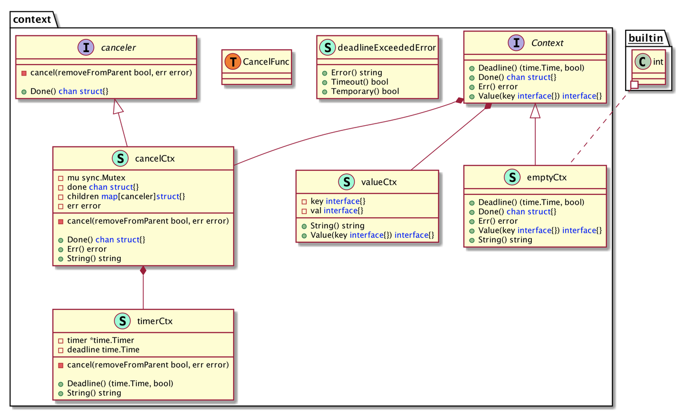
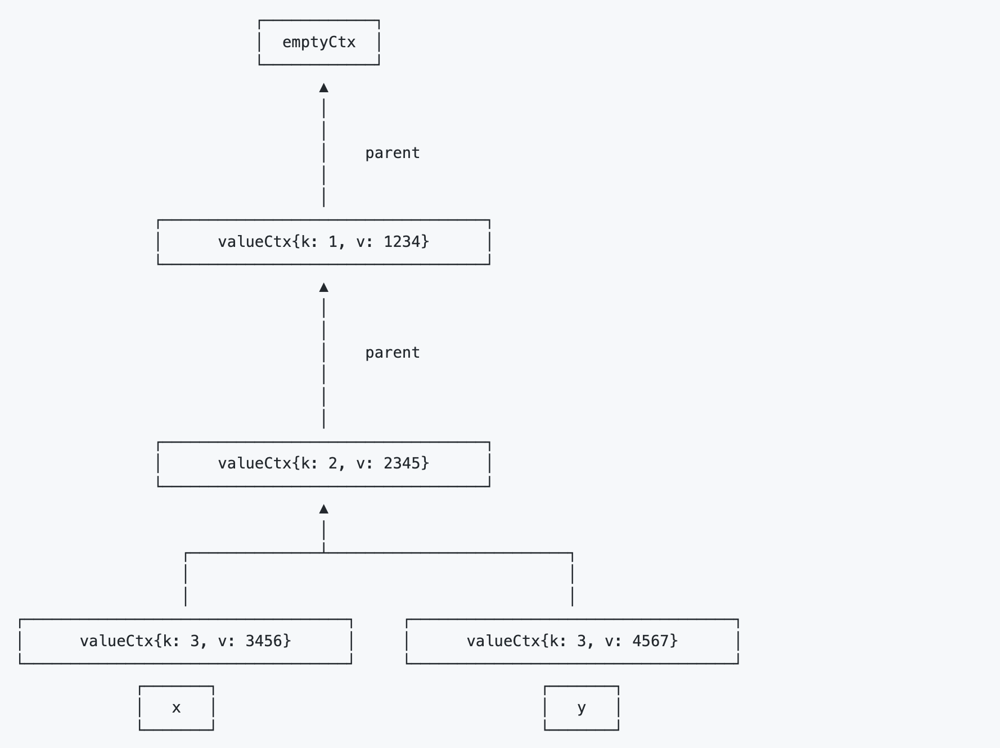

Go 1.7 标准库引入 context，中文译作“上下文”，准确说它是 goroutine 的上下文，包含 goroutine 的运行状态、环境、现场等信息。

context 主要用来在 goroutine 之间传递上下文信息，包括：取消信号、超时时间、截止时间、k-v 等。

随着 context 包的引入，标准库中很多接口因此加上了 context 参数，例如 database/sql 包。context 几乎成为了并发控制和超时控制的标准做法。

context.Context 类型的值可以协调多个 groutine 中的代码执行“取消”操作，并且可以存储键值对。最重要的是它是并发安全的。

与它协作的 API 都可以由外部控制执行“取消”操作，例如：取消一个 HTTP 请求的执行。

Go 语言中的 server 实际上是一个“协程模型”，也就是说一个协程处理一个请求。例如在业务的高峰期，某个下游服务的响应变慢，而当前系统的请求又没有超时控制，或者超时时间设置地过大，那么等待下游服务返回数据的协程就会越来越多。而我们知道，协程是要消耗系统资源的，后果就是协程数激增，内存占用飙涨，甚至导致服务不可用。更严重的会导致雪崩效应，整个服务对外表现为不可用。

context 包就是为了解决上面所说的这些问题而开发的：在 一组 goroutine 之间传递共享的值、取消信号、deadline……

[](https://user-images.githubusercontent.com/7698088/59235969-a405cc00-8c26-11e9-9448-2c6c86e8263b.png)

**context 用来解决 goroutine 之间****退出通知****、****元数据传递****的功能。**

- emptyCtx，所有 ctx 类型的根，用 context.TODO()，或 context.Background() 来生成。
- valueCtx，主要就是为了在 ctx 中嵌入上下文数据，一个简单的 k 和 v 结构，同一个 ctx 内只支持一对 kv，需要更多的 kv 的话，会形成一棵树形结构。
- cancelCtx，用来取消程序的执行树，一般用 WithCancel，WithTimeout，WithDeadline 返回的取消函数本质上都是对应了 cancelCtx。
- timerCtx，在 cancelCtx 上包了一层，支持基于时间的 cancel。



接口：Context、canceler

结构体：emptyCtx为Context的一个实现；cancelCtx、valueCtx中包含了Context类型的值（其实是其父Context的指针）；timerCtx中包含了一个cancelCtx的值。

WithCancel、WithTimeout、WithDeadline：传入一个父的Context类型值，返回一个新的可取消的Context和用于取消该返回Context的函数，同时保证父Context取消后该子Context也会被取消。WithTimeout、WithDeadline内部存在了一个定时器，到时间点后会自动帮我们调用取消函数。

WithValue：传入一对kv，返回一个新的Context，新的Context内部会记录这对kv，供以后查询。

如果我们把一个网络请求的处理看做是一个任务的话，使用Context帮助我们在子任务树中传递取消任务的信号，并可以根据WithXXX生成新的子Context传递到下游子任务中，整体呈现出一个树状结构。上层Context被取消后会沿着树向下递归的告知所衍生的所有Context该任务被取消。相反的，子Context被取消并不会影响到其父Context是否被取消。另外，Context还可以携带kv在任务中传递。

# Context接口

```
type Context interface {
        Deadline() (deadline time.Time, ok bool)
        Done() <-chan struct{}
        Err() error
        Value(key interface{}) interface{}
}
```

- Deadline：获取是否设置了到期时间以及所设置的截止时间。如果有设置过期时间的话，Context会到那个时间点时自动发起取消Context的操作。
- Done：返回一个通道，如果通道关闭则代表该Context已经被取消；如果返回的为nil，则代表该Context是一个永远不会被取消的Context。
- Err：返回该Context被取消的原因，如果只使用Context包的Context类型的话，那么只可能返回Canceled（代表被明确取消）或者DeadlineExceeded（因超时而取消）
- Value：你可能经常看到代码中使用该函数从ctx中获取一个string key中的值，即一个Context内部是可以携带很多kv的, 关于如何存储，可以想象成一个树中的某个节点，每个节点保存了指向父节点的指针，从当前的节点一层层向根节点寻找

# emptyCtx

emptyCtx是一个int值

```
ctx1 := context.Background()
//或者
ctx2 := context.TODO()
```

二者只有String方法返回的字符串不同这一区别

background 通常用在 main 函数中，作为所有 context 的根节点。

todo 通常用在并不知道传递什么 context的情形。例如，调用一个需要传递 context 参数的函数，你手头并没有其他 context 可以传递，这时就可以传递 todo。这常常发生在重构进行中，给一些函数添加了一个 Context 参数，但不知道要传什么，就用 todo “占个位子”，最终要换成其他 context。

# valueCtx

源代码：

```
type valueCtx struct {
   Context
   key, val interface{}
}
func (c *valueCtx) Value(key interface{}) interface{} {
   if c.key == key {
      return c.val
   }
   return c.Context.Value(key)
}
func WithValue(parent Context, key, val interface{}) Context {
   if key == nil {
      panic("nil key")
   }
   if !reflectlite.TypeOf(key).Comparable() {
      panic("key is not comparable")
   }
   return &valueCtx{parent, key, val}
}
```

valueCtx使用：

```
package main

import (
	"context"
	"fmt"
)

type orderID int

func main() {
	var x = context.TODO()
	x = context.WithValue(x, orderID(1), "1234")
	x = context.WithValue(x, orderID(2), "2345")

	y := context.WithValue(x, orderID(3), "4567")
	x = context.WithValue(x, orderID(3), "3456")

	fmt.Println(x.Value(orderID(3)))
	fmt.Println(y.Value(orderID(3)))
}
```

生成的树：



使用context携带数据

```
context.WithValue(context.Background(), info,
	 map[string]string{"order_id" : "111", "payment_id" : "222"}
)
```

# cancelCtx

cancelCtx：

```
type cancelCtx struct {
   Context						  //parent

   mu       sync.Mutex            // protects following fields
   done     chan struct{}         // created lazily, closed by first cancel call
   // 直接child为其他类型Context时，递归找第一个类型为cancel的child
   children map[canceler]struct{} 
   err      error                 // set to non-nil by the first cancel call
}

func (c *cancelCtx) Done() <-chan struct{} {
   c.mu.Lock()
   if c.done == nil {
      c.done = make(chan struct{})
   }
   d := c.done
   c.mu.Unlock()
   return d
}
```

CancelContext中，调用cancel方法，done channel关闭后，监听done通道的协程，执行`<-c.Done()`方法结束阻塞（读已经关闭的通道时会返回对应数据类型的零值）。

c.done 是“懒汉式”创建，只有调用了 Done() 方法的时候才会被创建。再次说明，函数返回的是一个只读的 channel，而且没有地方向这个 channel 里面写数据。所以，直接调用读这个 channel，协程会被 block 住。一般通过搭配 select 来使用。一旦关闭，就会立即读出零值。

```
func WithCancel(parent Context) (ctx Context, cancel CancelFunc) {
   // 创建一个cancelCtx
   c := newCancelCtx(parent)
   
   propagateCancel(parent, &c)

   // true 表示把自己从parent中移除, 因为是主动 cancel, 所以在parent引用中删除自己
   // Canceled 是一个预定义测错误
   return &c, func() { c.cancel(true, Canceled) }
}

// newCancelCtx returns an initialized cancelCtx.
func newCancelCtx(parent Context) cancelCtx {
   return cancelCtx{Context: parent}
}

// propagateCancel arranges for child to be canceled when parent is.
func propagateCancel(parent Context, child canceler) {
   // 如果parent里一个可取消的都没有，则直接返回（通过匿名结构体，访问parent链）
   if parent.Done() == nil {
      return 
   }
   
   if p, ok := parentCancelCtx(parent); ok {
      p.mu.Lock()
      if p.err != nil {
         // parent has already been canceled
         // child 还没加到 parent 的 childred 数组，传递false
         child.cancel(false, p.err)
      } else {
         // 加入 parent 的 children 数组
         if p.children == nil {
            p.children = make(map[canceler]struct{})
         }
         p.children[child] = struct{}{}
      }
      p.mu.Unlock()
   } else {
      // 第三方Context接口的处理
      go func() {
         select {
         case <-parent.Done():
            child.cancel(false, parent.Err())
         case <-child.Done():
         }
      }()
   }
}
```

```
// cancel closes c.done, cancels each of c's children, and, if
// removeFromParent is true, removes c from its parent's children.
func (c *cancelCtx) cancel(removeFromParent bool, err error) {
   if err == nil {
      panic("context: internal error: missing cancel error")
   }
   c.mu.Lock()
   if c.err != nil {
      c.mu.Unlock()
      return // already canceled
   }
   c.err = err
   if c.done == nil {
      c.done = closedchan
   } else {
      close(c.done)
   }
   for child := range c.children {
      // NOTE: acquiring the child's lock while holding parent's lock.
      //和子context连接不用断，子context取消后会从父parent的children列表里删掉自身
      child.cancel(false, err) 
   }
   c.children = nil
   c.mu.Unlock()
   
   // 删除自身
   if removeFromParent {
      removeChild(c.Context, c)
   }
}
```

```
// parentCancelCtx follows a chain of parent references until it finds a
// *cancelCtx. This function understands how each of the concrete types in this
// package represents its parent.
// 递归的向上查找cancelCtx类型的节点，找到第一个就停止
func parentCancelCtx(parent Context) (*cancelCtx, bool) {
   for {
      switch c := parent.(type) {
      case *cancelCtx:
         return c, true
      case *timerCtx:
         return &c.cancelCtx, true // timerCtx里面包装了一个cancelCtx类型的节点
      case *valueCtx:
         parent = c.Context // 继续向上找
      default:
         return nil, false
      }
   }
}

// removeChild removes a context from its parent.
func removeChild(parent Context, child canceler) {
   p, ok := parentCancelCtx(parent)
   if !ok {
      return
   }
   p.mu.Lock()
   if p.children != nil {
      delete(p.children, child)
   }
   p.mu.Unlock()
}
```

# timerCtx

```
type timerCtx struct {
	cancelCtx
	timer *time.Timer // Under cancelCtx.mu.

	deadline time.Time
}
```

timerCtx 首先是一个 cancelCtx，所以它能取消。看下 cancel() 方法：

```
func (c *timerCtx) cancel(removeFromParent bool, err error) {
	// 直接调用 cancelCtx 的取消方法
	c.cancelCtx.cancel(false, err)
	if removeFromParent {
		// 从父节点中删除子节点
		removeChild(c.cancelCtx.Context, c)
	}
	c.mu.Lock()
	if c.timer != nil {
		// 关掉定时器，这样，在deadline 到来时，不会再次取消
		c.timer.Stop()
		c.timer = nil
	}
	c.mu.Unlock()
}
```

创建 timerCtx 的方法：

```
func WithTimeout(parent Context, timeout time.Duration) (Context, CancelFunc) {
	return WithDeadline(parent, time.Now().Add(timeout))
}
```

WithTimeout 函数直接调用了 WithDeadline，传入的 deadline 是当前时间加上 timeout 的时间，也就是从现在开始再经过 timeout 时间就算超时。也就是说，WithDeadline 需要用的是绝对时间。重点来看它：

```
func WithDeadline(parent Context, deadline time.Time) (Context, CancelFunc) {
	if cur, ok := parent.Deadline(); ok && cur.Before(deadline) {
		// 如果父节点 context 的 deadline 早于指定时间。直接构建一个可取消的 context。
		// 原因是一旦父节点超时，自动调用 cancel 函数，子节点也会随之取消。
		// 所以不用单独处理子节点的计时器时间到了之后，自动调用 cancel 函数
		return WithCancel(parent)
	}
	
	// 构建 timerCtx
	c := &timerCtx{
		cancelCtx: newCancelCtx(parent),
		deadline:  deadline,
	}
	// 挂靠到父节点上
	propagateCancel(parent, c)
	
	// 计算当前距离 deadline 的时间
	d := time.Until(deadline)
	if d <= 0 {
		// 直接取消
		c.cancel(true, DeadlineExceeded) // deadline has already passed
		return c, func() { c.cancel(true, Canceled) }
	}
	c.mu.Lock()
	defer c.mu.Unlock()
	if c.err == nil {
		// d 时间后，timer 会自动调用 cancel 函数。自动取消
		c.timer = time.AfterFunc(d, func() {
			c.cancel(true, DeadlineExceeded)
		})
	}
	return c, func() { c.cancel(true, Canceled) }
}
```

也就是说仍然要把子节点挂靠到父节点，一旦父节点取消了，会把取消信号向下传递到子节点，子节点随之取消。

有一个特殊情况是，如果要创建的这个子节点的 deadline 比父节点要晚，也就是说如果父节点是时间到自动取消，那么一定会取消这个子节点，导致子节点的 deadline 根本不起作用，因为子节点在 deadline 到来之前就已经被父节点取消了。

这个函数的最核心的一句是：

```
c.timer = time.AfterFunc(d, func() {
	c.cancel(true, DeadlineExceeded)
})
```

c.timer 会在 d 时间间隔后，自动调用 cancel 函数，并且传入的错误就是 DeadlineExceeded：

```
var DeadlineExceeded error = deadlineExceededError{}

type deadlineExceededError struct{}

func (deadlineExceededError) Error() string   { return "context deadline exceeded" }
```

# 使用demo

```
package main

import (
	"context"
	"fmt"
	"net/http"
	"time"
)

func main() {
	// 创建一个超时时间为100毫秒的上下文
	ctx := context.Background()
	ctx, _ = context.WithTimeout(ctx, 1000*time.Millisecond)

	// 创建一个访问Google主页的请求
	req, _ := http.NewRequest(http.MethodGet, "http://google.com", nil)
	// 将超时上下文关联到创建的请求上
	req = req.WithContext(ctx)

	// 创建一个HTTP客户端并执行请求
	client := &http.Client{}
	res, err := client.Do(req)
	// 如果请求失败了，记录到STDOUT
	if err != nil {
		fmt.Println("Request failed:", err)
		return
	}
	// 请求成功后打印状态码
	fmt.Println("Response received, status code:", res.StatusCode)
}
```

```
func main() {
	ctx, _ := context.WithTimeout(context.Background(), 1*time.Millisecond)
	flag := 0
	go watch(ctx, &flag)
	<-ctx.Done()
	if flag == 1 {
		fmt.Println("中止")
	} else {
		fmt.Println("完成")
	}
}

func watch(c context.Context, flag *int) {
	for {
		select {
		case <-c.Done():
			*flag = 1
			return
		default:
			fmt.Println("working")
		}
	}
}
```
