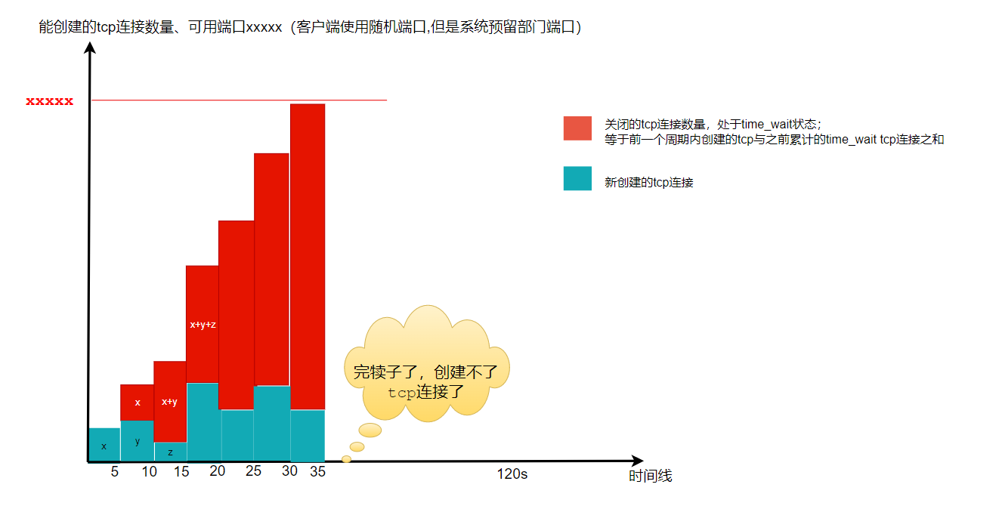

`http.Client`的主要属性如下：

```go
type Client struct {
    Jar CookieJar
    Timeout time.Duration
    Transport RoundTripper
}
```

## 坑：默认的HttpClient

**默认的HttpClient不包含请求超时时间**，如果你使用http.Get(url)或者&Client{}, 这将会使用http.DefaultClient，这个结构体内`no timeout`。

假如发出请求的服务端API有问题：没有及时响应httpclient请求但是保持了连接， 在高并发情况下，打开的连接数会持续增长，最终导致客户端服务器资源到达瓶颈。

解决方案：**不要使用默认的HTTPClient， 总是为HttpClient指定`Timeout`**

```css
	client := &http.Client{		Timeout: 10 * time.Second,	}
```

HttpClient Timeout包括连接、重定向(如果有)、从Response Body读取的时间，内置定时器会在Get，Head、Post、Do 方法之后继续运行，直到读取完Response.Body。


## 坑2：默认的Http Transport池化机制

目前常见的HttpClient(.NET Core,golang) 都会有连接池的概念， 客户端会尽量复用池中**已经建立的tcp连接** （sqlclient连接池也是复用的tcp连接）。

**之前我有个误区，认为连接池是预置连接（因为有个开源作者实现的redis库是预置连接），其实不是的，连接池强调的是复用已创建的连接，连接池的创建是由首次请求来驱动的。**

golang的`Transport`用于连接池化。

> DefaultTransport is the default implementation of Transport and is  
> used by DefaultClient. It establishes network connections as needed  
> and caches them for reuse by subsequent calls. It uses HTTP proxies  
> as directed by the HTTPPROXYand𝐻𝑇𝑇𝑃𝑃𝑅𝑂𝑋𝑌𝑎𝑛𝑑NO_PROXY (or httpproxyandℎ𝑡𝑡𝑝𝑝𝑟𝑜𝑥𝑦𝑎𝑛𝑑no_proxy) environment variables.

```dart
MaxIdleConns  int
MaxIdleConnsPerHost int    //  如果是0， 使用DefaultMaxIdleConnsPerHost=2 
MaxConnsPerHost int         // 0意味无限制
IdleConnTimeout time.Duration  // 0 意味无限制
```

默认值：  
MaxIdleConns =100， MaxIdleConnsPerHost=2  
没有定义MaxConns字段,golang其实创建conn是无限制的，MaxConnsPerHost=0

```go
var DefaultTransport RoundTripper = &Transport{
        Proxy: ProxyFromEnvironment,
        DialContext: (&net.Dialer{
                Timeout:   30 * time.Second,
                KeepAlive: 30 * time.Second,
        }).DialContext,
        ForceAttemptHTTP2:     true,
        MaxIdleConns:          100,
        IdleConnTimeout:       90 * time.Second,
        TLSHandshakeTimeout:   10 * time.Second,
        ExpectContinueTimeout: 1 * time.Second,
}
```

http连接池化 ，是公共连接池， 能创建的连接是无限制的（虽然没字段，但是代码分析是无限制的）， 每个Host能创建的连接MaxConnsPerHost=0 ， 也是无限制的；

有坑位的是`DefaultMaxIdleConnsPerHost=2`：字面含义是连接池中每个主机的空闲连接数是2个，其实也就是每个主机能复用的连接数就是2个。

发现问题了吗？ 能无限制创建，但是能复用的只有2个。

 这意味着：如果你的请求是**高并发持续请求**， 一开始请求能无限制创建， 但是由于不能复用tcp连接（2个，聊胜于无）， 造成客户端主动关闭tcp连接，time_wait状态(2min)会占用大量端口， 之后就不能发起tcp连接了。

有些同学不知道威力，我画个图理解一下。



在并发持续请求host的情况下， 因为不能复用tcp连接，就会频繁销毁连接， 这样会累积很多`time_wait状态的不可用连接`， 没过多久就创建不了了。

> 这个问题的本质是 主动关闭的TCP连接，服务器会产生大量的time-wait状态连接（2min），占用了可用的网络文件描述符。

解决方案：**不要使用默认Transport，增加MaxIdleConnsPerHost**

# Jar

用于保存Cookie，如果配置此参数，在HTTP响应`Set-Cookie`时，可自动保存，并在下次请求时将符合条件的Cookie写入至请求头中（与浏览器的形为类似）

Copy

```
jar, _ := cookiejar.New(nil)
http.DefaultClient = &http.Client{
    Jar: jar,
}
resp, _ := http.Get("https://www.baidu.com/")
fmt.Println(resp)
fmt.Println(jar)
```

# Timeout

HTTP请求的超时设置，包括了连接时间，重定向以及读取响应的时间，如果不配置，则为无超时处理，默认的Client则是无超时设置。其使用的Transport中的net.Dialer有相应的连接超时，此超时针仅针对连接，如果TCP连接成功，但是请求一直没有响应（死循环卡死等），则请求会一直等待，因此建议在实现使用中设置Client的超时配置，可做如下调整：

```
http.DefaultClient = &http.Client{
    Timeout: 10 * time.Second,
}
resp, err := http.Get("https://www.baidu.com/")
fmt.Println(err)
fmt.Println(resp)
```

# Transport

HTTP请求中使用的Transport，它处理HTTP的请求复用，各阶段的超时等各类配置，一些主要的参数配置：

## 总览

| 参数                    | 作用                                                                | 默认值                                   |
| :-------------------- | :---------------------------------------------------------------- | :------------------------------------ |
| 连接控制类                 |                                                                   |                                       |
| `Proxy`               | 指定使用 http 代理。这里推荐传入 `http.ProxyFromEnvironment`, 以支持系统配置的 http 代理 | `nil`，表示 **不使用** 任何代理，请注意             |
| `DialContext`         | TCP 连接函数。开发者可以简单封装一下，一般可以用来做一些监控或者特殊的地址解析逻辑                       | `nil`, 使用默认的 http 连接                  |
| 超时控制类                 |                                                                   |                                       |
| `TLSHandShakeTimeout` | `time.Duration` 类型，表示TLS 握手超时时间。这里推荐传入一个非零值                       | 0, 表示无限制                              |
| `IdleConnTimeout`     | `time.Duration` 类型，表示一个连接在空闲多久之后关闭。                               | 0, 表示不关闭                              |
| 连接数控制类                |                                                                   |                                       |
| `MaxIdleConns`        | 最大空闲连接数                                                           | 0, 表示无限制                              |
| `MaxIdleConnsPerHost` | 每一个 host 的最大连接数                                                   | `http.DefaultMaxIdleConnsPerHost`，即 2 |
| 缓冲区类                  |                                                                   |                                       |
| `WriteBufferSize`     | 写缓冲区的大小                                                           | 4kB                                   |
| `ReadBufferSize`      | 读缓冲区的大小                                                           | 4kB                                   |
| 其他                    |                                                                   |                                       |
| `ForceAttemptHTTP2`   | 字面意思，是否强制尝试 HTTP2。建议设置为 `true`                                    | `false`, 不尝试                          |

## TLSHandshakeTimeout

TLS的连接超时配置，Client的超时为整体的处理超时，只参数可只针对TLS的连接设置，如果有需要可单独配置此参数。

## DisableKeepAlives

是否禁用keepAlives，如果禁用了则每次HTTP请求完成后都会断开请求，除非有特别的应用场景，一般不建议禁用。复用TCP可减少DNS(如果使用域名请求)，TCP(TLS)连接的时间。

```
# 使用keepAlives的两次请求耗时统计，第二次无dnsLookup、tcpConnection以及tlsHandshake的连接处理
{"dnsLookup":2441971260,"tcpConnection":48464488,"tlsHandshake":423072093,"serverProcessing":67391793,"contentTransfer":299615,"total":2982340889}
{"serverProcessing":51478141,"contentTransfer":153230,"total":51669258}
```

## DisableCompression

是否禁用压缩，默认为false，启用压缩。当启用时，HTTP请求头会添加`Accept-Encoding: gzip`，并自动根据响应头中是否包含`Content-Encoding: gzip`自动将数据解压。

如果设置为true，则并不会自动在HTTP请求头添加`Accept-Encoding: gzip`，因此响应数据也并不会响应压缩数据（因为正常来说响应数据根据Accept-Encoding来响应合适的encoding）。那么如果我希望能接受响应的数据，但在接收到数据之后并不解压（如无需对数据做处理的场景，转发之类），则可以使用如下的处理：

```
var client = &http.Client{
    Transport: &http.Transport{
        DisableCompression: true,
    },
}


req, err := http.NewRequest("GET", "/", nil)
if err != nil {
    return
}
req.Header.Set("Accept-Encoding", "gzip")
resp, err := client.Do(req)

if err != nil {
    return
}
defer resp.Body.Close()
buf, err := ioutil.ReadAll(resp.Body)
```

## MaxIdleConns

最大的空闲连接数(keep-alive)，此配置针对所有的host，默认为无限制（0）。可根据实际应用场景配置此参数，避免生成了过多的空闲连接。

## MaxIdleConnsPerHost

与MaxIdleConns类似，只不过此限制是针对每个host有效。默认为DefaultMaxIdleConnsPerHost（2），可根据需要调整更大的数值。

## MaxConnsPerHost

每个host的最大连接数，包括连接中、活动、空闲的所有连接，默认为无限制（0）。

## IdleConnTimeout

空闲连接的超时时长，设置为0表示无限制，尽量配置此参数以便无用的空闲连接可被关闭，避免浪费连接资源。

## ResponseHeaderTimeout

连接成功后等待响应的超时时长，设置为0表示无限制。一般而言，在连接成功之后，数据响应之前的时长与服务器接口处理时长相等。在配置总体超时之后，较少单独配置此参数。

## MaxResponseHeaderBytes

响应头的最大字节数，默认为`10KB`。默认10KB的限制已可满足实际使用中的场景，如果接口响应的数据大量的记录在响应头中，超过限制尺寸则可调整更大的限制，但不太建议将大量的响应数据写入至响应头中（因为HTTP的响应头无法做压缩处理，浪费带宽）

## DialContext

定义如何创建一个非加密的TCP连接

# 自定义http.Client

在使用golang开发时，不建议使用默认的Client，最好根据自己的实际需求定制更符合应用的Client。首先看看golang中默认的Client，初始化代码如下：

```
var DefaultClient = &Client{}
```

初始化无指定任何参数，无超时设置，使用默认的transport，下面来看看默认的transport初始化代码：

```
var DefaultTransport RoundTripper = &Transport{
    Proxy: ProxyFromEnvironment,
    DialContext: (&net.Dialer{
        Timeout:   30 * time.Second,
        KeepAlive: 30 * time.Second,
        DualStack: true,
    }).DialContext,
    MaxIdleConns:          100,
    IdleConnTimeout:       90 * time.Second,
    TLSHandshakeTimeout:   10 * time.Second,
    ExpectContinueTimeout: 1 * time.Second,
}
```

常用的Client参数配置，如下：

```
&http.Client{
    // 总体的超时设置为10秒，需要注意，如果超时并不代表该处理失败，
    // 只代表该处理在10秒内未完成，处理结果未知
    Timeout: 10 * time.Second,
    Transport: &http.Transport{
        // 指定dial的超时设置
        DialContext: (&net.Dialer{
            Timeout:   10 * time.Second,
            KeepAlive: 30 * time.Second,
            DualStack: true,
        }).DialContext,
        MaxIdleConns:           50,
        IdleConnTimeout:        60 * time.Second,
        TLSHandshakeTimeout:    5 * time.Second,
        ExpectContinueTimeout:  1 * time.Second,
        // 限制响应头的大小，避免依赖的服务过多使用响应头
        MaxResponseHeaderBytes: 5 * 1024,
    },
}
```

对于`Proxy`参数我并没有配置，因为都是各内部系统的调用，无需要使用proxy，不配置此参数为了避免服务器上人为避免了proxy env导致所有请求都通过proxy转发。

# 实现自定义DNS解析

我有着各类HTTP的外部服务，平时的检测都是通过使用内部IP的形式来检测，而此方式的检测无法保证外网的访问是否正常，有一次外网访问出现问题而服务检测并未发现异常，因此需要增加外部访问的可用性检测。

我的外部服务最少部署在2个IDC以上，客户端通过域名的形式访问，因此我直接针对外网IP增加服务可用性测试，示例代码如下：

```
var client = &http.Client{
    Timeout: 10 * time.Second,
}

req, err := http.NewRequest("GET", "http://14.215.177.38/", nil)
req.Host = "www.baidu.com"
if err != nil {
    return
}
resp, err := client.Do(req)
```

我的入口IP针对HTTP请求的host做转发，因此需要指定Host参数才可转发至相应的服务。后续相关的服务都迁移至https，检测也需要指定为https，因为使用IP的形式访问，https证书校验会失败，因此调整为忽略https证书，如下：

```
var client = &http.Client{
    Timeout: 10 * time.Second,
    Transport: &http.Transport{
        TLSClientConfig: &tls.Config{
            InsecureSkipVerify: true,
        },
    },
}

req, err := http.NewRequest("GET", "https://14.215.177.38/", nil)
req.Host = "www.baidu.com"
if err != nil {
    return
}
resp, err := client.Do(req)
```

检测服务正常运行，外部服务也没有出现什么问题，大家都皆大欢喜之际。有一个服务在其中一个IDC的https证书更新有误，而服务检测忽略了相关的证书安全问题，没有及时发现又被批斗了。此时我只能跪求老大原谅，很快会拿出与客户端访问一致的检测服务。

一开始我是再自建了一个DNS的解析，短有效期，轮询切换相应IP解释，但是出问题的时候无法明确IP，因此此方案无法满足我的检测。最终深入研究http.Client的实现，我绕过DNS的解析来实现检测方式，代码如下：

```
var client = &http.Client{
    Timeout: 10 * time.Second,
    Transport: &http.Transport{
        DialContext: func(ctx context.Context, network, addr string) (net.Conn, error) {
            dialer := &net.Dialer{}
            return dialer.DialContext(ctx, network, "14.215.177.38:443")
        },
    },
}

req, err := http.NewRequest("GET", "https://www.baidu.com/", nil)
if err != nil {
    return
}
resp, err := client.Do(req)
```

调整DialContext，将对域名的访问直接调整为对IP的访问，直接绕过了DNS的解析，实现了完整的链路检测。

TCP复用是减少了域名解析以及连接的处理，在多次创建TCP请求时，每次还是需要依赖DNS的解析。在我实际使用的统计中，DNS的解析基本需要耗时1ms左右，因此我调整了`DialContext`实现DNS的缓存处理-[dnscache](https://github.com/vicanso/dnscache)。

```
// DNS解析缓存60秒
ds := dnscache.New(60)
http.DefaultClient.Transport = &http.Transport{
  DialContext: ds.GetDialContext(),
}
resp, err := http.Get("https://www.baidu.com/")
```

注：HTTP各阶段的处理时间统计参考[httpstat](https://github.com/davecheney/httpstat)
