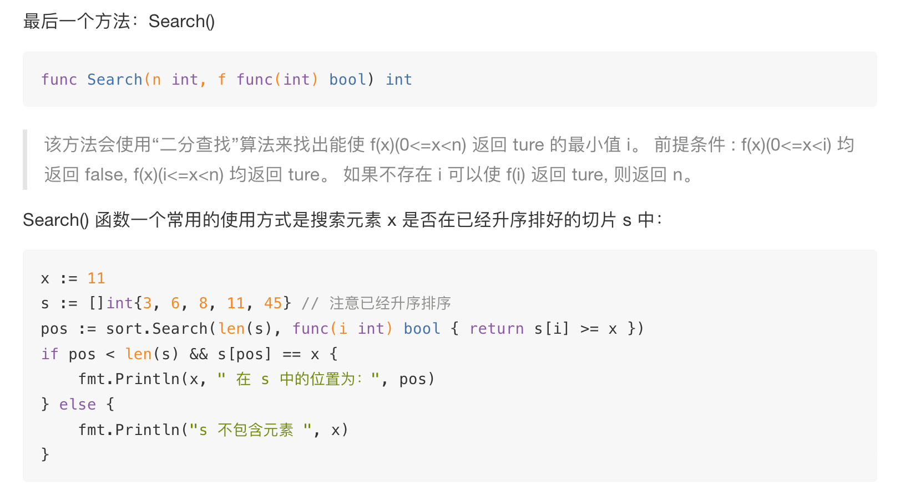

# sort.Interface

```
type Interface interface {
    // 获取数据集合元素个数
    Len() int
    // 如果 i 索引的数据小于 j 索引的数据，返回 true，且不会调用下面的 Swap()，即数据升序排序。
    Less(i, j int) bool
    // 交换 i 和 j 索引的两个元素的位置
    Swap(i, j int)
}
```

实现了该接口即可调用Sort()方法进行排序：

```
func Sort(data Interface)
```

Sort方法的唯一参数就是待排序的数据集合。

该包还提供了一个方法可以判断数据集合是否已经排好顺序，该方法的内部实现依赖于我们自己实现的 Len() 和 Less() 方法：

```
func IsSorted(data Interface) bool {
    n := data.Len()
    for i := n - 1; i > 0; i-- {
        if data.Less(i, i-1) {
            return false
        }
    }
    return true
}
```

此外，_sort_包提供了 Reverse() 方法，可以允许将数据按 Less() 定义的排序方式逆序排序，而不必修改 Less() 代码。方法定义如下：

```
func Reverse(data Interface) Interface
```

_sort_包原生支持[]int、[]float64 和[]string 三种内建数据类型切片的排序操作。

sort包内部实现了IntSlice类型，并实现了sort.Interface接口，sort.Ints()内将int切片转换为IntSlice并进行排序。

float64和string同理。



使用：

```
func main() {
	intList := []int{12, 34, 67448, 13, 484}
	floatList := []float64{1.9, 65.3, 48512.1, 13.22, 14581.11111, 3.3333333}
	strList := []string{"one", "two", "three", "four", "five", "six"}
	sort.Ints(intList)
	sort.Float64s(floatList)
	sort.Sort(sort.Float64Slice(floatList))
	sort.Sort(sort.Reverse(sort.StringSlice(strList)))
	fmt.Println(intList)
	fmt.Println(floatList)
	fmt.Println(strList)
    fmt.Println("index int:", sort.SearchInts(intList, 13))
	fmt.Println("index float:", sort.SearchFloat64s(floatList, 65.3))
	fmt.Println("index string:", sort.SearchStrings(strList, "four"))
}

//[12 13 34 484 67448]
//[1.9 3.3333333 13.22 65.3 14581.11111 48512.1]
//[two three six one four five]
//index int: 1
//index float: 3
//[five four one six three two]
//index string: 1
```

## 自定义结构体排序

原始方法：

```
package main

import (
	"fmt"
	"sort"
)

type Node struct {
	x int
}
type Nodes []Node

func (n Nodes) Less(i, j int) bool {
	return n[i].x < n[j].x
}
func (n Nodes) Len() int {
	return len(n)
}
func (n Nodes) Swap(i, j int) {
	n[i].x, n[j].x = n[j].x, n[i].x
}
func main() {
	nodes := Nodes{{3}, {5}, {0}, {-44}}
	fmt.Println(nodes)
	sort.Sort(nodes)
	fmt.Println(nodes)
}
```

**简化的方法**

sort包提供了以下函数：

```
func Slice(slice interface{}, less func(i, j int) bool) 
func SliceStable(slice interface{}, less func(i, j int) bool) 
func SliceIsSorted(slice interface{}, less func(i, j int) bool) bool 
func Search(n int, f func(int) bool) int
```

1、sort.Slice

完成[]interface的排序

```
type Node struct {
	x int
}
func main() {
	nodes := []Node{{10},{100},{1},{-100}}
	fmt.Println(nodes)
	sort.Slice(nodes, func(i, j int) bool {
		return nodes[i].x < nodes[j].x
	})
	fmt.Println(nodes)
}
```

2、sort.SliceStable

完成 []interface 的稳定排序

```
type Node struct {
	x int
	y int
}
func main() {
	nodes := []Node{{10,0},{100,1},{1,2},{1,3},{-100,4}}
	fmt.Println(nodes)
	sort.SliceStable(nodes, func(i, j int) bool {
		return nodes[i].x < nodes[j].x
	})
	fmt.Println(nodes)
}


sort.SliceStable(people, func(i, j int) bool { return people[i].Age > people[j].Age }) // 按年龄降序排序
fmt.Println("Sort by age:", people)

//➜  demo go run main.go
//[{10 0} {100 1} {1 2} {1 3} {-100 4}]
//[{-100 4} {1 2} {1 3} {10 0} {100 1}]
```

3、sort.SliceIsSorted

```
type Node struct {
	x int
	y int
}
func main() {
	nodes := []Node{{10,0},{100,1},{1,2},{1,3},{-100,4}}
	fmt.Println(nodes)
	sort.Slice(nodes, func(i, j int) bool {
		return nodes[i].x > nodes[j].x
	})
	fmt.Println(nodes)
	fmt.Println(sort.SliceIsSorted(nodes, func(i, j int) bool {
		return nodes[i].x < nodes[j].x
	}))
}

//[{10 0} {100 1} {1 2} {1 3} {-100 4}]
//[{100 1} {10 0} {1 2} {1 3} {-100 4}]
//false
```

4、sort.Search

**找到满足条件的第一个元素**  
该函数判断 []interface 是否存在指定元素

sort 包为 []int,[]float64,[]string 提供的 Search 函数其实也是调用的该函数，因为该函数是使用的二分查找法，所以要求 slice 为升序排序状态。并且判断条件必须为 >=。

```
type Node struct {
	x int
	y int
}
func main() {
	nodes := []Node{{-100,0},{100,1},{1000,2},{2000,3},{4000,4}}
	fmt.Println(nodes)
	key := 1000
	index := sort.Search(len(nodes), func(i int) bool {
		return nodes[i].x >= key
	})
	fmt.Println("index:", index)
}
```

- 降序 slice

如果 slice 是降序状态，而我们又不想将其变为升序，只需将判断条件由 >= 变更为 <= 即可。
