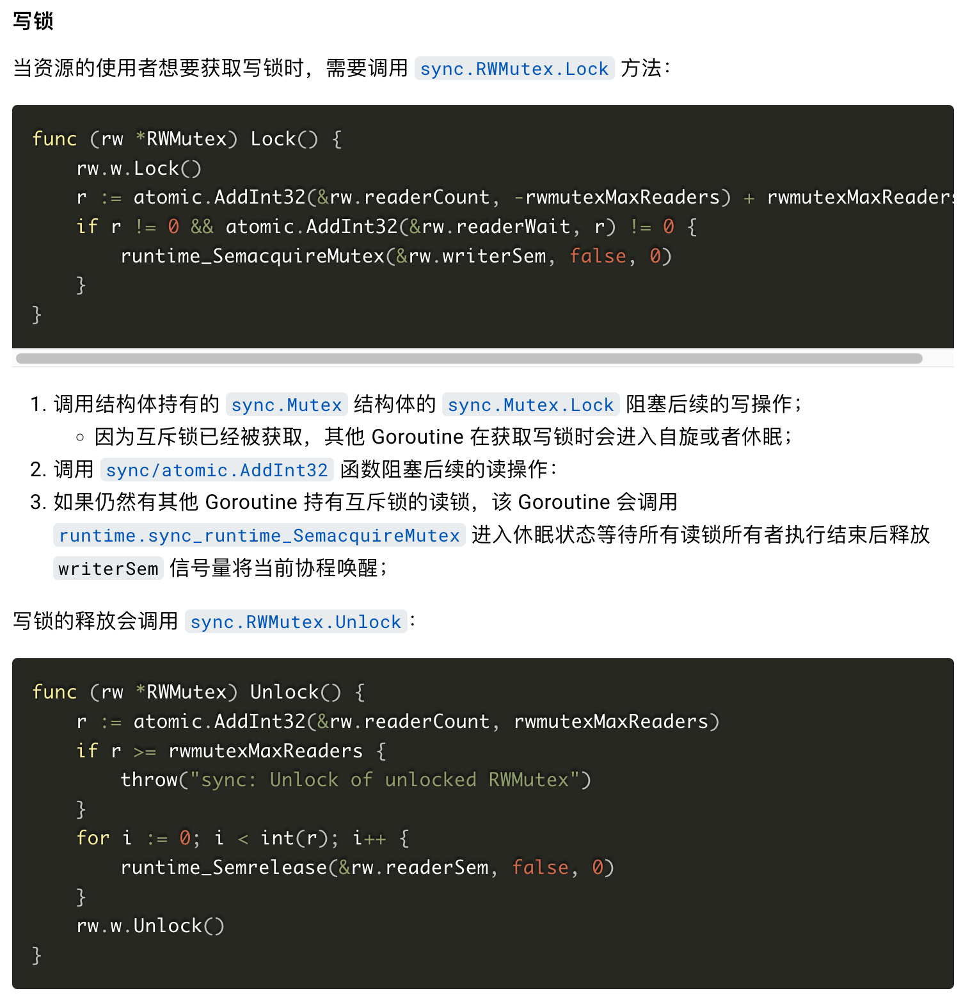
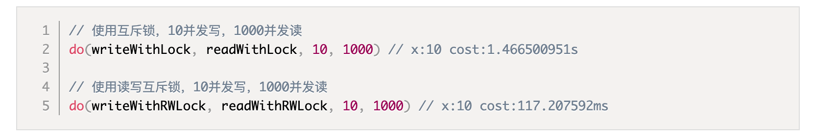

# Mutex

互斥锁是一种常用的控制共享资源访问的方法，它能够保证同一时间只有一个 goroutine 可以访问共享资源。Go 语言中使用sync包中提供的Mutex类型来实现互斥锁。

sync.Mutex提供了两个方法供我们使用。

|   |   |
|---|---|
|方法名|功能|
|func (m *Mutex) Lock()|获取互斥锁|
|func (m *Mutex) Unlock()|释放互斥锁|

demo：

```
package main

import (
	"fmt"
	"sync"
)

func main() {
	i := 0
	m := sync.Mutex{}
	var wg sync.WaitGroup
	wg.Add(2)
	go func() {
		defer wg.Done()
		for i < 10 {
			m.Lock()
			fmt.Println("1:", i)
			i++
			m.Unlock()
		}
	}()
	go func() {
		defer wg.Done()
		for i < 10 {
			m.Lock()
			fmt.Println("2:", i)
			i++
			m.Unlock()
		}
	}()
	wg.Wait()
}
```

# RWMutex

互斥锁是完全互斥的，但是实际上有很多场景是读多写少的，当我们并发的去读取一个资源而不涉及资源修改的时候是没有必要加互斥锁的，这种场景下使用读写锁是更好的一种选择。读写锁在 Go 语言中使用sync包中的RWMutex类型。

|   |   |   |
|---|---|---|
||读|写|
|读|Y|N|
|写|N|N|

sync.RWMutex提供了以下5个方法。

|   |   |
|---|---|
|方法名|功能|
|func (rw *RWMutex) Lock()|获取写锁|
|func (rw *RWMutex) Unlock()|释放写锁|
|func (rw *RWMutex) RLock()|获取读锁|
|func (rw *RWMutex) RUnlock()|释放读锁|
|func (rw *RWMutex) RLocker() Locker|返回一个实现Locker接口的读写锁|



demo：

```
var (
	x       int64
	wg      sync.WaitGroup
	mutex   sync.Mutex
	rwMutex sync.RWMutex
)

// writeWithLock 使用互斥锁的写操作
func writeWithLock() {
	mutex.Lock() // 加互斥锁
	x = x + 1
	time.Sleep(10 * time.Millisecond) // 假设读操作耗时10毫秒
	mutex.Unlock()                    // 解互斥锁
	wg.Done()
}

// readWithLock 使用互斥锁的读操作
func readWithLock() {
	mutex.Lock()                 // 加互斥锁
	time.Sleep(time.Millisecond) // 假设读操作耗时1毫秒
	mutex.Unlock()               // 释放互斥锁
	wg.Done()
}

// writeWithLock 使用读写互斥锁的写操作
func writeWithRWLock() {
	rwMutex.Lock() // 加写锁
	x = x + 1
	time.Sleep(10 * time.Millisecond) // 假设读操作耗时10毫秒
	rwMutex.Unlock()                  // 释放写锁
	wg.Done()
}

// readWithRWLock 使用读写互斥锁的读操作
func readWithRWLock() {
	rwMutex.RLock()              // 加读锁
	time.Sleep(time.Millisecond) // 假设读操作耗时1毫秒
	rwMutex.RUnlock()            // 释放读锁
	wg.Done()
}

func do(wf, rf func(), wc, rc int) {
	start := time.Now()
	// wc个并发写操作
	for i := 0; i < wc; i++ {
		wg.Add(1)
		go wf()
	}

	//  rc个并发读操作
	for i := 0; i < rc; i++ {
		wg.Add(1)
		go rf()
	}

	wg.Wait()
	cost := time.Since(start)
	fmt.Printf("x:%v cost:%v\n", x, cost)

}
```



# WaitGroup

go routine的使用

```
func hello() {
    fmt.Println("hello")
}
func main() {
	go hello() // 启动另外一个goroutine去执行hello函数
	fmt.Println("done！")
}
```

输出：`done！`

main routine在创建了hello函数的routine后继续执行，执行结束时销毁了hello routine。

修改：

```
package main

import (
	"fmt"
	"time"
)

func hello() {
	fmt.Println("hello")
}

func main() {
	go hello()
	fmt.Println("你好")
	time.Sleep(time.Second)
}
```

使用waitGroup等待其他协程退出

```
package main

import (
	"fmt"
	"sync"
)

var wg sync.WaitGroup

func hello(i int) {
	defer wg.Done()
	fmt.Println("task ", i)
}
func main() {
	for i := 0; i < 10; i++ {
		wg.Add(1)
		go hello(i)
	}
	wg.Wait()
}
```

sync.WaitGroup有以下几个方法：

|   |   |
|---|---|
|方法名|功能|
|func (wg * WaitGroup) Add(delta int)|计数器+delta|
|(wg *WaitGroup) Done()|计数器-1|
|(wg *WaitGroup) Wait()|阻塞直到计数器变为0|

sync.WaitGroup内部维护着一个计数器，计数器的值可以增加和减少。例如当我们启动了 N 个并发任务时，就将计数器值增加N。每个任务完成时通过调用 Done 方法将计数器减1。通过调用 Wait 来等待并发任务执行完，当计数器值为 0 时，表示所有并发任务已经完成。

需要注意sync.WaitGroup是一个结构体，进行参数传递的时候要传递指针。

add方法：

```
func (wg *WaitGroup) Add(delta int) {
	statep, semap := wg.state()
	state := atomic.AddUint64(statep, uint64(delta)<<32)
	v := int32(state >> 32)
	w := uint32(state)
	if v < 0 {
		panic("sync: negative WaitGroup counter")
	}
	if v > 0 || w == 0 {
		return
	}
	*statep = 0
	for ; w != 0; w-- {
		runtime_Semrelease(semap, false, 0)
	}
}
```

Done方法的实现是向add方法中传入-1

sync.WaitGroup.Add 可以更新 sync.WaitGroup 中的计数器 counter。虽然 sync.WaitGroup.Add 方法传入的参数可以为负数，但是计数器只能是非负数，一旦出现负数就会发生程序崩溃。当调用计数器归零，即所有任务都执行完成时，才会通过 sync.runtime_Semrelease 唤醒处于等待状态的 Goroutine。

sync.WaitGroup 的另一个方法 sync.WaitGroup.Wait 会在计数器大于 0 并且不存在等待的 Goroutine 时，调用 runtime.sync_runtime_Semacquire 陷入睡眠。

当 sync.WaitGroup 的计数器归零时，陷入睡眠状态的 Goroutine 会被唤醒，上述方法也会立刻返回。

# Once

在某些场景下我们需要确保某些操作即使在高并发的场景下也只会被执行一次，例如只加载一次配置文件等。

Go语言中的sync包中提供了一个针对只执行一次场景的解决方案——sync.Once。

结构体：

```
type Once struct {
	done uint32
	m    Mutex
}
```

```
func (o *Once) Do(f func()) {
	if atomic.LoadUint32(&o.done) == 0 {
		o.doSlow(f)
	}
}

func (o *Once) doSlow(f func()) {
	o.m.Lock()
	defer o.m.Unlock()
	if o.done == 0 {
		defer atomic.StoreUint32(&o.done, 1)
		f()
	}
}
```

demo：

```
package singleton

import (
    "sync"
)

type singleton struct {}

var instance *singleton
var once sync.Once

func GetInstance() *singleton {
    once.Do(func() {
        instance = &singleton{}
    })
    return instance
}
```

# sync.Map

Go 语言中内置的 map 不是并发安全的，请看下面这段示例代码。

```
package main

import (
	"fmt"
	"strconv"
	"sync"
)

var m = make(map[string]int)

func get(key string) int {
	return m[key]
}

func set(key string, value int) {
	m[key] = value
}

func main() {
	wg := sync.WaitGroup{}
	for i := 0; i < 10; i++ {
		wg.Add(1)
		go func(n int) {
			key := strconv.Itoa(n)
			set(key, n)
			fmt.Printf("k=:%v,v:=%v\n", key, get(key))
			wg.Done()
		}(i)
	}
	wg.Wait()
}
```

将上面的代码编译后执行，会报出fatal error: concurrent map writes错误。我们不能在多个 goroutine 中并发对内置的 map 进行读写操作，否则会存在数据竞争问题。

Go语言的sync包中提供了一个开箱即用的并发安全版 map——sync.Map。开箱即用表示其不用像内置的 map 一样使用 make 函数初始化就能直接使用。

|   |   |
|---|---|
|方法名|功能|
|func (m *Map) Store(key, value interface{})|存储key-value数据|
|func (m *Map) Load(key interface{}) (value interface{}, ok bool)|查询key对应的value|
|func (m *Map) LoadOrStore(key, value interface{}) (actual interface{}, loaded bool)|查询或存储key对应的value|
|func (m *Map) LoadAndDelete(key interface{}) (value interface{}, loaded bool)|查询并删除key|
|func (m *Map) Delete(key interface{})|删除key|
|func (m *Map) Range(f func(key, value interface{}) bool)|对map中的每个key-value依次调用f|

demo：

```
package main

import (
	"fmt"
	"strconv"
	"sync"
)

// 并发安全的map
var m = sync.Map{}

func main() {
	wg := sync.WaitGroup{}
	// 对m执行20个并发的读写操作
	for i := 0; i < 20; i++ {
		wg.Add(1)
		go func(n int) {
			key := strconv.Itoa(n)
			m.Store(key, n)         // 存储key-value
			value, _ := m.Load(key) // 根据key取值
			fmt.Printf("k=:%v,v:=%v\n", key, value)
			wg.Done()
		}(i)
	}
	wg.Wait()
}
```
