[https://learnku.com/articles/41728](https://learnku.com/articles/41728)

# 典型的线程池

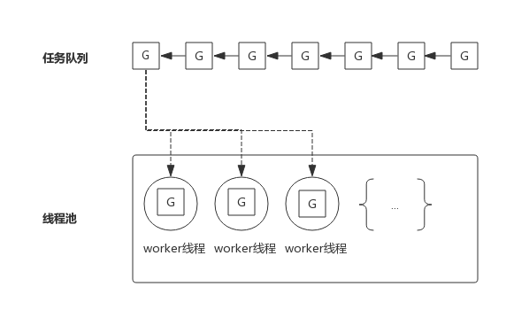

线程池中的worker线程不断地从任务队列中取出任务并执行。而worker线程的调度则交给操作系统进行调度。

如果worker线程执行的G任务中发生系统调用，则操作系统会将该线程置为阻塞状态，也意味着该线程在怠工，也意味着消费任务队列的worker线程变少了，也就是说线程池消费任务队列的能力变弱了。

如果任务队列中的大部分任务都会进行系统调用，则会让这种状态恶化，大部分worker线程进入阻塞状态，从而任务队列中的任务产生堆积。

解决这个问题的一个思路就是重新审视线程池中线程的数量，增加线程池中线程数量可以一定程度上提高消费能力，但随着线程数量增多，由于过多线程争抢CPU，消费能力会有上限，甚至出现消费能力下降。 如下图所示：

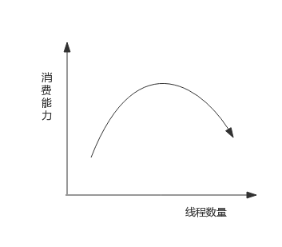

# Goroutine调度器

线程数过多，意味着操作系统会不断地切换线程，频繁的上下文切换就成了性能瓶颈。

Go 语言的调度器通过使用与 CPU 数量相等的线程减少线程频繁切换的内存开销，同时在每一个线程上执行额外开销更低的 Goroutine 来降低操作系统和硬件的负载。  

## 调度模型

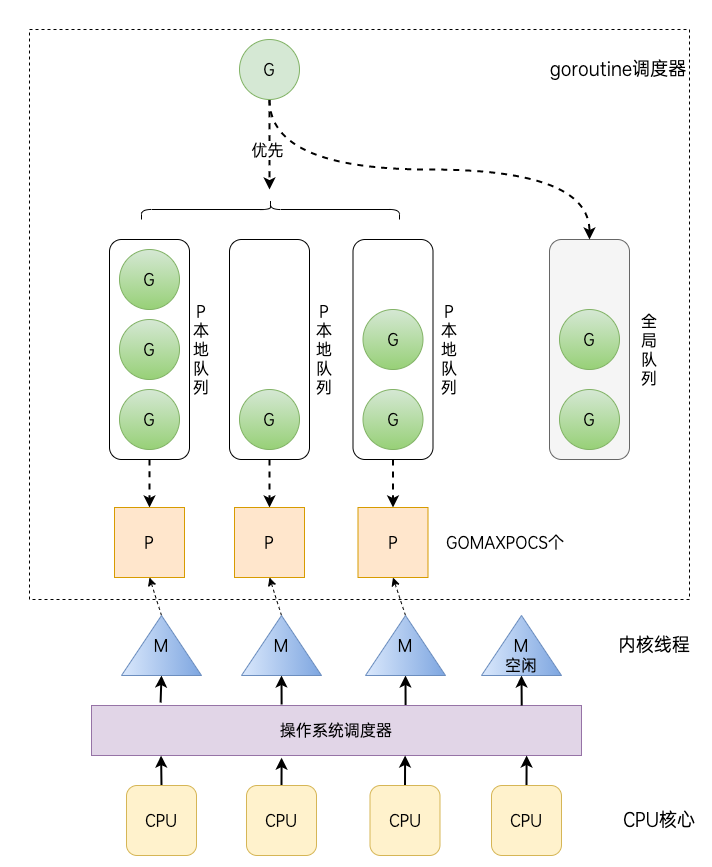

- G（Goroutine）: 即Go协程，每个go关键字都会创建一个协程。
- M（Machine）： 工作线程，在Go中称为Machine。
- P(Processor): 处理器（Go中定义的一个摡念，不是指CPU），包含运行Go代码的必要资源，也有调度goroutine的能力。

Go语言相比起其他语言的优势在于OS线程是由OS内核来调度的， goroutine 则是由Go运行时（runtime）自己的调度器调度的，完全是在用户态下完成的， 不涉及内核态与用户态之间的频繁切换，包括内存的分配与释放，都是在用户态维护着一块大的内存池， 不直接调用系统的malloc函数（除非内存池需要改变），成本比调度OS线程低很多。 另一方面充分利用了多核的硬件资源，近似的把若干goroutine均分在物理线程上， 再加上本身 goroutine 的超轻量级，以上种种特性保证了 goroutine 调度方面的性能。

## GOMAXPROCS

一般来讲，程序运行时就将GOMAXPROCS大小设置为CPU核数，可让Go程序充分利用CPU。

在某些IO密集型的应用里，这个值可能并不意味着性能最好。

理论上当某个Goroutine进入系统调用时，会有一个新的M被启用或创建，继续占满CPU。

但由于Go调度器检测到M被阻塞是有一定延迟的，也即旧的M被阻塞和新的M得到运行之间是有一定间隔的，所以在IO密集型应用中不妨把GOMAXPROCS设置的大一些，或许会有好的效果。

# 协程与线程的绑定关系

# M

Go 语言并发模型中的 M 是操作系统线程。调度器最多可以创建 10000 个线程，但是其中大多数的线程都不会执行用户代码（可能陷入系统调用），**最多只会有 GOMAXPROCS 个活跃线程能够正常运行。**

在默认情况下，运行时会将 GOMAXPROCS 设置成当前机器的核数，我们也可以在程序中使用 `runtime.GOMAXPROCS` 来改变最大的活跃线程数。

**g0 是一个运行时中比较特殊的 Goroutine，它会深度参与运行时的调度过程，包括 Goroutine 的创建、大内存分配和 CGO 函数的执行。**

线程想运行任务就得获取 P，从 P 的本地队列获取 G，P 队列为空时，M 也会尝试从全局队列拿一批 G 放到 P 的本地队列，或从其他 P 的本地队列偷一半放到自己 P 的本地队列。M 运行 G，G 执行之后，M 会从 P 获取下一个 G，不断重复下去。

M的数量：

- go 语言本身的限制：go 程序启动时，会设置 M 的最大数量，默认 10000. 但是内核很难支持这么多的线程数，所以这个限制可以忽略。
- runtime/debug 中的 SetMaxThreads 函数，设置 M 的最大数量
- 一个 M 阻塞了，会创建新的 M。

# P

调度器中的处理器 P 是线程和 Goroutine 的中间层，它能提供线程需要的上下文环境，也会负责调度线程上的等待队列，通过处理器 P 的调度，每一个内核线程都能够执行多个 Goroutine，它能在 Goroutine 进行一些 I/O 操作时及时让出计算资源，提高线程的利用率。

P的数量由启动时环境变量 $GOMAXPROCS 或者是由 runtime 的方法 GOMAXPROCS() 决定。这意味着在程序执行的任意时刻都只有 $GOMAXPROCS 个 goroutine 在同时运行。

# 系统调用

当M一旦进入系统调用后，会脱离go runtime的控制。试想万一系统调用阻塞了呢，此时又无法进行抢占，是不是整个M也就罢工了。所以为了维持整个调度体系的高效运转，必然要在进入系统调用之前要做点什么以防患未然。

1. 异步系统调用 G 会和MP分离（G挂到netpoller）
2. 同步系统调用 MG 会和P分离（P另寻M），当M从系统调用返回时，不会继续执行，而是将G放到run queue。

在 Go 里面阻塞主要分为以下 4 种场景：

1. 由于原子、互斥量或通道操作调用导致 Goroutine 阻塞，调度器将把当前阻塞的 Goroutine 切换出去，重新调度 LRQ 上的其他 Goroutine；
2. 由于网络请求和 IO 操作导致 Goroutine 阻塞。Go 程序提供了网络轮询器（NetPoller）来处理网络请求和 IO 操作的问题，其后台通过 kqueue（MacOS），epoll（Linux）或 iocp（Windows）来实现 IO 多路复用。通过使用 NetPoller 进行网络系统调用，调度器可以防止 Goroutine 在进行这些系统调用时阻塞 M。这可以让 M 执行 P 的 LRQ 中其他的 Goroutines，而不需要创建新的 M。执行网络系统调用不需要额外的 M，网络轮询器使用系统线程，它时刻处理一个有效的事件循环，有助于减少操作系统上的调度负载。用户层眼中看到的 Goroutine 中的“block socket”，实现了 goroutine-per-connection 简单的网络编程模式。实际上是通过 Go runtime 中的 netpoller 通过 Non-block socket + I/O 多路复用机制“模拟”出来的。
3. 当调用一些系统方法的时候（如文件 I/O），如果系统方法调用的时候发生阻塞，这种情况下，网络轮询器（NetPoller）无法使用，而进行系统调用的 G1 将阻塞当前 M1。调度器引入 其它M 来服务 M1 的P。
4. 如果在 Goroutine 去执行一个 sleep 操作，导致 M 被阻塞了。Go 程序后台有一个监控线程 sysmon，它监控那些长时间运行的 G 任务然后设置可以强占的标识符，别的 Goroutine 就可以抢先进来执行。

[https://qiankunli.github.io/2020/11/21/goroutine_system_call.html](https://qiankunli.github.io/2020/11/21/goroutine_system_call.html)

# 调度策略

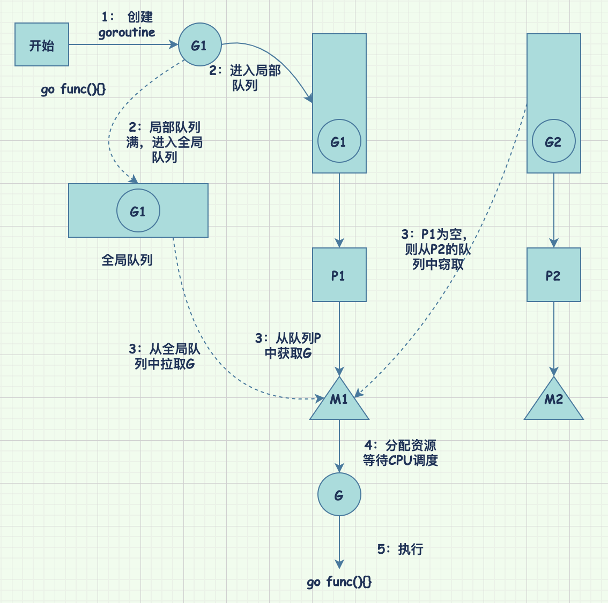

复用线程：避免频繁的创建、销毁线程，而是对线程的复用。

1）work stealing 机制

当本线程无可运行的 G 时，尝试从其他线程绑定的 P 偷取 G（偷取一半P），而不是销毁线程。

2）hand off 机制

当本线程因为 G 进行系统调用阻塞时，线程释放绑定的 P，把 P 转移给其他空闲的线程执行。

利用并行：GOMAXPROCS 设置 P 的数量，最多有 GOMAXPROCS 个线程分布在多个 CPU 上同时运行。GOMAXPROCS 也限制了并发的程度，比如 GOMAXPROCS = 核数/2，则最多利用了一半的 CPU 核进行并行。

抢占：在 coroutine 中要等待一个协程主动让出 CPU 才执行下一个协程，在 Go 中，一个 goroutine 最多占用 CPU 10ms，防止其他 goroutine 被饿死，这就是 goroutine 不同于 coroutine 的一个地方。

全局 G 队列：在新的调度器中依然有全局 G 队列，但功能已经被弱化了，当 M 执行 work stealing 从其他 P 偷不到 G 时，它可以从全局 G 队列获取 G。

# 场景

(1) 场景 1

P 拥有 G1，M1 获取 P 后开始运行 G1，G1 使用 go func() 创建了 G2，为了局部性 G2 优先加入到 P1 的本地队列。

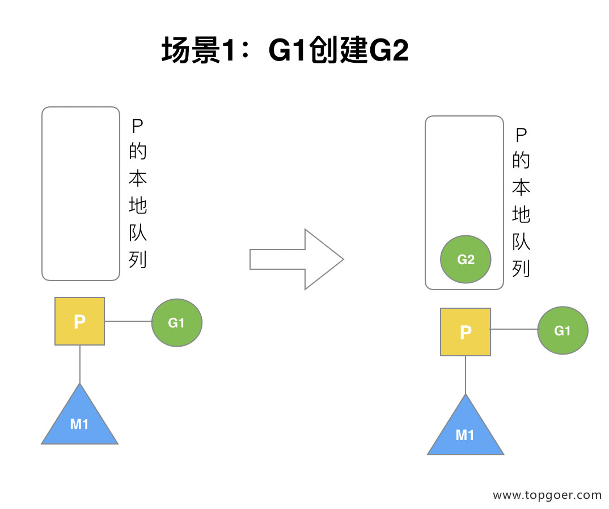

(2) 场景 2

G1 运行完成后 (函数：goexit)，M 上运行的 goroutine 切换为 G0，G0 负责调度时协程的切换（函数：schedule）。从 P 的本地队列取 G2，从 G0 切换到 G2，并开始运行 G2 (函数：execute)。实现了线程 M1 的复用。

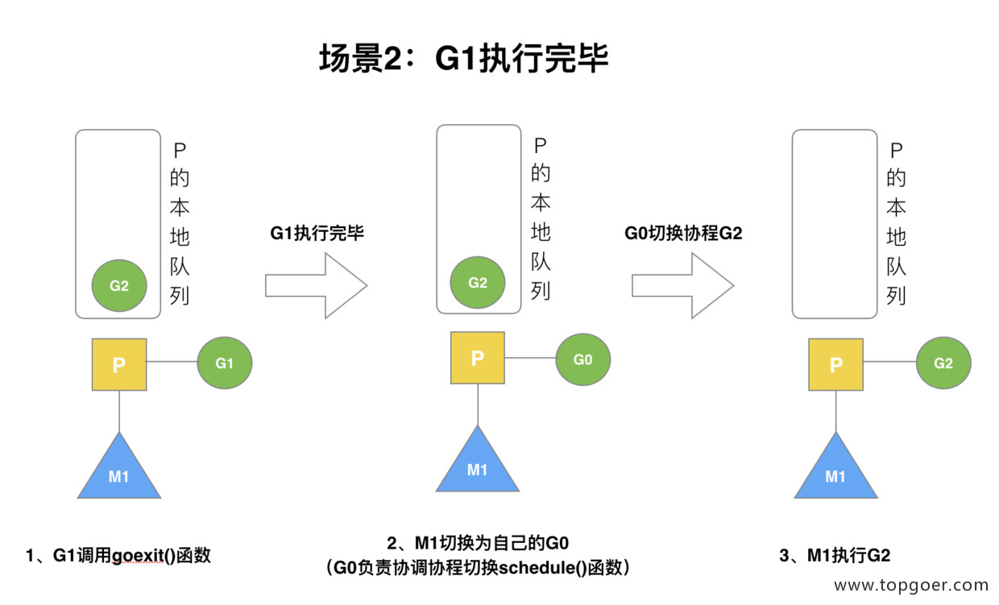

(3) 场景 3

假设每个 P 的本地队列只能存 4 个 G。G2 创建了 6 个 G，前 4 个 G（G3, G4, G5,G6）已经加入 p1 的本地队列，p1 本地队列满了。

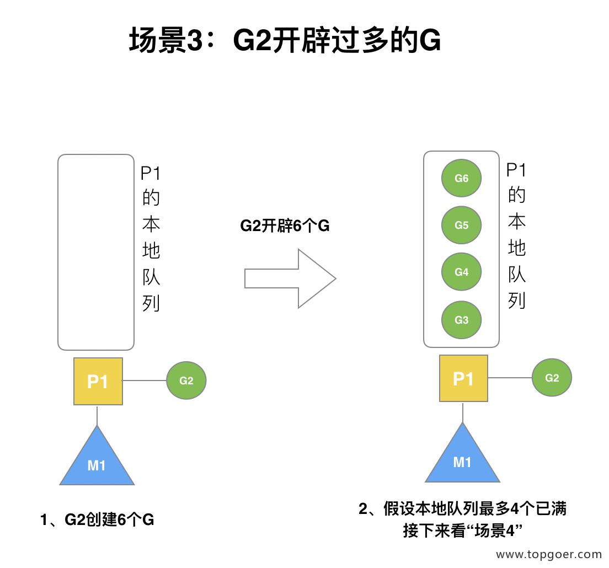

(4) 场景 4

G2 在创建 G7 的时候，发现 P1 的本地队列已满，需要执行负载均衡 (把 P1 中本地队列中前一半的 G，还有新创建 G 转移到全局队列)

（实现中并不一定是新的 G，如果 G 是 G2 之后就执行的，会被保存在本地队列，利用某个老的 G 替换新 G 加入全局队列）

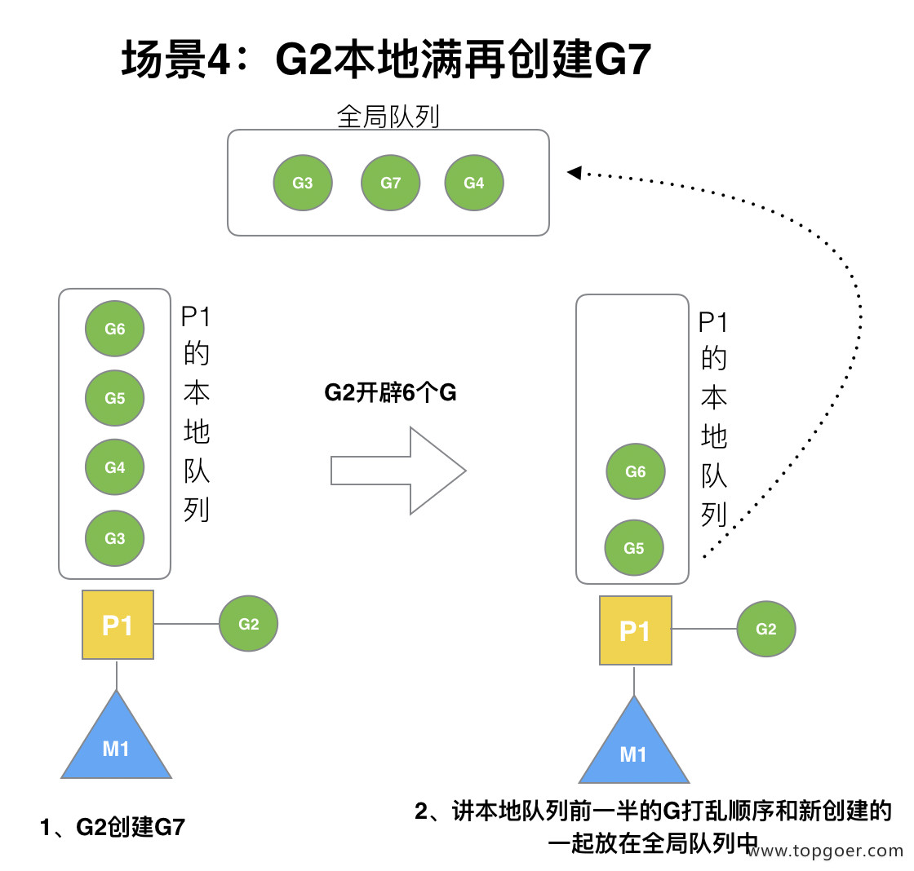

这些 G 被转移到全局队列时，会被打乱顺序。所以 G3,G4,G7 被转移到全局队列。

(5) 场景 5

G2 创建 G8 时，P1 的本地队列未满，所以 G8 会被加入到 P1 的本地队列。

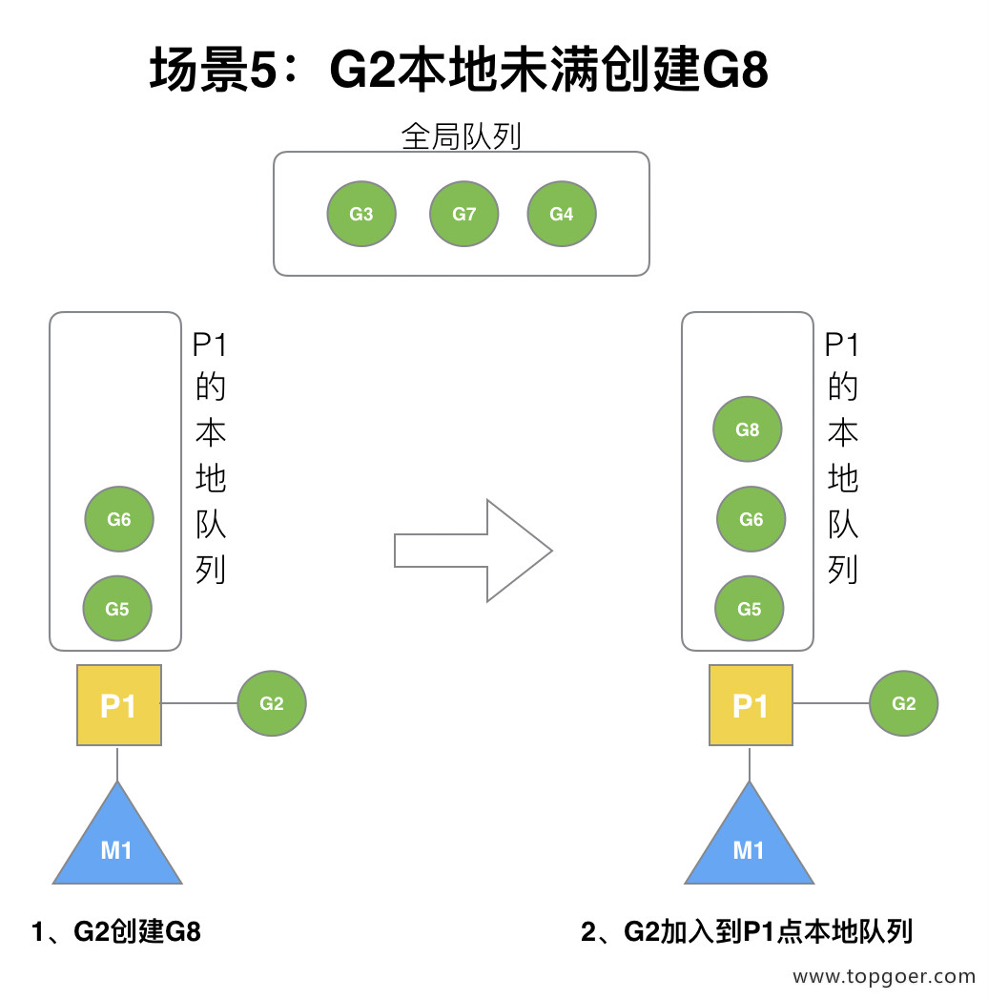

G8 加入到 P1 点本地队列的原因还是因为 P1 此时在与 M1 绑定，而 G2 此时是 M1 在执行。所以 G2 创建的新的 G 会优先放置到自己的 M 绑定的 P 上。

(6) 场景 6

规定：在创建 G 时，运行的 G 会尝试唤醒其他空闲的 P 和 M 组合去执行。

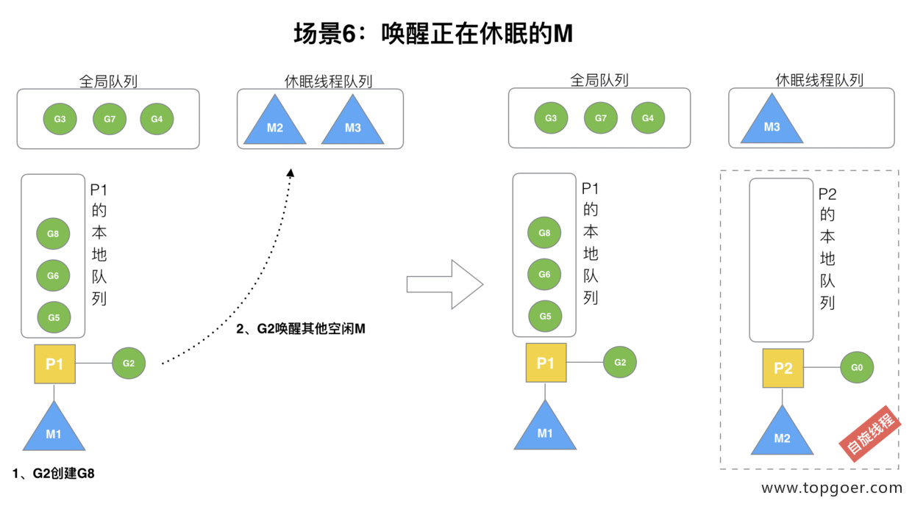

假定 G2 唤醒了 M2，M2 绑定了 P2，并运行 G0，但 P2 本地队列没有 G，M2 此时为自旋线程（没有 G 但为运行状态的线程，不断寻找 G）。

(7) 场景 7

M2 尝试从全局队列 (简称 “GQ”) 取一批 G 放到 P2 的本地队列（函数：findrunnable()）。M2 从全局队列取的 G 数量符合下面的公式：

n = min(len(GQ)/GOMAXPROCS + 1, len(GQ/2))

至少从全局队列取 1 个 g，但每次不要从全局队列移动太多的 g 到 p 本地队列，给其他 p 留点。这是从全局队列到 P 本地队列的负载均衡。

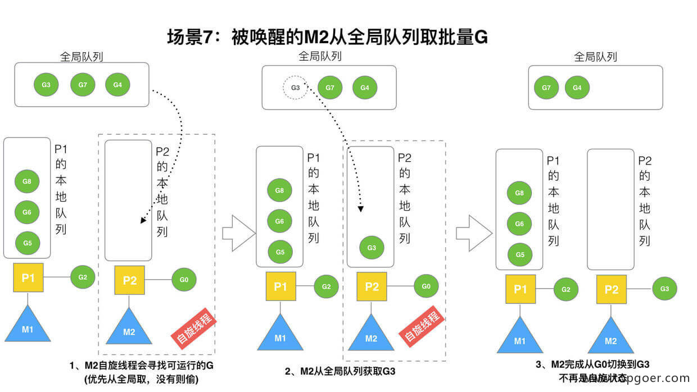

假定我们场景中一共有 4 个 P（GOMAXPROCS 设置为 4，那么我们允许最多就能用 4 个 P 来供 M 使用）。所以 M2 只从能从全局队列取 1 个 G（即 G3）移动 P2 本地队列，然后完成从 G0 到 G3 的切换，运行 G3。

(8) 场景 8

假设 G2 一直在 M1 上运行，经过 2 轮后，M2 已经把 G7、G4 从全局队列获取到了 P2 的本地队列并完成运行，全局队列和 P2 的本地队列都空了，如场景 8 图的左半部分。

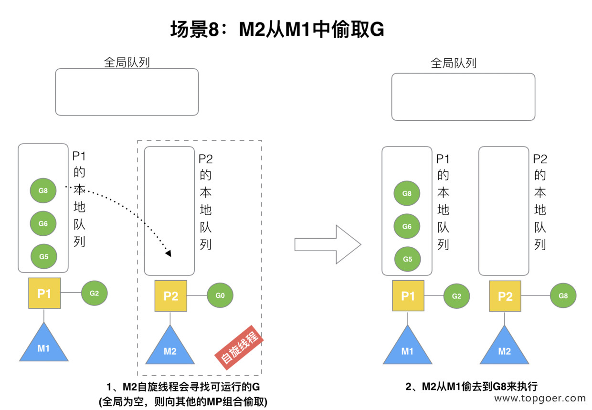

全局队列已经没有 G，那 m 就要执行 work stealing (偷取)：从其他有 G 的 P 哪里偷取一半 G 过来，放到自己的 P 本地队列。P2 从 P1 的本地队列尾部取一半的 G，本例中一半则只有 1 个 G8，放到 P2 的本地队列并执行。

(9) 场景 9

G1 本地队列 G5、G6 已经被其他 M 偷走并运行完成，当前 M1 和 M2 分别在运行 G2 和 G8，M3 和 M4 没有 goroutine 可以运行，M3 和 M4 处于自旋状态，它们不断寻找 goroutine。

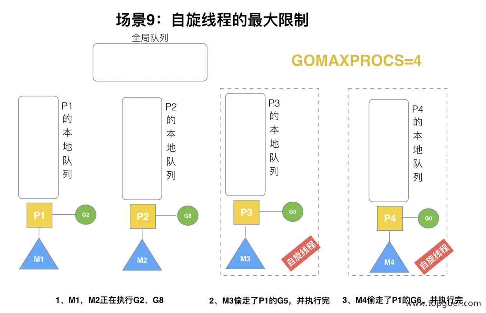

为什么要让 m3 和 m4 自旋，自旋本质是在运行，线程在运行却没有执行 G，就变成了浪费 CPU. 为什么不销毁现场，来节约 CPU 资源。因为创建和销毁 CPU 也会浪费时间，我们希望当有新 goroutine 创建时，立刻能有 M 运行它，如果销毁再新建就增加了时延，降低了效率。当然也考虑了过多的自旋线程是浪费 CPU，所以系统中最多有 GOMAXPROCS 个自旋的线程 (当前例子中的 GOMAXPROCS=4，所以一共 4 个 P)，多余的没事做线程会让他们休眠。

(10) 场景 10

假定当前除了 M3 和 M4 为自旋线程，还有 M5 和 M6 为空闲的线程 (没有得到 P 的绑定，注意我们这里最多就只能够存在 4 个 P，所以 P 的数量应该永远是 M>=P, 大部分都是 M 在抢占需要运行的 P)，G8 创建了 G9，G8 进行了阻塞的系统调用，M2 和 P2 立即解绑，P2 会执行以下判断：如果 P2 本地队列有 G或全局队列有 G 且有空闲的 M，P2 会立马唤醒 1 个 M 和它绑定，否则 P2 会加入到空闲 P 列表，等待 M 来获取可用的 p。本场景中，P2 本地队列有 G9，可以和其他空闲的线程 M5 绑定。

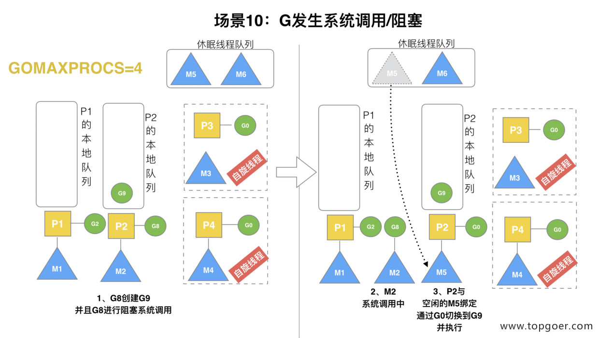

(11) 场景 11

G8 创建了 G9，假如 G8 进行了非阻塞系统调用。

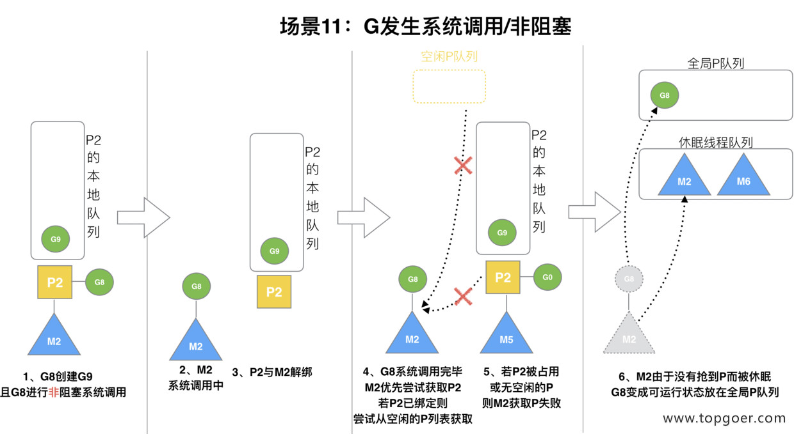

M2 和 P2 会解绑，但 M2 会记住 P2，然后 G8 和 M2 进入系统调用状态。当 G8 和 M2 退出系统调用时，会尝试获取 P2，如果无法获取，则获取空闲的 P，如果依然没有，G8 会被记为可运行状态，并加入到全局队列，M2 因为没有 P 的绑定而变成休眠状态 (长时间休眠等待 GC 回收销毁)。
