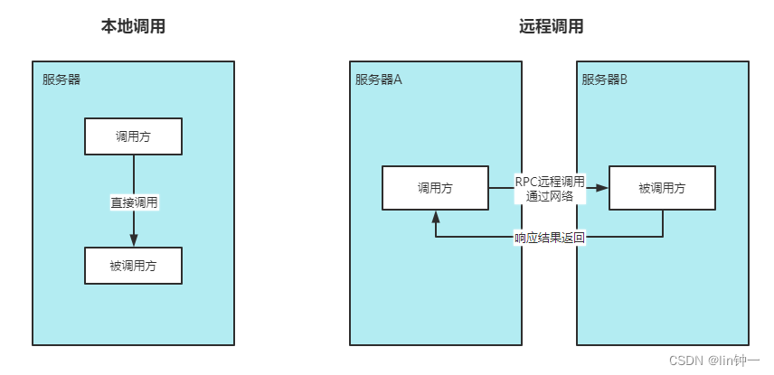
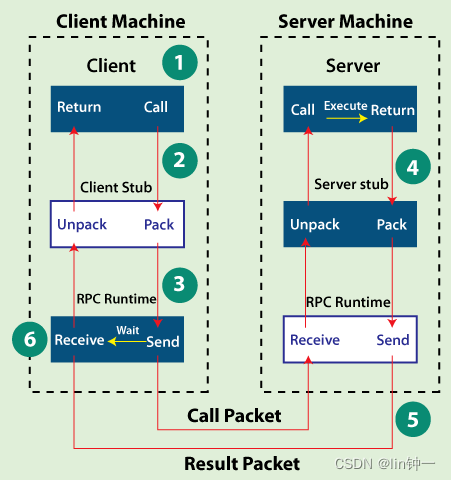
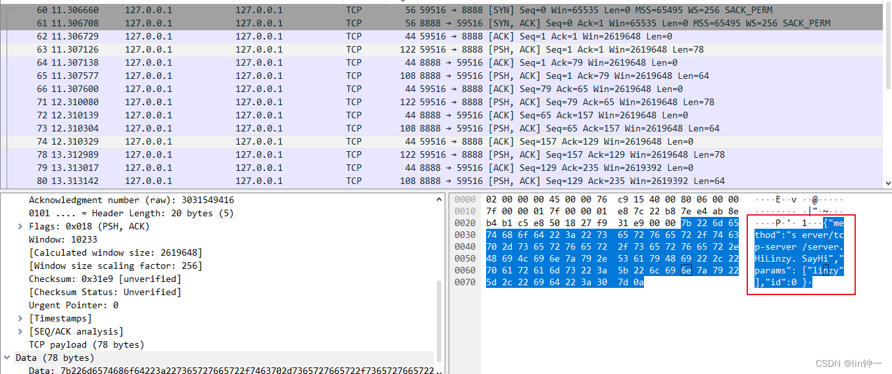
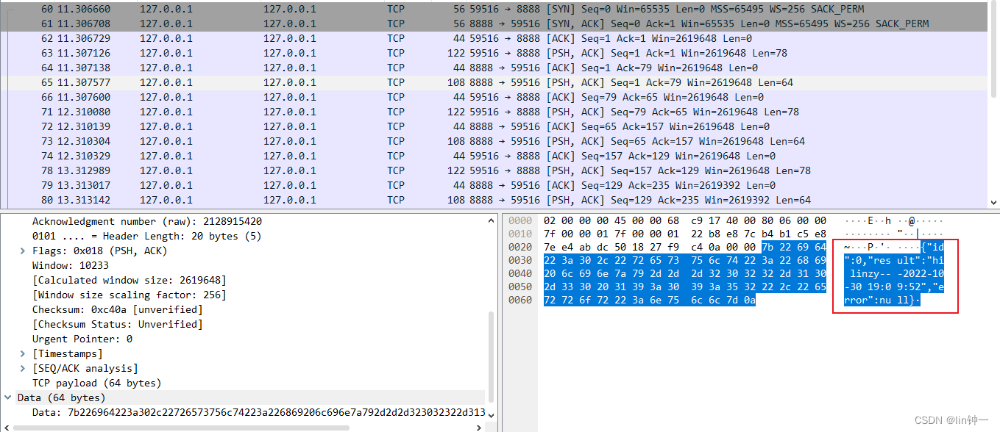
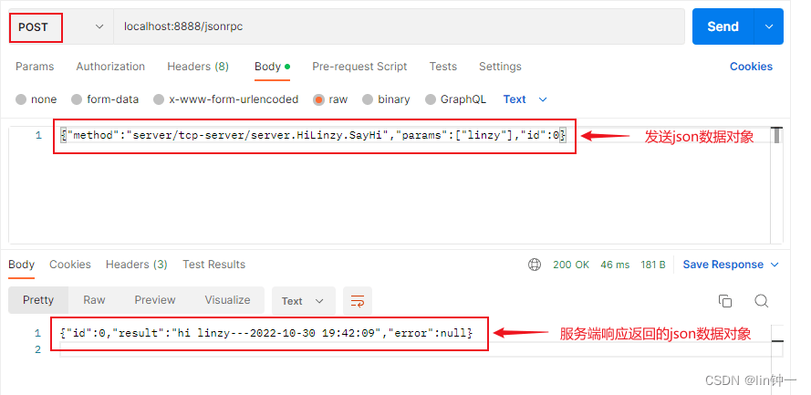

🔗 原文链接： [https://learnku.com/articles/73101](https://learnku.com/articles/73101)

⏰ 剪存时间：2023-07-28 15:34:12 (UTC+8)

✂️ 本文档由 [飞书剪存](https://www.feishu.cn/hc/zh-CN/articles/606278856233?from=in_ccm_clip_doc)一键生成

# 前言

本文作为 Grpc 的开篇，通过文档先了解一下 rpc。 个人网站： [linzyblog.netlify.app/](https://linzyblog.netlify.app/) 示例代码已经上传到 github： [点击跳转](https://github.com/Gopherlinzy/go-grpc-example)

# 一、RPC #

## 1、什么是 RPC？

RPC（Remote Procedure Call 远程过程调用） 是一种软件通信协议，一个程序可以使用该协议向位于网络上另一台计算机中的程序请求服务，而无需了解网络的详细信息。RPC 用于调用远程系统上的其他进程，如本地系统。 过程调用有时也称为 函数调用或 子程序调用。

RPC 是一种客户端 - 服务器交互形式（调用者是客户端，执行者是服务器），通常通过请求 - 响应消息传递系统实现。与本地过程调用一样，RPC 是一种 同步 操作，需要 阻塞 请求程序，直到返回远程过程的结果。但是，使用共享相同地址空间的轻量级进程或 线程 可以同时执行多个 RPC。

通俗的解释： 客户端在不知道调用细节的情况下，调用存在于远程计算机上的某个对象，就像调用本地应用程序中的对象一样。

接口定义语言（IDL）—— 用于描述软件组件的应用程序编程接口（API）的规范语言 —— 通常用于远程过程调用软件。在这种情况下， IDL 在链路两端的机器之间提供了一座桥梁，这些机器可能使用不同的操作系统 (OS) 和计算机语言。

实际场景：

有两台服务器，分别是服务器 A、服务器 B。在 服务器 A 上的应用 想要调用服务器 B 上的应用，它们可以直接本地调用吗？

答案是不能的，但走 RPC 的话，十分方便。因此常有人称使用 RPC，就跟本地调用一个函数一样简单。



## 2、HTTP 和 RPC 的区别

### 1）概念区别

RPC 是一种方法，而 HTTP 是一种协议。两者都常用于实现服务，在这个层面最本质的区别是 RPC 服务主要工作在 TCP 协议之上（也可以在 HTTP 协议），而 HTTP 服务工作在 HTTP 协议之上。由于 HTTP 协议基于 TCP 协议，所以 RPC 服务天然比 HTTP 更轻量，效率更胜一筹。

两者都是基于网络实现的，从这一点上，都是基于 Client/Server 架构。

### 2）从协议上区分

RPC 是远端过程调用，其调用协议通常包含： 传输协议 和 序列化协议 。

- 传输协议：著名的 grpc，它底层使用的是 http2 协议；还有 dubbo 一类的自定义报文的 tcp 协议。
- 序列化协议：基于文本编码的 json 协议；也有二进制编码的 protobuf、hession 等协议；还有针对 java 高性能、高吞吐量的 kryo 和 ftc 等序列化协议。

HTTP 服务工作在 HTTP 协议之上，而且 HTTP 协议基于 TCP 协议。

## 3、RPC 如何工作的？

当调用 RPC 时，调用环境被挂起，过程参数通过网络传送到过程执行的环境，然后在该环境中执行过程。

当过程完成时，结果将被传送回调用环境，在那里继续执行，就像从常规过程调用返回一样。

在 RPC 期间，将执行以下步骤：

1. 客户端调用客户端存根。该调用是本地过程调用，参数以正常方式压入堆栈。
2. 客户端存根将过程参数打包到消息中并进行系统调用以发送消息。过程参数的打包称为 编组 。
3. 客户端的本地操作系统将消息从客户端机器发送到远程服务器机器。
4. 服务器操作系统将传入的数据包传递给服务器存根。
5. 服务器存根从消息中解包参数 —— 称为 解编组 。
6. 当服务器过程完成时，它返回到服务器存根，它将返回值编组为一条消息。然后服务器 存根将消息交给传输层。
7. 传输层将生成的消息发送回客户端传输层，传输层将消息返回给客户端存根。
8. 客户端存根解组返回参数，然后执行返回给调用者。

Client （客户端）：服务调用方。 Server（服务端）：服务提供方。 Client Stub（客户端存根）：存放服务端的地址消息，负责将客户端的请求参数打包成网络消息，然后通过网络发送给服务提供方。 Server Stub（服务端存根）：接收客户端发送的消息，再将客户端请求参数打包成网络消息，然后通过网络远程发送给服务方。



## 4、RPC 的优缺点 #

尽管它拥有广泛的好处，但使用 RPC 的人肯定应该注意一些陷阱。

RPC 为开发人员和应用程序管理人员提供的一些优势：

- 帮助客户端通过传统使用高级语言中的过程调用与服务器进行通信。
- 可以在分布式环境中使用，也可以在本地环境中使用。
- 支持面向进程和面向线程的模型。
- 对用户隐藏内部消息传递机制。
- 只需极少的努力即可重写和重新开发代码。
- 提供抽象，即网络通信的消息传递特性对用户隐藏。
- 省略许多协议层以提高性能。

另一方面，RPC 的一些缺点包括：

- 客户端和服务器各自的例程使用不同的执行环境，资源（如文件）的使用也更加复杂。因此，RPC 系统并不总是适合传输大量数据。
- RPC 极易发生故障，因为它涉及一个通信系统、另一台机器和另一个进程。
- RPC 没有统一的标准；它可以通过多种方式实现。
- RPC 只是基于交互的，因此它在硬件架构方面没有提供任何灵活性。

## 5、常见的 RPC 框架 #

### 1）跟语言绑定框架 #

- Dubbo：国内最早开源的 RPC 框架，由阿里巴巴公司开发并于 2011 年末对外开源，仅支持 Java 语言。
- Motan：微博内部使用的 RPC 框架，于 2016 年对外开源，仅支持 Java 语言。
- Tars：腾讯内部使用的 RPC 框架，于 2017 年对外开源，仅支持 C++ 语言。
- Spring Cloud：国外 Pivotal 公司 2014 年对外开源的 RPC 框架，仅支持 Java 语言。

### 2）跨语言开源框架 #

- gRPC：Google 于 2015 年对外开源的跨语言 RPC 框架，支持多种语言。
- Thrift：最初是由 Facebook 开发的内部系统跨语言的 RPC 框架，2007 年贡献给了 Apache 基金，成为 Apache 开源项目之一，支持多种语言。
- Rpcx：是一个类似阿里巴巴 Dubbo 和微博 Motan 的 RPC 框架，开源，支持多种语言。

# 二、RPC 快速入门 #

Go 语言标准包 ( net/rpc ) 已经提供了对 RPC 的支持，而且支持三个级别的 RPC： TCP、HTTP和JSONRPC 。但 Go 语言的 RPC 包是独一无二的 RPC，它和传统的 RPC 系统不同，它只支持 Go 语言开发的服务器与客户端之间的交互，因为在内部，它们采用了 Gob 来编码。

## 1、简单的 RPC 示例 #

### 1）服务端实现 #

我们先构造一个 HelloService 类型，其中的 SayHi 方法用于实现打印功能：

```
type HelloService struct{}

func (h *HelloService) SayHi(request string, response *string) error {
    format := time.Now().Format("2006-01-02 15:04:05")
    *response = "hi " + request + "---" + format
    return nil
}
```

Go 语言的 RPC 规则：方法只能有两个可序列化的参数，其中第二个参数是指针类型，并且返回一个 error 类型，同时必须是公开的方法。

将 HelloService 类型的对象注册为一个 RPC 服务：

RegisterName 类似于 Register，但使用提供的名称作为类型， Register 函数调用会将对象类型中所有满足 RPC 规则的对象方法注册为 RPC 函数，所有注册的方法会放在 “HelloService” 服务空间之下。 rpc.ServeConn 函数在该 TCP 连接上为对方提供 RPC 服务。 我们的服务支持多个 TCP 连接，然后为每个 TCP 连接提供 RPC 服务。

### 2）客户端实现 #

在客户端请求 HelloService 服务的代码：

rpc.Dial 拨号 RPC 服务，然后通过 dial.Call 调用具体的 RPC 方法。 在调用 dial.Call 时，第一个参数是用点号连接的 RPC 服务名字和方法名字，第二和第三个参数分别我们定义 RPC 方法的两个参数，第一个是客服端传递的消息，第二个是由服务端产生返回的结果。

## 2、更安全的 RPC 接口 #

在涉及 RPC 的应用中，作为开发人员一般至少有三种角色：首先是服务端实现 RPC 方法的开发人员，其次是客户端调用 RPC 方法的人员，最后也是最重要的是制定服务端和客户端 RPC 接口规范的设计人员。在前面的例子中我们为了简化将以上几种角色的工作全部放到了一起，虽然看似实现简单，但是不利于后期的维护和工作的切割。

### 1）服务端重构 #

如果要重构 HelloService 服务，第一步需要明确服务的名字和接口：

我们将 RPC 服务的接口规范分为三个部分：首先是服务的名字，然后是服务要实现的详细方法列表，最后是注册该类型服务的函数。 为了避免名字冲突，我们在 RPC 服务的名字中增加了包路径前缀（这个是 RPC 服务抽象的包路径，并非完全等价 Go 语言的包路径）。 RegisterHelloService 注册服务时，编译器会要求传入的对象满足 HelloServiceInterface 接口。

基于 RPC 接口规范编写真实的服务端代码：

### 2）客户端重构 #

为了简化客户端用户调用 RPC 函数，我们在可以在接口规范部分增加对客户端的简单包装：

提供了一个 DialHelloService 方法，直接拨号 HelloService 服务。

基于新的客户端接口，我们可以简化客户端用户的代码：

现在客户端用户不用再担心 RPC 方法名字或参数类型不匹配等低级错误的发生。

在新的 RPC 服务端实现中，我们用 RegisterHelloService 函数来注册函数，这样不仅可以避免命名服务名称的工作，同时也保证了传入的服务对象满足了 RPC 接口的定义。

## 3、跨语言的 RPC #

标准库的 RPC 默认采用 Go 语言特有的 gob 编码，因此从其他语言调用 Go 语言实现的 RPC 服务将比较困难。在互联网的微服务时代，每个 RPC 以及服务的使用者都可能采用不同的编程语言，因此跨语言是互联网时代 RPC 的一个首要条件。得益于 RPC 的框架设计，Go 语言的 RPC 其实也是很容易实现跨语言支持的。

Go 语言的 RPC 框架有两个比较有特色的设计：

- RPC 数据打包时可以通过插件实现自定义的编码和解码。
- RPC 建立在抽象的 io.ReadWriterCloser 接口之上的，我们可以将 RPC 架设在不同的通信协议之上。

这里我们使用 Go 官方自带的 net/rpc/jsonrpc 扩展实现一个跨语言的 rpc。

### 1）服务端实现 #

首先是基于 json 编码重新实现 RPC 服务：

代码中最大的变化是用 rpc.ServeCodec 函数替代了 rpc.ServeConn 函数，传入的参数是针对服务端的 json 编解码器。

### 2）客户端实现 #

实现 json 版本的客户端：

我们先手工调用 net.Dial 函数建立 TCP 连接，然后基于该连接建立针对客户端的 json 编解码器。 在确保客户端可以正常调用 RPC 服务的方法之后，我们用一个普通的 TCP 服务代替 Go 语言版本的 RPC 服务，这样可以查看客户端调用时发送的数据格式。

### 3）分析数据格式 #

我们用 Wireshark 抓个包看看我们直接传递的数据格式：



这是一个 json 编码的数据，其中 method 部分对应要调用的 rpc 服务和方法组合成的名字，params 部分的第一个元素为参数，id 是由调用端维护的一个唯一的调用编号。

请求的 json 数据对象在内部对应两个结构体：客户端是 clientRequest，服务端是 serverRequest。clientRequest 和 serverRequest 结构体的内容基本是一致的：

我们再来查看服务端响应的结果的数据结构：



返回的结果也是一个 json 格式的数据：

其中 id 对应输入的 id 参数，result 为返回的结果，error 部分在出问题时表示错误信息。对于顺序调用来说，id 不是必须的。但是 Go 语言的 RPC 框架支持 异步调用 ，当返回结果的顺序和调用的顺序不一致时，可以通过 id 来识别对应的调用。

返回的 json 数据也是对应内部的两个结构体：客户端是 clientResponse，服务端是 serverResponse。两个结构体的内容同样也是类似的：

因此无论采用何种语言，只要遵循同样的 json 结构，以同样的流程就可以和 Go 语言编写的 RPC 服务进行通信。这样我们就实现了跨语言的 RPC。

## 4、HTTP 上的 RPC #

Go 语言内在的 RPC 框架已经支持在 HTTP 协议上提供 RPC 服务。但是框架的 HTTP 服务同样采用了内置的 gob 协议，并且没有提供采用其它协议的接口，因此 从其它语言依然无法访问的 。

在前面的例子中，我们已经实现了在 TCP 协议之上运行 jsonrpc 服务，并且通过 Wireshark 抓包分析传递的数据 json 数据格式。现在我们尝试在 http 协议上提供 jsonrpc 服务。

新的 RPC 服务其实是一个类似 REST 规范的接口，接收请求并采用相应处理流程：

RPC 的服务架设在 “/jsonrpc” 路径，在处理函数中基于 http.ResponseWriter 和 http.Request 类型的参数构造一个 io.ReadWriteCloser 类型的 conn 通道。 然后基于 conn 构建针对服务端的 json 编码解码器。最后通过 rpc.ServeRequest 函数为每次请求处理一次 RPC 方法调用。

用 Postman 模拟 RPC 调用过程，向连接 localhost:8888/jsonrpc 发送一条 json 字符串



这样我们就可用很方便的从不同的语言或者不同的方式来访问 RPC 服务了。

参考文章： [www.techtarget.com/searchapparchit...](https://www.techtarget.com/searchapparchitecture/definition/Remote-Procedure-Call-RPC)

[https://mp.weixin.qq.com/s__biz=MzI5MDAzNTAxMQ==&mid=2455917150&idx=1&sn=8a8325b09e6e2a0e34bf86609967f28c&scene=19#wechat_redirect](https://mp.weixin.qq.com/s?__biz=MzI5MDAzNTAxMQ==&mid=2455917150&idx=1&sn=8a8325b09e6e2a0e34bf86609967f28c&scene=19#wechat_redirect)

[chai2010.cn/advanced-go-programmin...](https://chai2010.cn/advanced-go-programming-book/ch4-rpc/ch4-01-rpc-intro.html)

本作品采用 [《CC 协议》](https://learnku.com/docs/guide/cc4.0/6589)，转载必须注明作者和本文链接
