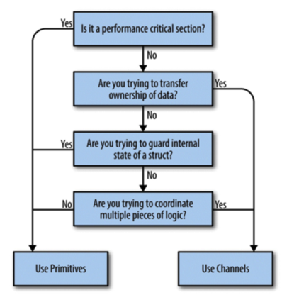
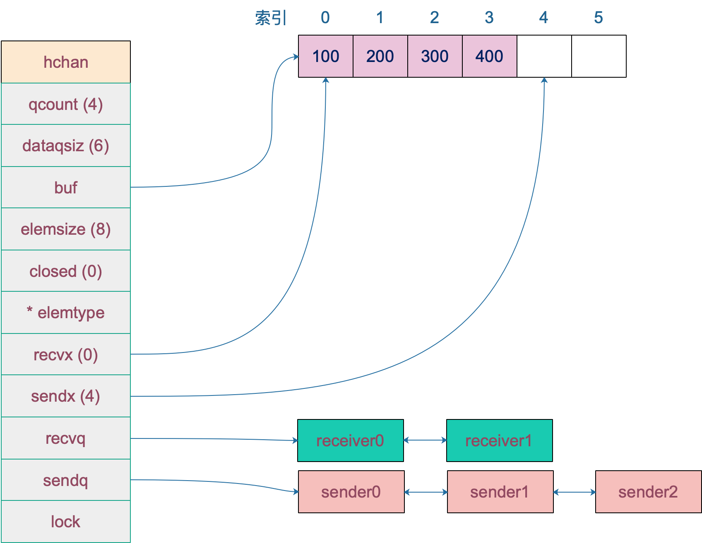
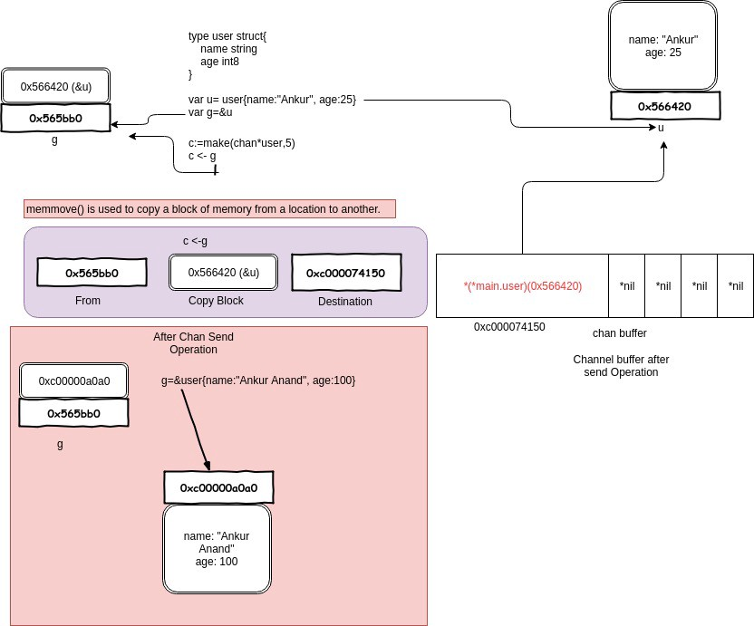

# channel

## channel 应用

Channel 和 goroutine 的结合是 Go 并发编程的大杀器。而 Channel 的实际应用也经常让人眼前一亮，通过与 select，cancel，timer 等结合，它能实现各种各样的功能。接下来，我们就要梳理一下 channel 的应用。

### 停止信号

前面一节如何优雅关闭 channel 那一节已经讲得很多了，这块就略过了。

channel 用于停止信号的场景还是挺多的，经常是关闭某个 channel 或者向 channel 发送一个元素，使得接收 channel 的那一方获知道此信息，进而做一些其他的操作。

### 任务定时

与 timer 结合，一般有两种玩法：实现超时控制，实现定期执行某个任务。

有时候，需要执行某项操作，但又不想它耗费太长时间，上一个定时器就可以搞定：

```
select {
	case <-time.After(100 * time.Millisecond):
	case <-s.stopc:
		return false
}
```

等待 100 ms 后，如果 s.stopc 还没有读出数据或者被关闭，就直接结束。这是来自 etcd 源码里的一个例子，这样的写法随处可见。

定时执行某个任务，也比较简单：

```
func worker() {
	ticker := time.Tick(1 * time.Second)
	for {
		select {
		case <- ticker:
			// 执行定时任务
			fmt.Println("执行 1s 定时任务")
		}
	}
}
```

每隔 1 秒种，执行一次定时任务。

### 解耦生产方和消费方

服务启动时，启动 n 个 worker，作为工作协程池，这些协程工作在一个 for {} 无限循环里，从某个 channel 消费工作任务并执行：

```
func main() {
	taskCh := make(chan int, 100)
	go worker(taskCh)

    // 塞任务
	for i := 0; i < 10; i++ {
		taskCh <- i
	}

    // 等待 1 小时 
	select {
	case <-time.After(time.Hour):
	}
}

func worker(taskCh <-chan int) {
	const N = 5
	// 启动 5 个工作协程
	for i := 0; i < N; i++ {
		go func(id int) {
			for {
				task := <- taskCh
				fmt.Printf("finish task: %d by worker %d\n", task, id)
				time.Sleep(time.Second)
			}
		}(i)
	}
}
```

5 个工作协程在不断地从工作队列里取任务，生产方只管往 channel 发送任务即可，解耦生产方和消费方。

程序输出：

```
finish task: 1 by worker 4
finish task: 2 by worker 2
finish task: 4 by worker 3
finish task: 3 by worker 1
finish task: 0 by worker 0
finish task: 6 by worker 0
finish task: 8 by worker 3
finish task: 9 by worker 1
finish task: 7 by worker 4
finish task: 5 by worker 2
```

### 控制并发数

有时需要定时执行几百个任务，例如每天定时按城市来执行一些离线计算的任务。但是并发数又不能太高，因为任务执行过程依赖第三方的一些资源，对请求的速率有限制。这时就可以通过 channel 来控制并发数。

下面的例子来自《Go 语言高级编程》：

```
var limit = make(chan int, 3)

func main() {
    // …………
    for _, w := range work {
        go func() {
            limit <- 1
            w()
            <-limit
        }()
    }
    // …………
}
```

构建一个缓冲型的 channel，容量为 3。接着遍历任务列表，每个任务启动一个 goroutine 去完成。真正执行任务，访问第三方的动作在 w() 中完成，在执行 w() 之前，先要从 limit 中拿“许可证”，拿到许可证之后，才能执行 w()，并且在执行完任务，要将“许可证”归还。这样就可以控制同时运行的 goroutine 数。

## overview

channel和Mutex的选择：



通过 channel，Go 实现了通过通信来实现内存共享。Channel 是在多个 goroutine 之间传递数据和同步的重要手段。

使用原子函数、读写锁可以保证资源的共享访问安全，但使用 channel 更优雅。

Channel 字面意义是“通道”，类似于 Linux 中的管道。声明 channel 的语法如下：

```
chan T // 声明一个双向通道
chan<- T // 声明一个只能用于发送的通道
<-chan T // 声明一个只能用于接收的通道
```

单向通道的声明，用 <- 来表示，它指明通道的方向。你只要明白，代码的书写顺序是从左到右就马上能掌握通道的方向是怎样的。

因为 channel 是一个引用类型，所以在它被初始化之前，它的值是 nil，channel 使用 make 函数进行初始化。可以向它传递一个 int 值，代表 channel 缓冲区的大小（容量），构造出来的是一个缓冲型的 channel；不传或传 0 的，构造的就是一个非缓冲型的 channel。

两者有一些差别：非缓冲型 channel 无法缓冲元素，对它的操作一定顺序是“发送-> 接收 -> 发送 -> 接收 -> ……”，如果想连续向一个非缓冲 chan 发送 2 个元素，并且没有接收的话，第一次一定会被阻塞；对于缓冲型 channel 的操作，则要“宽松”一些。

## channel 实现原理

对 chan 的发送和接收操作都会在编译期间转换成为底层的发送接收函数。

Channel 分为两种：带缓冲、不带缓冲。对不带缓冲的 channel 进行的操作实际上可以看作“同步模式”，带缓冲的则称为“异步模式”。

同步模式下，发送方和接收方要同步就绪，只有在两者都 ready 的情况下，数据才能在两者间传输（后面会看到，实际上就是内存拷贝）。否则，任意一方先行进行发送或接收操作，都会被挂起，等待另一方的出现才能被唤醒。

异步模式下，在缓冲槽可用的情况下（有剩余容量），发送和接收操作都可以顺利进行。否则，操作的一方（如写入）同样会被挂起，直到出现相反操作（如接收）才会被唤醒。

### 数据结构

```
type hchan struct {
	// chan 里元素数量
	qcount   uint
	// chan 底层循环数组的长度
	dataqsiz uint
	// 指向底层循环数组的指针
	// 只针对有缓冲的 channel
	buf      unsafe.Pointer
	// chan 中元素大小
	elemsize uint16
	// chan 是否被关闭的标志
	closed   uint32
	// chan 中元素类型
	elemtype *_type // element type
	// 已发送元素在循环数组中的索引
	sendx    uint   // send index
	// 已接收元素在循环数组中的索引
	recvx    uint   // receive index
	// 等待接收的 goroutine 队列
	recvq    waitq  // list of recv waiters
	// 等待发送的 goroutine 队列
	sendq    waitq  // list of send waiters

	// 保护 hchan 中所有字段
	lock mutex
}

type waitq struct {
	first *sudog
	last  *sudog
}
```

关于字段的含义都写在注释里了，再来重点说几个字段：

buf 指向底层循环数组，只有缓冲型的 channel 才有。

sendx，recvx 均指向底层循环数组，表示当前可以发送和接收的元素位置索引值（相对于底层数组）。

sendq，recvq 分别表示被阻塞的 goroutine，这些 goroutine 由于尝试读取 channel 或向 channel 发送数据而被阻塞。

waitq 是 sudog 的一个双向链表，而 sudog 实际上是对 goroutine 的一个封装。

lock 用来保证每个读 channel 或写 channel 的操作都是原子的。

例如，创建一个容量为 6 的，元素为 int 型的 channel 数据结构如下 ：

[](https://user-images.githubusercontent.com/7698088/61179068-806ee080-a62d-11e9-818c-16af42025b1b.png)

### 创建

我们知道，通道有两个方向，发送和接收。理论上来说，我们可以创建一个只发送或只接收的通道，但是这种通道创建出来后，怎么使用呢？一个只能发的通道，怎么接收呢？同样，一个只能收的通道，如何向其发送数据呢？

一般而言，使用 make 创建一个能收能发的通道：

```
// 无缓冲通道
ch1 := make(chan int)
// 有缓冲通道
ch2 := make(chan int, 10)
```

源代码：

```
const hchanSize = unsafe.Sizeof(hchan{}) + uintptr(-int(unsafe.Sizeof(hchan{}))&(maxAlign-1))

func makechan(t *chantype, size int64) *hchan {
	elem := t.elem

	// 省略了检查 channel size，align 的代码
	// ……

	var c *hchan
	// 如果元素类型不含指针 或者 size 大小为 0（无缓冲类型）
	// 只进行一次内存分配
	if elem.kind&kindNoPointers != 0 || size == 0 {
		// 如果 hchan 结构体中不含指针，GC 就不会扫描 chan 中的元素
		// 只分配 "hchan 结构体大小 + 元素大小*个数" 的内存
		c = (*hchan)(mallocgc(hchanSize+uintptr(size)*elem.size, nil, true))
		// 如果是缓冲型 channel 且元素大小不等于 0（大小等于 0的元素类型：struct{}）
		if size > 0 && elem.size != 0 {
			c.buf = add(unsafe.Pointer(c), hchanSize)
		} else {
			// race detector uses this location for synchronization
			// Also prevents us from pointing beyond the allocation (see issue 9401).
			// 1. 非缓冲型的，buf 没用，直接指向 chan 起始地址处
			// 2. 缓冲型的，能进入到这里，说明元素无指针且元素类型为 struct{}，也无影响
			// 因为只会用到接收和发送游标，不会真正拷贝东西到 c.buf 处（这会覆盖 chan的内容）
			c.buf = unsafe.Pointer(c)
		}
	} else {
		// 进行两次内存分配操作
		c = new(hchan)
		c.buf = newarray(elem, int(size))
	}
	c.elemsize = uint16(elem.size)
	c.elemtype = elem
	// 循环数组长度
	c.dataqsiz = uint(size)

	// 返回 hchan 指针
	return c
}
```

### 发送

使用 ch <- i 表达式向 Channel 发送数据时遇到的几种情况：

- 如果当前 Channel 的 recvq 上存在已经被阻塞的 Goroutine，那么会直接将数据发送给当前 Goroutine 并将其设置成下一个运行的 Goroutine；
- 如果 Channel 存在缓冲区并且其中还有空闲的容量，我们会直接将数据存储到缓冲区 sendx 所在的位置上；
- 如果不满足上面的两种情况，会创建一个 runtime.sudog 结构并将其加入 Channel 的 sendq 队列中，当前 Goroutine 也会陷入阻塞等待其他的协程从 Channel 接收数据；

发送数据的过程中包含几个会触发 Goroutine 调度的时机：

- 发送数据时发现 Channel 上存在等待接收数据的 Goroutine，立刻设置处理器的 runnext 属性，但是并不会立刻触发调度；
- 发送数据时并没有找到接收方并且缓冲区已经满了，这时会将自己加入 Channel 的 sendq 队列并调用 runtime.goparkunlock 触发 Goroutine 的调度让出处理器的使用权；

### 接收

从 Channel 中接收数据时可能会发生的五种情况：

- 如果 Channel 为空，那么会直接调用 runtime.gopark 挂起当前 Goroutine；
- 如果 Channel 已经关闭并且缓冲区没有任何数据，runtime.chanrecv 会直接返回；
- 如果 Channel 的 sendq 队列中存在挂起的 Goroutine，会将 recvx 索引所在的数据拷贝到接收变量所在的内存空间上，然后将 sendq 队列中 Goroutine 的数据拷贝到channel缓冲区，释放阻塞的go routine；
- 如果 Channel 的缓冲区中包含数据，那么直接读取 recvx 索引对应的数据；
- 在默认情况下会挂起当前的 Goroutine，将 runtime.sudog 结构加入 recvq 队列并陷入休眠等待调度器的唤醒；

会触发 Goroutine 调度的两个时机：

- 当 Channel 为空时；
- 当缓冲区中不存在数据并且也不存在数据的发送者时；

### 关闭

close 逻辑比较简单，对于一个 channel，recvq 和 sendq 中分别保存了阻塞的发送者和接收者。关闭 channel 后，对于等待接收者而言，会收到一个相应类型的零值。对于等待发送者，会直接 panic。所以，在不了解 channel 还有没有接收者的情况下，不能贸然关闭 channel。

close 函数先上一把大锁，接着把所有挂在这个 channel 上的 sender 和 receiver 全都连成一个 sudog 链表，再解锁。最后，再将所有的 sudog 全都唤醒。

唤醒之后，该干嘛干嘛。sender 会继续执行 chansend 函数里 goparkunlock 函数之后的代码，很不幸，检测到 channel 已经关闭了，panic。receiver 则比较幸运，进行一些扫尾工作后，返回。这里，selected 返回 true，而返回值 received 则要根据 channel 是否关闭，返回不同的值。如果 channel 关闭，received 为 false，否则为 true。这我们分析的这种情况下，received 返回 false。

## channel 进阶

总结一下操作 channel 的结果：

|   |   |   |   |
|---|---|---|---|
|**操作**|**nil channel**|**closed channel**|**not nil, not closed channel**|
|close|panic|panic|正常关闭|
|读 <- ch|阻塞|读到对应类型的零值|阻塞或正常读取数据。缓冲型 channel 为空或非缓冲型 channel 没有等待发送者时会阻塞|
|写 ch <-|阻塞|panic|阻塞或正常写入数据。非缓冲型 channel 没有等待接收者或缓冲型 channel buf 满时会被阻塞|

总结一下，发生 panic 的情况有三种：向一个关闭的 channel 进行写操作；关闭一个 nil 的 channel；重复关闭一个 channel。

读、写一个 nil channel 都会被阻塞。

### 发送和接收元素的本质

Remember all transfer of value on the go channels happens with the copy of value.

就是说 channel 的发送和接收操作本质上都是 “值的拷贝”，无论是从 sender goroutine 的栈到 chan buf，还是从 chan buf 到 receiver goroutine，或者是直接从 sender goroutine 到 receiver goroutine。

```
type user struct {
	name string
	age int8
}

var u = user{name: "Ankur", age: 25}
var g = &u

func modifyUser(pu *user) {
	fmt.Println("modifyUser Received Vaule", pu)
	pu.name = "Anand"
}

func printUser(u <-chan *user) {
	time.Sleep(2 * time.Second)
	fmt.Println("printUser goRoutine called", <-u)
}

func main() {
	c := make(chan *user, 5)
	c <- g
	fmt.Println(g)
	// modify g
	g = &user{name: "Ankur Anand", age: 100}
	go printUser(c)
	go modifyUser(g)
	time.Sleep(5 * time.Second)
	fmt.Println(g)
}
```

运行结果：

```
&{Ankur 25}
modifyUser Received Value &{Ankur Anand 100}
printUser goRoutine called &{Ankur 25}
&{Anand 100}
```

这里就是一个很好的 share memory by communicating 的例子。

[](https://user-images.githubusercontent.com/7698088/61191276-16ad1000-a6db-11e9-9729-cdea7744f002.png)

一开始构造一个结构体 u，地址是 0x56420，图中地址上方就是它的内容。接着把 &u 赋值给指针 g，g 的地址是 0x565bb0，它的内容就是一个地址，指向 u。

main 程序里，先把 g 发送到 c，根据 copy value 的本质，进入到 chan buf 里的就是 0x56420，它是指针 g 的值（不是它指向的内容），所以打印从 channel 接收到的元素时，它就是 &{Ankur 25}。因此，这里并不是将指针 g “发送” 到了 channel 里，只是拷贝它的值而已。

再强调一次：

Remember all transfer of value on the go channels happens with the copy of value.

### 资源泄漏

Channel 可能会引发 goroutine 泄漏。

泄漏的原因是 goroutine 操作 channel 后，处于发送或接收阻塞状态，而 channel 处于满或空的状态，一直得不到改变。同时，垃圾回收器也不会回收此类资源，进而导致 gouroutine 会一直处于等待队列中，不见天日。

### 如何优雅地关闭 channel

关于 channel 的使用，有几点不方便的地方：

1. 在不改变 channel 自身状态的情况下，无法获知一个 channel 是否关闭。
2. 关闭一个 closed channel 会导致 panic。所以，如果关闭 channel 的一方在不知道 channel 是否处于关闭状态时就去贸然关闭 channel 是很危险的事情。
3. 向一个 closed channel 发送数据会导致 panic。所以，如果向 channel 发送数据的一方不知道 channel 是否处于关闭状态时就去贸然向 channel 发送数据是很危险的事情。

根据 sender 和 receiver 的个数，分下面几种情况：

1. 一个 sender，一个 receiver
2. 一个 sender， M 个 receiver
3. N 个 sender，一个 reciver
4. N 个 sender， M 个 receiver

对于 1，2，只有一个 sender 的情况就不用说了，直接从 sender 端关闭就好了，没有问题。重点关注第 3，4 种情况。

第 3 种情形下，优雅关闭 channel 的方法是：the only receiver says “please stop sending more” by closing an additional signal channel。

解决方案就是增加一个传递关闭信号的 channel，receiver 通过信号 channel 下达关闭数据 channel 指令。senders 监听到关闭信号后，停止发送数据。我把代码修改地更简洁了：

```
func main() {
	rand.Seed(time.Now().UnixNano())

	const Max = 100000
	const NumSenders = 1000

	dataCh := make(chan int, 100)
	stopCh := make(chan struct{})

	// senders
	for i := 0; i < NumSenders; i++ {
		go func() {
			for {
				select {
				case <- stopCh:
					return
				case dataCh <- rand.Intn(Max):
				}
			}
		}()
	}

	// the receiver
	go func() {
		for value := range dataCh {
			if value == Max-1 {
				fmt.Println("send stop signal to senders.")
				close(stopCh)
				return
			}

			fmt.Println(value)
		}
	}()

	select {
	case <- time.After(time.Hour):
	}
}
```

这里的 stopCh 就是信号 channel，它本身只有一个 sender，因此可以直接关闭它。senders 收到了关闭信号后，select 分支 “case <- stopCh” 被选中，退出函数，不再发送数据。

需要说明的是，上面的代码并没有明确关闭 dataCh。在 Go 语言中，对于一个 channel，如果最终没有任何 goroutine 引用它，不管 channel 有没有被关闭，最终都会被 gc 回收。所以，在这种情形下，所谓的优雅地关闭 channel 就是不关闭 channel，让 gc 代劳。

最后一种情况，优雅关闭 channel 的方法是：any one of them says “let’s end the game” by notifying a moderator to close an additional signal channel。

和第 3 种情况不同，这里有 M 个 receiver，如果直接还是采取第 3 种解决方案，由 receiver 直接关闭 stopCh 的话，就会重复关闭一个 channel，导致 panic。因此需要增加一个中间人，M 个 receiver 都向它发送关闭 dataCh 的“请求”，中间人收到第一个请求后，就会直接下达关闭 dataCh 的指令（通过关闭 stopCh，这时就不会发生重复关闭的情况，因为 stopCh 的发送方只有中间人一个）。另外，这里的 N 个 sender 也可以向中间人发送关闭 dataCh 的请求。

```
func main() {
	rand.Seed(time.Now().UnixNano())

	const Max = 100000
	const NumReceivers = 10
	const NumSenders = 1000

	dataCh := make(chan int, 100)
	stopCh := make(chan struct{})

	// It must be a buffered channel.
	toStop := make(chan string, 1)

	var stoppedBy string

	// moderator
	go func() {
		stoppedBy = <-toStop
		close(stopCh)
	}()

	// senders
	for i := 0; i < NumSenders; i++ {
		go func(id string) {
			for {
				value := rand.Intn(Max)
				if value == 0 {
					select {
					case toStop <- "sender#" + id:
					default:
					}
					return
				}

				select {
				case <- stopCh:
					return
				case dataCh <- value:
				}
			}
		}(strconv.Itoa(i))
	}

	// receivers
	for i := 0; i < NumReceivers; i++ {
		go func(id string) {
			for {
				select {
				case <- stopCh:
					return
				case value := <-dataCh:
					if value == Max-1 {
						select {
						case toStop <- "receiver#" + id:
						default:
						}
						return
					}

					fmt.Println(value)
				}
			}
		}(strconv.Itoa(i))
	}

	select {
	case <- time.After(time.Hour):
	}

}
```

代码里 toStop 就是中间人的角色，使用它来接收 senders 和 receivers 发送过来的关闭 dataCh 请求。

这里将 toStop 声明成了一个 缓冲型的 channel。假设 toStop 声明的是一个非缓冲型的 channel，那么第一个发送的关闭 dataCh 请求可能会丢失。因为无论是 sender 还是 receiver 都是通过 select 语句来发送请求，如果中间人所在的 goroutine 没有准备好，那 select 语句就不会选中，直接走 default 选项，什么也不做。这样，第一个关闭 dataCh 的请求就会丢失。

如果，我们把 toStop 的容量声明成 Num(senders) + Num(receivers)，那发送 dataCh 请求的部分可以改成更简洁的形式：

```
...
toStop := make(chan string, NumReceivers + NumSenders)
...
			value := rand.Intn(Max)
			if value == 0 {
				toStop <- "sender#" + id
				return
			}
...
				if value == Max-1 {
					toStop <- "receiver#" + id
					return
				}
...
```

直接向 toStop 发送请求，因为 toStop 容量足够大，所以不用担心阻塞，自然也就不用 select 语句再加一个 default case 来避免阻塞。

可以看到，这里同样没有真正关闭 dataCh，原样同第 3 种情况。

以上，就是最基本的一些情形，但已经能覆盖几乎所有的情况及其变种了。只要记住：

don’t close a channel from the receiver side and don’t close a channel if the channel has multiple concurrent senders.

以及更本质的原则：

don’t close (or send values to) closed channels.

### 关闭的 channel 仍能读出数据

从一个有缓冲的 channel 里读数据，当 channel 被关闭，依然能读出有效值。只有当返回的 ok 为 false 时，读出的数据才是无效的。

```
func main() {
	ch := make(chan int, 5)
	ch <- 18
	close(ch)
	x, ok := <-ch
	if ok {
		fmt.Println("received: ", x)
	}

	x, ok = <-ch
	if !ok {
		fmt.Println("channel closed, data invalid.")
	}
}
```

运行结果：

```
received:  18
channel closed, data invalid.
```

先创建了一个有缓冲的 channel，向其发送一个元素，然后关闭此 channel。之后两次尝试从 channel 中读取数据，第一次仍然能正常读出值。第二次返回的 ok 为 false，说明 channel 已关闭，且通道里没有数据。
