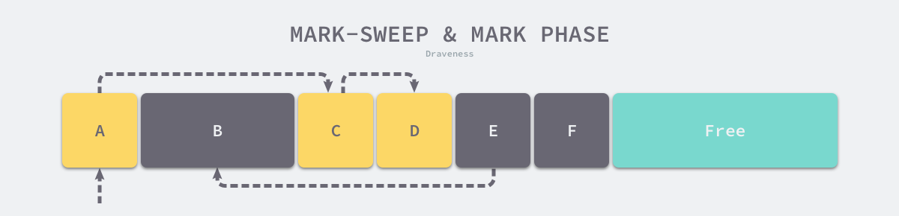
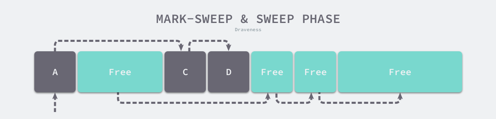
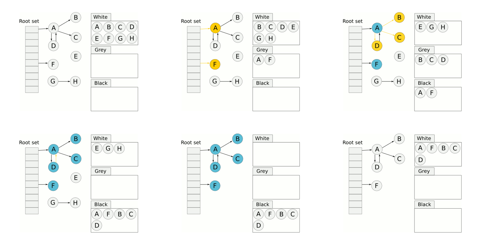
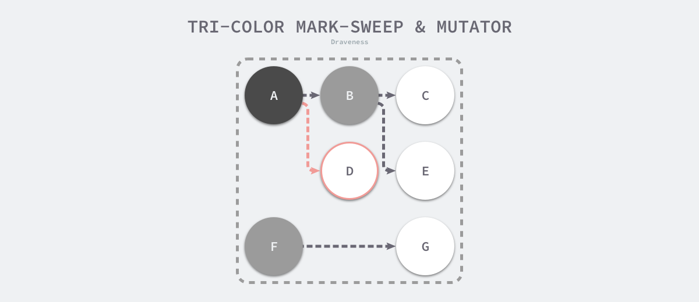
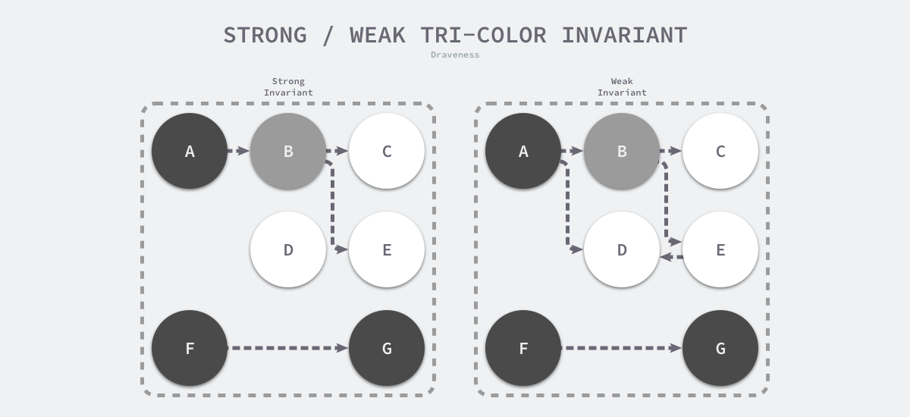
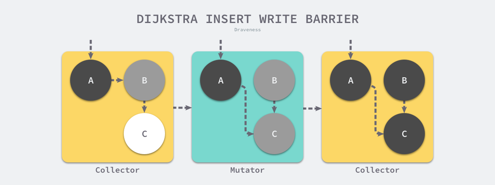
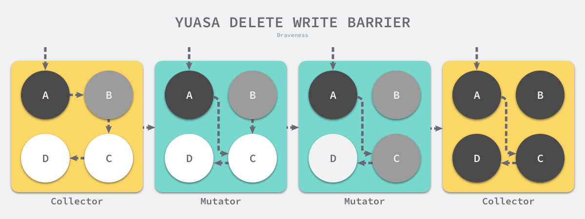
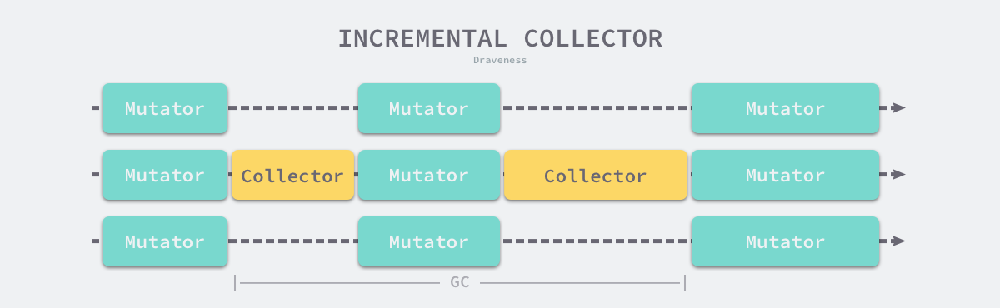
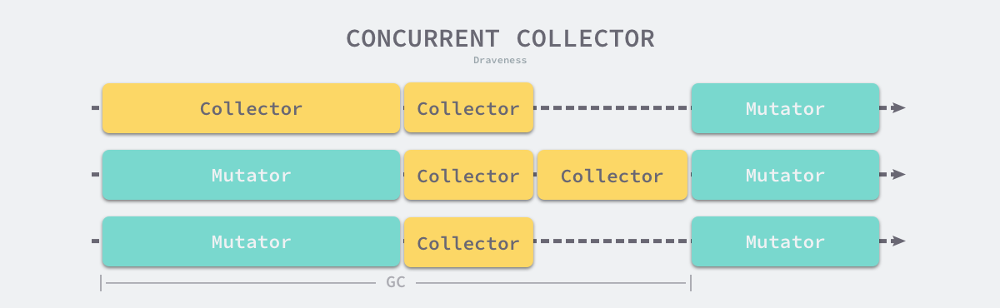

# 垃圾标记方法

- 引用计数法：需要额外机制解决循环引用问题
- 可达性分析（Java、Go采用）

# 标记清除算法

标记清除（Mark-Sweep）算法是最常见的垃圾收集算法，标记清除收集器是跟踪式垃圾收集器，其执行过程可以分成标记（Mark）和清除（Sweep）两个阶段：

1. 标记阶段 — 从根对象出发查找并标记堆中所有存活的对象；
2. 清除阶段 — 遍历堆中的全部对象，回收未被标记的垃圾对象并将回收的内存加入空闲链表；

如下图所示，内存空间中包含多个对象，我们从根对象出发依次遍历对象的子对象并将从根节点可达的对象都标记成存活状态，即 A、C 和 D 三个对象，剩余的 B、E 和 F 三个对象因为从根节点不可达，所以会被当做垃圾：



标记阶段结束后会进入清除阶段，在该阶段中收集器会依次遍历堆中的所有对象，释放其中没有被标记的 B、E 和 F 三个对象并将新的空闲内存空间以链表的结构串联起来，方便内存分配器的使用。



# 三色标记过程

为了解决原始标记清除算法带来的长时间 STW，多数现代的追踪式垃圾收集器都会实现三色标记算法的变种以缩短 STW 的时间。

- 所有对象最初都是白色
- 将所有初始的可达对象，即全局对象或者栈对象(root集合)，标记为灰色。
- 任意取出一个灰色对象，将所有它引用到的白色对象标记为灰色，然后将它自身标记为黑色。
- 重复上一步，直到找不到灰色对象。
- 剩下的对象不是白色就是黑色。
- 所有黑色对象都是可达的，而白色对象是不可达的。回收掉白色对象。



# 屏障

由于用户程序可能在标记执行的过程中修改对象的指针，所以三色标记清除算法本身是不可以并发或者增量执行的，它仍然需要 STW。

在如下所示的三色标记过程中，用户程序建立了从 A 对象到 D 对象的引用，但是因为程序中已经不存在能访问到D的灰色对象了，所以 D 对象会被垃圾收集器错误地回收。



为了支持并发或者增量地标记对象，需要引入屏障技术。

想要在并发或者增量的标记算法中保证正确性，我们需要达成以下两种三色不变性（Tri-color invariant）中的一种：

- 强三色不变性 — 黑色对象不会指向白色对象，只会指向灰色对象或者黑色对象；
- 弱三色不变性 — 黑色对象指向的白色对象必须包含至少一条从灰色对象经由多个白色对象的可达路径。



Go 语言中使用的两种写屏障技术，分别是 Dijkstra 提出的插入写屏障和 Yuasa 提出的删除写屏障，这里会分析它们如何保证三色不变性和垃圾收集器的正确性。

## 插入写屏障

Dijkstra 在 1978 年提出了插入写屏障，通过如下所示的写屏障，用户程序和垃圾收集器可以在交替工作的情况下保证程序执行的正确性：

每当执行类似 *slot = ptr 的表达式时，我们会执行上述写屏障通过 shade 函数尝试改变指针的颜色。如果 ptr 指针是白色的，那么该函数会将该对象设置成灰色，其他情况则保持不变。

```
writePointer(slot, ptr):
    shade(ptr)
    *slot = ptr
```



假设我们在应用程序中使用 Dijkstra 提出的插入写屏障，在一个垃圾收集器和用户程序交替运行的场景中会出现如上图所示的标记过程：

1. 垃圾收集器将根对象指向 A 对象标记成黑色并将 A 对象指向的对象 B 标记成灰色；
2. 用户程序修改 A 对象的指针，将原本指向 B 对象的指针指向 C 对象，这时触发写屏障将 C 对象标记成灰色；
3. 垃圾收集器依次遍历程序中的其他灰色对象，将它们分别标记成黑色；

Dijkstra 的插入写屏障是一种相对保守的屏障技术，它会将**有存活可能的对象都标记成灰色**以满足强三色不变性。在如上所示的垃圾收集过程中，实际上不再存活的 B 对象最后没有被回收；而如果我们在第二和第三步之间将指向 C 对象的指针改回指向 B，垃圾收集器仍然认为 C 对象是存活的，这些被错误标记的垃圾对象只有在下一个循环才会被回收。

插入式的 Dijkstra 写屏障虽然实现非常简单并且也能保证强三色不变性，但是它也有明显的缺点。因为栈上的对象在垃圾收集中也会被认为是根对象，所以为了保证内存的安全，Dijkstra 必须为栈上的对象增加写屏障或者在标记阶段完成重新对栈上的对象进行扫描，这两种方法各有各的缺点，前者会大幅度增加写入指针的额外开销，后者重新扫描栈对象时需要暂停程序，垃圾收集算法的设计者需要在这两者之间做出权衡。

## 删除写屏障

在老对象的引用被删除时，将白色的老对象涂成灰色，这样删除写屏障就可以保证弱三色不变性，老对象引用的下游对象一定可以被灰色对象引用。

```
writePointer(slot, ptr)
    shade(*slot)
    *slot = ptr
```



假设我们在应用程序中使用 Yuasa 提出的删除写屏障，在一个垃圾收集器和用户程序交替运行的场景中会出现如上图所示的标记过程：

垃圾收集器将根对象指向 A 对象标记成黑色并将 A 对象指向的对象 B 标记成灰色；

- 用户程序将 A 对象原本指向 B 的指针指向 C，触发删除写屏障，但是因为 B 对象已经是灰色的，所以不做改变；
- 用户程序将 B 对象原本指向 C 的指针删除，触发删除写屏障，白色的 C 对象被涂成灰色；
- 垃圾收集器依次遍历程序中的其他灰色对象，将它们分别标记成黑色；

# 增量与并发

现代垃圾收集器的优化策略：

- 增量垃圾收集 — 增量地标记和清除垃圾，降低应用程序暂停的最长时间；
- 并发垃圾收集 — 利用多核的计算资源，在用户程序执行时并发标记和清除垃圾；

因为增量和并发两种方式都可以与用户程序交替运行，所以我们需要使用屏障技术保证垃圾收集的正确性；与此同时，应用程序也不能等到内存溢出时触发垃圾收集，因为当内存不足时，应用程序已经无法分配内存，这与直接暂停程序没有什么区别，增量和并发的垃圾收集需要提前触发并在内存不足前完成整个循环，避免程序的长时间暂停。

## 增量收集器

增量式（Incremental）的垃圾收集是减少程序最长暂停时间的一种方案，它可以将原本时间较长的暂停时间切分成多个更小的 GC 时间片，虽然从垃圾收集开始到结束的时间更长了，但是这也减少了应用程序暂停的最大时间：



需要注意的是，增量式的垃圾收集需要与三色标记法一起使用，为了保证垃圾收集的正确性，我们需要在垃圾收集开始前打开写屏障，这样用户程序修改内存都会先经过写屏障的处理，保证了堆内存中对象关系的强三色不变性或者弱三色不变性。虽然增量式的垃圾收集能够减少最大的程序暂停时间，但是增量式收集也会增加一次 GC 循环的总时间，在垃圾收集期间，因为写屏障的影响用户程序也需要承担额外的计算开销，所以增量式的垃圾收集也不是只带来好处的，但是总体来说还是利大于弊。

## 并发收集器

并发（Concurrent）的垃圾收集不仅能够减少程序的最长暂停时间，还能减少整个垃圾收集阶段的时间，通过开启读写屏障、**利用多核优势与用户程序并行执行**，并发垃圾收集器确实能够减少垃圾收集对应用程序的影响：



虽然并发收集器能够与用户程序一起运行，但是并不是所有阶段都可以与用户程序一起运行，部分阶段还是需要暂停用户程序的，不过与传统的算法相比，并发的垃圾收集可以将能够并发执行的工作尽量并发执行；当然，因为读写屏障的引入，并发的垃圾收集器也一定会带来额外开销，不仅会增加垃圾收集的总时间，还会影响用户程序，这是我们在设计垃圾收集策略时必须要注意的。

# gc的时机

- 在为对象分配堆内存时（前面讲的mheap申请内存时），检查垃圾回收触发条件（根据当前与上次的heap size的比例来决定，默认情况下是GOGC=100，即内存新增一倍就会触发）
- 监控进程每隔一段时间（2min）检查一次垃圾回收状态，如果长时间没有执行过（2min），则强制触发gc
- 用户手动调用（ runtime.GC()）

# 垃圾回收阶段

1. 清理终止阶段；

1. **暂停程序**，所有的处理器在这时会进入安全点（Safe point）；
2. 如果当前垃圾收集循环是强制触发的，我们还需要处理还未被清理的内存管理单元；

2. 标记阶段；

1. 将状态切换至 _GCmark、开启写屏障、用户程序协助（Mutator Assists）并将根对象入队；
2. 恢复执行程序，标记进程和用于协助的用户程序会开始并发标记内存中的对象，写屏障会将被覆盖的指针和新指针都标记成灰色，而所有新创建的对象都会被直接标记成黑色；
3. 开始扫描根对象，包括所有 Goroutine 的栈、全局对象以及不在堆中的运行时数据结构，扫描 Goroutine 栈期间会暂停当前处理器；
4. 依次处理灰色队列中的对象，将对象标记成黑色并将它们指向的对象标记成灰色；
5. 使用分布式的终止算法检查剩余的工作，发现标记阶段完成后进入标记终止阶段；

3. 标记终止阶段；

1. **暂停程序**、将状态切换至 _GCmarktermination 并关闭辅助标记的用户程序；
2. 清理处理器上的线程缓存；

4. 清理阶段；

1. 将状态切换至 _GCoff 开始清理阶段，初始化清理状态并关闭写屏障；
2. 恢复用户程序，所有新创建的对象会标记成白色；
3. 后台并发清理所有的内存管理单元，当 Goroutine 申请新的内存管理单元时就会触发清理；
