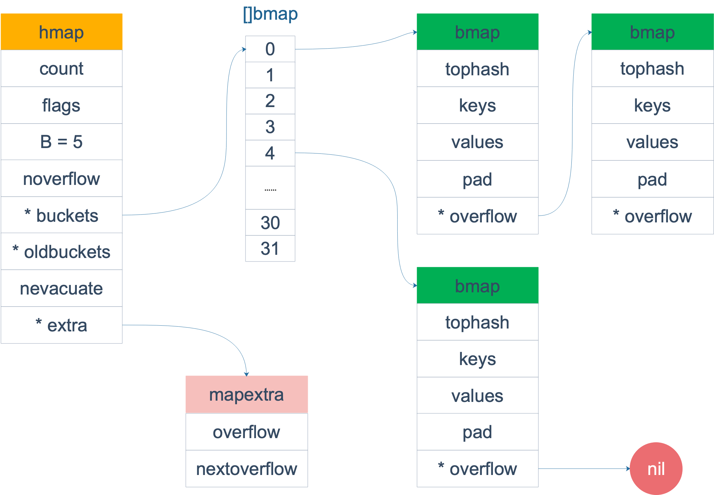
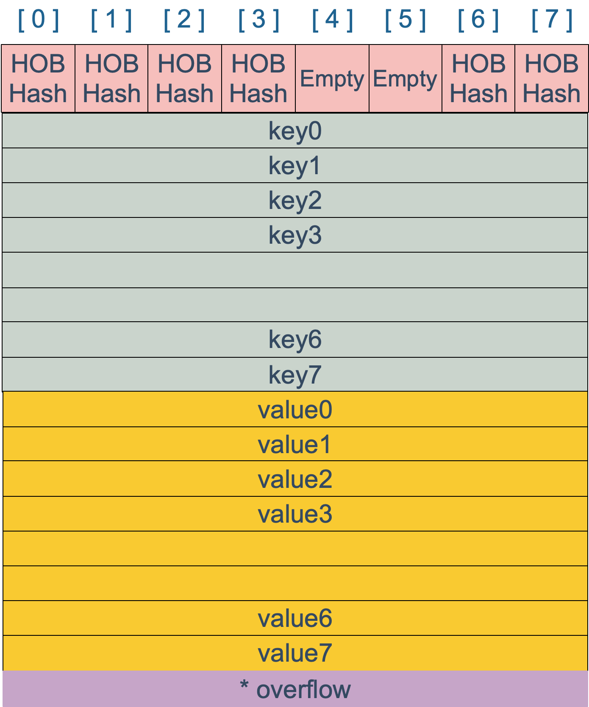
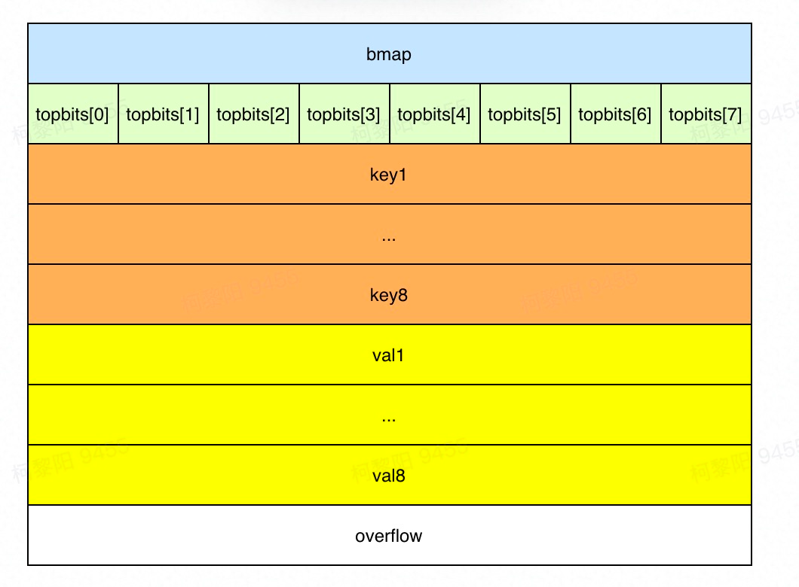

# 什么是 map

有两个关键点：map 是由 key-value 对组成的；key 只会出现一次。

和 map 相关的操作主要是：

1. 增加一个 k-v 对 —— Add or insert；
2. 删除一个 k-v 对 —— Remove or delete；
3. 修改某个 k 对应的 v —— Reassign；
4. 查询某个 k 对应的 v —— Lookup；

简单说就是最基本的 增删查改。

map 的设计也被称为 “The dictionary problem”，它的任务是设计一种数据结构用来维护一个集合的数据，并且可以同时对集合进行增删查改的操作。最主要的数据结构有两种：哈希查找表（Hash table）、搜索树（Search tree）。

哈希查找表用一个哈希函数将 key 分配到不同的桶（bucket，也就是数组的不同 index）。这样，开销主要在哈希函数的计算以及数组的常数访问时间。在很多场景下，哈希查找表的性能很高。

哈希查找表一般会存在“碰撞”的问题，就是说不同的 key 被哈希到了同一个 bucket。一般有两种应对方法：链表法和开放地址法。链表法将一个 bucket 实现成一个链表，落在同一个 bucket 中的 key 都会插入这个链表。开放地址法则是碰撞发生后，通过一定的规律，在数组的后面挑选“空位”，用来放置新的 key。

# map 内存模型

在源码中，表示 map 的结构体是 hmap，它是 hashmap 的“缩写”：

```
// 位于runtime/map.go

type hmap struct {

	// 键值对的数量
	count int
	// 标记当前是否有协程在写，或遍历
	flags uint8
	// 桶数组长度 = 2 ^ B。当n=3时，桶数组长度=8
	B uint8
    
	noverflow uint16
	// hash种子，新建map时生成
	hash0 uint32
	// 指向桶数组
	buckets unsafe.Pointer
	// 指向老桶数组，扩容时用
	oldbuckets unsafe.Pointer
	// 搬迁的桶个数，扩容时用
	nevacuate uintptr

	extra *mapextra // optional fields

}
```

B 是 buckets 数组的长度的对数，也就是说 buckets 数组的长度就是 2^B。bucket 里面存储了 key 和 value。

buckets 是一个指针，最终它指向的是一个结构体：

```
type bmap struct {
	tophash [bucketCnt]uint8
}
```

但这只是表面(src/runtime/hashmap.go)的结构，编译期间会给它加料，动态地创建一个新的结构：

```
type bmap struct {
    topbits  [8]uint8
    keys     [8]keytype
    values   [8]valuetype
    pad      uintptr
    overflow uintptr
}
```

bmap 就是我们常说的“桶”，桶里面会最多装 8 个 key，这些 key 之所以会落入同一个桶，是因为它们经过哈希计算后，哈希结果是“一类”的。在桶内，又会根据 key 计算出来的 hash 值的高 8 位来决定 key 到底落入桶内的哪个位置（一个桶内最多有8个位置）。

整体图：

[](https://user-images.githubusercontent.com/7698088/57576986-acd87600-749f-11e9-8710-75e423c7efdb.png)

当 map 的 key 和 value 都不是指针，并且 size 都小于 128 字节的情况下，会把 bmap 标记为不含指针，这样可以避免 gc 时扫描整个 hmap。但是，我们看 bmap 其实有一个 overflow 的字段，是指针类型的，破坏了 bmap 不含指针的设想，这时会把 overflow 移动到 extra 字段来。

```
// mapextra holds fields that are not present on all maps.
type mapextra struct {
	// If both key and elem do not contain pointers and are inline, then we mark bucket
	// type as containing no pointers. This avoids scanning such maps.
	// However, bmap.overflow is a pointer. In order to keep overflow buckets
	// alive, we store pointers to all overflow buckets in hmap.extra.overflow and hmap.extra.oldoverflow.
	// overflow and oldoverflow are only used if key and elem do not contain pointers.
	// overflow contains overflow buckets for hmap.buckets.
	// oldoverflow contains overflow buckets for hmap.oldbuckets.
	// The indirection allows to store a pointer to the slice in hiter.
	overflow    *[]*bmap
	oldoverflow *[]*bmap

	// nextOverflow holds a pointer to a free overflow bucket.
	nextOverflow *bmap
}
```

bmap 是存放 k-v 的地方，我们把视角拉近，仔细看 bmap 的内部组成。

[](https://user-images.githubusercontent.com/7698088/57577391-f88f1d80-74a7-11e9-893c-4783dc4fb35e.png)

上图就是 bucket 的内存模型，HOB Hash 指的就是 top hash。 注意到 key 和 value 是各自放在一起的，并不是 key/value/key/value/... 这样的形式。源码里说明这样的好处是在某些情况下可以省略掉 padding 字段，节省内存空间。

例如，有这样一个类型的 map：

```
map[int64]int8
```

如果按照 key/value/key/value/... 这样的模式存储，那在每一个 key/value 对之后都要额外 padding 7 个字节；而将所有的 key，value 分别绑定到一起，这种形式 key/key/.../value/value/...，则只需要在最后添加 padding。

每个 bucket 设计成最多只能放 8 个 key-value 对，如果有第 9 个 key-value 落入当前的 bucket，那就需要再构建一个 bucket ，通过 overflow 指针连接起来。

# 创建map

从语法层面上来说，创建 map 很简单：

```
ageMp := make(map[string]int)
// 指定 map 长度
ageMp := make(map[string]int, 8)

// ageMp 为 nil，不能向其添加元素，会直接panic
var ageMp map[string]int
```

通过汇编语言可以看到，实际上底层调用的是 makemap 函数，主要做的工作就是初始化 hmap 结构体的各种字段，例如计算 B 的大小，设置哈希种子 hash0 等等。

```
func makemap(t *maptype, hint int64, h *hmap, bucket unsafe.Pointer) *hmap {
	// 省略各种条件检查...

	// 找到一个 B，使得 map 的装载因子在正常范围内
	B := uint8(0)
	for ; overLoadFactor(hint, B); B++ {
	}

	// 初始化 hash table
	// 如果 B 等于 0，那么 buckets 就会在赋值的时候再分配
	// 如果长度比较大，分配内存会花费长一点
	buckets := bucket
	var extra *mapextra
	if B != 0 {
		var nextOverflow *bmap
		buckets, nextOverflow = makeBucketArray(t, B)
		if nextOverflow != nil {
			extra = new(mapextra)
			extra.nextOverflow = nextOverflow
		}
	}

	// 初始化 hamp
	if h == nil {
		h = (*hmap)(newobject(t.hmap))
	}
	h.count = 0
	h.B = B
	h.extra = extra
	h.flags = 0
	h.hash0 = fastrand()
	h.buckets = buckets
	h.oldbuckets = nil
	h.nevacuate = 0
	h.noverflow = 0

	return h
}

// overLoadFactor reports whether count items placed in 1<<B buckets is over loadFactor.
// bucketCnt = 8
// if count < 8, B会设置为0
func overLoadFactor(count int, B uint8) bool {
	return count > bucketCnt && uintptr(count) > loadFactorNum*(bucketShift(B)/loadFactorDen)
}
```

注意，这个函数返回的结果：*hmap，它是一个指针，而我们之前讲过的 makeslice 函数返回的是 Slice 结构体：

```
func makeslice(et *_type, len, cap int) slice
```

回顾一下 slice 的结构体定义：

```
// runtime/slice.go
type slice struct {
    array unsafe.Pointer // 元素指针
    len   int // 长度 
    cap   int // 容量
}
```

结构体内部包含底层的数据指针。

makemap 和 makeslice 的区别，带来一个不同点：当 map 和 slice 作为函数参数时，在函数参数内部对 map 的操作会影响 map 自身；而对 slice 却不会（之前讲 slice 的文章里有讲过）。

主要原因：一个是指针（*hmap），一个是结构体（slice）。Go 语言中的函数传参都是值传递，在函数内部，参数会被 copy 到本地。*hmap指针 copy 完之后，仍然指向同一个 map，因此函数内部对 map 的操作会影响实参。而 slice 被 copy 后，会成为一个新的 slice，对它进行的操作不会影响到实参。

# 定位key

根据key获取value，或者存储key,vlaue对都需先在在哈希表中定位key，然后返回value或将value存储到相应的位置，其流程如下：

1. 计算hash(key)，每种类型的哈希方法由系统初始化， string类型的key哈希函数为strhash，底层调用memhash，详见runtime/alg.go

假设生成的hash值如下（64位机器生成的hash值为64位）：

`11011010 | 0001010011101000111001101110111010011100111111010011 | 1010`

2. 根据哈希值定位应该在哪个桶

假设B=4，桶的数量为`2^4 = 16`，则hash值最后4位用来定位key应该在哪个桶，本应该是

`hash % len（buckets）`其等价于`（len（buckets）- 1）&（hash后4位）`,由于取余操作不如位运算操作快，因此一般采用后一种方式，本例定位到10号桶

3. 定位槽

当定位到在哪个桶后，需要进一步定位key在桶中哪个槽，一般的方式为挨个遍历比较，但go map为bucket中每个key生成了一个tophash，取值为hash值前8位。由于每个key的tophash大概率不同，因此可以先和tophash的每个值比较，若不等，则key一定不在该槽，若相等，则大概率在，但还需要进一步调用equal() 方法验证。比较整数比比较其他类型速度更快，因此可快速排除不相等的key，提高搜索key的性能

整体布局如下所示：



当tophash相等后，因为key，value皆以数组的方式存放，可根据其在topbits的下标直接通过内存地址计算出key，value的地址进行定位和后续操作。

gin使用的路由框架[httprouter](https://github.com/julienschmidt/httprouter)也使用了类似的思想，当我们定义路由时，httprouter将其组织成压缩字典树的形式，从上到下保存每个节点的信息

例如 /api/order/get , 由3个节点分别保存 api，order，get，代表每级路由关系，若api下有多个路径，则api节点的子节点有多个，此时请求进入服务，需要挨个匹配路径。

httprouter在每个节点用indices存放了所有子节点的首字母，因此大多数情况下可以只比较一个字母进入下一级。

4. 下一个桶

当前桶遍历完没有key时，若bmap.overflow不为空，需要继续寻找溢出桶，定位方式和之前一样

用到溢出桶，需要一个桶8位塞满8个元素，这在其他语言发生概率较低，比如java的hashmap，默认装置因子0.75表示平均一个桶有0.75个元素就要发生扩容，但go map的扩容条件比较苛刻，装载因子为6.5，因此有一定的概率使用溢出桶

我们以代码val,ok := map[key]实际调用的方法mapaccess2() 来看看key定位流程，以下省略了一些无关代码，因此十分简短易懂。

```
func mapaccess2(t *maptype, h *hmap, key unsafe.Pointer) (unsafe.Pointer, bool) {
	// 不能同时读写
	if h.flags&hashWriting != 0 {
		throw("concurrent map read and map write")
	}

	// 获取计算key哈希的方法，每种类型的哈希方法由系统初始化，详见runtime/alg.go
	alg := t.key.alg

	// 计算hash值
	hash := alg.hash(key, uintptr(h.hash0))

	// 计算掩码
	m := bucketMask(h.B)

	// 定位在哪个bucket
	b := (*bmap)(unsafe.Pointer(uintptr(h.buckets) + (hash&m)*uintptr(t.bucketsize)))

	// 计算tophash，关于tophash下面说明
	top := tophash(hash)
    
bucketloop:
	// 遍历bucket
	for ; b != nil; b = b.overflow(t) {
		// 遍历bucket每个槽
		for i := uintptr(0); i < bucketCnt; i++ {
			if b.tophash[i] != top {
                // 后面没有其他槽有数据了
				if b.tophash[i] == emptyRest {
					break bucketloop
				}
				continue
			}
            // 找到对应key的地址
			k := add(unsafe.Pointer(b), dataOffset+i*uintptr(t.keysize))
			if t.indirectkey() {
				k = *((*unsafe.Pointer)(k))
			}

			// 若key相等，说明找到，返回value
			if alg.equal(key, k) {
				e := add(unsafe.Pointer(b), dataOffset+bucketCnt*uintptr(t.keysize)+i*uintptr(t.elemsize))
				if t.indirectelem() {
					e = *((*unsafe.Pointer)(e))
				}
				return e, true
			}
		}
	}
	// 没有找到key，返回零值和false
	return unsafe.Pointer(&zeroVal[0]), false
}
```

存放键值对的操作和获取类似，先定位key的内存地址，再进行操作，区别在于存放元素时涉及到扩容逻辑。

# 扩容

当数据结构元素太多，影响了增删改查速度甚至装不下时，需要通过扩容缓解

除此之外，go map中就算元素不多，但溢出桶较多，会触发等量扩容

判断是否触发扩容的逻辑如下：

```
// 当前没有在扩容，且需要扩容
if !h.growing() && (overLoadFactor(h.count+1, h.B) || 
                    tooManyOverflowBuckets(h.noverflow, h.B)) {
   hashGrow(t, h)
   goto again 
}

// 元素个数大于8且元素个数大于 6.5 * 桶的数量
func overLoadFactor(count int, B uint8) bool {
   return count > bucketCnt && 
        uintptr(count) > loadFactorNum*(bucketShift(B)/loadFactorDen)
}

// 溢出桶过多
func tooManyOverflowBuckets(noverflow uint16, B uint8) bool {
    if B > 15 {
        B = 15
    }
    return noverflow >= uint16(1)<<(B&15)
}
```

第 1 点：我们知道，每个 bucket 有 8 个空位，在没有溢出，且所有的桶都装满了的情况下，装载因子算出来的结果是 8。因此当装载因子超过 6.5 时，表明很多 bucket 都快要装满了，查找效率和插入效率都变低了。在这个时候进行扩容是有必要的。

第 2 点：是对第 1 点的补充。就是说在装载因子比较小的情况下，这时候 map 的查找和插入效率也很低，而第 1 点识别不出来这种情况。表面现象就是计算装载因子的分子比较小，即 map 里元素总数少，但是 bucket 数量多（真实分配的 bucket 数量多，包括大量的 overflow bucket）。

不难想像造成这种情况的原因：不停地插入、删除元素。先插入很多元素，导致创建了很多 bucket，但是装载因子达不到第 1 点的临界值，未触发扩容来缓解这种情况。之后，删除元素降低元素总数量，再插入很多元素，导致创建很多的 overflow bucket，但就是不会触犯第 1 点的规定，你能拿我怎么办？overflow bucket 数量太多，导致 key 会很分散，查找插入效率低得吓人，因此出台第 2 点规定。这就像是一座空城，房子很多，但是住户很少，都分散了，找起人来很困难。

对于命中条件 1，2 的限制，都会发生扩容。但是扩容的策略并不相同，毕竟两种条件应对的场景不同。

对于条件 1，元素太多，而 bucket 数量太少，很简单：将 B 加 1，bucket 最大数量（2^B）直接变成原来 bucket 数量的 2 倍。于是，就有新老 bucket 了。注意，这时候元素都在老 bucket 里，还没迁移到新的 bucket 来。而且，新 bucket 只是最大数量变为原来最大数量（2^B）的 2 倍（2^B * 2）。

对于条件 2，其实元素没那么多，但是 overflow bucket 数特别多，说明很多 bucket 都没装满。解决办法就是开辟一个新 bucket 空间，将老 bucket 中的元素移动到新 bucket，使得同一个 bucket 中的 key 排列地更紧密。这样，原来，在 overflow bucket 中的 key 可以移动到 bucket 中来。结果是节省空间，提高 bucket 利用率，map 的查找和插入效率自然就会提升。

hashGrow函数做一些扩容的准备工作，例如创建新的桶数组，若为元素过多，则将数组容量翻倍。否则是溢出桶过多，采用原桶容量（元素不多，不需要更大的容量，只是需要重新整合，消除溢出桶）

上面说的 hashGrow() 函数实际上并没有真正地“搬迁”，它只是分配好了新的 buckets，并将老的 buckets 挂到了 oldbuckets 字段上。真正搬迁 buckets 的动作在 growWork() 函数中，而调用 growWork() 函数的动作是在 mapassign 和 mapdelete 函数中。也就是插入或修改、删除 key 的时候，都会尝试进行搬迁 buckets 的工作。先检查 oldbuckets 是否搬迁完毕，具体来说就是检查 oldbuckets 是否为 nil。

```
func hashGrow(t *maptype, h *hmap) {
	// B+1 相当于是原来 2 倍的空间
	bigger := uint8(1)

	// 对应条件 2
	if !overLoadFactor(int64(h.count), h.B) {
		// 进行等量的内存扩容，所以 B 不变
		bigger = 0
		h.flags |= sameSizeGrow
	}
	// 将老 buckets 挂到 buckets 上
	oldbuckets := h.buckets
	// 申请新的 buckets 空间
	newbuckets, nextOverflow := makeBucketArray(t, h.B+bigger)

	flags := h.flags &^ (iterator | oldIterator)
	if h.flags&iterator != 0 {
		flags |= oldIterator
	}
	// 提交 grow 的动作
	h.B += bigger
	h.flags = flags
	h.oldbuckets = oldbuckets
	h.buckets = newbuckets
	// 搬迁进度为 0
	h.nevacuate = 0
	// overflow buckets 数为 0
	h.noverflow = 0

	// ……
}
```

Go map不是一次性扩容，而是渐进式扩容，每次搬迁2个桶到新桶上，其中一个是key所在的桶，和一个另外的桶。这样扩容的好处是将扩容的复杂度均摊到每次操作，保证在map操作上耗时稳定，缺点是实现复杂。实际扩容发生在赋值，删除操作时

扩容以桶为单位，具体来说是将老桶的元素转移到两个新桶，直到该桶及其溢出桶的元素都被转移完毕

扩容状态会影响mapaccess方法，若当前正在扩容中，且遍历的新桶对应的老桶还没被搬迁，则需要到老桶上找元素，如下所示

```
// 检查是否正在写

if h.flags&hashWriting != 0 {

   throw("concurrent map read and map write")

}

// ...

// 当前定位到的桶，默认是新桶

b := (*bmap)(unsafe.Pointer(uintptr(h.buckets) + (hash&m)*uintptr(t.bucketsize)))

// 老桶存在，说明正在扩容

if c := h.oldbuckets; c != nil {

   if !h.sameSizeGrow() {

      // There used to be half as many buckets; mask down one more power of two.

 m >>= 1

   }

   // 定位到老桶

   oldb := (*bmap)(unsafe.Pointer(uintptr(c) + (hash&m)*uintptr(t.bucketsize)))

   // 老桶没有搬迁

   if !evacuated(oldb) {

      // 下面使用老桶

      b = oldb

   }

}
```

这里有个并发问题：如果决定使用老桶，同时cpu切换到另一个协程搬迁了老桶，则当前协程在老桶根据key定位不到数据，但事实上map中有该数据，只是被转移到新桶了。因此在并发场景下需使用sync.Map

遍历时发生扩容：

1. 遍历开始前就正在扩容
2. 遍历开始时没有扩容，过程中发生扩容

第一种遍历扩容后的map，遍历的每个bucket都能对应到old map的一个bucket，首先先查对应老bucket是否已迁移，若已迁移，则遍历当前bucket就行，否则需要回到老bucket找数据。那是否把老bucket的数据取出来挨个遍历呢？

事情并没有这么简单，因为两个新bucket对应一个老bucket，若这里把老bucket数据遍历完，下次到另一个新bucket，又会遍历一次该老bucket，导致重复遍历

因此这里只是遍历该老bucket分裂到当前新bucket的数据，剩余的数据等下次再遍历

```
// checkBucket = 新map的bucket，也就是当前遍历的bucket

// 正在扩容且对应的老bucket没有迁移，且不是等长迁移

if checkBucket != noCheck && !h.sameSizeGrow() {

 if t.reflexivekey() || alg.equal(k, k) {

 hash := alg.hash(k, uintptr(h.hash0))

      // 若老bucket的key未来不转移到该bucket，则continue

      if hash&bucketMask(it.B) != checkBucket {

         continue

      }
```

第二种方式初始化时hiter. B保存了当时的桶的个数，hiter.buckets保存了所有桶的指针，相当于生成快照。若为等量扩容，则在新数组上遍历，和组合二类似，否则在老数组上遍历。

在老数组上遍历就涉及到，当前的bucket是否已被迁移，若没有迁移，那没什么好说的，直接遍历。有人会说，如果遍历过程中，其他协程的修改导致该桶扩容了，老桶被清空了怎么办？

其实不用担心，迁移当没有其他协程在遍历老桶，才会清空老桶。
