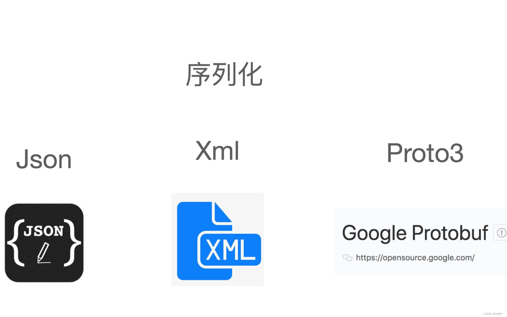
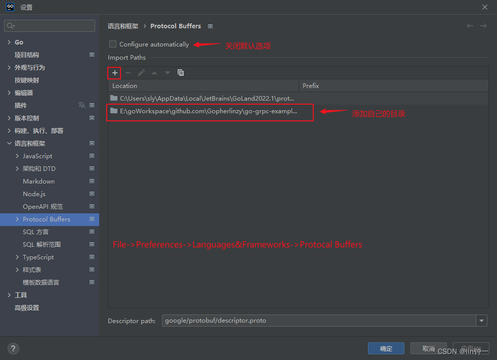

🔗 原文链接： [https://learnku.com/articles/73102](https://learnku.com/articles/73102)

⏰ 剪存时间：2023-07-28 17:44:48 (UTC+8)

✂️ 本文档由 [飞书剪存](https://www.feishu.cn/hc/zh-CN/articles/606278856233?from=in_ccm_clip_doc)一键生成

# 前言

通过 protubuf 文档先了解一下 protobuf 语法。 个人网站： [linzyblog.netlify.app/](https://linzyblog.netlify.app/) 示例代码已经上传到 github： [点击跳转](https://github.com/Gopherlinzy/go-grpc-example)

# 一、Protobuf

## 1、什么是 protobuf？

Protocol Buffers (Protobuf) 是一种免费的开源 跨平台数据格式，用于序列化结构化数据。它是谷歌公司开发的一种数据描述语言，并于 2008 年开源。Protobuf 刚开源时的定位类似于 XML、JSON 等数据描述语言，通过附带工具生成代码并实现将结构化数据序列化的功能。

Protocol Buffers 是一种与语言、平台无关，可扩展的序列化结构化数据的方法，常用于通信协议，数据存储等等。相较于 JSON、XML，它更小、更快、更简单，因此也更受开发人员的青眯。

protobuf 官方文档： [点击跳转](https://developers.google.com/protocol-buffers/docs/overview)

## 2、JSON、XML、Protobuf 选择

### 1）什么是序列化和反序列化

- 序列化是将数据结构或对象状态转换为格式（xml/json/protobuf）的过程可以存储或传输。
- 反序列化是从表示的格式（xml/json/protobuf）构造数据结构 / 对象状态的过程



### 2）JSON、XML、Protobuf 对比

**JSON** ：最流行的主要还是 json。因为浏览器对于 json 数据支持非常好，有很多内建的函数支持。

- 具有可读性 / 可编辑性
- 无需预先知道模式即可解析
- 优秀的浏览器支持
- 比 XML 更简洁

JSON 数据格式：

```
{
    "title":"Protobuf article",
    "status":"DRAFT",
    "members" : [
    {
      "name" : "Molecule Man",
      "age" : 29,
      "secretIdentity" : "Dan Jukes",
      "powers" : [
        "Radiation resistance",
        "Turning tiny",
        "Radiation blast"
      ]
    },
}
```

**XML** ：现在基本很少使用 XML。json 使用了键值对的方式，不仅压缩了一定的数据空间，同时也具有可读性。

- 具有可读性 / 可编辑性
- 无需预先知道模式即可解析
- SOAP 等标准
- 良好的工具支持（xsd、xslt、sax、dom 等）
- 相当冗长

XML 数据格式：

**Protobuf** ：适合高性能，对响应速度有要求的数据传输场景。因为 profobuf是二进制数据格式，需要编码和解码 。数据本身不具有可读性。因此只有在反序列化之后得到真正可读的数据。

- 非常密集的数据（输出小）
- 在不知道架构的情况下很难稳健地解码（数据格式在内部是模棱两可的，需要架构来解释）
- 处理速度非常快
- 不具有可读性 / 可编辑性（密集的二进制数据）

Protobuf 数据格式：

|   |   |   |   |   |   |
|---|---|---|---|---|---|
|数据格式|数据保存方式|可读性 / 可编辑性|解析速度|语言支持|使用范围|
|JSON|文本|好|一般|所有语言|文件存储、数据交互|
|XML|文本|好|慢|所有语言|文件存储、数据交互|
|Protobuf|二进制|不可读|快|所有语言|文件存储、数据交互|

### 3）使用 Protobuf 替代 XML/JSON 的好处

- 与 xml/json 相比，Protobuf 格式在表示数据结构方面更小、更快。
- xml/Json 以字符串形式交换数据，然后在使用 解析器 检索时解析它们，这个过程在处理和内存消耗方面可能非常昂贵。但是使用 protobuf，它使用预定义模式，使得解析逻辑高效而简单。
- 解析 json 字符串、数组和对象需要顺序扫描，这意味着没有元素大小或体头的计数。多层次 xml 文档也是如此。

当然也不能一味的使用 Protobuf，JSON 适用的场景远远大于 Protobuf，在有些时候 Protocol Buffers 仍然沒有 JSON 要来的方便。

- 与 xml/json 相比，protobuf 的学习曲线略高。
- 当你的数据是需要别人可读的。
- 你不打算直接处理接收的数据，而是从数据中取你想要的部分处理。
- 不想经过特殊处理，直接能从浏览器中解读的。
- 在 web 服务还没有准备好将数据模型绑定到特定模式的场景中，protobuf 没有多大用处。

### 4）Protobuf 使用场景 #

- 在考虑将 Protobuf 用于 web 服务之间的通信 (比如不与客户端浏览器解析引擎交互)
- 当文档大小在 MB 左右，且数据类型混合时，protobuf 将在性能方面优于 xml/json，protobuf 在网络上对数据的编码和解码速度更快。如果数据是巨大的 GB，那么无论选择什么编码技术栈 (如 protobug/json/xml)，都需要压缩。
- 在需要双重解码的场景中 (比如威胁搜索对同一命令行进行多次解码)，protobuf 比 JSON 要快得多。
- 当 web 服务过渡到使用 gRPC 而不是传统的 REST 框架时，protobuf 是推荐使用的标准。

# 二、proto3 语法

## 1、简单示例

syntax : 用来标记当前使用 proto 的哪个版本。如果不指定，编译器会使用 proto2。 package : 指定包名，用来防止消息类型命名冲突。 option go_package : 选项信息，代表生成后的 go 代码包路径。在生成 gRPC 代码时，必须指明。 message : 声明消息的关键字，类似 Go 语言中的 struct。

FirstMsg 消息定义指定了三个字段（名称 / 值对），每个字段都有一个名称和一个类型。 定义字段语法格式: 类型 字段名 编号 ，例如 repeated int32 nums = 1; 在生成 gRPC 代码时会自动生成数组 [] int32 类型。

分配字段编号说明:

- 消息定义中的每个字段都有一个唯一的编号。这些字段编号用于在 消息二进制格式中标识您的字段，并且在使用消息类型后不应更改。
- [1, 15]之内的标识号在编码的时候会占用一个字节。[16, 2047]之内的标识号则占用2个字节。
- 最小的标识号可以从 1 开始，最大到 2^29 - 1, or 536,870,911。不可以使用其中的 [19000－19999], 因为是预留信息，如果使用，编译时会报错。

## 2、proto 数据类型与 Go 数据类型对应 #

|   |   |   |
|---|---|---|
|.proto Type|Go Type|Notes|
|double|float64||
|float|float32||
|int32|int32|使用变长编码。对于负值的效率很低，如果有负值，使用 sint32|
|int64|int64|使用变长编码。对于负值的效率很低，如果有负值，使用 sint64|
|uint32|uint32|使用变长编码|
|uint64|uint64|使用变长编码|
|sint32|int32|使用变长编码，负值时比 int32 高效的多|
|sint64|int64|使用变长编码，有符号的整型值。编码时比通常的 int64 高效。|
|fixed32|uint32|总是 4 个字节，如果数值比 2^28^ 大的话，这个类型会比 uint32 高效。|
|fixed64|uint64|总是 8 个字节，如果数值比 2^56^ 大的话，这个类型会比 uint64 高效。|
|bool|bool||
|string|string|字符串必须包含 UTF-8 编码或 7 位 ASCII 文本，且长度不能超过 2^32^。|
|bytes|[]byte|可以包含不超过 2^32^ 的任意字节序列。|

## 3、指定消息字段规则 #

- singular：消息中 至多 存在一个该字段的数据。使用 proto3 语法时，当没有为给定字段指定其他字段规则时，这是默认字段规则。
- optional：与 singular 类似，不同之处在于可以检查该值是否已经显式设置了值。字段有两种可能的状态:

- 该字段已设置，并包含从连接中显式设置或解析的值。它将被序列化到连接上。
- 该字段未设置，将返回默认值。它不会被序列化。

- repeated：该字段类型可以在消息中可以重复设置多次，重复值的顺序将被保留。（设置成为数组类型）
- map：成对的键 / 值字段类型。

## 4、保留标示符 reserved #

什么是保留标示符？reserved 标记的编号、字段名，都不能在当前消息中使用。

保留标识符的作用：对于特殊的字段名或者编号通过完全删除字段或将其注释掉来更新消息类型，如果后面出现其他用户对该消息进行更新重用了特殊的字段名或者编号，可能会导致严重的错误，包括数据损坏、出现隐私漏洞等。 为了确保这种情况不会发生的一种方法就是用保留标识符指定保留已删除的字段名或者编号。如果有其他用户试图重用这些字段名或编号，protobuf 则会报错预警。

注意：不能在同一 reserved 语句中混合字段名称和字段编号。

## 5、枚举类型 #

枚举：在定义消息类型时，希望其中一个字段只是预定义值列表中的一个值。 例如，假设您想为每个 SearchRequest 添加一个 Corpus 字段，其中枚举预定义值可以是 UNIVERSAL、WEB、IMAGES、LOCAL、NEWS、PRODUCTS 或 VIDEO。您可以通过在消息定义中添加一个枚举，为每个可能的值添加一个常量。

在下面的示例中，我们添加了一个包含所有可能值的 enum 调用 Corpus，以及一个 type 字段 Corpus：

每个枚举类型必须将其第一个类型映射为编号 0, 原因有两个：

- 必须有一个零值，以便我们可以使用 0 作为数字 默认值。
- 零值必须是第一个元素，以便与第一个枚举值始终为默认值的 proto2 语义兼容 。

可以对相同的编号分配给不同的枚举常量来定义别名。只需要将 allow_alias选项设置为true ，否则协议编译器将在找到别名时生成错误消息。尽管所有别名值在反序列化期间都有效，但在序列化时始终使用第一个值。

注意：

- 枚举器常量必须在 32 位整数范围内。
- 枚举类型同样可以使用保留标识符。

## 6、引入其他 proto 文件消息类型

### 1）被引入文件 class.proto

文件位置:proto/class.proto

### 2）使用引入文件 user.proto #

文件位置:proto/user.proto

如果Goland提示:Cannot resolve import...



## 7、嵌套消息类型 #

可以使用其他消息类型作为字段类型，也可以在其他消息类型中定义和使用消息类型。

## 8、map 类型消息 #

创建关联映射作为数据定义的一部分，map 数据结构格式：

注意：

- key_type 只能是任何整数或字符串类型 (除浮点类型和任何标量 bytes 类型)。
- enum 不能作为 key_type 和 value_type 定义的类型。
- map 字段不能是 repeated。

示例：

**向后兼容性** map 语法等效于以下内容，因此不支持 map 的 Protobuf 实现仍然可以处理你的数据：

任何支持映射的 Protobuf 实现都必须生成和接受上述定义可以接受的数据。

## 9、切片 (数组) 字段类型 #

需要创建切片 (数组) 字段类型：

## 10、oneof (只能选择一个) #

如果需要一条包含多个字段的消息，并且最多同时设置一个字段，可以强制执行此行为并使用 oneof 功能节省内存。

oneof 字段与常规字段一样，在 oneof 共享内存中的所有字段，最多可以同时设置一个字段。设置 oneof 的任何成员会自动清除所有其他成员。

如果设置了多个值，则由 proto 中的 order 确定的最后一个设置的值将覆盖所有以前的设置值。

在生成的代码中，oneof 字段具有与常规字段相同的 getter 和 setter。还可以获得一种特殊的方法来检查 oneof 中设置了哪个值（如果有）。

## 11、Any 任何类型 #

Any 消息类型允许您将消息作为嵌入类型使用，而不需要它们的.proto 定义。

Any 以字节的形式包含任意序列化的消息，以及作为该消息类型的全局唯一标识符并解析为该消息类型的 URL。要使用 Any 类型，您需要 import google/protobuf/any.proto

# 三、小结 #

本章我们了解 proto3 的语法，下一章我会详细介绍 gRPC 以及如何加载 protoc-gen-go 插件达到生成 Go 代码的目的。

本作品采用 [《CC 协议》](https://learnku.com/docs/guide/cc4.0/6589)，转载必须注明作者和本文链接
