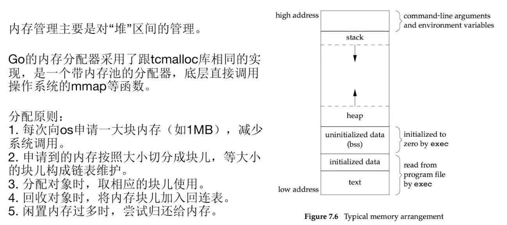
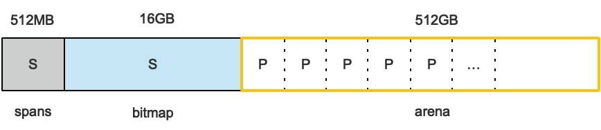
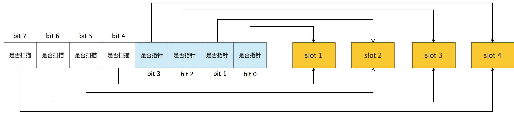
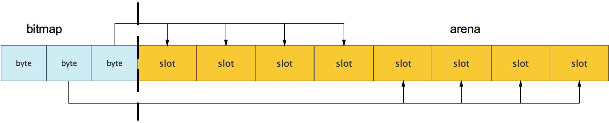
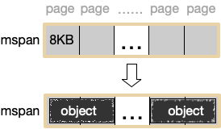
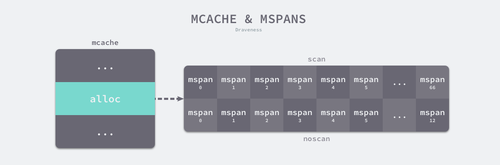
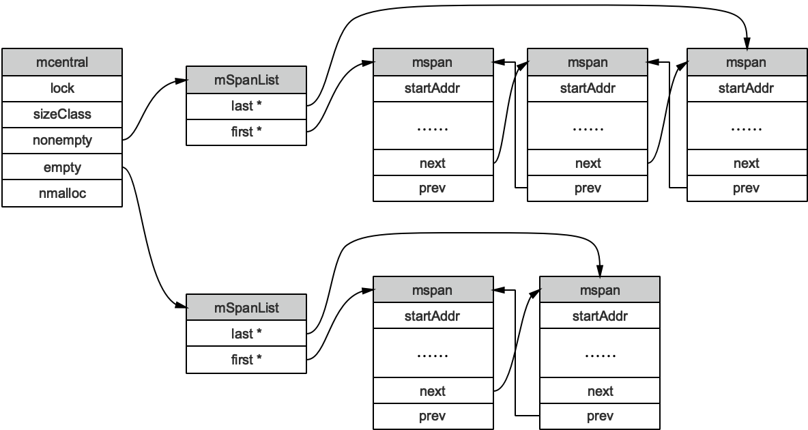
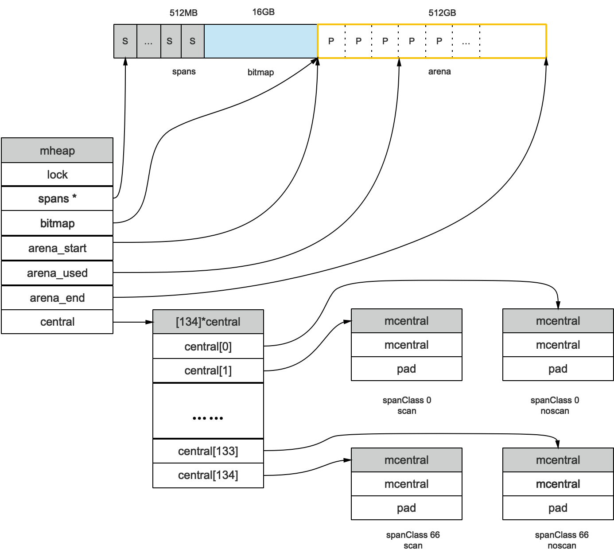
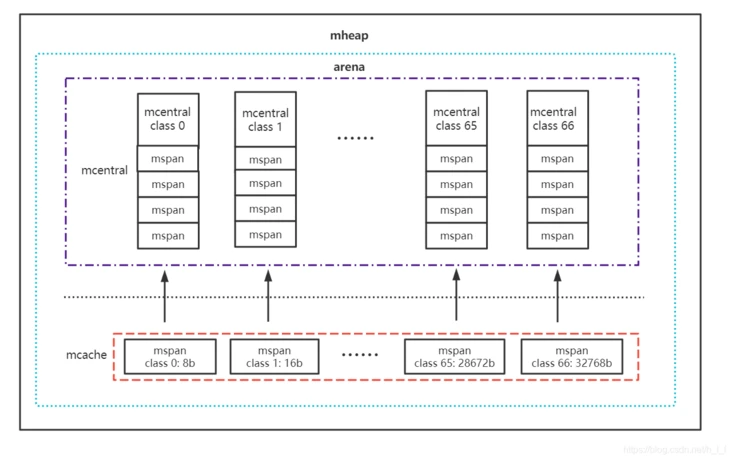

Go语言内置运行时（就是runtime），抛弃了传统的内存分配方式，改为自主管理。这样可以自主地实现更好的内存使用模式，比如内存池、预分配等等。这样，不会每次内存分配都需要进行系统调用。

Golang运行时的内存分配算法主要源自 Google 为 C 语言开发的TCMalloc算法，全称Thread-Caching Malloc。核心思想就是把内存分为多级管理，从而降低锁的粒度。它将可用的堆内存采用二级分配的方式进行管理：每个线程都会自行维护一个独立的内存池，进行内存分配时优先从该内存池中分配，当内存池不足时才会向全局内存池申请，以避免不同线程对全局内存池的频繁竞争。



堆中的内存分配机制：

- Go在程序启动时，会向操作系统申请一大块内存，之后自行管理。
- Go内存管理的基本单元是mspan，它由若干个页组成，每种mspan可以分配特定大小的object。
- mcache, mcentral, mheap是Go内存管理的三大组件，层层递进。mcache管理线程在本地缓存的mspan；mcentral管理全局的mspan供所有线程使用；mheap管理Go的所有动态分配内存。
- 极小对象会分配在一个object中，以节省资源，使用tiny分配器分配内存；一般小对象通过mspan分配内存；大对象则直接由mheap分配内存。

# 基础概念

Go在程序启动的时候，会先向操作系统申请一块内存（注意这时还只是一段虚拟的地址空间，并不会真正地分配内存），切成小块后自己进行管理。

申请到的内存块被分配了三个区域，在X64上分别是512MB，16GB，512GB大小。

[](https://user-images.githubusercontent.com/7698088/54165891-9e6cde80-449d-11e9-8947-14e6f75f4089.png)

arena区域就是我们所谓的堆区，Go动态分配的内存都是在这个区域，它把**内存分割成****8KB****大小的页**，一些页组合起来称为mspan。

bitmap区域标识arena区域哪些地址保存了对象，并且用4bit标志位表示对象是否包含指针、GC标记信息。bitmap中一个byte大小的内存对应arena区域中4个指针大小（指针大小为 8B ）的内存，所以bitmap区域的大小是512GB/(4*8B)=16GB。





每个span和arena中的一个页一一对应，所以spans区域的大小就是512GB/8KB*8B=512MB。除以8KB是计算arena区域的页数，而最后乘以8是计算spans区域所有指针的大小(一个指针大小为 8 Bytes)。

spans区域存放mspan（也就是一些arena分割的页组合起来的内存管理基本单元）的指针，表示span对应的页被分配给了某个mspan。

创建mspan的时候，按页填充对应的spans区域，在回收object时，根据地址很容易就能找到它所属的mspan。

# mspan

mspan：Go中内存管理的基本单元，是由一片**连续的**8KB的页组成的大块内存。mspan是一个包含起始地址、mspan规格、页的数量等内容的双端链表。

每个mspan按照它自身的属性Size Class的大小分割成若干个object，每个object可存储一个对象。并且会使用一个位图来标记其尚未使用的object。属性Size Class决定object大小，而mspan只会分配给和object尺寸大小接近的对象，当然，对象的大小要小于object大小。

如下图，mspan由一组连续的页组成，按照一定大小划分成object。

[](https://user-images.githubusercontent.com/7698088/54070690-0b198a80-429e-11e9-8838-eef9cd160f5c.png)

Go1.9.2里mspan的Size Class共有67种：

```
// path: /usr/local/go/src/runtime/sizeclasses.go

const _NumSizeClasses = 67

var class_to_size = [_NumSizeClasses]uint16{0, 8, 16, 32, 48, 64, 80, 96, 112, 128, 144, 160, 176, 192, 208, 224, 240, 256, 288, 320, 352, 384, 416, 448, 480, 512, 576, 640, 704, 768, 896, 1024, 1152, 1280, 1408, 1536,1792, 2048, 2304, 2688, 3072, 3200, 3456, 4096, 4864, 5376, 6144, 6528, 6784, 6912, 8192, 9472, 9728, 10240, 10880, 12288, 13568, 14336, 16384, 18432, 19072, 20480, 21760, 24576, 27264, 28672, 32768}
```

根据mspan的Size Class可以得到它划分的object大小。 比如Size Class等于3，object大小就是32B。 32B大小的object可以存储对象大小范围在17B~32B的对象。而对于微小对象（小于16B），分配器会将其进行合并，将几个对象分配到同一个object中。

数组里最大的数是32768，也就是32KB，超过此大小就是大对象了，类型Size Class为0表示大对象，直接由堆内存分配，而小对象都要通过mspan来分配。

对于mspan来说，它的Size Class会决定它所能分到的页数：

```
// path: /usr/local/go/src/runtime/sizeclasses.go

const _NumSizeClasses = 67

var class_to_allocnpages = [_NumSizeClasses]uint8{0, 1, 1, 1, 1, 1, 1, 1, 1, 1, 1, 1, 1, 1, 1, 1, 1, 1, 1, 1, 1, 1, 1, 1, 1, 1, 1, 1, 1, 1, 1, 1, 1, 1, 2, 1, 2, 1, 2, 1, 3, 2, 3, 1, 3, 2, 3, 4, 5, 6, 1, 7, 6, 5, 4, 3, 5, 7, 2, 9, 7, 5, 8, 3, 10, 7, 4}
```

比如当我们要申请一个object大小为32B的mspan的时候，在class_to_size里对应的索引是3，而索引3在class_to_allocnpages数组里对应的页数就是1。

mspan结构体定义：

```
// path: /usr/local/go/src/runtime/mheap.go

type mspan struct {
    //链表前向指针，用于将span链接起来
	next *mspan	
	
	//链表前向指针，用于将span链接起来
	prev *mspan	
	
	// 起始地址，也即所管理页的地址
	startAddr uintptr 
	
	// 管理的页数
	npages uintptr 
	
	// 块个数，表示有多少个块可供分配
	nelems uintptr 

    //分配位图，每一位代表一个块是否已分配
	allocBits *gcBits 

    // 已分配块的个数
	allocCount uint16 
	
	// class表中的class ID，和Size Class相关
	spanclass spanClass  

    // class表中的对象大小，也即块大小
	elemsize uintptr 
}
```

startAddr直接指向arena区域的某个位置，表示这个mspan的起始地址，allocBits指向一个位图，每位代表一个块是否被分配了对象；allocCount则表示总共已分配的对象个数。

# 内存管理组件

内存分配由内存分配器完成。分配器由3种组件构成：mcache, mcentral, mheap。


## mcache

mcache：每个工作线程都会绑定一个mcache，本地缓存可用的mspan资源，这样就可以直接给Goroutine分配，因为不存在多个Goroutine竞争的情况，所以不会消耗锁资源。

mcache的结构体定义：

```
//path: /usr/local/go/src/runtime/mcache.go

type mcache struct {
    alloc [numSpanClasses]*mspan
}
numSpanClasses = _NumSizeClasses << 1
```

mcache用Span Classes作为索引管理多个用于分配的mspan，它包含所有规格的mspan。它是_NumSizeClasses的2倍，也就是67*2=134，为什么有一个两倍的关系：为了加速之后内存回收的速度，数组里一半的mspan中分配的对象不包含指针，另一半则包含指针。

对于无指针对象的mspan在进行垃圾回收的时候无需进一步扫描它是否引用了其他活跃的对象。



mcache在初始化的时候是没有任何mspan资源的，在使用过程中会动态地从mcentral申请，之后会缓存下来。当对象小于等于32KB大小时，使用mcache的相应规格的mspan进行分配。

## mcentral

mcentral：为所有mcache提供切分好的mspan资源。每个central保存一种特定大小的全局mspan列表，包括已分配出去的和未分配出去的。 每个mcentral对应一种mspan，而mspan的种类导致它分割的object大小不同。当工作线程的mcache中没有合适（也就是特定大小的）的mspan时就会从mcentral获取（只获取对应class的mcentral的锁即可）。

mcentral被所有的工作线程共同享有，存在多个Goroutine竞争的情况，因此会消耗锁资源。结构体定义：

```
//path: /usr/local/go/src/runtime/mcentral.go

type mcentral struct {
    // 互斥锁
    lock mutex 
    
    // 规格
    sizeclass int32 
    
    // 尚有空闲object的mspan链表
    nonempty mSpanList 
    
    // 没有空闲object的mspan链表，或者是已被mcache取走的msapn链表
    empty mSpanList 
    
    // 已累计分配的对象个数
    nmalloc uint64 
}
```

[](https://user-images.githubusercontent.com/7698088/54211962-2219e000-451d-11e9-85e1-0e8200925fa5.png)

empty表示这条链表里的mspan都被分配了object，或者是已经被cache取走了的mspan，这个mspan就被那个工作线程独占了。而nonempty则表示有空闲对象的mspan列表。每个central结构体都在mheap中维护。

简单说下mcache从mcentral获取和归还mspan的流程：

- 获取  
    加锁；从nonempty链表找到一个可用的mspan；并将其从nonempty链表删除；将取出的mspan加入到empty链表；将mspan返回给工作线程；解锁。
- 归还  
    加锁；将mspan从empty链表删除；将mspan加入到nonempty链表；解锁。

## mheap

mheap：代表Go程序持有的所有堆空间，Go程序使用一个mheap的全局对象_mheap来管理堆内存。

当 mcentral 列表为空时，mcentral 从 mheap 获取一系列页用于需要的大小规格的 span。而mheap没有资源时，会向操作系统申请新内存。mheap主要用于大对象的内存分配，以及管理空闲的span，在mcentral申请时分配给mcentral。

同时我们也看到，mheap中含有所有规格的mcentral（134个，无指针67+有指针67），所以，当一个mcache从mcentral申请mspan时，只需要在独立的mcentral中使用锁，并不会影响申请其他规格的mspan。

[](https://user-images.githubusercontent.com/7698088/54213273-1cbd9500-451f-11e9-93e4-28f39615b6a2.png)

# 内存分配流程

变量是在栈上分配还是在堆上分配，是由逃逸分析的结果决定的。通常情况下，编译器是倾向于将变量分配到栈上的，因为它的开销小，最极端的就是”zero garbage”，所有的变量都会在栈上分配，这样就不会存在内存碎片，垃圾回收之类的东西。



Go的内存分配器在分配对象时，根据对象的大小，分成三类：小对象（小于等于16B）、一般对象（大于16B，小于等于32KB）、大对象（大于32KB）。

大体上的分配流程：

- 32KB 的对象，直接从mheap上分配；
- <=16B 的对象使用mcache的tiny分配器分配；
- (16B,32KB] 的对象，首先计算对象的规格大小，然后使用mcache中相应规格大小的mspan分配；

- 如果mcache没有相应规格大小的mspan，则向mcentral申请
- 如果mcentral没有相应规格大小的mspan，则向mheap申请
- 如果mheap中也没有合适大小的mspan，则向操作系统申请
