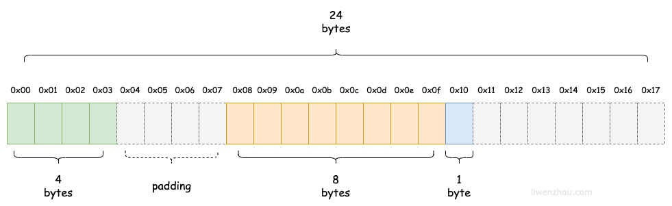
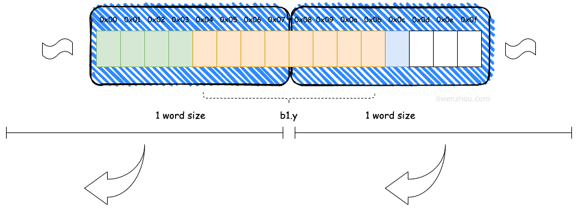
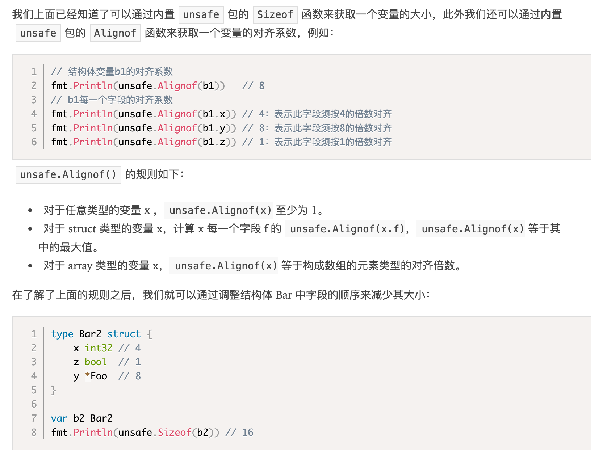
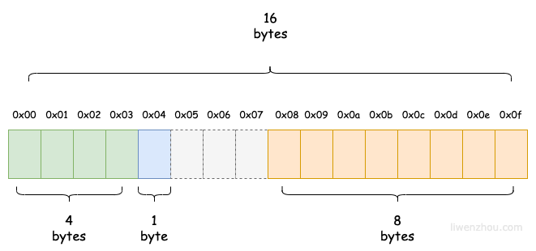
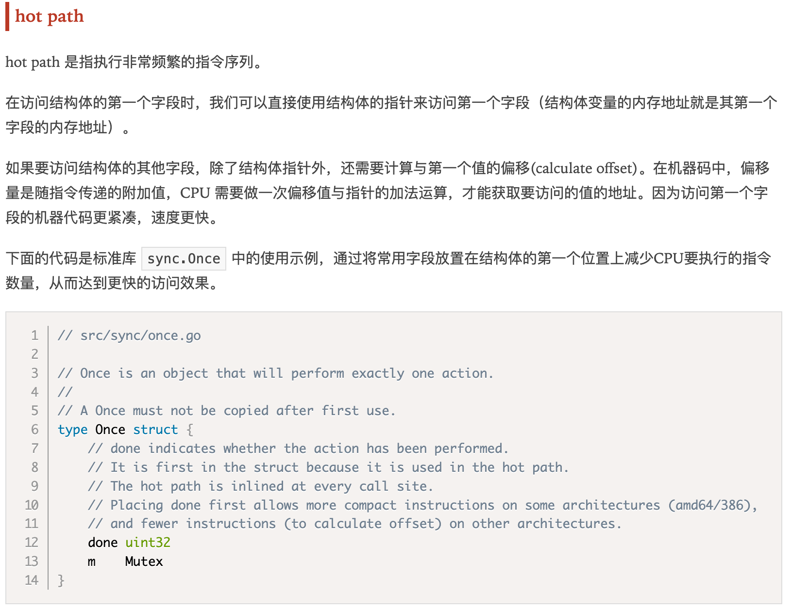

之所以这么设计是为了减少 CPU 访问内存的次数，加大 CPU 访问内存的吞吐量。如果不进行内存对齐的话，很可能就会增加CPU访问内存的次数。例如下图中CPU想要获取b1.y字段的值可能就需要两次总线周期。结构体内存对齐

结构体占用一块连续的内存，一个结构体的大小由结构体中的字段决定。

```
type Foo struct {
    A int8 // 1
    B int8 // 1
    C int8 // 1
}

var f Foo
fmt.Println(unsafe.Sizeof(f))  // 3
```

但是结构体的大小又不完全由结构体的字段决定，例如：

```
type Bar struct {
	x int32 // 4
	y *Foo  // 8
	z bool  // 1
}

var b1 Bar
fmt.Println(unsafe.Sizeof(b1)) // 24
```

由于内存填充机制，其内存布局为：



Go 在编译的时候会按照一定的规则自动进行内存对齐。之所以这么设计是为了减少 CPU 访问内存的次数，加大 CPU 访问内存的吞吐量。如果不进行内存对齐的话，很可能就会增加CPU访问内存的次数。例如下图中CPU想要获取b1.y字段的值可能就需要两次总线周期。



因为 CPU 访问内存时，并不是逐个字节访问，而是以字（word）为单位访问。比如 64位CPU的字长（word size）为8bytes，那么CPU访问内存的单位也是8字节，每次加载的内存数据也是固定的若干字长，如8words（64bytes）、16words(128bytes）等。

## 对齐保证



此时Bar2变量的内存布局示意图如下：



## host path


