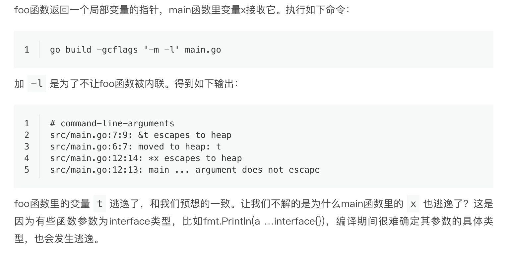

逃逸分析（Escape analysis）是指由编译器决定内存分配的位置，不需要程序员指定。

编译器会分析代码的特征和代码生命周期，Go中的对象只有在编译器可以证明在函数返回后不会再被引用的，才分配到栈上，其他情况下都是分配到堆上。

Go语言里没有一个关键字或者函数可以直接让变量被编译器分配到堆上，相反，编译器通过分析代码来决定将变量分配到何处。

编译器会根据变量是否被外部引用来决定是否逃逸：

1. 如果函数外部没有引用，则优先放到栈中；
2. 如果函数外部存在引用，则必定放到堆中；

对第一条，如果申请了很大的数组，栈中分配压力太大，就分配到堆中。

**go语言内存分配位置与变量是结构体还是基本类型无关**

demo：

```
package main

import "fmt"

func foo() *int {
	t := 3
	return &t;
}

func main() {
	x := foo()
	fmt.Println(*x)
}
```



# 总结

- 堆上动态分配内存比栈上静态分配内存，开销大很多。
- 变量分配在栈上需要能在编译期确定它的作用域，否则会分配到堆上。

Go编译器会在编译期考察变量的作用域，并作一系列检查，如果它的作用域在运行期间对编译器一直是可知的，那么就会分配到栈上。

简单来说，编译器会根据变量是否被外部引用来决定是否逃逸。对于Go程序员来说，编译器的这些逃逸分析规则不需要掌握，我们只需通过go build -gcflags '-m'命令来观察变量逃逸情况就行了。

不要盲目使用变量的指针作为函数参数，虽然它会减少复制操作。但其实当参数为变量自身的时候，复制是在栈上完成的操作，开销远比变量逃逸后动态地在堆上分配内存少的多。

最后，尽量写出少一些逃逸的代码，提升程序的运行效率。
