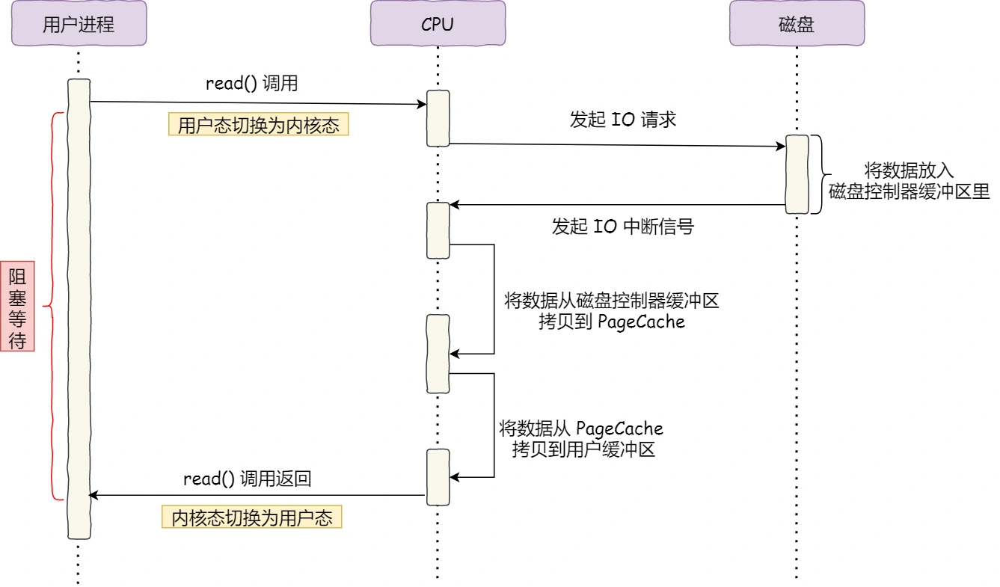
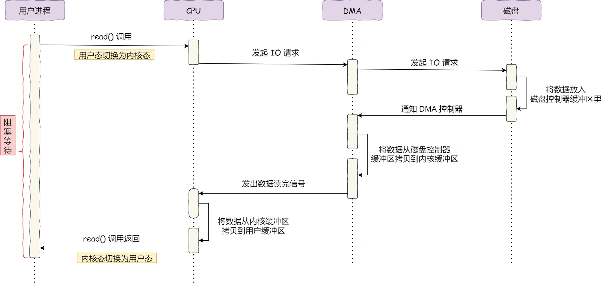
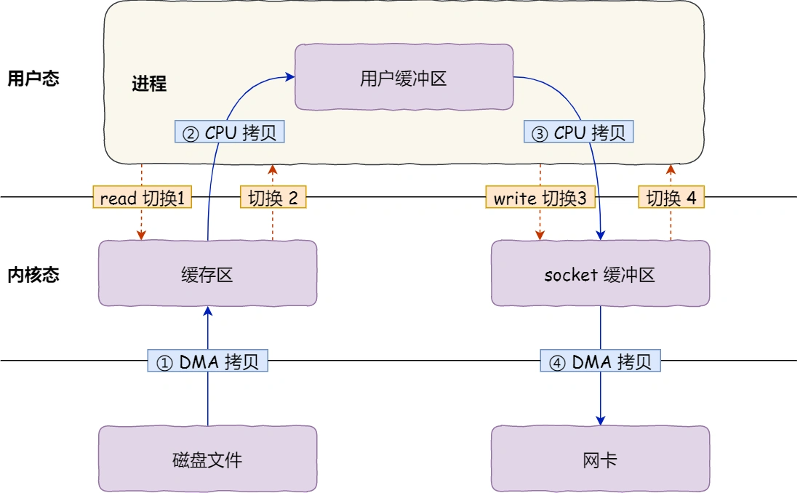
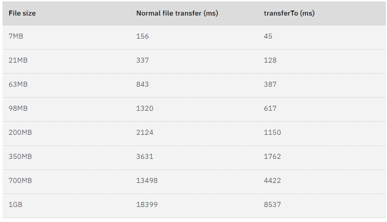
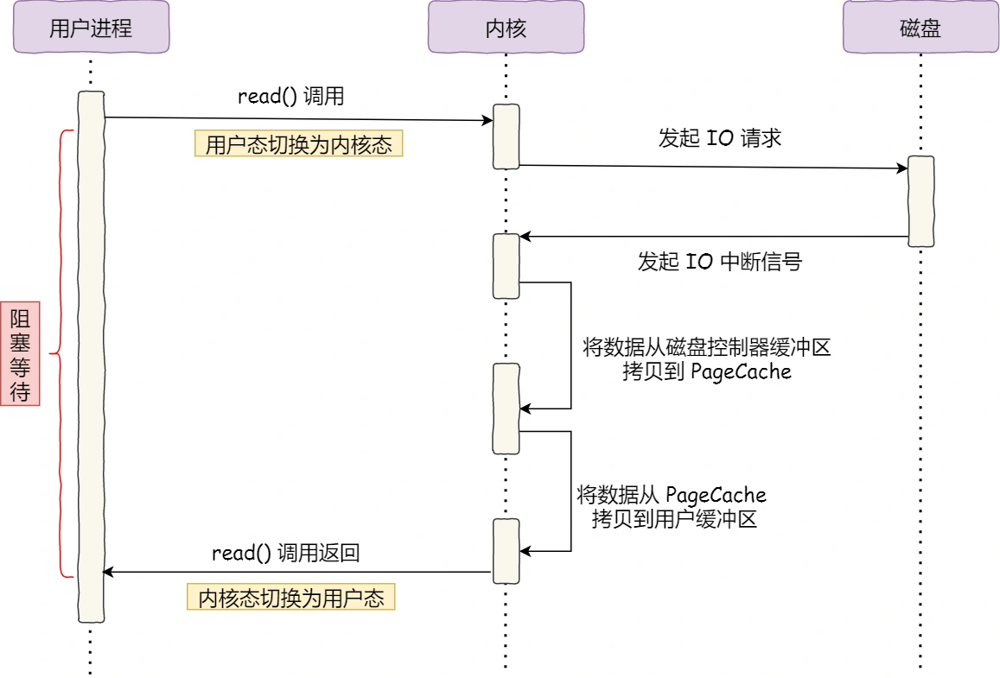
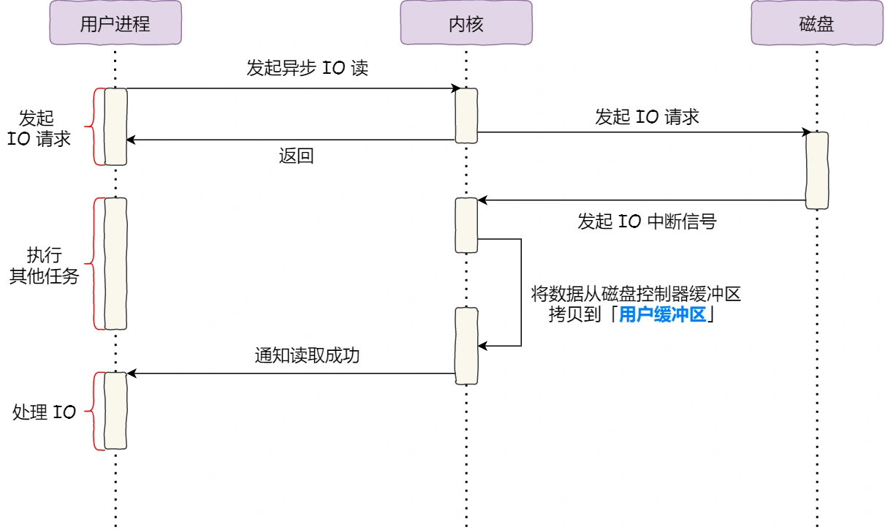

# DMA 与零拷贝

磁盘、网卡这类 I/O 设备和内存之间经常需要搬运大量数据。如果每个字节都由 CPU 读取设备寄存器、再写入内存，CPU 会把大量时间浪费在机械的数据搬运上。

DMA、零拷贝、PageCache、Direct I/O 和异步 I/O 都是在解决 I/O 性能问题，但它们解决的问题不完全一样：

| 技术 | 主要解决什么问题 |
|---|---|
| DMA | 减少 CPU 参与设备和内存之间的大块数据搬运 |
| 零拷贝 | 减少内核态和用户态之间不必要的数据复制 |
| PageCache | 用内存缓存磁盘文件，减少真实磁盘访问 |
| Direct I/O | 绕过 PageCache，避免缓存污染和额外缓存成本 |
| 异步 I/O | 让调用线程不必阻塞等待 I/O 完成 |

# 为什么要有 DMA

在没有 DMA 技术前，I/O 设备和内存之间的数据搬运通常依赖 CPU 完成，典型流程是：

- CPU 向磁盘控制器发送读请求；
- 磁盘控制器准备数据，并把数据放入自己的设备缓冲区；
- CPU 从设备缓冲区读取数据到寄存器；
- CPU 再把寄存器中的数据写入内存；
- 整个搬运过程持续占用 CPU。



这种方式的问题很明显：CPU 不仅要负责计算和调度，还要亲自搬运大量 I/O 数据。数据量一大，CPU 会被内存复制拖住，无法有效处理其他任务。

DMA（Direct Memory Access，直接内存访问）就是为了解决这个问题。它允许 I/O 设备在 CPU 配置好传输参数后，直接和内存进行数据传输。

需要注意：DMA 并不表示 CPU 完全不参与 I/O。CPU 仍然负责发起系统调用、检查参数、准备缓冲区、配置 DMA 描述符、处理中断和执行协议栈逻辑。DMA 减少的是 CPU 对大块数据的逐字节搬运。

使用 DMA 后，读取磁盘文件的大致流程如下：



- 用户进程调用 `read()`，请求读取文件数据；
- 内核检查参数，准备内核缓冲区或 PageCache 页；
- 设备驱动把 I/O 请求和 DMA 描述符提交给磁盘控制器；
- 磁盘控制器从磁盘读取数据，并通过 DMA 把数据写入内存；
- DMA 传输完成后，设备通过中断通知 CPU；
- CPU 处理中断，内核完成后续收尾工作；
- 如果是普通 `read()`，内核还会把数据从内核缓冲区复制到用户缓冲区。

现代磁盘、网卡等设备通常自带 DMA 能力。可以把 DMA 理解为：CPU 负责安排任务，设备负责把大块数据搬到指定内存位置。

# 传统文件传输的问题

服务端发送静态文件时，最直观的写法是先把文件读到用户缓冲区，再把用户缓冲区写入 socket：

```c
read(file_fd, user_buf, len);
write(socket_fd, user_buf, len);
```



这个过程通常包含 2 次系统调用：

- `read()`：用户态进入内核态，完成后返回用户态；
- `write()`：用户态再次进入内核态，完成后返回用户态。

严格说，这里更准确叫**用户态/内核态模式切换**。如果系统调用期间线程被阻塞并让出 CPU，才会进一步发生真正的线程或进程上下文切换。

传统 `read + write` 还会发生 4 次数据搬运：

- 磁盘数据通过 DMA 进入 PageCache 或内核读缓冲区；
- CPU 把内核缓冲区的数据复制到用户缓冲区；
- CPU 把用户缓冲区的数据复制到 socket 发送缓冲区；
- 网卡通过 DMA 从 socket 发送缓冲区读取数据并发送。

对于“读取文件后原样发给客户端”的场景，用户进程并不需要修改文件内容。数据先进入用户态、再回到内核态，这两次 CPU copy 就是冗余开销。

优化方向有两个：

- 减少系统调用次数，也就是减少用户态和内核态之间的切换；
- 减少 CPU copy，尤其是避免数据在用户缓冲区和内核缓冲区之间来回复制。

# 零拷贝

## `mmap + write`

`read()` 会把内核缓冲区的数据复制到用户缓冲区。如果应用只是把文件原样发送出去，可以用 `mmap()` 建立文件到用户虚拟地址空间的映射，避免这次复制：

```c
buf = mmap(NULL, len, PROT_READ, MAP_PRIVATE, file_fd, offset);
write(socket_fd, buf, len);
```

`mmap()` 的关键作用是建立映射关系：用户进程可以通过虚拟地址访问文件页，而这些文件页实际由内核的 PageCache 承载。

需要注意，`mmap()` 调用本身不一定立刻从磁盘读取数据。真实读取通常发生在进程首次访问映射地址时：访问触发缺页异常，内核再把对应文件页读入 PageCache，并建立页表映射。


`mmap + write` 的大致流程是：

- `mmap()` 建立文件页到用户虚拟地址空间的映射；
- 访问映射区域时，如果 PageCache 未命中，磁盘通过 DMA 把数据读入 PageCache；
- `write()` 把 PageCache 中的数据复制到 socket 发送缓冲区；
- 网卡通过 DMA 从 socket 发送缓冲区读取数据并发送。

相比 `read + write`，`mmap + write` 省掉了“内核缓冲区到用户缓冲区”的 CPU copy。但是它仍然需要 `write()` 系统调用，也通常仍然需要把 PageCache 中的数据复制到 socket 发送缓冲区。

## `sendfile`

Linux 提供了 `sendfile()`，用于在两个文件描述符之间传输数据。它常用于把普通文件直接发送到 socket：

```c
#include <sys/sendfile.h>

ssize_t sendfile(int out_fd, int in_fd, off_t *offset, size_t count);
```

`out_fd` 是输出端文件描述符，`in_fd` 是输入端文件描述符，`offset` 表示从输入文件的哪个位置开始读取，`count` 表示传输长度，返回值是实际传输的字节数。

`sendfile()` 的优势是把原来的 `read()` + `write()` 合并成一次系统调用，并且数据不再进入用户缓冲区。


早期或不支持 scatter-gather 的路径中，`sendfile()` 大致包含：

- 磁盘通过 DMA 把文件数据读入 PageCache；
- CPU 把 PageCache 中的数据复制到 socket 发送缓冲区；
- 网卡通过 DMA 从 socket 发送缓冲区读取数据并发送。

这种方式减少了系统调用次数，也避免了数据进入用户缓冲区，但仍有一次从 PageCache 到 socket buffer 的 CPU copy。

## `sendfile + SG-DMA`

如果网卡支持 SG-DMA（Scatter-Gather DMA），内核可以把 PageCache 中文件页的描述信息传给 socket 层，网卡再根据这些分散的内存片段直接 DMA 读取并发送。


这种路径大致是：

- 磁盘通过 DMA 把文件数据读入 PageCache；
- 内核把缓冲区描述符和长度交给 socket 层；
- 网卡通过 SG-DMA 直接从 PageCache 对应的内存页读取数据并发送。

此时不再需要 CPU 把 PageCache 数据复制到 socket 发送缓冲区，所以文件传输路径上的 CPU copy 可以降为 0。

这就是常说的零拷贝文件传输。它的准确含义是：数据不进入用户态，且尽量避免内核内部的 CPU copy；数据仍然会通过 DMA 在设备和内存之间移动。

## 几种文件传输方式对比

| 方式 | 系统调用次数 | CPU copy | DMA copy | 是否经过用户缓冲区 | 是否使用 PageCache |
|---|---:|---:|---:|---|---|
| `read + write` | 2 | 2 | 2 | 是 | 是 |
| `mmap + write` | 2 | 1 | 2 | 用户态可映射访问 | 是 |
| `sendfile` | 1 | 1 | 2 | 否 | 是 |
| `sendfile + SG-DMA` | 1 | 0 | 2 | 否 | 是 |
| Direct I/O | 视接口而定 | 取决于接口和缓冲区 | 通常有 | 可能经过 | 否 |

这里的 “CPU copy” 指 CPU 参与的内存到内存复制；“DMA copy” 指设备和内存之间的数据搬运。零拷贝里的“零”通常不是指系统中完全没有数据搬运，而是指减少或消除用户态和内核态之间的 CPU copy。

# 零拷贝技术的使用

Kafka、Nginx 等系统都在适合的场景使用零拷贝来提升文件传输吞吐。

Kafka 的日志段本身就是顺序追加的文件。Broker 向 Consumer 发送消息时，如果消息不需要在用户态重新编码或修改，就可以通过 Java NIO 的 `FileChannel.transferTo()` 触发底层零拷贝路径：

```java
@Override
public long transferFrom(FileChannel fileChannel,
                         long position,
                         long count) throws IOException {
    return fileChannel.transferTo(position, count, socketChannel);
}
```

在 Linux 上，`transferTo()` 通常可以落到 `sendfile()` 或类似的内核传输机制上，从而避免把文件数据先拷贝到 JVM 堆内存，再拷贝回内核 socket 缓冲区。



Nginx 也支持 `sendfile`：

```nginx
http {
    sendfile on;
}
```

`sendfile on` 表示静态文件发送尽量走内核零拷贝路径；`sendfile off` 则更接近传统读取再发送的路径。

零拷贝是否能显著提升性能，取决于文件大小、缓存命中率、网卡能力、内核版本、TLS 是否终止在用户态、CPU 是否已经成为瓶颈等因素。它不是“必然提升一倍”的固定优化，但在静态文件传输、日志分发、消息日志读取这类场景里通常很有价值。

# PageCache 有什么作用

前面多次提到的内核缓冲区，在文件 I/O 场景中通常就是 PageCache。

PageCache 是 Linux 用内存缓存文件数据的机制。它的作用不是简单“替代磁盘”，而是利用内存缓存提升文件读写性能。

读文件时：

- 如果目标数据已经在 PageCache 中，内核可以直接从内存返回；
- 如果目标数据不在 PageCache 中，内核会向磁盘发起 I/O，把数据读入 PageCache；
- 后续访问同一批文件页时，就可以命中内存。

PageCache 的两个重要优化是：

- **缓存**：保存最近访问过的文件页，提高重复访问性能；
- **预读**：顺序读取时，内核可能提前把后续文件页读入 PageCache，降低后续读取延迟。



PageCache 对小文件、热点文件、重复读取、顺序读取都很有帮助。零拷贝文件传输也经常依赖 PageCache，因为磁盘数据先进入 PageCache，网卡再从这些内存页读取数据。

# 大文件传输一定不该用 PageCache 吗

不一定。

大文件顺序传输时，PageCache 可能带来两个问题：

- 大文件只读一次，缓存命中收益很低；
- 大文件占用大量 PageCache，可能挤掉真正的热点小文件，造成缓存污染。

但这不等于“大文件一定不能用零拷贝”或“大文件一定不能经过 PageCache”。如果大文件会被反复访问，PageCache 仍然可能有收益；如果系统 CPU copy 是主要瓶颈，`sendfile` 也仍然可能比传统 `read + write` 更合适。

更准确的结论是：大文件冷数据传输需要评估 PageCache 污染问题，可以考虑以下策略：

- 使用 Direct I/O 绕过 PageCache；
- 使用异步 I/O 降低等待成本；
- 使用 `posix_fadvise(..., POSIX_FADV_DONTNEED)` 提示内核及时回收已读文件页；
- 对大文件传输限速，避免挤压其他业务；
- 应用自己维护缓存时，避免和 PageCache 重复缓存同一批数据。

# Direct I/O 与异步 I/O

Direct I/O 和异步 I/O 是两个不同维度的概念：

- **Direct I/O** 关注是否绕过 PageCache；
- **异步 I/O** 关注调用线程是否需要阻塞等待 I/O 完成。

一个 I/O 可以是同步的 buffered I/O，也可以是异步的 direct I/O；在一些现代接口里，也可以提交异步 buffered I/O。不能简单说“异步 I/O 就一定绕过 PageCache”。

Direct I/O 的典型流程是：应用提供满足对齐要求的用户缓冲区，内核让设备通过 DMA 尽量直接把数据搬到这块用户缓冲区对应的物理页中。



Direct I/O 适合：

- 数据库这类应用已经自己实现缓存管理的系统；
- 大文件冷数据顺序读写，且不希望污染 PageCache；
- 对 I/O 延迟和缓存行为有明确控制需求的场景。

Direct I/O 的代价是：

- 不能利用 PageCache 的缓存和预读；
- 对用户缓冲区地址、长度、文件偏移通常有对齐要求；
- 小 I/O 可能更慢，因为失去了内核合并和缓存能力；
- 编程复杂度更高。

异步 I/O 适合解决阻塞等待问题。应用提交 I/O 后可以继续处理其他任务，等 I/O 完成后再通过回调、事件、完成队列等方式处理结果。Linux 上常见的异步 I/O 接口包括 Linux AIO 和 `io_uring`。

# 如何选择

文件传输方式不要只按文件大小机械选择，而要看数据是否需要进入用户态处理、是否会重复访问、CPU copy 是否是瓶颈、PageCache 是否会被污染。

| 场景 | 更合适的方式 |
|---|---|
| 静态文件直接发送给 socket | `sendfile` / 零拷贝 |
| 文件内容需要在用户态修改或加密 | `read + write` 或应用层缓冲 |
| 文件映射后需要随机访问 | `mmap` |
| 热点小文件或重复读取 | buffered I/O + PageCache |
| 大文件冷数据顺序传输 | 评估 Direct I/O、异步 I/O 或 `posix_fadvise` |
| 数据库自带缓存管理 | Direct I/O 常见 |

一句话总结：

DMA 解决的是设备和内存之间的数据搬运成本；零拷贝解决的是文件传输时用户态和内核态之间的冗余复制；PageCache 提升缓存命中和预读性能；Direct I/O 和异步 I/O 分别解决缓存绕过和等待阻塞问题。它们不是互斥概念，而是根据 I/O 路径和业务场景组合使用。
