# Linux 内存模型

本文以 Linux 的内存管理为主线，部分地址空间示例使用经典 x86 32 位 Linux 说明。需要注意，`3G/1G` 用户态/内核态划分、高端内存、`896MB` 直接映射区等都是 32 位时代的典型模型；在 64 位 Linux 上，虚拟地址空间更大，许多 32 位高端内存问题已经不再是主要矛盾。

理解 Linux 内存模型时，要先区分三件事：

- **虚拟地址空间**：每个进程看到的地址空间。
- **物理内存组织**：真实内存如何按 NUMA node、zone、page 管理。
- **地址翻译机制**：CPU 如何通过 MMU、页表、TLB 把虚拟地址翻译成物理地址。

# 相关术语

## 存储层次

计算机里的存储介质按速度和容量大致分层：

| 层次 | 典型速度 | 典型容量 | 说明 |
|---|---:|---:|---|
| 寄存器 | ns 级 | 字节级 | CPU 内部，最快 |
| L1/L2/L3 Cache | ns 到十几 ns | KB 到 MB 级 | 缓解 CPU 和内存速度差 |
| 主存 DRAM | 百 ns 级 | GB 级 | 操作系统管理的物理内存 |
| SSD/磁盘 | us 到 ms 级 | GB 到 TB 级 | 持久化存储 |

L1 Cache 通常分为指令缓存 `L1i` 和数据缓存 `L1d`。L2 一般属于某个核心或小范围核心，L3 往往由一个 CPU socket 内多个核心共享，具体结构取决于 CPU 架构。

## 虚拟地址和物理地址

- **虚拟地址**：进程执行代码时看到的地址。每个进程都有自己的虚拟地址空间。
- **物理地址**：真实 DRAM 上的地址。
- **地址翻译**：CPU 访问内存时，MMU 会根据页表把虚拟地址翻译为物理地址。

虚拟内存的价值主要有三个：

- 让每个进程拥有独立地址空间，互相隔离；
- 让进程以为自己拥有连续地址空间，简化程序模型；
- 允许操作系统按需分配物理页、换出页面、共享文件页。

## 页和页表

- **页（page）**：Linux 管理虚拟内存和物理内存的基本单位。常见页大小是 4KB，x86 还支持 2MB、1GB 等大页。
- **页框（page frame）**：物理内存中的一个页大小区域。
- **`struct page`**：Linux 内核为每个物理页维护的描述结构，用来记录该页的状态、引用关系、所属 LRU 等信息。
- **页表（page table）**：保存在内存中的多级表结构，用来记录虚拟页到物理页框的映射关系。

页表不是哈希表，也不完整存放在 MMU 里。MMU 根据当前进程的页表基址遍历内存中的页表；TLB 负责缓存最近使用过的地址翻译结果。

## PageCache 和匿名页

- **文件页 / PageCache page**：有文件作为后备存储的页，例如可执行文件、动态库、普通文件内容。干净文件页在内存紧张时可以直接丢弃，之后需要时再从磁盘读取。
- **匿名页 / Anonymous page**：没有文件作为后备存储的页，例如堆、栈、匿名 `mmap`。匿名页不能简单丢弃，回收时通常需要写入 swap，或者确认它已经不再被使用。

## 内存回收、compaction 和 OOM

- **内存回收**：内核在内存紧张时释放可回收页面。优先对象通常包括 PageCache、可写回的脏页、可以换出的匿名页等。
- **`kswapd`**：后台内存回收线程，负责在内存水位较低时主动回收页面。
- **compaction**：内存规整，把可移动页面搬到一起，腾出连续的大块物理页，主要解决外部碎片问题，常由 `kcompactd` 参与。
- **OOM killer**：当内核无法回收出足够内存时，会选择并杀死某些进程，以避免整个系统不可用。

# 用户空间和内核空间

用户空间和内核空间是虚拟地址空间里的权限划分，不是物理内存被简单切成两块。

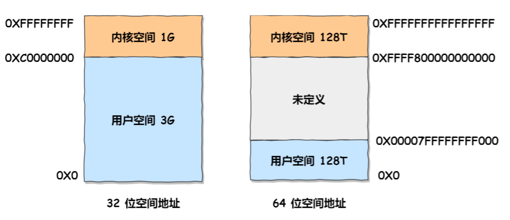

在经典 x86 32 位 Linux 中，一个进程的虚拟地址空间是 4GB，常见划分是：

- 低地址 3GB：用户空间；
- 高地址 1GB：内核空间。

这只是常见配置，不是所有 32 位内核的唯一选择。

在 x86-64 上，用户空间和内核空间都位于更大的虚拟地址范围中。很多资料会用 4 级页表下的 `128TB` 用户空间和 `128TB` 内核空间来说明，但实际布局会受 CPU 架构、5 级页表、内核配置等因素影响。

## 用户态和内核态

- 进程在用户态运行时，只能直接访问自己的用户空间虚拟地址。
- 当进程执行系统调用、中断或异常时，CPU 切换到内核态，开始执行内核代码。
- 内核态代码可以访问内核空间，也可以在安全检查后代表进程访问用户空间数据。

不能理解成“用户程序进入内核态后自己访问内核空间”。真正执行的是内核代码，用户程序只是触发了进入内核的入口。

虽然每个进程都有独立的用户空间，但每个进程虚拟地址空间中的内核地址部分通常映射到同一份内核物理内存。这样，任意进程陷入内核后，内核都能通过固定的内核地址访问内核代码和内核数据结构。

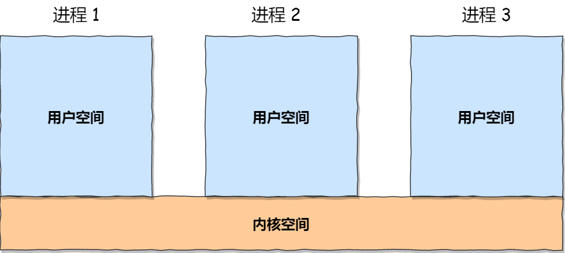

# 进程地址空间布局

用户进程能直接访问的是用户空间。以经典 32 位 `3G/1G` 划分为例，用户空间虚拟地址范围大致是 `0x00000000` 到 `0xBFFFFFFF`。

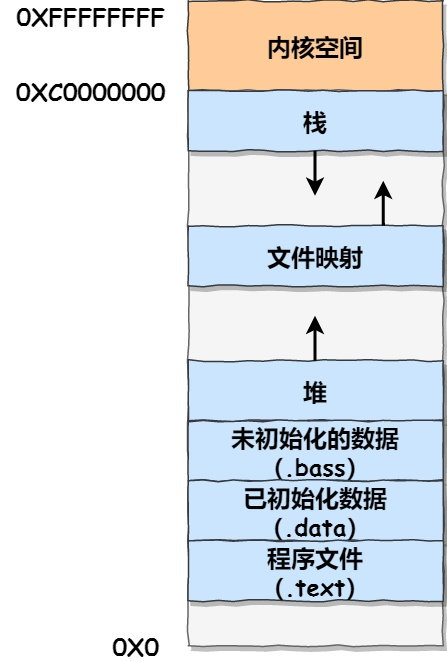

一个进程的用户空间通常包含：

- **代码段 `.text`**：可执行指令，通常只读、可执行。
- **只读数据段 `.rodata`**：字符串常量、只读常量等。
- **数据段 `.data`**：已经初始化的全局变量、静态变量。
- **BSS 段 `.bss`**：未初始化或初始化为 0 的全局变量、静态变量，加载后内容为 0。
- **堆 `heap`**：动态分配内存区域，常由 `malloc` 管理，可通过 `brk` 扩展。
- **文件映射区 `mmap area`**：动态库、共享内存、文件映射、匿名映射等。
- **栈 `stack`**：函数调用栈、局部变量、返回地址、部分调用上下文等，通常向低地址增长。


概念图通常会把代码段、数据段、BSS、堆、mmap 区、栈画成固定顺序，但真实 Linux 进程还会受到 ASLR、动态链接器、线程栈、不同架构和内核配置影响，实际地址并不一定固定。

可以用 `size` 查看一个可执行文件中 text、data、bss 的大小：

```bash
size /usr/bin/ssh
text    data     bss     dec     hex filename
592777  2324   13072  608173   947ad /usr/bin/ssh
```

# 内核地址空间

以 x86 32 位经典模型为例，内核虚拟地址空间从 `0xC0000000` 到 `0xFFFFFFFF`，总大小 1GB。

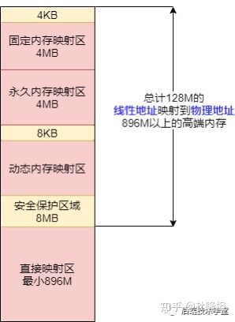

## 直接映射区

直接映射区（Direct Mapping Region）是内核虚拟地址和物理地址之间存在固定偏移关系的一段区域。

在经典 32 位 Linux 中，内核空间前约 896MB 通常用于直接映射低端物理内存。假设 `PAGE_OFFSET = 0xC0000000`，那么转换关系大致是：

```text
内核虚拟地址 = 物理地址 + PAGE_OFFSET
```

例如，内核虚拟地址 `0xC0000001` 对应的物理地址大致是 `0x00000001`。内核可以通过 `virt_to_phys()`、`phys_to_virt()` 在这类直接映射地址之间转换。

## 高端内存映射区

32 位内核地址空间只有 1GB，不可能把所有物理内存都永久直接映射进内核空间。为了访问 896MB 之外的物理内存，内核把剩余虚拟地址空间用于各种临时或动态映射：

- **`vmalloc` 区**：虚拟地址连续，物理页不要求连续，适合分配较大的内核虚拟连续内存。
- **永久映射区**：早期内核用于映射高端内存页。
- **固定映射区 `fixmap`**：在固定虚拟地址处映射特定用途的物理地址，例如 APIC、ACPI 等。

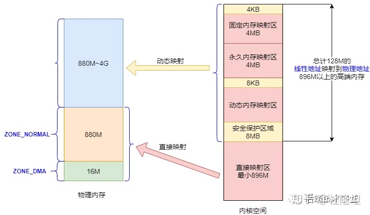

在 64 位 Linux 中，内核虚拟地址空间足够大，高端内存问题不再像 32 位那样突出，但直接映射区、`vmalloc` 区、模块区、`fixmap` 等概念仍然存在。

# 虚拟内存和地址翻译

如果进程直接使用物理地址，不同进程很容易互相覆盖数据，也很难实现权限隔离。虚拟内存通过页表为每个进程提供独立地址空间，CPU 访问内存时再把虚拟地址翻译为物理地址。

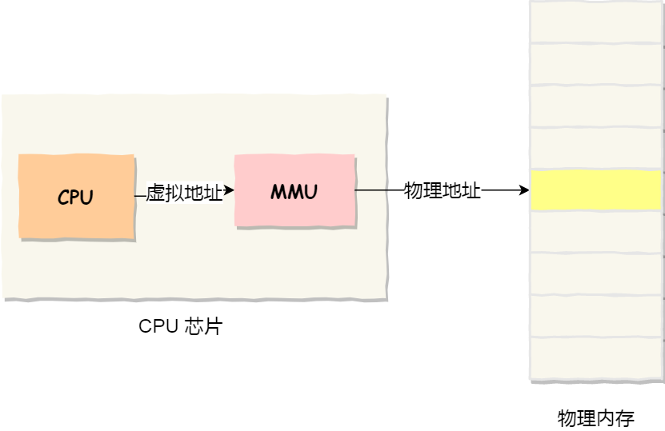

地址翻译依赖三个核心组件：

- **页表**：内存中的多级映射表。
- **MMU**：CPU 内部负责地址翻译的硬件单元。
- **TLB**：CPU 内部缓存最近地址翻译结果的高速缓存。

# 分段、分页和 Linux 的实际使用

## 分段机制

分段是一种按逻辑段管理地址空间的机制。一个虚拟地址可以由**段选择子**和**段内偏移量**组成。

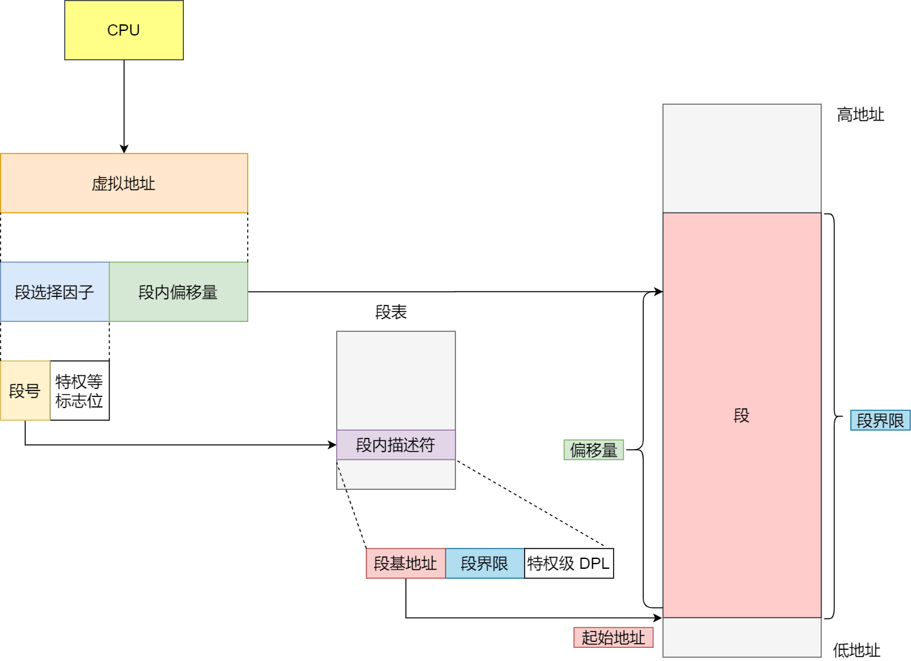

- 段选择子保存在段寄存器中，包含段表索引等信息。
- 段表项记录段基地址、段界限、权限等级等。
- 如果段内偏移没有超过段界限，就用段基地址加偏移得到线性地址或物理地址。

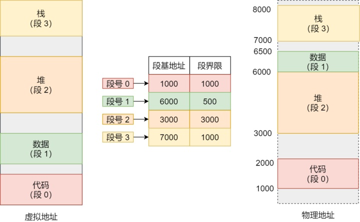

例如段 3 的基地址是 7000，偏移量是 500，则地址是 7500。

需要注意：这是操作系统教材中的通用分段模型。Linux 在 x86 上主要使用“平坦分段 + 分页”。也就是说，段基地址通常被设置为 0，地址空间隔离和权限控制主要依赖分页。x86-64 下分段机制进一步弱化，主要保留 FS/GS 等特殊用途。

## 分页机制

分页把虚拟地址空间和物理内存都划分为固定大小的页。虚拟地址通常拆成两部分：

- 虚拟页号；
- 页内偏移。

页表根据虚拟页号找到物理页框号，再和页内偏移组合成物理地址。

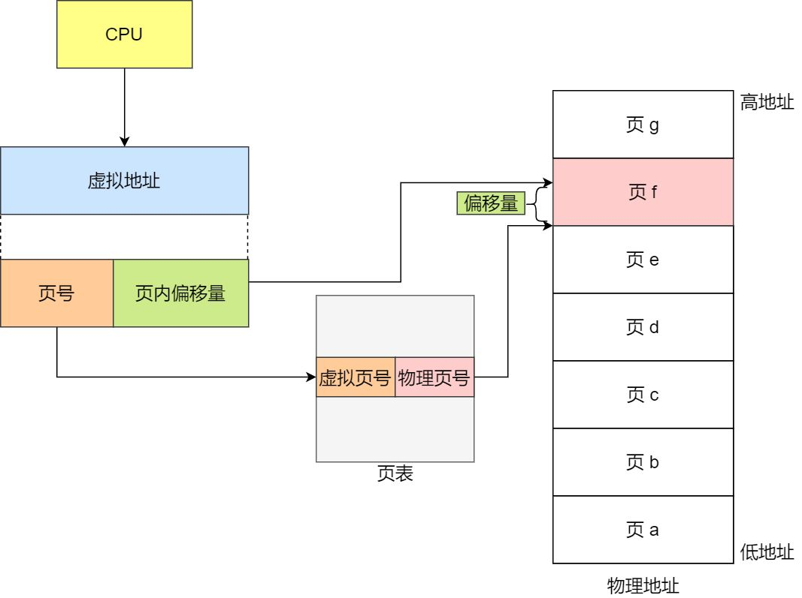

地址翻译的基本步骤是：

- CPU 生成一个虚拟地址；
- MMU 先查 TLB；
- TLB 命中时，直接得到物理页框号；
- TLB 未命中时，MMU 根据页表基址遍历内存中的页表；
- 找到页表项后，把物理页框号和页内偏移组合成物理地址；
- 如果页表项不存在或权限不允许，则触发缺页异常或保护异常。

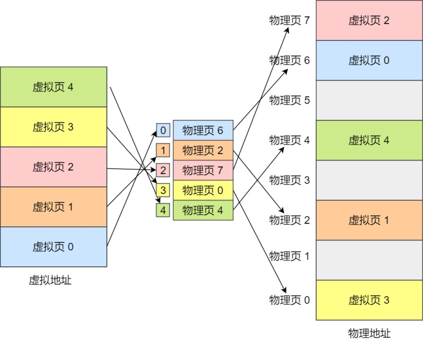

分页主要解决外部碎片问题，因为物理内存可以按页框离散分配；但分页仍然可能产生内部碎片，例如进程只使用了一个页的一小部分，整个页框仍会被占用。

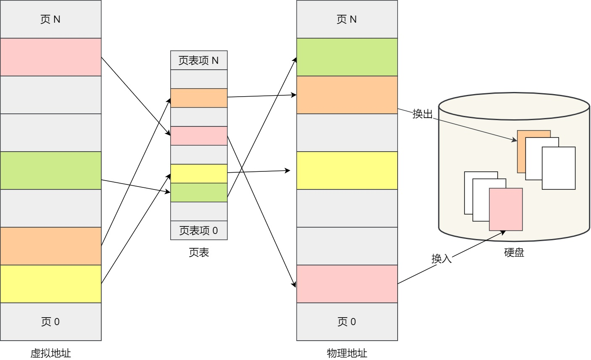

## 缺页异常

当进程访问的虚拟地址没有有效页表项时，CPU 会触发缺页异常，进入内核处理。缺页不一定是错误，常见情况包括：

- 首次访问匿名内存，内核按需分配物理页；
- 首次访问 `mmap` 文件页，内核从文件读入 PageCache 并建立映射；
- 页面被换出到 swap，需要重新换入；
- 访问非法地址或权限不匹配，此时会产生 `SIGSEGV` 等错误。

# 多级页表和 TLB

## 为什么需要多级页表

32 位虚拟地址空间大小是 4GB。如果页大小是 4KB，那么虚拟地址空间有 `2^20` 个虚拟页。假设每个页表项 4 字节，单级页表需要 4MB。

4MB 看起来不大，但每个进程都需要自己的用户页表。如果系统有大量进程，页表本身会占用很多内存。

多级页表的思路是：只为实际使用的虚拟地址范围创建下级页表。未使用的大段虚拟地址空间不需要真的分配完整页表页。

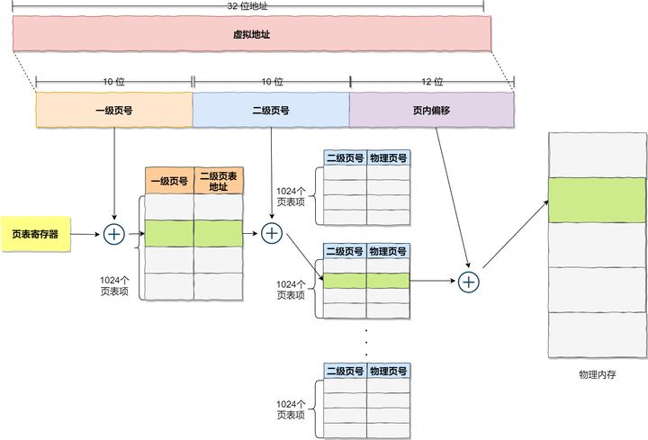

以二级页表为例：

- 一级页表覆盖整个虚拟地址空间；
- 一级页表项指向二级页表；
- 某段虚拟地址完全没被使用时，对应二级页表可以不创建。

64 位地址空间更大，所以 Linux 在 x86-64 上使用多级页表。常见 4 级页表包括：

- PGD（Page Global Directory）
- PUD（Page Upper Directory）
- PMD（Page Middle Directory）
- PTE（Page Table Entry）

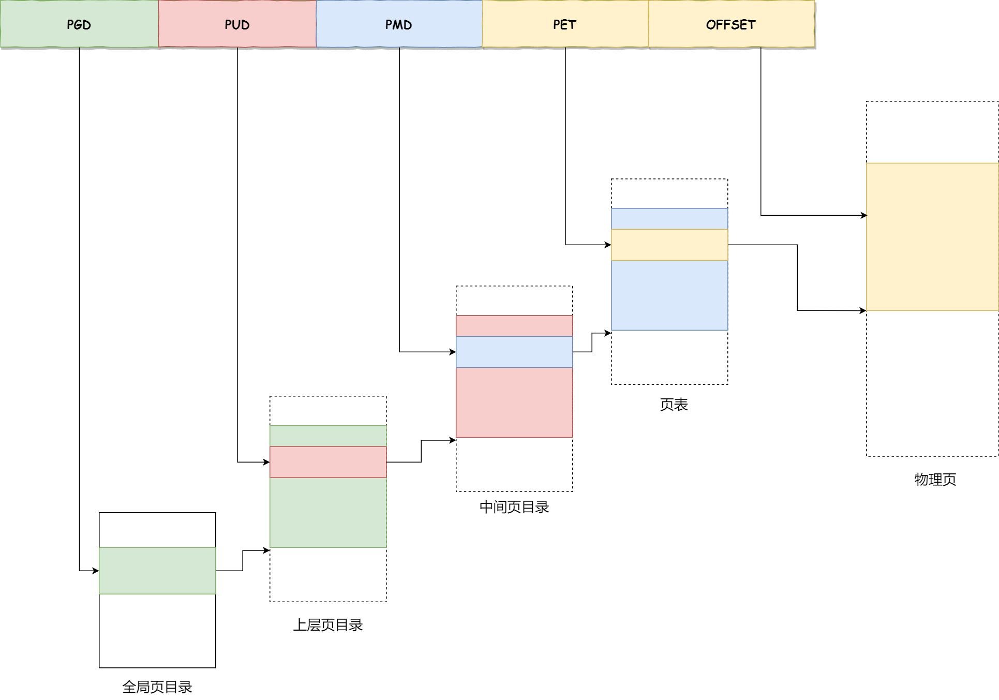

开启 5 级页表时，还会多一层 P4D。具体层级数量取决于架构和内核配置。

## TLB

多级页表节省了页表内存，但也增加了地址翻译时的内存访问次数。为了降低开销，CPU 引入了 TLB（Translation Lookaside Buffer）。

TLB 是 CPU 内部的地址翻译缓存，缓存最近使用过的“虚拟页 -> 物理页框”映射。

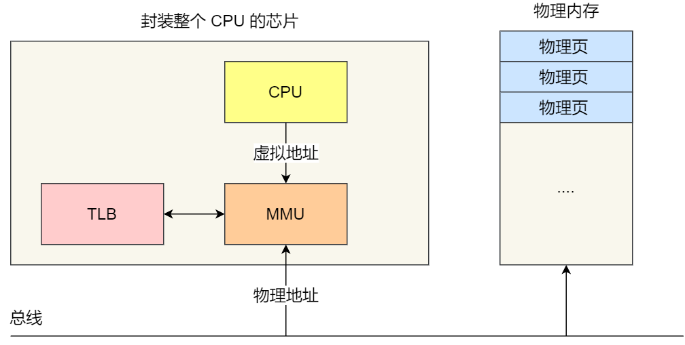

有了 TLB 后，CPU 访问内存时：

- 先查 TLB；
- TLB 命中，直接得到物理地址；
- TLB 未命中，MMU 执行 page walk，遍历页表；
- page walk 成功后，把结果填入 TLB；
- 后续访问同一页时可以直接命中 TLB。

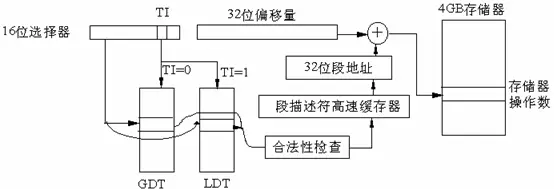

TLB 命中率通常很高，因为程序访问内存具有局部性。但进程切换、页表修改、权限变化等场景可能导致 TLB 刷新或失效，这也是地址空间切换有成本的原因之一。

## 段页式内存管理

段页式内存管理是教材里的组合模型：先按逻辑段划分地址空间，再把每个段分页。

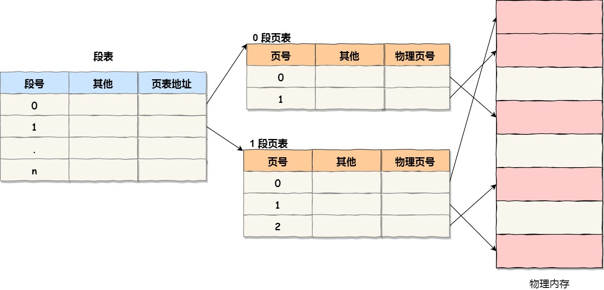

它的地址结构通常包含：

- 段号；
- 段内页号；
- 页内偏移。

访问时先查段表，再查页表，最后得到物理地址。这个模型有助于理解“逻辑组织”和“物理分配”的结合，但 Linux 的主线仍然是平坦分段加分页，日常理解 Linux 内存管理时重点应放在页表、VMA、PageCache、匿名页和物理页回收上。

# 物理内存组织：NUMA node 和 zone

虚拟地址空间解决的是“进程看到什么地址”。物理内存组织解决的是“内核如何管理真实 DRAM”。

## NUMA node

NUMA（Non-Uniform Memory Access，非一致性内存访问）描述的是多 CPU socket 系统中的内存访问差异。

一个 NUMA node 通常包含一个 CPU socket 及其本地内存。CPU 访问本地 node 的内存更快，访问其他 node 的内存更慢。Linux 分配内存时会尽量考虑 NUMA locality，减少跨节点访问。

## zone

每个 NUMA node 内部又会按硬件寻址能力和内核使用方式划分为多个 zone。

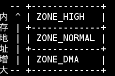

经典 x86 32 位模型里常见 zone 包括：

- **ZONE_DMA**：低 16MB 左右的物理内存，主要服务早期只能访问低地址内存的 ISA DMA 设备。
- **ZONE_NORMAL**：可被内核直接映射的普通内存区域，32 位经典模型中大致是 16MB 到 896MB。
- **ZONE_HIGHMEM**：32 位系统中无法被内核永久直接映射的高端物理内存，需要临时映射后访问。

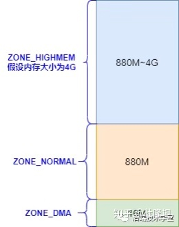

64 位系统通常没有 32 位意义上的 `ZONE_HIGHMEM`，但仍可能有 `ZONE_DMA`、`ZONE_DMA32`、`ZONE_NORMAL`、`ZONE_MOVABLE` 等 zone。zone 的核心意义是让内核在分配物理页时满足不同硬件和内核子系统的约束。

# 页面类型与内存回收

Linux 回收内存时，不是简单“释放其他进程最近没用的页面”。内核需要判断页面类型、是否脏、是否有后备存储、是否可移动。

常见页面类型：

- **干净文件页**：内容和磁盘文件一致，可以直接丢弃。
- **脏文件页**：内容被修改过，需要先写回磁盘再回收。
- **匿名页**：没有文件后备，回收时通常需要写入 swap。
- **不可回收页**：例如部分内核数据结构、被 pin 住的 DMA 页等，不能随便回收。

回收大致路径：

- 优先回收可丢弃的 PageCache；
- 对脏页触发写回；
- 对匿名页尝试换出到 swap；
- 通过 compaction 整理可移动页，获得更大的连续物理页；
- 如果仍然无法满足分配请求，触发 OOM killer。

# `malloc` 如何分配内存

`malloc()` 不是系统调用，而是 C 标准库里的内存分配函数。以 glibc `malloc` 为例，它会在用户态维护 allocator 元数据和缓存池，并在需要时向内核申请更多虚拟地址空间。

常见来源有两类：

- 通过 `brk()` / `sbrk()` 扩展堆；
- 通过 `mmap()` 创建匿名私有映射。

## `brk` 扩展堆

`brk()` 通过移动进程堆顶来扩大或缩小堆区。堆区在虚拟地址上通常连续，适合承载较小、频繁申请释放的对象。


glibc 会从堆中切分小块内存给应用。应用调用 `free()` 后，这些内存通常先回到 allocator 自己的空闲链表或缓存中，方便下次复用，不一定立刻归还给操作系统。

## `mmap` 分配大块内存

较大的分配可能通过匿名私有 `mmap()` 完成，映射区域通常位于 mmap area。


很多资料会提到 `128KB` 阈值，但它不是永远固定的规则。glibc 的阈值会受版本、运行时参数、历史分配行为影响，也可以通过 `mallopt` 调整。

## `malloc` 返回的是虚拟地址

`malloc()` 返回的是用户空间虚拟地址。拿到虚拟地址不代表立刻分配了真实物理页。

Linux 通常采用按需分配：

- `malloc()` 或 `mmap()` 先建立虚拟地址空间；
- 进程首次读写该地址时触发缺页异常；
- 内核再分配物理页并建立页表映射。

这也是为什么申请大量内存后，如果不实际访问，物理内存占用可能不会立刻等量增加。

## `free` 后内存是否归还操作系统

`free()` 的行为取决于这块内存来自哪里，也取决于 allocator 当前状态：

- 来自 `mmap()` 的大块内存，释放时通常可以通过 `munmap()` 直接归还给内核。
- 来自 `brk()` 堆区的小块内存，释放后通常先留在 malloc 的内存池中复用。
- 如果释放的是堆顶附近的大块空闲区域，glibc 也可能通过收缩 `brk` 把一部分堆内存归还给内核。

因此，“`brk` 分配的内存永远不会还给操作系统”是不准确的。更准确的说法是：`brk` 堆区中的普通小块释放通常不会立即归还操作系统，而是优先由 allocator 复用。

## 为什么不全部使用 `mmap`

如果每次小对象分配都调用 `mmap()`，会带来几个问题：

- 每次都要进入内核，系统调用成本更高；
- 每次新映射首次访问都可能触发缺页异常；
- 大量独立映射会增加 VMA 管理成本；
- 小对象分配释放频繁时，用户态 allocator 缓存更高效。

所以，通用 allocator 通常会混合使用 `brk` 和 `mmap`：

- 小块、频繁分配：优先从堆和 malloc 缓存池中分配；
- 大块、生命周期相对独立：可能使用 `mmap`，释放时更容易归还内核。

# 总结

Linux 内存模型可以按这条线理解：

```text
进程看到虚拟地址
    -> CPU 通过 MMU/TLB/页表翻译
    -> 找到真实物理页
    -> 物理页由 NUMA node / zone / struct page 管理
    -> 内存紧张时按 PageCache、匿名页、swap、compaction、OOM 等机制回收
```

核心边界是：

- 用户空间/内核空间是虚拟地址权限划分，不是物理内存简单切分；
- 页表保存在内存中，MMU 负责翻译，TLB 负责缓存翻译结果；
- Linux 主要依赖分页管理内存，分段在现代 Linux 中不是主角；
- PageCache 和匿名页的回收方式不同；
- `malloc` 管理的是用户态堆分配策略，真正物理页通常在缺页时按需分配。
