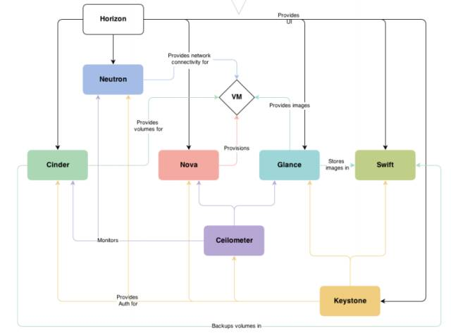
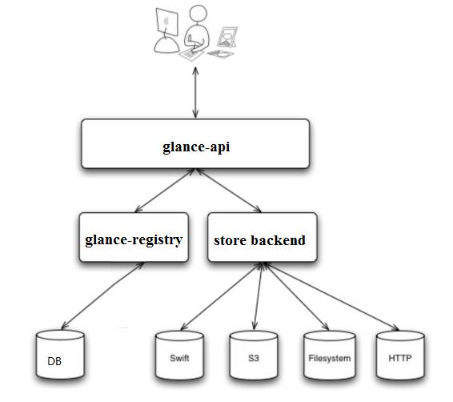

作为 IaaS 层的云操作系统，OpenStack 为虚机提供并管理三大类资源：计算、网络和存储。

**Nova**：管理VM的生命周期（管理计算资源）。

Neutron：为OpenStack提供网络服务，负责创建和管理L2，L3网络，给VM提供虚拟网络和物理网络连接（管理网络资源）。

Glance：管理VM启动镜像，Nova创建VM时将使用Glance提供的镜像（存储）。

Cinder：给VM提供存储服务，Cinder的每一个Volume在VM看来就是一块虚拟硬盘（存储）。

Swift：提供对象存储服务。VM可以通过Rest API存放对象到Swift，Glance也可以把镜像存在Swift，Cinder也可以把Volume备份存在Swift（可选）。

Keystore：提供认证和权限管理服务。OpenStack的每一个操作都需要经过Keystore审核。（核心服务之一）

Ceilometer：监控与计量服务（可选）

Horizon：web页面（可选）

# keystore

User可以是任何使用OpenStack的实体，用户身份验证信息Credentials可以是：

- 用户名/密码
- Token
- API Key
- 其他

Keystore验证用户的credentials后，给用户返还一个有效期24小时的token，作为后续访问凭证。

Project是一组资源的所有者，一个用户必须加入Project才能使用其中的资源。

各个服务在policy.json中定义了各个role拥有的权限。

# Glance

功能：

1. 提供 REST API 让用户能够查询和获取 image 的元数据和 image 本身
2. 支持多种方式存储 image，包括普通的文件系统、Swift、Amazon S3 等
3. 对 Instance 执行 Snapshot 创建新的 image

glance-registry：镜像元数据相关

store-backend：镜像存储相关
