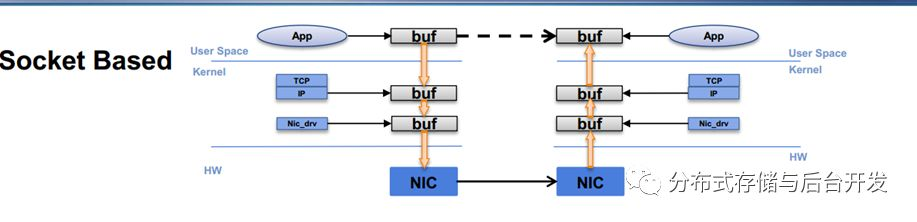
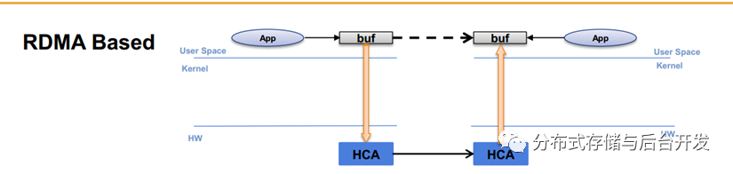
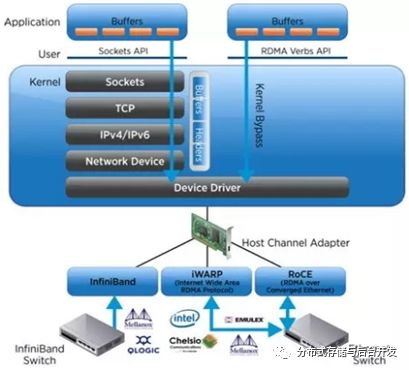
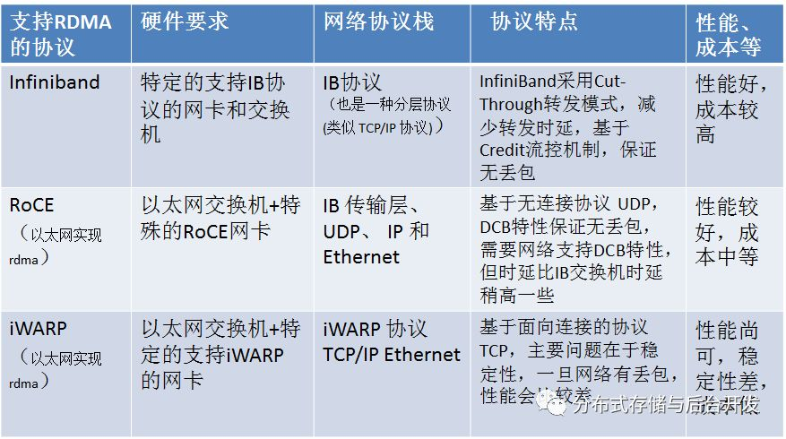
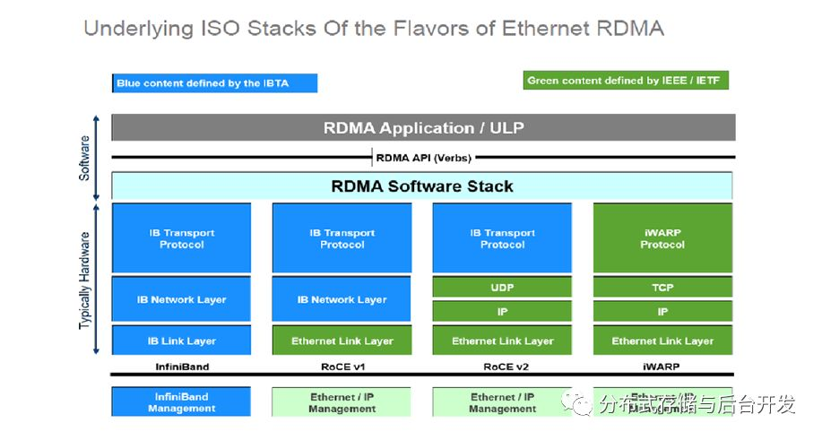
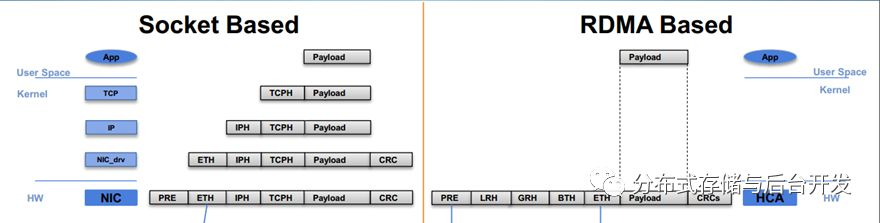
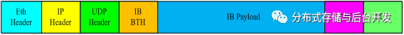
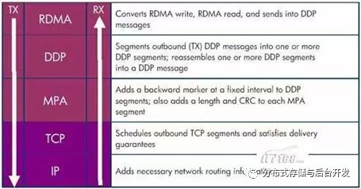
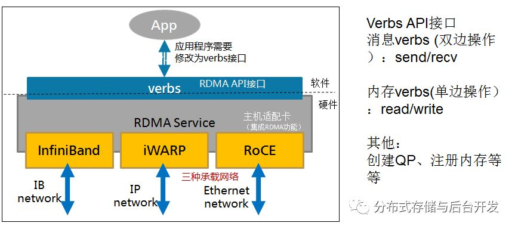
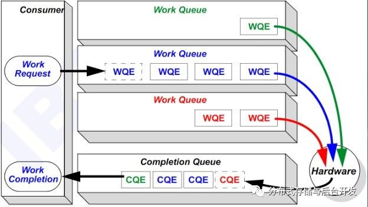

RDMA(RemoteDirect Memory Access)全称远程直接内存访问，是为了解决网络传输中服务器端数据处理的延迟而产生的一种新的内存访问技术，计算机可以直接存取其他计算机的内存，而不需要经过处理器耗时的处理，消除了外部存储器复制和上下文切换的开销，因而能解放内存带宽和CPU周期用于改进应用系统性能。RDMA技术可提供高吞吐、低延迟的网络通信，尤其适合在大规模并行计算机集群中使用。

先看看传统的TCP/IP协议数据传输流程：

**TCP/IP网络数据传输**

TCP/IP协议栈维护着两个缓冲区：sendbuffer和recvbuffer，它们合称为socketbuffer。

需要通过TCP连接传输出去的数据，需要先复制到sendbuffer，再复制给网卡通过网络传输出去。如果通过TCP连接接收到数据，数据首先通过网卡进入recvbuffer，再被复制到用户空间的appbuffer。

数据在系统内存、内核socketbuffer和网卡Buffer之间来回拷贝搬移，因此占用了大量的CPU计算资源和内存总线带宽，也加大了网络延时。

**RDMA技术概述**

基本概念：RDMA(Remote Direct Memory Access)远程直接内存访问，是一种新的内存数据读取技术，RDMA让计算机可以直接存取其他计算机的内存，把数据从一个系统快速移动到远程系统存储器中，而不需要经过处理器耗时的处理，也不会对对操作系统造成任何影响。

技术原理：

1)当一个应用执行RDMA 读或写请求时，不执行任何数据复制.在不需要任何内核内存参与的条件下， 从用户空间中的应用中发送到本地NIC(网卡)。

2)NIC 读取缓冲的内容，并通过网络传送到远程NIC。

3)目标NIC直接将数据写入到本段应用缓存中.

**RDMA和TCP/IP架构的对比分析**

RDMA：利用相关的硬件和软件协议技术，节点之间实现直接内存数据读写，以此解决TCP/IP协议的痛点。

RDMA的特点：零复制（zero-copy）、内核旁路（kernel bypass）、没有CPU参与（CPU offload ）

RDMA优势：高带宽、低延迟、低资源利用率

**支持RDMA的协议**

InfiniBand(IB): 从一开始就支持RDMA的新一代网络协议，被广泛应用到高性能计算中。但是InfiniBand和传统TCP/IP网络的差别非常大，需要专用的支持该技术的网卡和交换机，价格昂贵。

RoCE：RDMA融合以太网(RoCE): 即RDMA over Ethernet, 允许通过以太网执行RDMA的网络协议。这允许在标准以太网基础架构(交换机)上使用RDMA，只不过网卡必须是支持RoCE的特殊的NIC。 RoCE 又包括 RoCEv1 和 RoCEv2 两个版本（ RoCEv2依赖于UDP/IP协议，提供了在局域网中灵活的路由和拥塞控制功能）。  

iWARP ：允许通过TCP执行RDMA的网络协议，即RDMAover TCP/IP 。允许在标准以太网基础架构(交换机)上使用RDMA。利用成熟的 IP 网络； 继承 RDMA 的优点；

……

Infiniband、RoCE以及iWARP技术都是物理网卡上实现了相应的协议栈。将传统的TCP/IP协议栈的所有实现都移到了网卡上，主要具有以下3个显著特点

（1）协议栈加速，通过网卡的处理单元完成了协议栈的所有功能；

（2）避免了数据多次拷贝，其采用了RDMA技术，可直接将数据递交给应用程序线程；

（3）绕过操作系统，减少了系统调用所带来的开销。

**支持RDMA的协议特点总结与比较**

**支持RDMA网络协议栈的对比**

**Infiniband协议报文结构：**

Infiniband和tcp/ip协议对比

传输层BTH：QP号、内存地址及内存秘钥（key）

网络层GRH:  指明了源端口和目的端口标识符GID

Infinband是正统的RDMA协议，需要特定的网卡硬件和交换机。

在软件层面，实现编程接口时，需要先通过TCP建链，通信双方通过TCP通道获取对端的设备信息和QP信息（QP number 和 设备GID，相当于TCP中的端口号和IP地址），然后建立RDMA通道，后续通信就通过RDMA链路，使用原生态verbs库提供的API进行消息通信。

**RoCE协议栈**

以RoCEv2为例，RoCEv2的协议栈包括IB传输层、TCP/UDP、IP 和 Ethernet，其中后面三层都使用了 TCP/IP中相应层次的封包格式。IBBTH 即 InfiniBandBase Transport Header，定义了IB 传输层的相应头部字段。IBPayload 即为消息负载。ICRC 和 FCS 分别对应冗余检测和帧校验。

IBBTH、UDP、IP 以及 Ethernet Layer全是固化在网卡上的

**iWARP协议栈**

下图是iwarp的协议栈，最上面三层构成 iWARP协议族，用来保证高速网络的互操作性。

RDMA层协议负责根据RDMA写操作、RDMA读操作转换成RDMA消息，并将RDMA消息传向Direct Data Placement (DDP)层。

DDP层协议负责将过长的RDMA消息分段封装成DDP数据包继续向下转发到Marker-based, Protocol-data-unit-Aligned (MPA)层。

MPA层在DDP数据段的固定间隔位置增加一个后向标志、长度以及CRC校验数据，构成MPA数据段。TCP层负责对TCP数据段进行调度，确保发包能够顺利到达目标位置。IP层则在数据包中增加必要的网络路由数据信息。

 iWARP是在TCP/IP网络上实现RDMA技术，使用的是rdma_cm库的API（是在verbs基础上做了封装，增加了一些类似TCP中绑定、监听等的接口）。建立连接的时候直接使用rdma_cm接口建立通信链路，和TCP的实现类似，服务端需要有对socket的绑定、监听的过程。

**RDMA软硬件协议栈**

应用程序APP 通过 OFA Stack（亦或其他组织编写的 RDMAstack）提供的 verbs编程接口（比如WRITE、 READ、 SEND等）打包 IB payload，接下来便直接进入硬件，由 RDMA 网卡实现payload 的层层封装，软硬件协议栈如下图所示。

IB/RoCE 使用verbsAPI接口，实现iWARP需要使用到rdma_cmAPI

**RDMA工作原理**

RDMA 提供了基于基于消息队列的点对点通信

1、本端和目标端建立通信连接时，创建一条channel连接，每条Channel的首尾端点是两对QueuePairs（QP），每对QP由SendQueue（SQ）和ReceiveQueue（RQ）构成。RDMA还提供一种队列-CompleteQueue（CQ），CQ用来知会用户消息处理结果。

2、创建QP后，完成QP初始化，并交换通信双方的QP信息。

2、内存注册，向网卡注册databuff的虚拟内存地址，网卡返回内存操作秘钥key.

2、用户创建工作请求（WR），放入工作队列中（工作队列中每一个元素称为WQE），通过网卡异步调度后进行处理。

3、读写请求被处理后，RDMA会产生一个完成事件，放入完成队列CQ中，供用户程序处理。

如果是实现iWARP,需要使用rdma_cm库，增加绑定监听连接的流程。

**RDMA数据传输**

1、RDMASend | RDMA发送(/接收)操作 （Send/Recv）

     和TCP/IP的发送接收接口类似，但是数据包的组装是在硬件网卡上完成

     双边操作，发送端和接受端都要注册自己的工作情况，实现数据的发送、接收的处理。

2、RDMARead | RDMA读操作(单边操作 Pull)

       本端和目标端先建立连接，创建QP、CQ，注册内存；

       RDMA读操作本质上就是Pull操作, 把远程系统内存里的数据拉回到本地系统的内存里。目标端先提供虚拟内存地址和内存操作key ，本端收到后再封装自己的内存地址进去，执行read操作。

3、RDMAWrite | RDMA写操作(单边操作 Push)

     本端和目标端先建立连接，创建QP、CQ，注册内存；

      RDMA写操作本质上就是Push操作，把本地系统内存里的数据推送到远程系统的内存里。目标端先提供虚拟内存地址和内存操作key ，本端收到后再封装自己的内存地址进去，执行write操作。

**RDMA技术在ceph中的实现**

Ceph具有一个统一的消息通信框架msg，用于节点点数据传输和通信。该通信框架有三种实现模式，simple,async,  Xio（实验阶段）。

L版本已经从simple切到了async模式(异步I/O多路复用)。在async模式中通过扩展，实现RDMA数据的读写。X-sky和meallox公司合作，实现了基于infiniband的RDMA支持；Intel 公司实现了基于iWARP的RDMA支持。

Ceph依据节点功能可以将节点划分为4种类型，分别是Client、OSD、Monitor和MDS。

每个节点由Dispatcher（消息调度器）集合和Messenger（消息管理器）集合两部分组成。
Messenger：消息发送和接收
Dispatcher:消息处理或者消息转发

 在守护进程main函数中，需要创建一个或多个Messenger用于和其他模块交互通信，此时就要根据网络配置，选择对应的网络协议栈NetworkStack（根据消息类型选择RDMA/DPDK/TCP/ip），以及相应的网络通信协议及API接口，实现消息通信。
