# 基本概念

虚拟化：

- 基于Hypervisor
- 基于容器

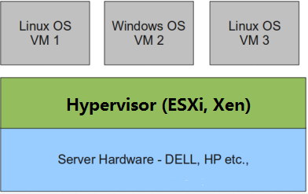

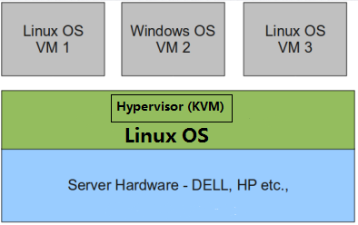

QEMU是一套由Fabrice Bellard编写的模拟处理器的自由软件，它是一个完整的可以单独运行的软件，可以独立模拟出整台计算机，包括CPU，内存，IO设备，通过一个特殊的“重编译器”对特定的处理器的二进制代码进行翻译，从而具有了跨平台的通用性。

KVM 全称是 Kernel-Based Virtual Machine，是基于 Linux 内核实现的，采用了硬件辅助虚拟化，对CPU进行虚拟效率较高。KVM有一个内核模块叫 kvm.ko，只用于管理虚拟 CPU 和内存。IO的虚拟化由操作系统和Qemu管理，因此KVM方案依赖QEMU。

## Libvirt

Libvirt是用于管理虚拟化平台的开源的API，后台程序和管理工具。它可以用于管理KVM、Xen、VMware ESX，QEMU和其他虚拟化技术。

Libvirt 包含 3 个东西：后台 daemon 程序 libvirtd、API 库和命令行工具 virsh

1. libvirtd是服务程序，接收和处理 API 请求；
2. API 库使得其他人可以开发基于 Libvirt 的高级工具，比如 virt-manager，这是个图形化的 KVM 管理工具；
3. virsh 是我们经常要用的 KVM 命令行工具。

# 环境搭建

kvm需要的包：

- qemu-kmu和qemu-system是KVM和QUMU的核心包，提供CPU、内存和IO虚拟化功能。
- libvirt，用于管理KVM等Hypervisor
- virt-manager kvm图形化管理工具
- bridge-utils 和 vlan，网络虚拟化需要

1、切换到root用户

`sudo -i`

2、查看主机是否支持硬件虚拟化

`egrep -c '(vmx|svm)' /proc/cpuinfo`

因为我们的实验本身是在虚拟机中进行的，所以输出0，表示不支持硬件虚拟化。

3、安装QEMU和libvirt

`apt install -y qemu libvirt-bin bridge-utils virt-manager virt-viewer`

如果是支持硬件虚拟化，那么执行安装：

`apt install -y kvm qemu-kvm libvirt-bin bridge-utils virt-manager virt-viewer`

bridge-utils是网桥管理工具。virt-manager是一个通用的桌面管理工具。virt-viewer是一个用于显示虚拟机的图形控制台的最小工具。

4、检查安装

```
virsh --version
virt-manager --version
virt-viewer --version
```

5、查看网络

```
ip a
brctl show
virsh net-list
```

安装完成以后，默认是启用了桥接网络virbr0，IP为192.168.122.1/24。

## 创建centos7虚拟机

# CPU虚拟化

KVM的虚拟化是需要硬件支持的，命令：

```
# egrep -o '(vmx|svm)'  /proc/cpuinfo
```

如果有输出 vmx 或者 svm，就说明当前的 CPU 支持 KVM。

一个 KVM 虚机在宿主机中其实是一个 qemu-kvm 进程，与其他 Linux 进程一样被调度。

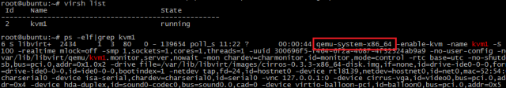

虚拟机中的每一个虚拟vCPU对应qumu-kvm进程中的一个线程：

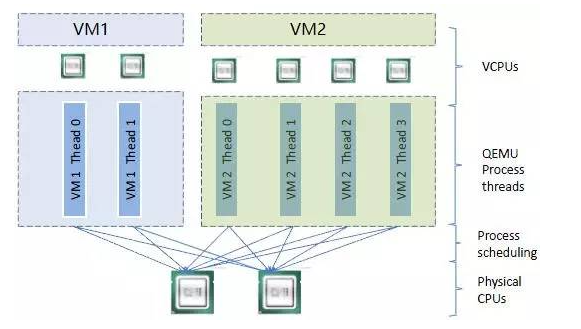

VM1的两个模拟CPU的线程和VM2的四个模拟CPU的线程分别在两个物理CPU上调度。

虚拟CPU数超过物理CPU数，称为overcommit，当所有虚拟起都满负荷运行时，这种方式会影响整体性能。

# 内存虚拟化

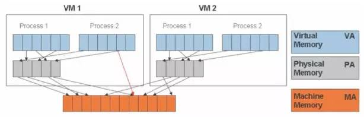

# 存储虚拟化

KVM 的存储虚拟化是通过存储池（Storage Pool）和卷（Volume）来管理的。  

Storage Pool 是宿主机上可以看到的一片存储空间，可以是多种类型。Volume 是在 Storage Pool 中划分出的一块空间，宿主机将 Volume 分配给虚拟机，Volume 在虚拟机中看到的就是一块硬盘。

## 目录类型的Storage Pool

文件目录是最常用的是Storage Pool类型，**KVM将宿主机的**`**/var/lib/libvirt/images**`**作为默认的StoragePool。**

该目录下的一个文件就是一个Volume。

默认路径的位置在`/etc/libvirt/storage`下的xml文件中配置。

demo：

给虚拟机添加一个磁盘

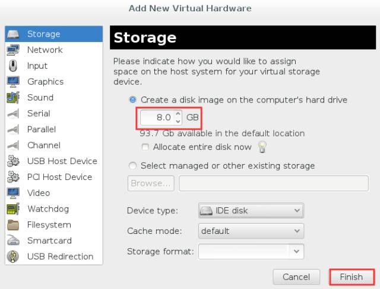

在 /var/lib/libvirt/images/ 下多了一个 8G 的文件 kvm1.img

```
root@ubuntu:~# ls -l /var/lib/libvirt/images/        

total 14044

-rw-r--r-- 1 root root   14417920 Sep  4 11:24 cirros-0.3.3-x86_64-disk.img

-rw------- 1 root root 8589934592 Sep  4 21:39 kvm1.img
```

使用文件做 Volume 有很多优点：存储方便、移植性好、可复制、可远程访问。

可远程访问：通过NFS或GlusterFS之类的分布式文件系统作为镜像的保存位置。

KVM支持多种Volume格式：

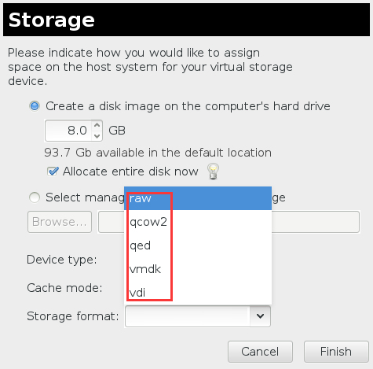

- raw：默认格式，即原始磁盘镜像格式，移植性好，性能好，但大小固定
- qcow2：推荐格式，copy on write，能够节省磁盘空间，支持多快照，支持存储压缩
- vmdk：VMWare的虚拟磁盘格式

## LVM类型的Storage Pool

# 网络虚拟化

## Linux Bridge

假设宿主机的网卡eth0与外网连接，则如何让宿主机上的VM1访问外网？

策略：

给VM1分配一个虚拟网卡vnet0，通过Linux Bridge将eth0和vnet0连接

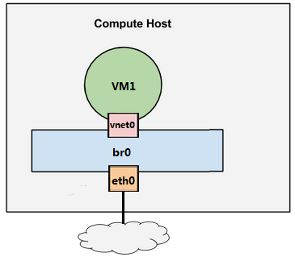

Linux Bridge 是 Linux 上用来做 TCP/IP 二层协议交换的设备，其功能大家可以简单的理解为是一个二层交换机或者 Hub。多个网络设备可以连接到同一个 Linux Bridge，当某个设备收到数据包时，Linux Bridge 会将数据转发给其他设备。

增加一个虚拟机：

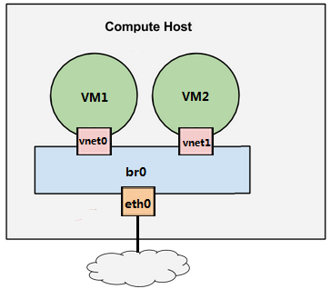

### 实验搭建该环境

编辑 /etc/network/interfaces，配置 br0。下面用 vmdiff 展示了对 /etc/network/interfaces 的修改。  

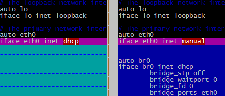

有两点需要注意：  

1. 之前宿主机的 IP 是通过 dhcp 配置在 eth0 上的；创建 Linux Bridge 之后，IP 就必须放到 br0 上了。  

2. 在 br0 的配置信息中请注意最后一行 “bridge_ports eth0”，其作用就是将 eth0 挂到 br0 上。

重启宿主机，查看 IP 配置，可以看到 IP 已经放到 br0 上了。

```
# ifconfig 
br0    Link encap:Ethernet  HWaddr 00:0c:29:8d:ec:be
inet addr:192.168.111.107  Mask:255.255.255.0
inet6 addr: fe80::20c:29ff:fe8d:ecbe/64 
RX packets:22573 errors:0 dropped:0
TX packets:2757 errors:0 dropped:0 
collisions:0 txqueuelen:0 
RX bytes:4927580  TX bytes:368895

eth0   Link encap:Ethernet  HWaddr 00:0c:29:8d:ec:be
inet6 addr: fe80::20c:29ff:fe8d:ecbe/64 
RX packets:24388 errors:0 dropped:0
TX packets:2816 errors:0 dropped:0
collisions:0 txqueuelen:1000 
RX bytes:5590438  TX bytes:411558


lo       Link encap:Local Loopback
inet addr:127.0.0.1  Mask:255.0.0.0
inet6 addr: ::1/128 Scope:Host
RX packets:146 errors:0 dropped:0
TX packets:146 errors:0 dropped:0
collisions:0 txqueuelen:0 
RX bytes:10521  TX bytes:10521


virbr0 Link encap:Ethernet  HWaddr 72:db:fb:f2:19:91
inet addr:192.168.122.1  Mask:255.255.255.0
UP BROADCAST MULTICAST  MTU:1500
RX packets:0 errors:0 dropped:0
TX packets:0 errors:0 dropped:0
collisions:0 txqueuelen:0 
RX bytes:0 (0.0 B)  TX bytes:0 (0.0 B)
```

用 brctl show 查看当前 Linux Bridge 的配置。 eth0 已经挂到 br0 上了。

```
# brctl show
bridge name     bridge id      STP enabled     interfaces
br0             8000.000c298decbe       no                    eth0
virbr0          8000.000000000000       yes
```

除了 br0，大家应该注意到还有一个 virbr0 的 Bridge，而且 virbr0 上已经配置了 IP 地址 192.168.122.1。 virbr0 的作用我们会在后面介绍。

在宿主机中 CloudMan 已经提前创建好了虚机 VM1 和 VM2，现在都处于关机状态

```
# virsh list --all
Id    Name                           State
----------------------------------------------------
-     VM1                            shut off
-     VM2                            shut off
```

**配置 VM1**

下面我们在 virt-manager 中查看一下 VM1 的网卡配置（为了使大家能够熟练使用命令行工具 virsh 和图形工具 virt-manager，CloudMan 在演示的时候会同时用到它们，两个工具都很重要）  

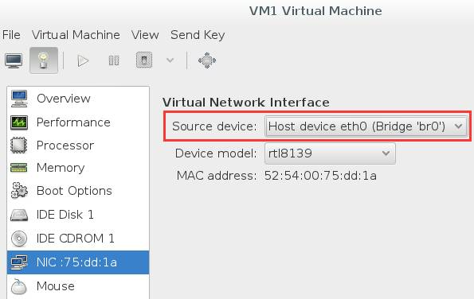

可以看到虚拟网卡的 source device 我们选择的是 br0。下面我们启动 VM1，看会发生什么。

```
# virsh start VM1
Domain VM1 started


# brctl show
bridge name     bridge id      STP enabled     interfaces
br0             8000.000c298decbe       no                    eth0
vnet0
virbr0          8000.000000000000       yes
```

brctl show 告诉我们 br0 下面添加了一个 vnet0 设备，通过 virsh 确认这就是VM1的虚拟网卡。

```
# virsh domiflist VM1
Interface  Type       Source     Model       MAC
-------------------------------------------------------
vnet0      bridge     br0        rtl8139     52:54:00:75:dd:1a
```

VM1 的 IP 是 DHCP 获得的（设置静态 IP 当然也可以），通过 virt-manager 控制台登录 VM1，查看 IP。

```
# ifconfig
eth0   Link encap:Ethernet  HWaddr 52:54:00:75:dd:1a
inet addr:192.168.111.106  Mask:255.255.255.0
inet6 addr: fe80::5054:ff:fe75:dd1a/64
RX packets:400 errors:0 dropped:0
TX packets:101 errors:0 dropped:0
collisions:0 txqueuelen:1000 
RX bytes:41950 TX bytes:12583
```

VM1 通过 DHCP 拿到的 IP 是 192.168.111.106，与宿主机（IP为192.168.111.107）是同一个网段。Ping 一下外网。

```
root@VM1:~# ping www.baidu.com
PING www.a.shifen.com (180.97.33.108) 56(84) bytes of data.
from 180.97.33.108: icmp_seq=1 ttl=53 time=34.9 ms
from 180.97.33.108: icmp_seq=2 ttl=53 time=36.2 ms
from 180.97.33.108: icmp_seq=3 ttl=53 time=38.8 ms
```

没问题，可以访问。

另外，在 VM1 中虚拟网卡是 eth0，并不是 vnet0。 vent0 是该虚拟网卡在宿主机中对应的设备名称，其类型是 TAP 设备，这里需要注意一下。  

**配置 VM2**

跟 VM1 一样，VM2 的虚拟网卡也挂在 br0上，启动 VM1，查看网卡信息。

```
# virsh start VM2
Domain VM2 started


# brctl show
bridge name     bridge id        STP enabled     interfaces
br0             8000.000c298decbe       no                    eth0
vnet0
vnet1
virbr0          8000.000000000000       yes
```

br0 下面多了 vnet1，通过 virsh 确认这就是 VM2 的虚拟网卡。

```
# virsh domiflist VM2
Interface  Type       Source     Model       MAC
-------------------------------------------------------
vnet0      bridge     br0        rtl8139     52:54:00:cf:33:a1
```

VM2 通过 DHCP 拿到的 IP 是 192.168.111.108，登录 VM2，验证网络的连通性，Ping VM1。

```
root@VM2:~# ping VM1
PING VM1 (192.168.111.106) 56(84) bytes of data.
from 192.168.111.106: icmp_seq=1 ttl=64 time=4.54 ms
from 192.168.111.106: icmp_seq=2 ttl=64 time=1.63 ms
from 192.168.111.106: icmp_seq=3 ttl=64 time=2.16 ms
```

Ping 宿主机。

```
root@VM2:~# ping 192.168.111.107
PING 192.168.111.107 (192.168.111.107) 56(84) bytes of data.
from 192.168.111.107: icmp_seq=1 ttl=64 time=1.02 ms
from 192.168.111.107: icmp_seq=2 ttl=64 time=0.052 ms
from 192.168.111.107: icmp_seq=3 ttl=64 time=0.064 ms
```

Ping 外网。

```
root@VM2:~# ping www.baidu.com
PING www.a.shifen.com (180.97.33.107) 56(84) bytes of data.
from 180.97.33.107: icmp_seq=1 ttl=53 time=53.9 ms
from 180.97.33.107: icmp_seq=2 ttl=53 time=45.0 ms
from 180.97.33.107: icmp_seq=3 ttl=53 time=44.2 ms
```

可见，通过 br0 这个 Linux Bridge，我们实现了 VM1、VM2、宿主机和外网这四者之间的数据通信。

### 理解virbr0

virbr0是KVM默认创建的一个Bridge，作用是为连接在Bridge上的虚拟网卡提供NAT访问外网的功能。virbr0默认分配了一个IP 192.168.122.1，并为连接其上的其他虚拟网卡提供DHCP服务。

virbr0使用dnsmasq提供DHCP服务，可以在宿主机查看该进程信息：

```
# ps -elf|grep dnsmasq
5 S libvirt+  2422     1  0  80   0 -  7054 poll_s 11:26 ?        00:00:00 /usr/sbin/dnsma
sq --conf-file=/var/lib/libvirt/dnsmasq/default.conf
```

在`/var/lib/libvirt/dnsmasq/`目录下又一个 default.leases 文件，当VM1成功获得DHCP的IP后，可以在该文件查看到相应的信息

```
# cat /var/lib/libvirt/dnsmasq/default.leases

144177 52:54:00:75:dd:1a 192.168.122.6 ubuntu *
```

## VLAN

虚拟局域网，可以将一个交换机划分成多个交换机，限制广播域，在二层把计算机隔离到不同的VLAN中。

交互机的两种端口：access+trunk

access：这些端口被打上了标签，相同标签的端口可以互相通信

trunk：用于将不同交换机连接起来

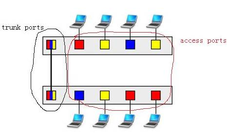

KVM中的VLAN实现：

eth0 是宿主机上的物理网卡，有一个命名为 eth0.10 的子设备与之相连。 eth0.10 就是 VLAN 设备了，其 VLAN ID 就是 VLAN 10。 eth0.10 挂在命名为 brvlan10 的 Linux Bridge 上，虚机 VM1 的虚拟网卡 vent0 也挂在 brvlan10 上。

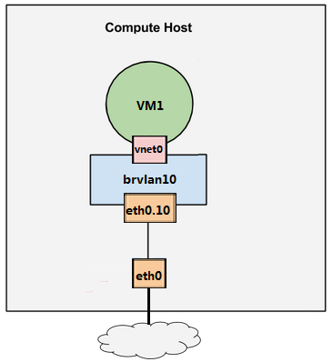

宿主机用软件实现了一个交换机（当然是虚拟的），上面定义了一个 VLAN10。 eth0.10，brvlan10 和 vnet0 都分别接到 VLAN10 的 Access口上。而 eth0 就是一个 Trunk 口。VM1 通过 vnet0 发出来的数据包会被打上 VLAN10 的标签。

再增加一个VLAN20

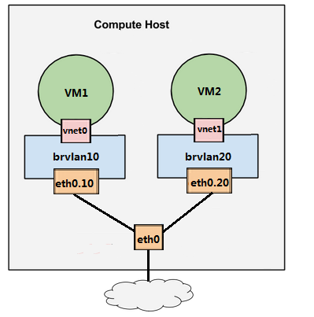

VLAN 设备总是以母子关系出现，母子设备之间是一对多的关系。 一个母设备（eth0）可以有多个子设备（eth0.10，eth0.20 ……），而一个子设备只有一个母设备。

Linux Bridge + VLAN = 虚拟交换机

总结：

- 物理交换机存在多个 VLAN，每个 VLAN 拥有多个端口。 同一 VLAN 端口之间可以交换转发，不同 VLAN 端口之间隔离。 所以交换机其包含两层功能：交换与隔离。
- Linux 的 VLAN 设备实现的是隔离功能，但没有交换功能。 一个 VLAN 母设备（比如 eth0）不能拥有两个相同 ID 的 VLAN 子设备，因此也就不可能出现数据交换情况。
- Linux Bridge 专门实现交换功能。 将同一 VLAN 的子设备都挂载到一个 Bridge 上，设备之间就可以交换数据了。
