# 进程

操作系统中最核心的概念之一就是 `进程`。进程是对正在运行的程序的抽象，操作系统通过进程来隔离资源、组织调度、管理权限并提供并发执行的假象。即使机器只有一个 CPU 核心，操作系统也可以通过快速切换进程，让多个程序看起来像是在同时运行。

从传统教材角度看，进程通常由程序段、数据段和进程控制块（PCB）组成；从现代操作系统实现角度看，进程更像是“资源容器 + 可调度执行上下文”的组合。

## 进程模型

在进程模型中，正在运行的软件会被抽象成一个个 `进程(process)`。一个进程可以理解为一个正在执行的程序实例，它不仅包含程序代码，还包含程序计数器、寄存器、栈、堆、打开文件、地址空间等运行时状态。

从概念上看，每个进程都像拥有自己的虚拟 CPU 和独立地址空间；从实际执行看，操作系统会通过调度器在多个进程之间切换 CPU 使用权。

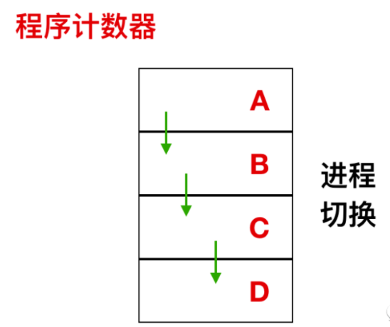

如上图所示，这是一个具有 4 个程序的多道程序系统。在进程不断切换的过程中，CPU 的程序计数器也会被保存和恢复。

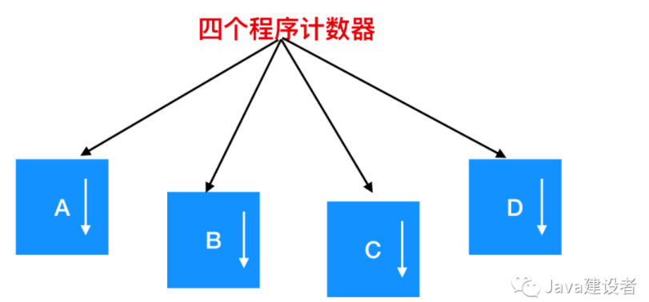

在上图中，这 4 道程序被抽象为 4 个拥有各自控制流的进程。每个进程都有自己的逻辑程序计数器；当某个进程被调度到 CPU 上运行时，内核会把它保存的程序计数器、寄存器等上下文恢复到真实 CPU 中。

如果机器只有一个 CPU 核心，那么在任意一个瞬间只能有一个进程真正运行。只是由于 CPU 在多个进程之间快速切换，用户会感觉多个进程在同时运行，这叫**并发**。

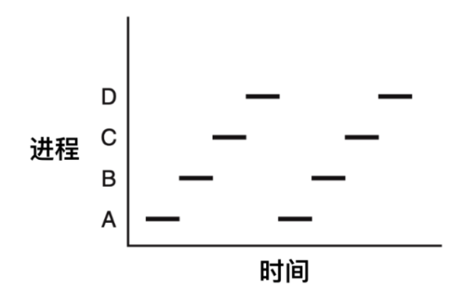

由于 CPU 会在各个进程之间来回快速切换，所以每个进程在 CPU 中的运行时间是无法确定的。并且当同一个进程再次在 CPU 中运行时，其在 CPU 内部的运行时间往往也是不固定的。

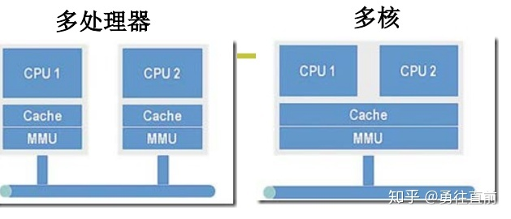

如果机器有多个 CPU 核心，那么多个进程可以被调度到不同核心上同时执行，这叫**并行**。多核机器上，进程既可以并发，也可以并行。

需要注意的是，多核 CPU 并不意味着“地址空间只有一个”。每个进程仍然有自己独立的虚拟地址空间，内核通过页表和 MMU 把不同进程的虚拟地址映射到物理内存。不同核心可能有各自的 L1/L2 cache，也可能共享最后一级 cache，但这和进程是否拥有独立地址空间是两个概念。

同一个进程内的多个线程共享该进程的地址空间和打开文件等资源，因此线程之间通信更方便；不同进程默认地址空间隔离，因此进程间通信通常需要管道、消息队列、共享内存、socket 等 IPC 机制。

## 进程的创建

操作系统需要一些方式来创建进程。下面是一些创建进程的方式：

- 系统初始化（`init`）
- 正在运行的程序执行了创建进程的系统调用（比如 `fork`）
- 用户请求创建一个新进程
- 初始化一个批处理工作

### 系统初始化

启动操作系统时，系统会创建若干进程。其中一部分是前台进程（foreground process），负责和用户交互；另一部分是后台进程，不直接和用户交互，而是长期等待事件并处理后台任务。例如邮件服务、Web 服务、日志服务、打印服务等通常都以后台进程形式运行。这类长期在后台运行的服务进程常被称为守护进程（daemon）。在 UNIX/Linux 中，可以用 `ps` 查看正在运行的进程；在 Windows 中，可以通过任务管理器查看进程。

### 系统调用创建

除了在启动阶段创建进程之外，一些新的进程也可以在后面创建。通常，一个正在运行的进程会发出系统调用来创建一个或多个新进程来帮助其完成工作。例如，如果有大量的数据需要经过网络调取并进行顺序处理，那么创建一个进程读数据，并把数据放到共享缓冲区中，而让第二个进程取走并正确处理会比较容易些。在多处理器中，让每个进程运行在不同的 CPU 上也可以使工作做的更快。

### 用户请求创建

在许多交互式系统中，输入一个命令或者双击图标就可以启动程序，以上任意一种操作都可以选择开启一个新的进程，在基本的 UNIX 系统中运行 X，新进程将接管启动它的窗口。在 Windows 中启动进程时，它一般没有窗口，但是它可以创建一个或多个窗口。每个窗口都可以运行进程。通过鼠标或者命令就可以切换窗口并与进程进行交互。

### 批处理创建

最后一种创建进程的情形会在大型机的批处理系统中应用。用户在这种系统中提交批处理作业。当操作系统决定它有资源来运行另一个任务时，它将创建一个新进程并从其中的输入队列中运行下一个作业。

从技术上讲，创建新进程最终都需要经过操作系统提供的进程创建接口。发起者可能是正在运行的用户进程、响应键盘或鼠标事件的系统组件，也可能是批处理系统。创建接口会告诉操作系统：创建一个新进程，并直接或间接指定新进程要运行的程序。

在经典 UNIX 模型中，创建新进程的核心系统调用是 `fork`。`fork` 会创建当前进程的一个子进程。子进程继承父进程的地址空间内容、环境变量、打开文件描述符等运行环境，但父子进程拥有不同的进程 ID，也拥有各自独立的执行流。

现代 UNIX/Linux 系统通常不会在 `fork` 时立刻完整复制父进程的所有物理内存，而是使用写时复制（copy-on-write）。父子进程刚创建出来时可以共享同一批只读物理页；当其中一个进程尝试写入某个页时，内核才复制该页，让修改发生在各自私有的物理页上。

通常，子进程会在 `fork` 后调用 `execve`，用一个新的程序替换当前进程的内存映像。例如，当用户在 shell 中输入 `sort` 命令时，shell 会先 `fork` 出一个子进程，子进程再调用 `execve` 执行 `sort` 程序。这两步分开的好处是：子进程可以在 `fork` 之后、`execve` 之前调整文件描述符，从而完成标准输入、标准输出和标准错误的重定向。

Windows 使用 `CreateProcess` 创建进程。它把“创建新进程”和“加载新程序”合在一次调用中完成，调用参数包括要执行的程序、命令行参数、安全属性、句柄继承、优先级、窗口信息以及用于返回新进程信息的结构体。除了 `CreateProcess`，Win32 还提供了许多用于进程管理、同步和通信的 API。

在 UNIX 和 Windows 中，进程创建之后，父进程和子进程默认拥有相互隔离的用户地址空间。某个进程修改自己地址空间中的普通变量，这个修改不会自动影响另一个进程。需要区分的是：普通私有内存默认隔离，但进程仍然可以通过共享内存、共享文件映射、`mmap(MAP_SHARED)` 等机制显式共享可写内存。

### copy-on-write

写时复制是一种延迟复制策略。`fork` 刚完成时，父子进程的虚拟地址可以指向同一批物理页，并把这些页标记为只读。只要双方只是读取数据，就不需要真正复制物理内存。

当父进程或子进程尝试写入某个共享页时，CPU 会触发缺页异常，内核再为写入方复制一份新的物理页，并更新页表。这样既保持了父子进程地址空间隔离，又避免了 `fork` 时复制大量内存的开销。

### fork

当程序调用 `fork()` 函数时，系统会创建一个新的子进程。子进程从 `fork()` 调用返回的位置继续执行，看起来像父进程“分裂”出了一个几乎相同的执行副本。

`fork()` 只调用一次，但是会返回两次：

- 在父进程中，`fork()` 返回子进程的 PID；
- 在子进程中，`fork()` 返回 `0`；
- 如果创建失败，`fork()` 返回负数。

下面给出一段实例代码，命名为 fork_example.c。

```c
#include <unistd.h>
#include <stdio.h>

int main() {
    pid_t fpid;

    fpid = fork();
    if (fpid < 0) {
        printf("error in fork!\n");
    } else if (fpid == 0) {
        printf("I am child. Process id is %d\n", getpid());
    } else {
        printf("I am parent. Child process id is %d\n", fpid);
    }

    return 0;
}
```

编译并执行，结果如下。

```bash
root@local:~# gcc -Wall fork_example.c && ./a.out
I am parent. Child process id is 28366
I am child. Process id is 28366
```

父子进程的执行先后顺序由调度器决定，因此输出顺序不固定。

使用 `fork()` 后，还需要区分孤儿进程和僵尸进程：

- **孤儿进程**：父进程先退出，子进程仍在运行。此时子进程会被 `init` 或 `systemd` 等进程接管。
- **僵尸进程**：子进程已经退出，但父进程没有调用 `wait()` / `waitpid()` 回收它的退出状态。此时子进程的用户空间资源已经释放，但进程表中仍保留一小段退出信息。

所以，父进程不是必须等待子进程退出后才能正常退出；真正需要注意的是，如果父进程长期存活，就应该及时 `wait` 子进程，避免产生僵尸进程。

## 进程的终止

进程创建之后会开始运行，最终也会因为某些原因终止。常见原因包括：

- 正常退出(自愿的)
- 错误退出(自愿的)
- 严重错误(非自愿的)
- 被其他进程杀死(非自愿的)

### 正常退出

多数进程是由于完成了工作而终止。当编译器完成了所给定程序的编译之后，编译器会执行一个系统调用告诉操作系统它完成了工作。这个调用在 UNIX 中是 `exit` ，在 Windows 中是 `ExitProcess`。面向屏幕中的软件也支持自愿终止操作。字处理软件、Internet 浏览器和类似的程序中总有一个供用户点击的图标或菜单项，用来通知进程删除它所打开的任何临时文件，然后终止。

### 错误退出

进程发生终止的第二个原因是发现运行条件不满足，例如用户执行如下命令：

```bash
gcc foo.c
```

编译 `foo.c` 但是该文件不存在，于是编译器就会发出声明并退出。在给出了错误参数时，面向屏幕的交互式进程通常并不会直接退出，因为这从用户的角度来说并不合理，用户需要知道发生了什么并想要进行重试，所以这时候应用程序通常会弹出一个对话框告知用户发生了系统错误，是需要重试还是退出。

### 严重错误

进程终止的第三个原因是由进程引起的错误，通常是由于程序中的错误所导致的。例如，执行了一条非法指令，引用不存在的内存，或者除数是 0 等。在有些系统比如 UNIX 中，进程可以通知操作系统，它希望自行处理某种类型的错误，在这类错误中，进程会收到信号（中断），而不是在这类错误出现时直接终止进程。

### 被其他进程杀死

第四个终止进程的原因是，某个进程执行系统调用告诉操作系统杀死某个进程。在 UNIX 中，这个系统调用是 kill。在 Win32 中对应的函数是 `TerminateProcess`（注意不是系统调用）。

## 进程的层次结构

在一些系统中，当一个进程创建了其他进程后，父进程和子进程就会以某种方式进行关联。子进程它自己就会创建更多进程，从而形成一个进程层次结构。

### UNIX 进程体系

在 UNIX/Linux 中，需要区分**进程树**和**进程组**。

进程树描述父子关系：父进程创建子进程，子进程又可以继续创建自己的子进程，因此系统中的进程可以形成以 `init` 或 `systemd` 为根的树状结构。

进程组主要用于作业控制。一个 shell 管道或前台任务中的多个进程通常会被放到同一个进程组里。当用户在终端中按下 `Ctrl+C` 时，终端驱动会把信号发送给当前前台进程组，而不是简单发送给某个进程及其所有后代。

这里有另一个例子，可以用来说明层次的作用，考虑 `UNIX` 在启动时如何初始化自己。一个称为 `init` 的特殊进程出现在启动映像中 。当 init 进程开始运行时，它会读取一个文件，文件会告诉它有多少个终端。然后为每个终端创建一个新进程。这些进程等待用户登录。如果登录成功，该登录进程就执行一个 shell 来等待接收用户输入指令，这些命令可能会启动更多的进程，以此类推。因此，整个操作系统中所有的进程都隶属于一个单个以 init 为根的进程树。

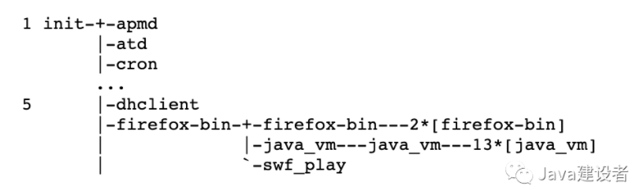

### Windows 进程体系

Windows 没有 UNIX 那种强父子进程树语义。创建进程的一方可以得到新进程的句柄，并用它查询、等待或控制该进程；但这个句柄可以被关闭或传递，进程的生命周期也不依赖创建者持续存在。Windows 仍然记录父进程 ID，也支持 Job Object 这类进程集合管理机制，但整体语义和 UNIX 的进程树不同。

## 进程状态

尽管每个进程是一个独立的实体，有其自己的程序计数器和内部状态，但是，进程之间仍然需要相互帮助。例如，一个进程的结果可以作为另一个进程的输入，在 shell 命令中：

```bash
cat chapter1 chapter2 chapter3 | grep tree
```

第一个进程是 `cat`，将三个文件级联并输出。第二个进程是 `grep`，它从输入中选择具有包含关键字 `tree` 的内容，根据这两个进程的相对速度（这取决于两个程序的相对复杂度和各自所分配到的 CPU 时间片），可能会发生下面这种情况，`grep` 准备就绪开始运行，但是输入进程还没有完成，于是必须阻塞 grep 进程，直到输入完毕。

当一个进程开始运行时，它可能会经历下面这几种状态：

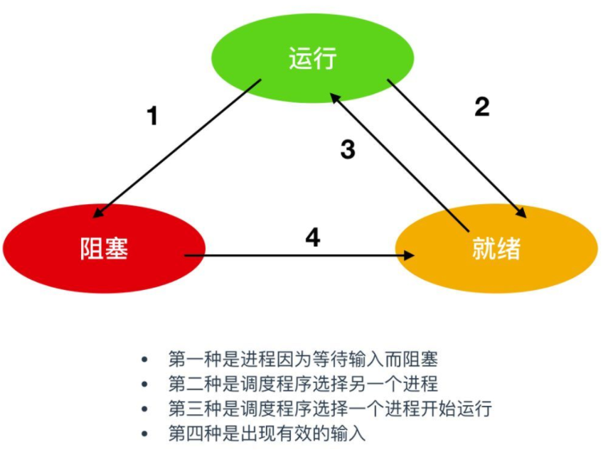

图中会涉及三种状态：

1. `运行态`，运行态指的就是进程实际占用 CPU 时间片运行时
2. `就绪态`，就绪态指的是可运行，但因为其他进程正在运行而处于就绪状态
3. `阻塞态`，除非某种外部事件发生，否则进程不能运行

如果有大量处于阻塞状态的进程，进程可能会占用着物理内存空间，显然不是我们所希望的，毕竟物理内存空间是有限的，被阻塞状态的进程占用着物理内存就一种浪费物理内存的行为。

所以，在虚拟内存管理的操作系统中，通常会把阻塞状态的进程的物理内存空间换出到硬盘，等需要再次运行的时候，再从硬盘换入到物理内存。

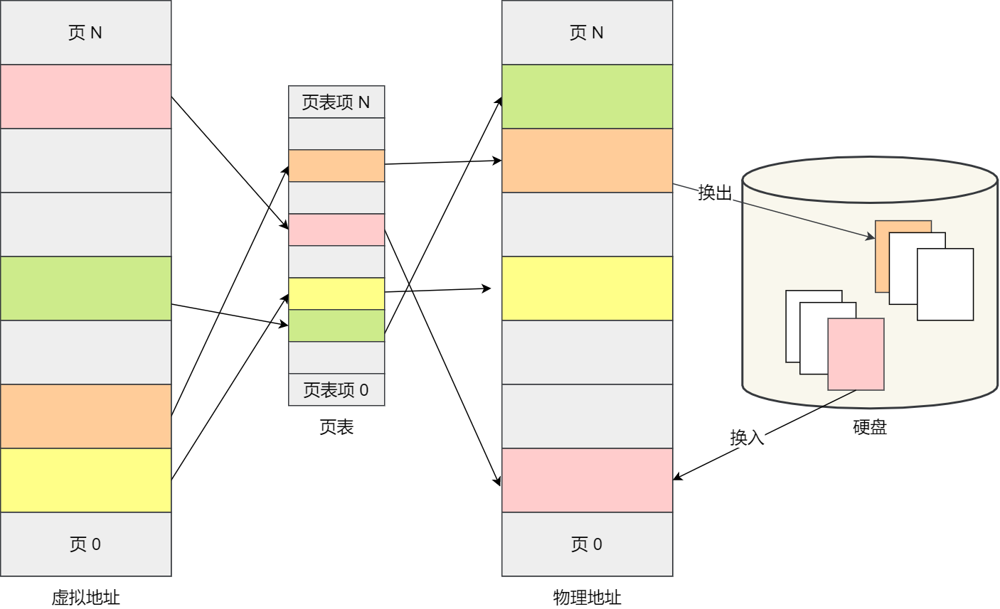

那么，就需要一个新的状态，来**描述进程没有占用实际的物理内存空间的情况，这个状态就是挂起状态**。这跟阻塞状态是不一样，阻塞状态是等待某个事件的返回。

另外，挂起状态可以分为两种：

- 阻塞挂起状态：进程在外存（硬盘）并等待某个事件的出现；
- 就绪挂起状态：进程在外存（硬盘），但只要进入内存，即刻立刻运行；

如果再把新建、终止等状态也纳入，就可以得到更完整的七状态模型，见如下图：

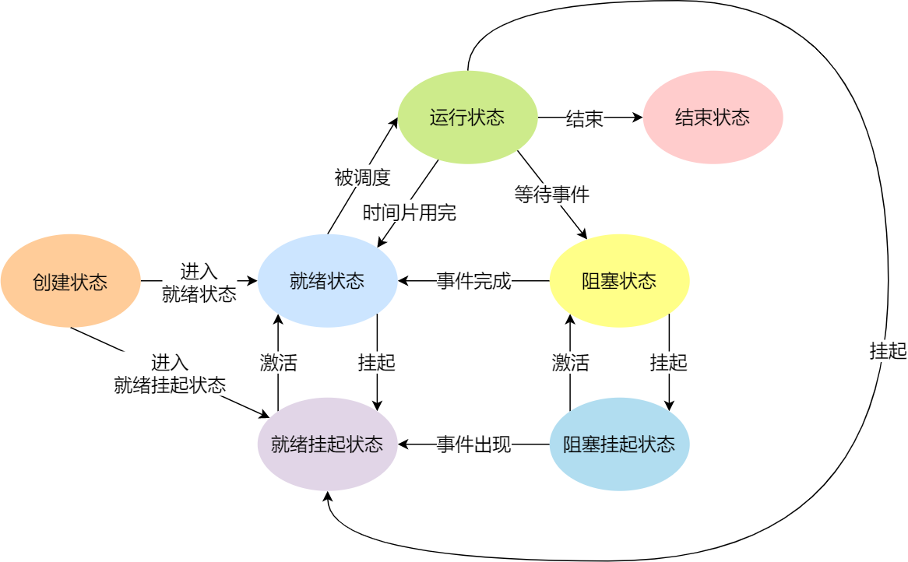

“挂起”在不同语境下容易混用，需要分清：

- 如果是因为内存压力把进程换出到外存，通常对应前面说的挂起状态。
- `sleep` 更准确地说是让进程进入睡眠/阻塞状态，等待定时器到期后重新变为就绪状态。
- `Ctrl+Z` 触发的是作业控制中的停止（stopped）状态，进程被 `SIGTSTP` 暂停，之后可以用 `fg` 或 `bg` 继续运行。

## 进程的实现

操作系统为了执行进程间的切换，会维护着一张表格，这张表就是 `进程表(process table)`。每个进程占用一个进程表项。该表项包含了进程状态的重要信息，包括程序计数器、堆栈指针、内存分配状况、所打开文件的状态、账号和调度信息，以及其他在进程由运行态转换到就绪态或阻塞态时所必须保存的信息，从而保证该进程随后能再次启动，就像从未被中断过一样。

下面展示了一个典型系统中的关键字段：

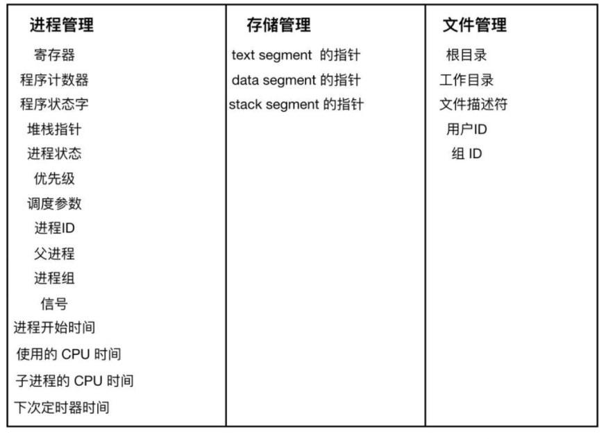

第一列内容与进程管理有关，第二列内容与 存储管理有关，第三列内容与文件管理有关。

与每一 I/O 类相关联的是一个称作 `中断向量表(interrupt vector)` 的位置（靠近内存底部的固定区域）。它包含中断服务程序的入口地址。假设当一个磁盘中断发生时，用户进程 3 正在运行，则中断硬件将程序计数器（指示下一条待执行指令的位置）、程序状态字（溢出、进位、符号、允许中断等标志位）、有时还有一个或多个寄存器压入堆栈，计算机随即跳转到中断向量所指示的地址。这就是硬件所做的事情。然后软件就随即接管一切剩余的工作。

当中断结束后，操作系统会调用一个 C 程序来处理中断剩下的工作。在完成剩下的工作后，会使某些进程就绪，接着调用调度程序，决定随后运行哪个进程。然后将控制权转移给一段汇编语言代码，为当前的进程装入寄存器值以及内存映射并启动该进程运行，下面显示了中断处理和调度的过程。

1. 硬件压入堆栈程序计数器等
2. 硬件从中断向量装入新的程序计数器
3. 汇编语言过程保存寄存器的值
4. 汇编语言过程设置新的堆栈
5. C 中断服务程序运行（典型的读和缓存写入）
6. 调度器决定下面哪个程序先运行
7. C 过程返回至汇编代码
8. 汇编语言过程开始运行新的当前进程

一个进程在执行过程中可能被中断数千次，但关键每次中断后，被中断的进程都返回到与中断发生前完全相同的状态。

进程的数据结构：

```c
struct task_struct {
	// 进程状态
	long			  state;
	// 虚拟内存结构体
	struct mm_struct  *mm;
	// 进程号
	pid_t			  pid;
	// 指向父进程的指针
	struct task_struct __rcu  *parent;
	// 子进程列表
	struct list_head		children;
	// 存放文件系统信息的指针
	struct fs_struct		*fs;
	// 一个数组，包含该进程打开的文件指针
	struct files_struct		*files;
};
```

`task_struct`就是Linux内核对于一个进程的描述，也叫做进程描述符。

文件描述符files：一个进程会从files[0]读取输入，输出到files[1]，错误信息输出到files[2]，每个进程被创建时，files的前三位被写入默认值，标准输入，标准输出和标准错误。

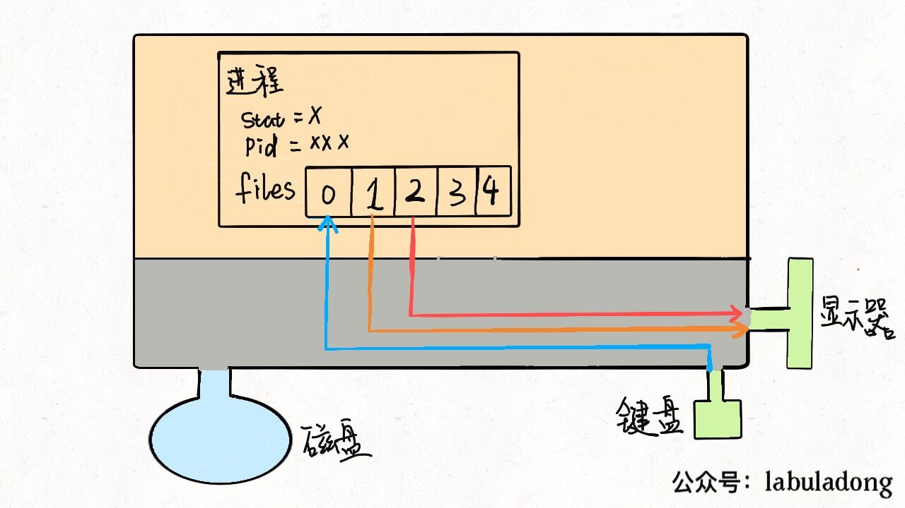

**Linux中一切皆文件。**

## 进程上下文切换

CPU 的上下文主要包括：CPU 寄存器、程序计数器（PC）、栈指针以及和当前执行流相关的内核状态。

CPU 进行上下文切换时，需要保存当前执行流的寄存器和 PC 等状态，再加载下一个执行流之前保存的状态。

进程是由内核管理和调度的，所以进程的切换只能发生在内核态。

**进程上下文切换不会复制虚拟内存、栈或全局变量本身**。它真正切换的是 CPU 执行现场和地址空间上下文，例如寄存器、PC、内核栈、页表基址、内存管理结构等。由于切换地址空间可能导致 TLB 失效，所以进程切换通常比同进程内的线程切换更重。

通常，会把交换的信息保存在进程的 PCB，当要运行另外一个进程的时候，我们需要从这个进程的 PCB 取出上下文，然后恢复到 CPU 中，这使得这个进程可以继续执行，如下图所示：

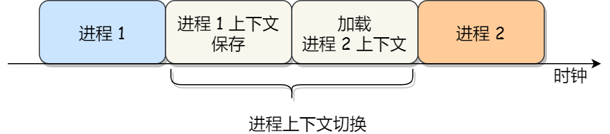

大家需要注意，进程的上下文开销是很关键的，我们希望它的开销越小越好，这样可以使得进程可以把更多时间花费在执行程序上，而不是耗费在上下文切换。

> 发生进程上下文切换有哪些场景？

- 为了保证所有进程可以得到公平调度，CPU 时间被划分为一段段的时间片，这些时间片再被轮流分配给各个进程。这样，当某个进程的时间片耗尽了，进程就从运行状态变为就绪状态，系统从就绪队列选择另外一个进程运行；
- 进程在系统资源不足（比如内存不足）时，要等到资源满足后才可以运行，这个时候进程也会被挂起，并由系统调度其他进程运行；
- 当进程通过睡眠函数 sleep 这样的方法将自己主动挂起时，自然也会重新调度；
- 当有优先级更高的进程运行时，为了保证高优先级进程的运行，当前进程会被挂起，由高优先级进程来运行；
- 发生硬件中断时，CPU 上的进程会被中断挂起，转而执行内核中的中断服务程序；

## 进程调度算法

- **先到先服务(FCFS)调度算法** : 从就绪队列中选择一个最先进入该队列的进程为之分配资源，使它立即执行并一直执行到完成或发生某事件而被阻塞放弃占用 CPU 时再重新调度。
- **短作业优先(SJF)的调度算法** : 从就绪队列中选出一个估计运行时间最短的进程为之分配资源，使它立即执行并一直执行到完成或发生某事件而被阻塞放弃占用 CPU 时再重新调度。
- **长作业优先(LJF)的调度算法** : 从就绪队列中选出一个估计运行时间最长的进程为之分配资源，使它立即执行并一直执行到完成或发生某事件而被阻塞放弃占用 CPU 时再重新调度。
- **时间片轮转调度算法** : 时间片轮转调度是一种最古老，最简单，最公平且使用最广的算法，又称 RR(Round robin)调度。每个进程被分配一个时间段，称作它的时间片，即该进程允许运行的时间。
- **多级反馈队列调度算法** ：多级反馈队列调度算法通过多级队列和动态优先级调整，兼顾交互响应和吞吐量，是很多通用调度器思想的基础。
- **优先级调度** ： 为每个进程分配优先级，优先执行高优先级进程。具有相同优先级的进程可以再按 FCFS、时间片轮转等规则调度。优先级可以根据任务类型、资源需求、等待时间等因素确定。

## 死锁的必要条件

以下四个条件同时出现时，就可能引起死锁：

- **互斥**：资源必须处于非共享模式，即一次只有一个进程可以使用。如果另一进程申请该资源，那么必须等待直到该资源被释放为止。
- **占有并等待**：一个进程至少应该占有一个资源，并等待另一资源，而该资源被其他进程所占有。
- **非抢占**：资源不能被抢占。只能在持有资源的进程完成任务后，该资源才会被释放。
- **循环等待**：有一组等待进程 `{P0, P1,..., Pn}`， `P0` 等待的资源被 `P1` 占有，`P1` 等待的资源被 `P2` 占有，......，`Pn-1` 等待的资源被 `Pn` 占有，`Pn` 等待的资源被 `P0` 占有。

### 死锁的处理策略

|          | 资源分配策略                                     | 各种可能模式                   | 主要优点                                     | 主要缺点                       |
| -------- | ------------------------------------------------ | ------------------------------ | -------------------------------------------- | ------------------------------ |
| 死锁预防 | 保守，宁可资源闲置                               | 一次请求所有资源，资源按需分配 | 不必进行剥夺                                 | 效率低，进程初始化时间长       |
| 死锁避免 | 是“预防”和“检测”的折中，在运行时判断是否可能死锁 | 寻找可能的安全允许顺序         | 不必进行剥夺                                 | 必须知道将来的资源需求         |
| 死锁检测 | 宽松，只要允许就分配资源                         | 定期检测死锁是否发生           | 不延长进程初始化时间，允许对死锁进行现场处理 | 通过剥夺解除死锁，造成性能损失 |

预防死锁：

- 破坏互斥条件：有些资源必须互斥使用，无法破坏互斥条件
- 破坏不剥夺条件：无法获得资源的进程释放已获取的资源，但反复申请和释放资源会增加系统开销，且释放已获取的资源可能导致前一阶段的工作失效。
- 破坏请求和保持条件：预先申请所需的全部资源。严重浪费系统资源，还可能导致饥饿现象
- 破坏循环等待条件：顺序资源分配法。浪费系统资源，并造成编程不便

死锁避免：找到一个分配资源的序列使得所有进程都能顺利完成，采用银行家算法实现。进程首次申请资源时，判断剩余资源是否能满足进程的最大需求。

死锁检测：通过死锁化简图判断出死锁存在后，剥夺资源|进程回滚|终止进程来解除死锁。

# 进程间通信

每个进程的用户地址空间都是独立的，一般而言是不能互相访问的，但内核空间是每个进程都共享的，所以进程之间要通信必须通过内核。

## 管道

如果你学过 Linux 命令，那你肯定很熟悉「`|`」这个竖线。

```bash
$ ps auxf | grep mysql
```

上面命令行里的「`|`」竖线就是一个**管道**，它的功能是将前一个命令（`ps auxf`）的输出，作为后一个命令（`grep mysql`）的输入，从这功能描述，可以看出**管道传输数据是单向的**，如果想相互通信，我们需要创建两个管道才行。

同时，我们得知上面这种管道是没有名字，所以「`|`」表示的管道称为**匿名管道**，用完了就销毁。

管道还有另外一个类型是**命名管道**，也被叫做 `FIFO`，因为数据是先进先出的传输方式。

在使用命名管道前，先需要通过 `mkfifo` 命令来创建，并且指定管道名字：

```bash
$ mkfifo myPipe
```

myPipe 就是这个管道的名称，基于 Linux 一切皆文件的理念，所以管道也是以文件的方式存在，我们可以用 ls 看一下，这个文件的类型是 p，也就是 pipe（管道） 的意思：

```bash
$ ls -l
prw-r--r--. 1 root    root         0 Jul 17 02:45 myPipe
```

接下来，我们往 myPipe 这个管道写入数据：

```bash
$ echo "hello" > myPipe  // 将数据写进管道
                         // 停住了 ...
```

你操作了后，你会发现命令执行后就停在这了，这是因为管道里的内容没有被读取，只有当管道里的数据被读完后，命令才可以正常退出。

于是，我们执行另外一个命令来读取这个管道里的数据：

```bash
$ cat < myPipe  // 读取管道里的数据
hello
```

可以看到，管道里的内容被读取出来了，并打印在了终端上，另外一方面，echo 那个命令也正常退出了。

我们可以看出，**管道这种通信方式效率低，不适合进程间频繁地交换数据**。当然，它的好处，自然就是简单，同时也我们很容易得知管道里的数据已经被另一个进程读取了。

匿名管道的创建，需要通过下面这个系统调用：

```c
int pipe(int fd[2])
```

这里表示创建一个匿名管道，并返回了两个描述符，一个是管道的读取端描述符 `fd[0]`，另一个是管道的写入端描述符 `fd[1]`。注意，这个匿名管道是特殊的文件，只存在于内存，不存于文件系统中。

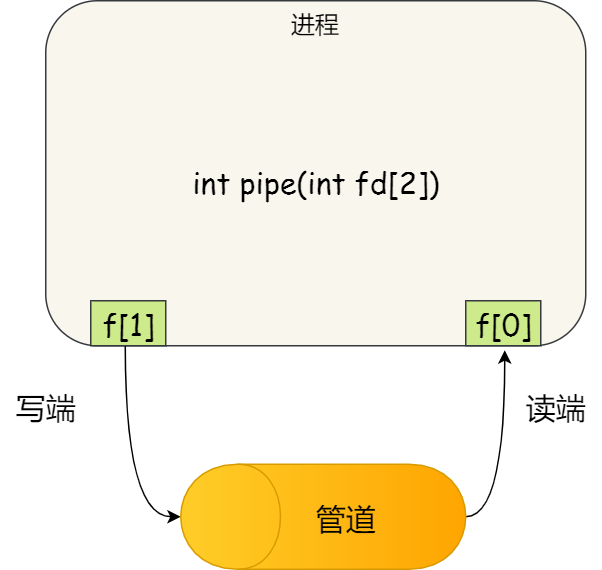

其实，**所谓的管道，就是内核里面的一串缓存**。从管道的一段写入的数据，实际上是缓存在内核中的，另一端读取，也就是从内核中读取这段数据。另外，管道传输的数据是无格式的流且大小受限。

看到这，你可能会有疑问了，这两个描述符都是在一个进程里面，并没有起到进程间通信的作用，怎么样才能使得管道是跨过两个进程的呢？

我们可以使用 `fork` 创建子进程，**创建的子进程会复制父进程的文件描述符**，这样就做到了两个进程各有两个「 `fd[0]` 与 `fd[1]`」，两个进程就可以通过各自的 fd 写入和读取同一个管道文件实现跨进程通信了。

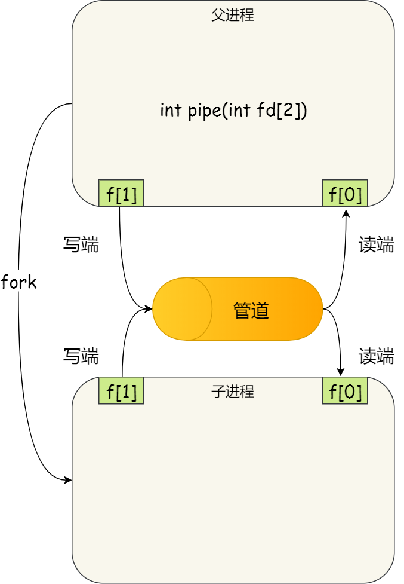

管道只能一端写入，另一端读出，所以上面这种模式容易造成混乱，因为父进程和子进程都可以同时写入，也都可以读出。那么，为了避免这种情况，通常的做法是：

- 父进程关闭读取的 fd[0]，只保留写入的 fd[1]；
- 子进程关闭写入的 fd[1]，只保留读取的 fd[0]；

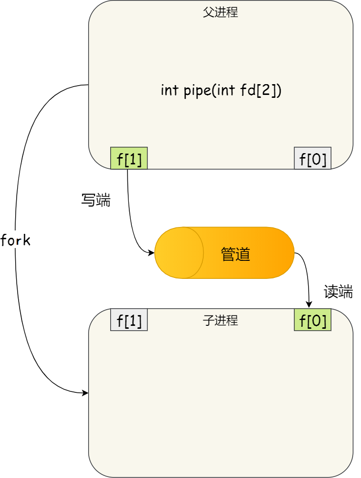

所以说如果需要双向通信，则应该创建两个管道。

到这里，我们仅仅解析了使用管道进行父进程与子进程之间的通信，但是在我们 shell 里面并不是这样的。

在 shell 里面执行 `A | B`命令的时候，A 进程和 B 进程都是 shell 创建出来的子进程，A 和 B 之间不存在父子关系，它俩的父进程都是 shell。

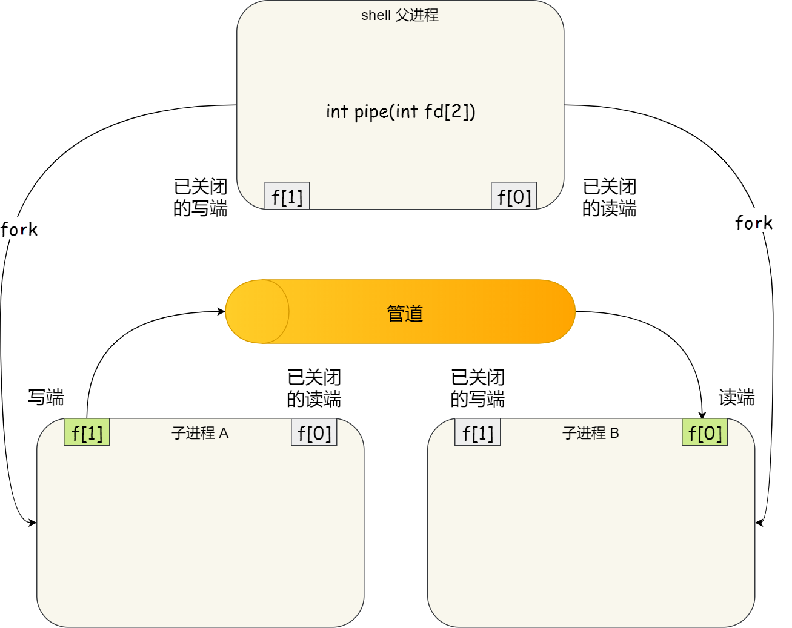

所以说，在 shell 里通过「`|`」匿名管道将多个命令连接在一起，实际上也就是创建了多个子进程，那么在我们编写 shell 脚本时，能使用一个管道搞定的事情，就不要多用一个管道，这样可以减少创建子进程的系统开销。

我们可以得知，**匿名管道的关键限制不是必须有父子关系，而是通信双方必须持有同一个管道的文件描述符**。最常见的方式是父进程先创建 pipe，再通过 `fork` 让子进程继承这些文件描述符；shell 管道也是利用这个机制把多个子进程连接起来。更特殊的情况下，文件描述符也可以通过 Unix domain socket 传递给无亲缘关系的进程。

另外，**对于命名管道，它可以在不相关的进程间也能相互通信**。因为命令管道，提前创建了一个类型为管道的设备文件，在进程里只要使用这个设备文件，就可以相互通信。

不管是匿名管道还是命名管道，进程写入的数据都是缓存在内核中，另一个进程读取数据时候自然也是从内核中获取，同时通信数据都遵循**先进先出**原则，不支持 lseek 之类的文件定位操作。

## 消息队列

**消息队列是保存在内核中的消息链表**，在发送数据时，会分成一个一个独立的数据单元，也就是消息体（数据块），消息体是用户自定义的数据类型，消息的发送方和接收方要约定好消息体的数据类型，所以每个消息体都是固定大小的存储块，不像管道是无格式的字节流数据。如果进程从消息队列中读取了消息体，内核就会把这个消息体删除。

消息队列生命周期随内核，如果没有释放消息队列或者没有关闭操作系统，消息队列会一直存在，而前面提到的匿名管道的生命周期，是随进程的创建而建立，随进程的结束而销毁。

**消息队列不适合比较大数据的传输**，因为在内核中每个消息体都有一个最大长度的限制，同时所有队列所包含的全部消息体的总长度也是有上限。在 Linux 内核中，会有两个宏定义 `MSGMAX` 和 `MSGMNB`，它们以字节为单位，分别定义了一条消息的最大长度和一个队列的最大长度。

**消息队列通信过程中，存在用户态与内核态之间的数据拷贝开销**，因为进程写入数据到内核中的消息队列时，会发生从用户态拷贝数据到内核态的过程，同理另一进程读取内核中的消息数据时，会发生从内核态拷贝数据到用户态的过程。

## 共享内存

消息队列的读取和写入的过程，都会有发生用户态与内核态之间的消息拷贝过程。那**共享内存**的方式，就很好的解决了这一问题。

现代操作系统，对于内存管理，采用的是虚拟内存技术，也就是每个进程都有自己独立的虚拟内存空间，不同进程的虚拟内存映射到不同的物理内存中。所以，即使进程 A 和 进程 B 的虚拟地址是一样的，其实访问的是不同的物理内存地址，对于数据的增删查改互不影响。

**共享内存的机制，就是拿出一块虚拟地址空间来，映射到相同的物理内存中**。这样这个进程写入的东西，另外一个进程马上就能看到了，都不需要拷贝来拷贝去，传来传去，大大提高了进程间通信的速度。

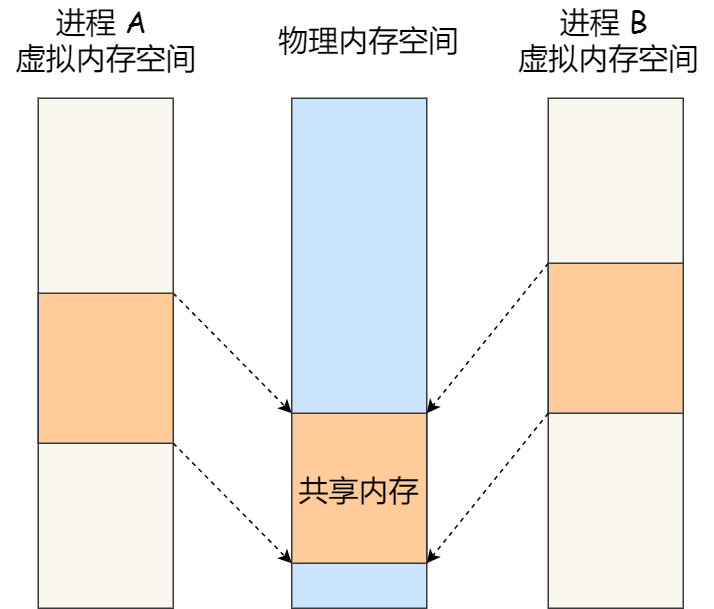

## 信号量

**信号量是一个整型的计数器，主要用于实现进程间的互斥与同步，而不是用于缓存进程间通信的数据**。

信号量表示资源的数量，控制信号量的方式有两种原子操作：

- 一个是 **P 操作**，这个操作会把信号量减去 1，相减后如果信号量 < 0，则表明资源已被占用，进程需阻塞等待；相减后如果信号量 >= 0，则表明还有资源可使用，进程可正常继续执行。
- 另一个是 **V 操作**，这个操作会把信号量加上 1，相加后如果信号量 <= 0，则表明当前有阻塞中的进程，于是会将该进程唤醒运行；相加后如果信号量 > 0，则表明当前没有阻塞中的进程；

P 操作是用在进入共享资源之前，V 操作是用在离开共享资源之后，这两个操作是必须成对出现的。

## 信号

信号是进程间通信机制中**唯一的异步通信机制**，因为可以在任何时候发送信号给某一进程，一旦有信号产生，我们就有下面这几种，用户进程对信号的处理方式。

**1.执行默认操作**。Linux 对每种信号都规定了默认操作，例如，上面列表中的 SIGTERM 信号，就是终止进程的意思。

**2.捕捉信号**。我们可以为信号定义一个信号处理函数。当信号发生时，我们就执行相应的信号处理函数。

**3.忽略信号**。当我们不希望处理某些信号的时候，就可以忽略该信号，不做任何处理。有两个信号是应用进程无法捕捉和忽略的，即 `SIGKILL` 和 `SIGSTOP`，它们用于在任何时候中断或结束某一进程。

## socket

本地 socket 被用于在**同一台主机上进程间通信**的场景：

- 本地 socket 的编程接口和 IPv4 、IPv6 套接字编程接口是一致的，可以支持「字节流」和「数据报」两种协议；
- 本地 socket 的实现效率大大高于 IPv4 和 IPv6 的字节流、数据报 socket 实现；

对于本地字节流 socket，其 socket 类型是 AF_LOCAL 和 SOCK_STREAM。

对于本地数据报 socket，其 socket 类型是 AF_LOCAL 和 SOCK_DGRAM。

本地字节流 socket 和 本地数据报 socket 在 bind 的时候，不像 TCP 和 UDP 要绑定 IP 地址和端口，而是**绑定一个本地文件**，这也就是它们之间的最大区别。

# 线程

线程与进程的比较如下：

- 进程是资源（包括内存、打开的文件等）分配的单位，线程是 CPU 调度的单位；
- 进程拥有一个完整的资源平台，而线程只独享必不可少的资源，如寄存器和栈；
- 线程同样具有就绪、阻塞、执行三种基本状态，同样具有状态之间的转换关系；
- 线程能减少并发执行的时间和空间开销；

线程相比进程能减少开销，体现在：

- 线程的创建时间比进程快，因为进程在创建的过程中，还需要资源管理信息，比如内存管理信息、文件管理信息，而线程在创建的过程中，不会涉及这些资源管理信息，而是共享它们；
- 线程的终止时间比进程快，因为线程释放的资源相比进程少很多；
- 同一个进程内的线程切换比进程切换快，因为线程具有相同的地址空间（虚拟内存共享），这意味着同一个进程的线程都具有同一个页表，那么在切换的时候不需要切换页表。而对于进程之间的切换，切换的时候要把页表给切换掉，而页表的切换过程开销是比较大的；
- 由于同一进程的各线程间共享内存和文件资源，那么在线程之间数据传递的时候，就不需要经过内核了，这就使得线程之间的数据交互效率更高了；

系统调用 `fork()` 可以创建一个子进程，POSIX 线程库中的 `pthread_create()` 可以创建一个线程。在 Linux 中，进程和线程底层都用 `task_struct` 描述，内核调度器调度的对象本质上都是 task。

区别在于资源共享关系不同：

- 创建普通进程时，父子进程默认拥有不同的地址空间、文件描述符表等资源视图；
- 创建线程时，同一进程内的多个线程共享地址空间、文件描述符表、信号处理方式等资源；
- 每个线程仍然拥有自己独立的寄存器、程序计数器、栈、调度状态等执行上下文。

Linux 创建线程通常基于 `clone` 系统调用，通过不同的 flags 决定哪些资源共享、哪些资源独立。线程可以看作是共享了大量进程资源的 task，而不是完全独立的新进程。

进程之间：

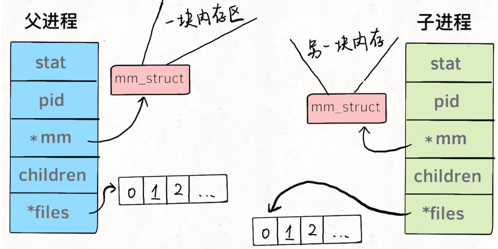

线程之间：

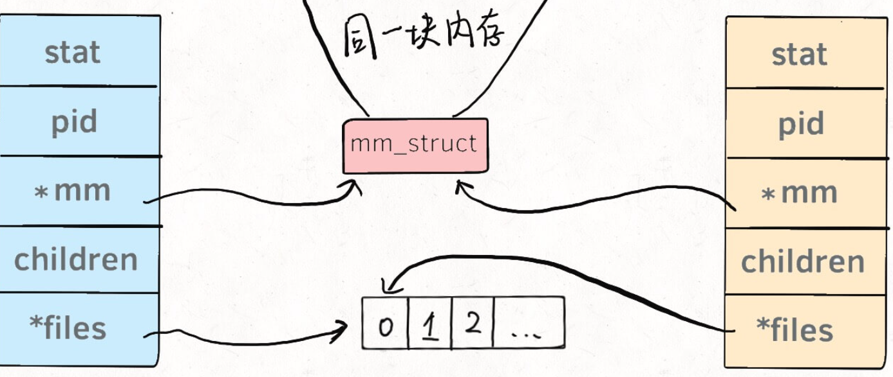

多线程：

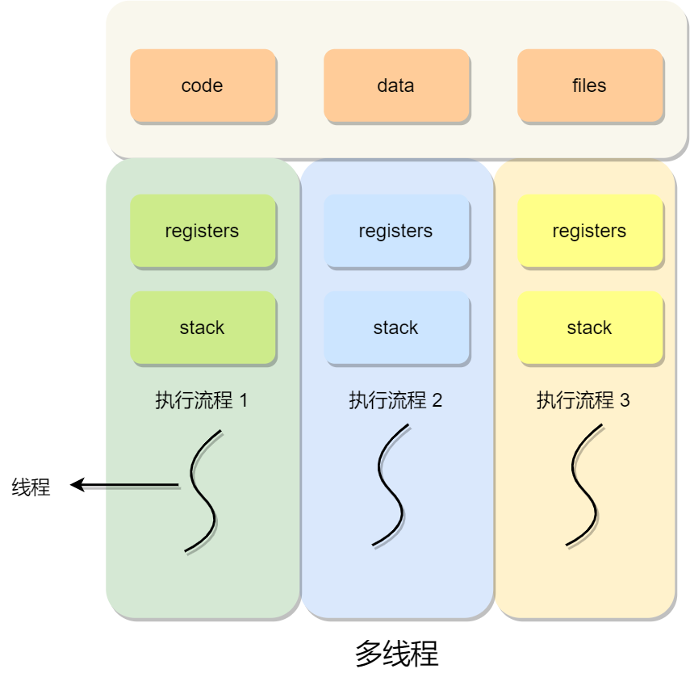

线程的上下文主要包括寄存器、PC、栈和线程局部状态。线程共享进程的地址空间和文件等资源，但每个线程都有自己的执行现场。

## 线程的实现

主要有三种线程的实现方式：

- **用户线程（User Thread）**：在用户空间实现的线程，不是由内核管理的线程，是由用户态的线程库来完成线程的管理；
- **内核线程（Kernel Thread）**：在内核中实现的线程，是由内核管理的线程；
- **轻量级进程（LightWeight Process, LWP）**：由内核支持的可调度执行实体，常用于承载用户线程；

那么，这还需要考虑一个问题，用户线程和内核线程的对应关系。

首先，第一种关系是**多对一**的关系，也就是多个用户线程对应同一个内核线程：

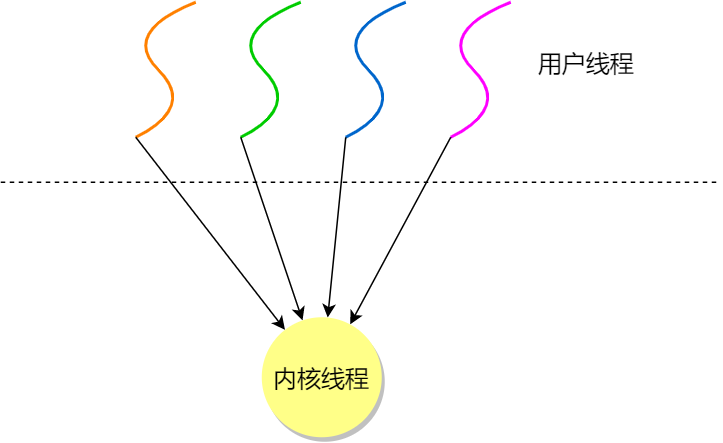

第二种是**一对一**的关系，也就是一个用户线程对应一个内核线程：

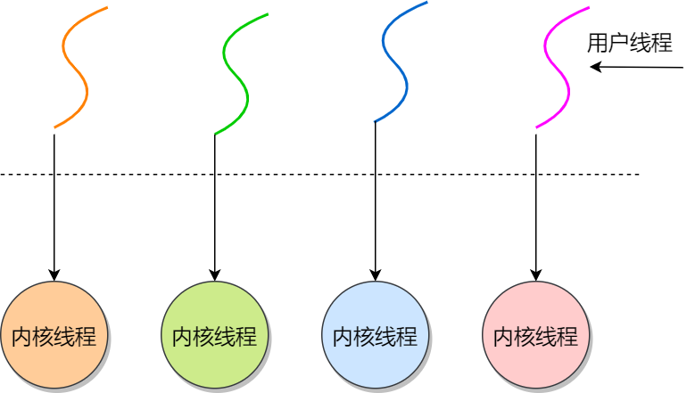

第三种是**多对多**的关系，也就是多个用户线程对应到多个内核线程：

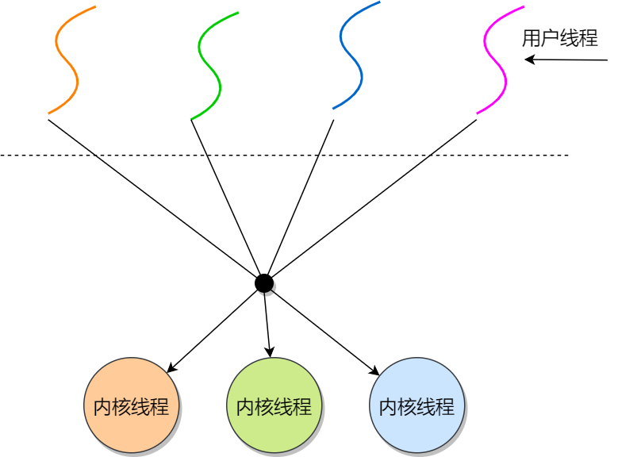

实现在用户空间的线程称为用户级线程。用户线程建立在线程库之上，创建、调度、同步和销毁主要由用户态线程库完成，内核通常不知道这些用户线程的存在。

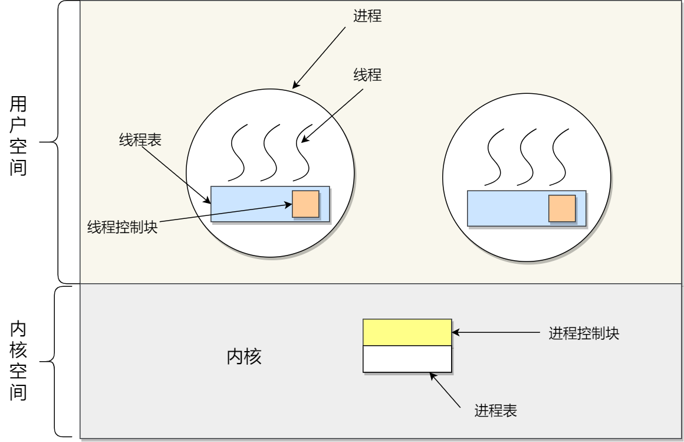

用户线程的**优点**：

- 每个进程都需要有它私有的线程控制块（TCB）列表，用来跟踪记录它各个线程状态信息（PC、栈指针、寄存器），TCB 由用户级线程库函数来维护，可用于不支持线程技术的操作系统；
- 用户线程的切换也是由线程库函数来完成的，无需进入内核态，所以速度很快；

用户线程的**缺点**：

- 如果一个用户线程执行阻塞式系统调用，而运行时没有做特殊处理，可能导致整个进程对应的内核执行实体被阻塞；
- 多对一模型下，多个用户线程只能运行在同一个内核线程上，无法真正利用多核并行；
- 内核无法直接感知用户线程的优先级和阻塞状态，调度协作更复杂。

**内核线程是由操作系统管理的，线程对应的 TCB 自然是放在操作系统里的，这样线程的创建、终止和管理都是由操作系统负责。**

内核线程的模型通常对应前面提到的**一对一**关系，即一个用户线程对应一个内核可调度实体，如下图所示：

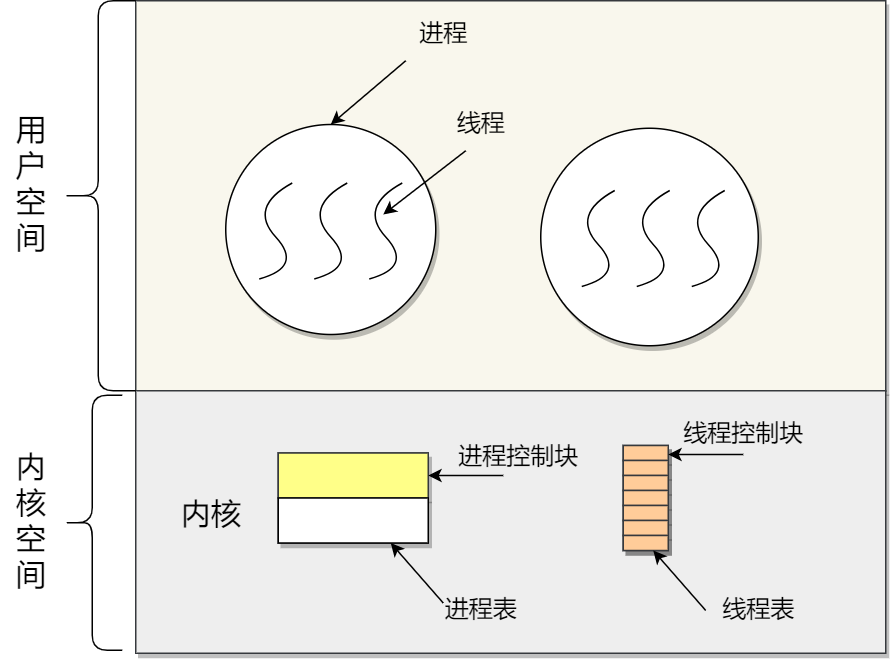

内核线程的**优点**：

- 在一个进程当中，如果某个内核线程发起系统调用而被阻塞，并不会影响其他内核线程的运行；
- 内核级线程能参与全局的多核处理器资源分配，充分利用多核 CPU 优势。

内核线程的**缺点**：

- 内核级线程调度开销较大。调度内核线程的代价可能和调度进程差不多昂贵，代价要比用户级线程大很多。
- 线程表是存放在操作系统固定的表格空间或者堆栈空间里，所以内核级线程的数量是有限的。

**轻量级进程（Light-weight process，LWP）是内核提供的可调度执行实体，用来支持用户线程运行。** 一个进程可以有一个或多个 LWP，每个 LWP 通常对应一个内核线程。

LWP 由内核管理，并像普通进程一样参与调度。Linux 中的线程实现可以理解为 LWP 风格：线程和进程都由 `task_struct` 表示，只是线程之间通过 `clone` 共享地址空间、文件表等资源。

在概念上，一个进程代表资源容器和程序实例，一个 LWP 或内核线程代表可被调度执行的控制流。线程不像普通进程那样默认拥有一整套独立资源，而是更多地共享所属进程的资源。

在 LWP 之上也是可以使用用户线程的，那么 LWP 与用户线程的对应关系就有三种：

- `1 : 1`，即一个 LWP 对应 一个用户线程；
- `N : 1`，即一个 LWP 对应多个用户线程；
- `M : N`，即多个 LWP 对应多个用户线程；

接下来针对上面这三种对应关系说明它们优缺点。先看下图的 LWP 模型：

**1 : 1 模式**

一个线程对应到一个 LWP 再对应到一个内核线程，如上图的进程 4，属于此模型。

- 优点：实现并行，当一个 LWP 阻塞，不会影响其他 LWP；
- 缺点：每一个用户线程，就产生一个内核线程，创建线程的开销较大。

**N : 1 模式**

多个用户线程对应一个 LWP 再对应一个内核线程，如上图的进程 2，线程管理是在用户空间完成的，此模式中用户的线程对操作系统不可见。

- 优点：用户线程要开几个都没问题，且上下文切换发生用户空间，切换的效率较高；
- 缺点：一个用户线程如果阻塞了，则整个进程都将会阻塞，另外在多核 CPU 中，是没办法充分利用 CPU 的。

**M : N 模式**

根据前面的两个模型混搭一起，就形成 `M:N` 模型，该模型提供了两级控制，首先多个用户线程对应到多个 LWP，LWP 再一一对应到内核线程，如上图的进程 3。

- 优点：综合了前两种优点，大部分的线程上下文发生在用户空间，且多个线程又可以充分利用多核 CPU 的资源。

# 协程

Go 协程通常指 goroutine。它不是操作系统线程，而是由 Go runtime 管理的轻量级执行单元。goroutine 有自己的栈和执行状态，但它的调度不是由业务代码直接控制，而是由 Go runtime 调度器负责。

goroutine 切换通常发生在用户态，不需要像线程切换那样每次都进入内核调度，因此创建和切换成本都比较低。但 goroutine 最终仍然必须运行在操作系统线程上，真正占用 CPU 的仍然是内核调度的线程。

## Go 的 GMP 模型

Go runtime 使用 GMP 模型调度 goroutine：

- `G`：goroutine，表示一个待执行的协程任务；
- `M`：machine，对应操作系统线程，真正被内核调度；
- `P`：processor，表示调度资源，维护本地运行队列，负责把 G 调度到 M 上执行。

一个 goroutine 只有被分配到某个 `P`，并由某个 `M` 执行时，才真正运行在 CPU 上。操作系统看不到 goroutine，只能看到 Go 进程中的 OS 线程；Go runtime 负责在这些线程之上调度大量 goroutine。
