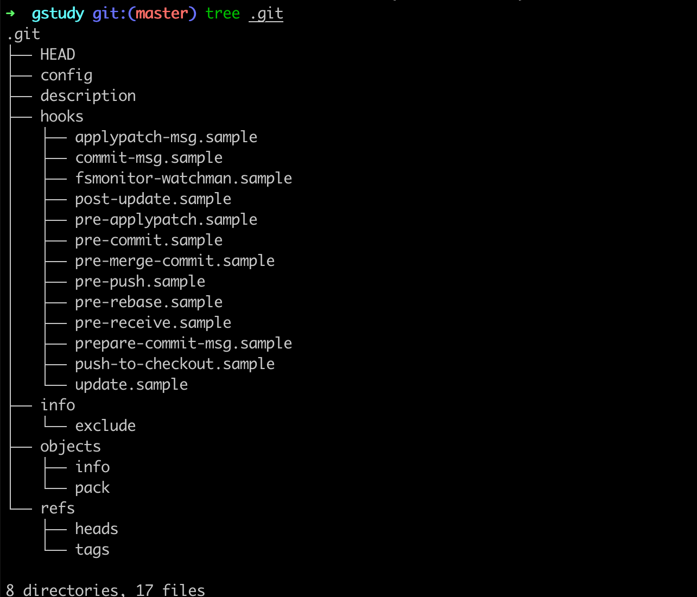
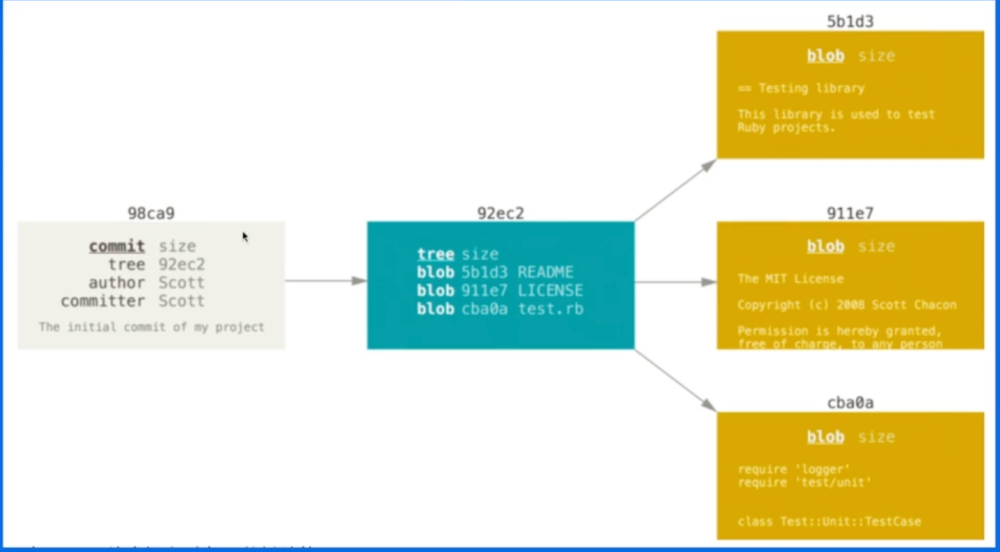

# 结构

tree命令查看git结构



# Git配置

低层配置会覆盖高层配置

--global

--system

--local

```
# 用户名
git config --local user.name "alice"
```

# remote

```
git remote -v

git remote add origin_ssh git@github.com:git/git.git
git remote add origin_http https://github.com/git/git.git

➜  gstudy git:(master) cat .git/config
[core]
	repositoryformatversion = 0
	filemode = true
	bare = false
	logallrefupdates = true
	ignorecase = true
	precomposeunicode = true
[remote "origin_ssh"]
	url = git@github.com:git/git.git
	fetch = +refs/heads/*:refs/remotes/origin_ssh/*
[remote "origin_http"]
	url = https://github.com/git/git.git
	fetch = +refs/heads/*:refs/remotes/origin_http/*
  
# 可以为fetch和push设置不同的源
```

# 配置ssh

```
# 生成key 制定ed25519算法
ssh-keygen -t ed25519 -C "xxx@qq.com"

# 保存
cat ~/.ssh/id_ed25519.pub

# 添加到github
```

# git add

```
➜  gstudy git:(master) touch a.md
➜  gstudy git:(master) ✗ git add .
➜  gstudy git:(master) ✗ tree .git
.git
├── HEAD
├── config
├── description
├── hooks
│   ├── applypatch-msg.sample
│   ├── commit-msg.sample
│   ├── fsmonitor-watchman.sample
│   ├── post-update.sample
│   ├── pre-applypatch.sample
│   ├── pre-commit.sample
│   ├── pre-merge-commit.sample
│   ├── pre-push.sample
│   ├── pre-rebase.sample
│   ├── pre-receive.sample
│   ├── prepare-commit-msg.sample
│   ├── push-to-checkout.sample
│   └── update.sample
├── index
├── info
│   └── exclude
├── objects
│   ├── e6
│   │   └── 9de29bb2d1d6434b8b29ae775ad8c2e48c5391
│   ├── info
│   └── pack
└── refs
    ├── heads
    └── tags

9 directories, 19 files

vim ...

➜  gstudy git:(master) git cat-file -p e69de29bb2d1d6434b8b29ae775ad8c2e48c5391

➜  gstudy git:(master) git cat-file -p 45432245fe8188c38dcbc9b4d9723a2288036475
dadsf

➜  gstudy git:(master) tree .git
.git
├── COMMIT_EDITMSG
├── HEAD
├── config
├── description
├── hooks
│   ├── applypatch-msg.sample
│   ├── commit-msg.sample
│   ├── fsmonitor-watchman.sample
│   ├── post-update.sample
│   ├── pre-applypatch.sample
│   ├── pre-commit.sample
│   ├── pre-merge-commit.sample
│   ├── pre-push.sample
│   ├── pre-rebase.sample
│   ├── pre-receive.sample
│   ├── prepare-commit-msg.sample
│   ├── push-to-checkout.sample
│   └── update.sample
├── index
├── info
│   └── exclude
├── logs
│   ├── HEAD
│   └── refs
│       └── heads
│           └── master
├── objects
│   ├── 45
│   │   └── 432245fe8188c38dcbc9b4d9723a2288036475
│   ├── 5a
│   │   └── c64a51c9af1e79859a25230bc62741d13e6a64
│   ├── e6
│   │   └── 9de29bb2d1d6434b8b29ae775ad8c2e48c5391
│   ├── f2
│   │   └── 167f25139faef7f7099fcc69e9320f7ff7c315
│   ├── info
│   └── pack
└── refs
    ├── heads
    │   └── master
    └── tags

15 directories, 26 files
```

# objects

- blob：文件内容
- tree：目录信息
- commit：提交信息



# 分支

创建新分支：

```
git checkout -b test
```

# tag

```
git tag v0.0.1

➜  gstudy git:(feature) tree .git
.git
├── COMMIT_EDITMSG
├── HEAD
├── config
├── description
├── hooks
│   ├── applypatch-msg.sample
│   ├── commit-msg.sample
│   ├── fsmonitor-watchman.sample
│   ├── post-update.sample
│   ├── pre-applypatch.sample
│   ├── pre-commit.sample
│   ├── pre-merge-commit.sample
│   ├── pre-push.sample
│   ├── pre-rebase.sample
│   ├── pre-receive.sample
│   ├── prepare-commit-msg.sample
│   ├── push-to-checkout.sample
│   └── update.sample
├── index
├── info
│   └── exclude
├── logs
│   ├── HEAD
│   └── refs
│       └── heads
│           ├── feature
│           └── master
├── objects
│   ├── 45
│   │   └── 432245fe8188c38dcbc9b4d9723a2288036475
│   ├── 5a
│   │   └── c64a51c9af1e79859a25230bc62741d13e6a64
│   ├── e6
│   │   └── 9de29bb2d1d6434b8b29ae775ad8c2e48c5391
│   ├── f2
│   │   └── 167f25139faef7f7099fcc69e9320f7ff7c315
│   ├── info
│   └── pack
└── refs
    ├── heads
    │   ├── feature
    │   └── master
    └── tags
        └── v0.0.1
```

# amend

修改上次commit的信息：

```
git commit --amend
```

# gc

```
git gc
```

# fetch

将远程分支代码拉到本地，不会进行merge

# pull

拉取远程分支并进行merge
