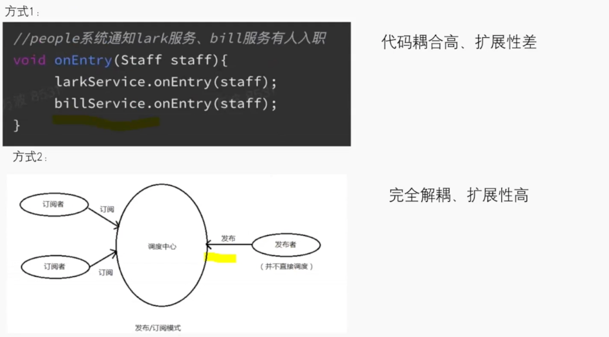
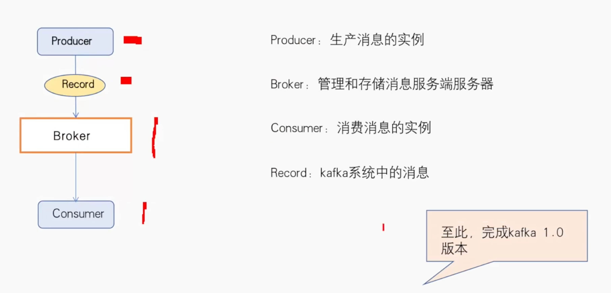
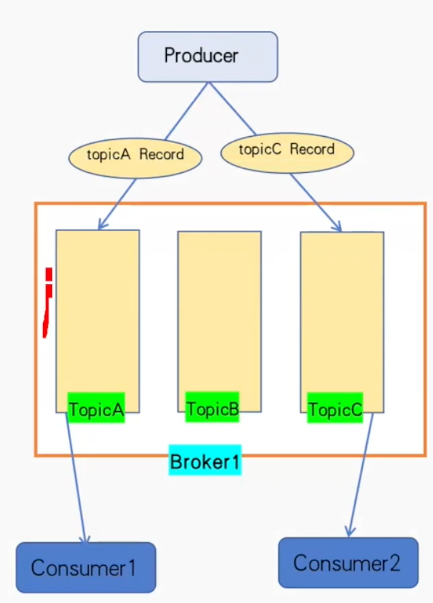
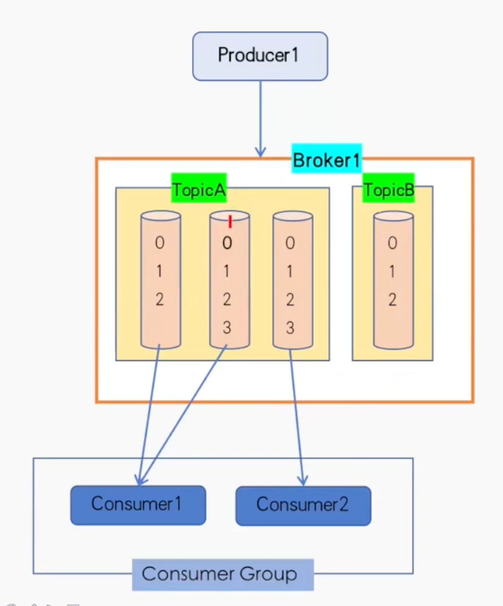
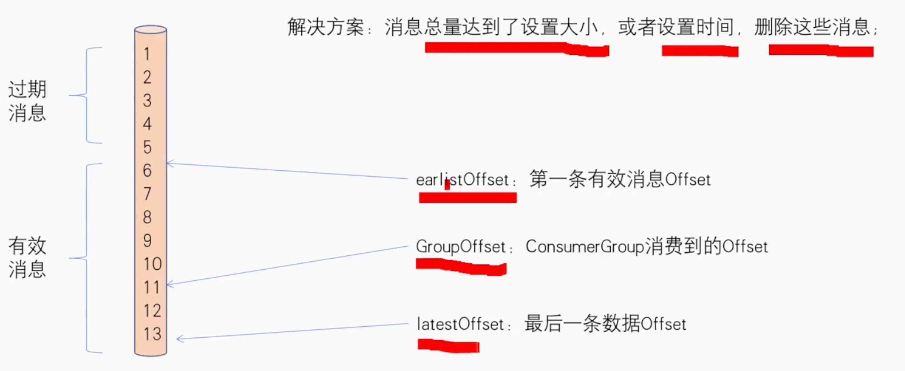
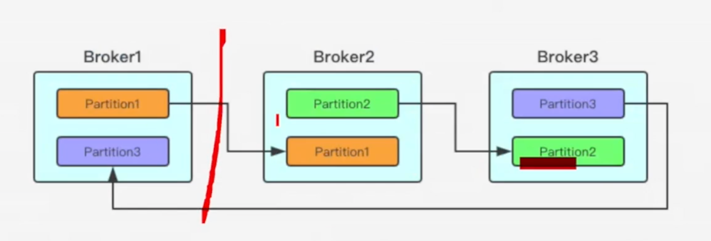
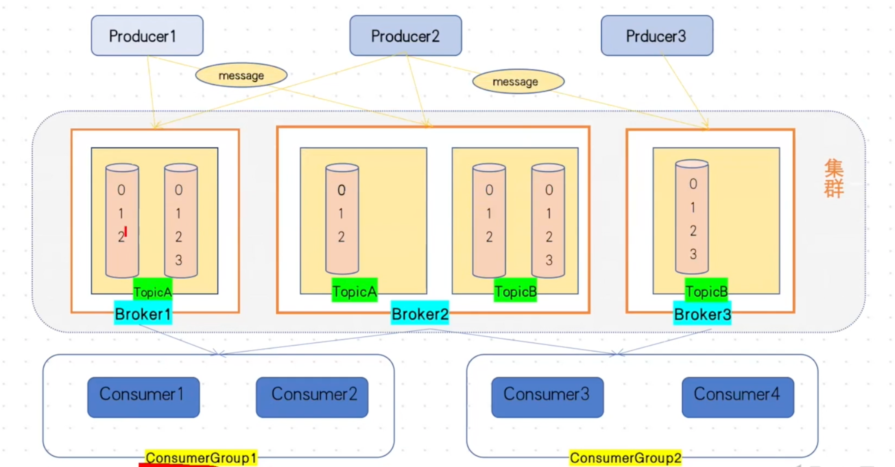

# 发布订阅模型

单进程

调度中心

场景：系统上线后，消息发送方发现，不只有入职的消息，还有离职，请假的情况，希望集成到系统中。

方案：给每个消息添加一个分类

Topic：消息的类别

场景：随着公司规模扩大，需要多机部署，此时，生产没问题，单消费多机可能会产生重复消费问题。

解决方案：将Topic做更细粒度划分，叫partition，每个partition只被一个consumer消费

Partition：实际消息存储的地方，一个有序队列

Offset：Record在partition的位置

consumerGroup：共同处理消息的一组消费者实例

# 位点

场景：随着时间增多，消息占用了很多磁盘空间

# Replication & Cluster

场景：机器故障，机器上的消息丢失

解决方案：部署多台Broker，消息根据partition在不同机器之间备份

# 拓扑模型

# overview

优势：

- 高吞吐，低延迟
- 可扩展性：通过zookeeper存储集群元信息
- 持久性：数据持久化到磁盘
- 容错性：允许集群中节点故障
- 高并发

Broker：kafka集群中包含或者多个服务器，这些服务器称为Broker

Topic：每条发不到kafka集群的消息的类别，对消息进行分类

Partition：物理上对应一个文件夹，一个topic下包含多个partition，提高系统并发量，kafka基本的存储单元

Record：对应一条消息

offset：消息在partion中的偏移量

kafka保证写如同一个partition中的消息的顺序

副本：Kafka允许为topic的partition配置副本数量，当集群中的节点出现故障时，能自动进行故障转移。

副本有两种类型：

- Leader Replica：分区只包含一个leader replica，producer和consumer的请求均通过该副本
- follower Replica：不处理任何请求，只和leader进行数据同步
