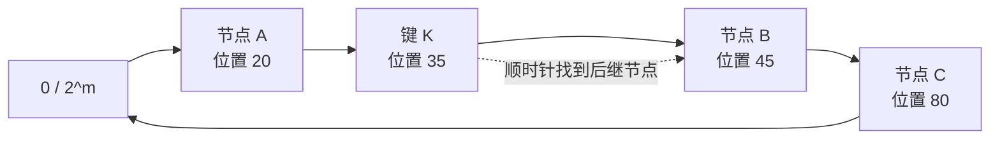
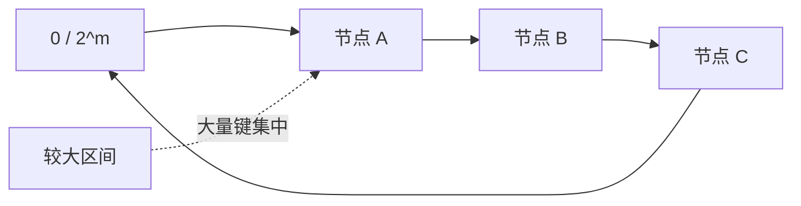
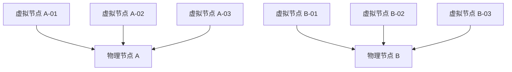

# 一致性哈希

一致性哈希（Consistent Hashing）用于在一组可能动态变化的节点之间建立稳定的键到节点映射。它的核心目标不是让数据永远不迁移，而是让节点增减时只重新映射一小部分键。

典型应用包括：

- 分布式缓存的键路由；
- 分布式存储的数据分片；
- 请求按用户、租户或会话进行粘性路由；
- 分布式任务的分片调度。

本文只讨论路由算法。数据副本、故障恢复、成员发现和一致性协议需要由系统的其他机制完成。

## 1. 为什么普通取模不够稳定

最直接的分片方式是：

```text
node_index = hash(key) % node_count
```

当节点数量固定时，这种方式简单、均匀且查询成本低。但节点数参与了计算，因此节点数从 `N` 变成 `N + 1` 后，大量键的余数都会变化。

例如：

| `hash(key)` | `% 3` | `% 4` | 是否改变 |
|---:|---:|---:|---|
| 7 | 1 | 3 | 是 |
| 18 | 0 | 2 | 是 |
| 29 | 2 | 1 | 是 |

在哈希值均匀、节点编号为 `0...N-1` 的理想情况下，从 `N` 个节点扩容到 `N + 1` 个节点，大约有 `N / (N + 1)` 的键需要重新映射。例如从 3 个节点扩容到 4 个节点，期望约 75% 的键改变目标节点。

不同系统受到的影响不同：

- **缓存系统**：通常不迁移旧缓存，而是产生大量缓存失效和回源请求，可能形成缓存雪崩；
- **有状态存储**：需要搬迁数据，迁移成本可能很高；
- **粘性路由**：大量会话会被路由到新的处理节点。

一致性哈希要解决的就是节点集合变化时的大规模重新映射问题。

## 2. 一致性哈希如何工作

### 2.1 把节点和键映射到同一哈希空间

选择一个 `m` 位哈希空间：

```text
[0, 2^m - 1]
```

把最大值和 0 首尾相接，就得到一个逻辑上的哈希环。`2^32` 是常见示例，但不是算法要求；工程中也可以使用 64 位或更大的哈希空间。

节点和键都被哈希到这个空间中：

```text
node_position = hash("node:" + node_id)
key_position  = hash("key:" + key)
```

两者需要进入同一个可比较的哈希空间，但不应该因为原始字符串相同而混淆，所以示例加入了不同的命名空间前缀。

### 2.2 顺时针寻找后继节点

一个键归属于从它的位置开始，沿顺时针方向遇到的第一个节点。数值上等价于：

```text
找到位置 >= hash(key) 的第一个节点；
如果不存在，则回绕到位置最小的节点。
```



上图中，键 K 的位置是 35，顺时针遇到的第一个节点是位置 45 的节点 B，因此 K 由 B 负责。

### 2.3 基本查找伪代码

可以把环上的节点位置存入有序数组，并使用二分查找：

```text
points = sort(all_node_positions)
owner[position] = physical_node

function locate(key):
    if points is empty:
        return error("no available node")

    h = hash("key:" + key)
    i = lower_bound(points, h)  # 第一个 points[i] >= h 的位置

    if i == length(points):
        i = 0                   # 越过环尾，回绕到最小位置

    return owner[points[i]]
```

若环上共有 `V` 个位置，使用有序数组时：

- 单次查询复杂度为 `O(log V)`；
- 空间复杂度为 `O(V)`；
- 单个位置的插入或删除需要移动数组元素，最坏为 `O(V)`；
- 重建整个有序数组通常为 `O(V log V)`。

也可以使用平衡树维护节点位置，使单个位置的插入、删除和查询都保持 `O(log V)`。

## 3. 节点变化时哪些键会移动

假设环上已有相邻节点 P 和 S，现在在它们之间加入节点 X：

```text
加入前：

P ----------------------------> S
          区间 (P, S] 由 S 负责

加入后：

P ------------> X ------------> S
   (P, X] 归 X     (X, S] 仍归 S
```

只有落在 `(P, X]` 区间内的键从 S 迁移到 X，其他区间不受影响。

移除 X 时过程相反：

```text
P ------------> X ------------> S
   (P, X] 归 X

移除 X 后：

P ----------------------------> S
          (P, X] 改由 S 负责
```

节点变化的影响可以概括为：

| 操作 | 发生重新映射的键 | 新的负责节点 |
|---|---|---|
| 加入节点 X | X 与其逆时针前驱之间的键 | X |
| 移除节点 X | 原来由 X 负责的键 | X 的顺时针后继 |

在哈希均匀且节点容量相同的理想情况下：

- 从 `N` 个节点增加到 `N + 1` 个节点，期望约 `1 / (N + 1)` 的键重新映射；
- 从 `N` 个节点移除一个节点，期望约 `1 / N` 的键重新映射。

这就是一致性哈希的“最小扰动”特性。它减少迁移范围，但不会消除迁移。

## 4. 为什么需要虚拟节点

### 4.1 物理节点太少时容易分布不均

如果直接把少量物理节点各映射一次，随机位置之间的区间可能相差很大。负责大区间的节点会承载更多键和请求。



这种不均衡来自环上区间长度不均。除此之外，即使区间完全均匀，少数热点键也仍然可能造成负载倾斜，这是另一个问题。

### 4.2 虚拟节点是逻辑位置，不是数据副本

虚拟节点（Virtual Node，常简称 vnode）是一个物理节点在哈希环上的多个逻辑位置：

```text
A-01 = hash("node:A:01") -> 物理节点 A
A-02 = hash("node:A:02") -> 物理节点 A
A-03 = hash("node:A:03") -> 物理节点 A
```

虚拟节点不是物理机副本，也不天然保存额外的数据副本。它只是增加同一物理节点在环上的落点数量。



查询时先找到顺时针方向上的虚拟节点，再通过映射表找到对应的物理节点：

```text
key -> hash ring position -> virtual node -> physical node
```

### 4.3 虚拟节点的作用

虚拟节点主要解决三个问题：

1. **改善均衡度**：每个物理节点分散负责多个较小区间，降低单个大区间带来的偏差；
2. **分散故障压力**：一个物理节点退出后，它负责的多个区间通常会转移给不同的物理节点；
3. **表达权重**：容量更大的节点可以配置更多虚拟节点，从而期望承担更多键。

例如：

| 物理节点 | 相对容量 | 虚拟节点数 |
|---|---:|---:|
| A | 1 | 100 |
| B | 1 | 100 |
| C | 2 | 200 |

这种权重是统计意义上的近似。虚拟节点数量越多，分布通常越平滑，但会增加环的内存占用和维护成本。具体数量应通过实际键分布和负载测试决定，而不是机械套用固定值。

## 5. 工程实现中的关键边界

### 5.1 哈希函数必须稳定且分布良好

哈希函数需要满足：

- 相同输入在所有客户端、所有进程中产生相同结果；
- 不因进程重启、语言运行时随机种子或版本变化而改变；
- 输出尽量均匀；
- 碰撞概率足够低。

不能直接使用某些语言默认的进程内哈希函数。例如，一些运行时会为防止哈希攻击而在每次启动时使用不同的随机种子。

节点标识也必须稳定。通常使用节点的固定 ID，而不是可能变化的临时地址或列表下标。

### 5.2 所有路由方必须看到一致的成员视图

如果不同客户端看到的节点列表或版本不同，同一个键可能被路由到不同节点。因此系统还需要：

- 成员发现；
- 节点健康检查；
- 配置版本或 epoch；
- 节点变更的发布和收敛机制。

这些能力不由一致性哈希算法本身提供。

### 5.3 一致性哈希不提供数据副本

一致性哈希通常只确定主节点。若要容忍节点故障，还需要配置副本。

一种常见做法是从键的主位置开始顺时针遍历，选择后续不同的物理节点：

```text
function locate_replicas(key, replica_count):
    if points is empty or replica_count <= 0:
        return []

    target = min(replica_count, count_distinct_physical_nodes())
    start = lower_bound(points, hash("key:" + key))
    if start == length(points):
        start = 0

    result = []
    visited = 0

    while visited < length(points) and length(result) < target:
        i = (start + visited) % length(points)
        node = owner[points[i]]

        if node not in result:
            append node to result

        visited = visited + 1

    return result
```

实现时必须跳过属于同一物理节点的其他虚拟节点，否则多个“副本”可能仍落在同一台机器上。

该查找先用二分搜索定位起点，随后遍历虚拟节点。最坏时间复杂度为 `O(log V + V)`，结果空间复杂度为 `O(min(replica_count, N))`，其中 `V` 是虚拟节点总数，`N` 是物理节点数。

### 5.4 虚拟节点不能解决热点键

虚拟节点只能改善大量均匀键的统计分布。如果某个键本身占据大量流量，它仍然只会被路由到一个主节点。

热点键通常需要其他手段：

- 本地多级缓存；
- 热点键复制；
- 请求合并；
- 读写分离；
- 对热点业务键进一步拆分。

### 5.5 缓存路由和数据分片的处理方式不同

节点变化后：

- 缓存系统可以接受缓存未命中，由后端重新填充，但要防止瞬时回源洪峰；
- 有状态存储必须设计数据搬迁、双写、校验和切流流程；
- 请求路由需要考虑存量会话是否允许漂移。

“键被重新映射”不等于“数据已经安全迁移”。

### 5.6 需要限制单节点负载

经典一致性哈希只追求较小的重新映射范围，不严格保证每个节点的负载上限。节点容量差异、键数量有限或流量分布倾斜时，仍可能过载。

工程中可以结合：

- 加权虚拟节点；
- bounded-load consistent hashing；
- 节点负载反馈；
- 限流和熔断；
- 手动迁移热点分片。

## 6. 一个带虚拟节点的实现框架

下面的伪代码展示核心结构，不包含并发控制、成员同步和数据迁移：

```text
class ConsistentHashRing:
    points = sorted list of uint64
    owner = map<uint64, PhysicalNode>

    function add_node(node, virtual_node_count):
        for i in 0 .. virtual_node_count - 1:
            point = hash("node:" + node.id + ":" + i)
            collision = 0

            while point already exists:
                collision = collision + 1
                point = hash(
                    "node:" + node.id + ":" + i + ":collision:" + collision
                )

            insert point into points
            owner[point] = node

    function remove_node(node):
        for each point whose owner[point] is node:
            remove point from points
            delete owner[point]

    function locate(key):
        if points is empty:
            return error("no available node")

        h = hash("key:" + key)
        i = lower_bound(points, h)

        if i == length(points):
            i = 0

        return owner[points[i]]
```

生产实现还应明确：

- 节点增删是否原子发布；
- 读请求是否允许使用旧环；
- 哈希碰撞如何处理；
- 虚拟节点数量和权重如何配置；
- 节点失效后何时摘除；
- 数据迁移完成前如何避免读写不一致。

## 7. 与其他路由算法的比较

| 算法 | 查询成本 | 节点变化时的重新映射 | 主要特点 |
|---|---:|---:|---|
| `hash(key) % N` | `O(1)` | 通常很多 | 简单，适合节点集合固定的场景 |
| 一致性哈希环 | `O(log V)` | 较少 | 自然表达连续哈希区间和虚拟节点，但需要维护有序环 |
| Rendezvous Hashing | `O(N)`，可优化 | 较少 | 不需要维护环，对每个键给所有节点打分 |

选择算法时需要考虑节点规模、变更频率、查询延迟、权重表达方式和实现复杂度，而不是默认所有分布式系统都必须使用一致性哈希环。

## 8. 常见误区

### 一致性哈希只适用于缓存

不对。它是一种稳定的键到节点映射方法，也可用于存储分片、请求路由和任务调度。

### 一致性哈希保证绝对均匀

不对。它依赖哈希函数、虚拟节点数量、键数量和节点权重，只能提供统计意义上的均衡。

### 虚拟节点就是数据副本

不对。虚拟节点只是物理节点在环上的逻辑位置。数据副本需要单独设计。

### 节点变化后只有一个节点受到影响

没有虚拟节点时，一段连续区间通常转移给一个相邻节点；使用虚拟节点后，一个物理节点对应多个区间，这些区间可能分散转移给多个物理节点。

### 一致性哈希可以避免所有数据迁移

不对。它只减少重新映射的数据量。实际数据如何复制、校验和切换不属于哈希算法本身。

### 虚拟节点可以解决热点键

不对。虚拟节点改善的是大量键的整体分布，无法拆分单个热点键的流量。

## 9. 总结

一致性哈希的核心链路是：

```text
节点和键进入同一哈希空间
  -> 键顺时针寻找第一个节点
  -> 节点变化时只重新映射局部区间
  -> 使用虚拟节点改善均衡度和权重表达
```

需要记住它的能力边界：

- 它解决的是稳定路由，不负责成员一致性；
- 它减少迁移，不消除迁移；
- 它改善整体均衡，不解决单个热点键；
- 它不提供副本、容灾或数据迁移流程。
