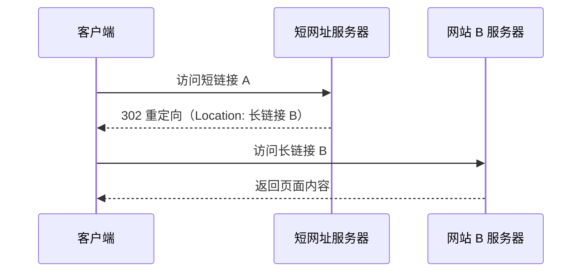

短URL的好处：

- 链接变短，在对内容长度有限制的平台发文，可编辑的文字就变多了
- 长链生成的二维码比较密集，短链比较稀疏，容易识别
- 链接太长在某些平台无法识别为超链接

# 原理
短链接 A: http://gk.link/a/10gpO
长链接 B: https://u.geekbang.org/subject/fe/100044701?utm_source=frontend&utm_medium=message&utm_term=frontendmessage

使用302重定向，临时重定向，浏览器每次都会访问短网址服务器，方便server统计分享链接的点击次数。

如果使用301，浏览器会直接在缓存中拿到长链接，不利于数据分析。

# 短网址的长度

当前互联网上的网页总数大概是 45亿，45亿超过了 2^{32}=4294967296232=4294967296，但远远小于64位整数的上限值，那么用一个64位整数足够了。

微博的短网址服务用的是长度为7的字符串，这个字符串可以看做是62进制的数，那么最大能表示{62}^7=3521614606208627=3521614606208个网址，远远大于45亿。所以**长度为7就足够了**。

一个64位整数如何转化为字符串呢？，假设我们只是用大小写字母加数字，那么可以看做是62进制数，log_{62} {(2^{64}-1)}=10.7_l__o__g_62(264−1)=10.7，即字符串最长11就足够了。

实际生产中，还可以再短一点，比如新浪微博采用的长度就是7，因为 62^7=3521614606208627=3521614606208，这个量级远远超过互联网上的URL总数了，绝对够用了。

现代的web服务器（例如Apache, Nginx）大部分都区分URL里的大小写了，所以用大小写字母来区分不同的URL是没问题的。

因此，**正确答案：长度不超过7的字符串，由大小写字母加数字共62个字母组成**

**服务端保存url和短url的映射**

# 一对一还是一对多映射？

一个长网址，对应一个短网址，还是可以对应多个短网址？ 这也是个重大选择问题

一般而言，一个长网址，在不同的地点，不同的用户等情况下，生成的短网址应该不一样，这样，在后端数据库中，可以更好的进行数据分析。如果一个长网址与一个短网址一一对应，那么在数据库中，仅有一行数据，无法区分不同的来源，就无法做数据分析了。

以这个7位长度的短网址作为唯一ID，这个ID下可以挂各种信息，比如生成该网址的用户名，所在网站，HTTP头部的 User Agent等信息，收集了这些信息，才有可能在后面做大数据分析，挖掘数据的价值。短网址服务商的一大盈利来源就是这些数据。

**正确答案：一对多**
