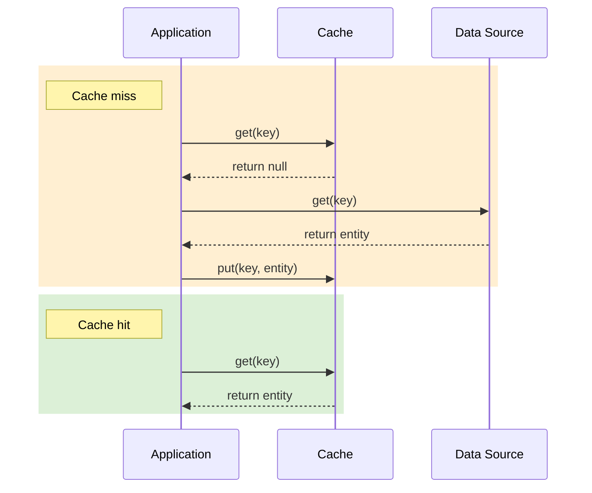
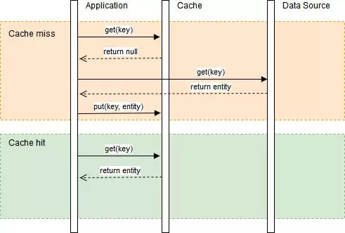
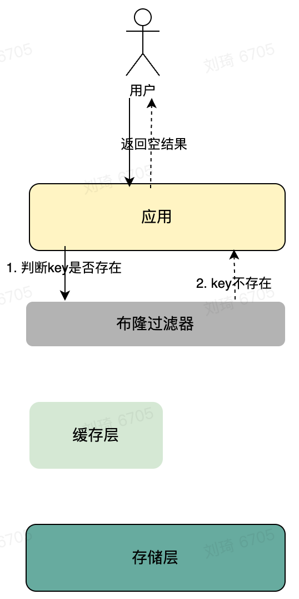
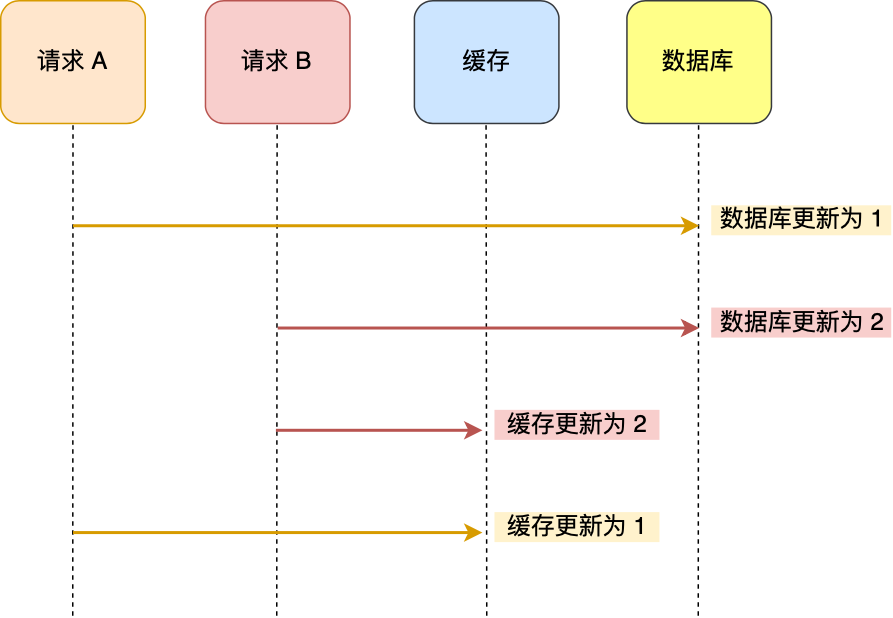
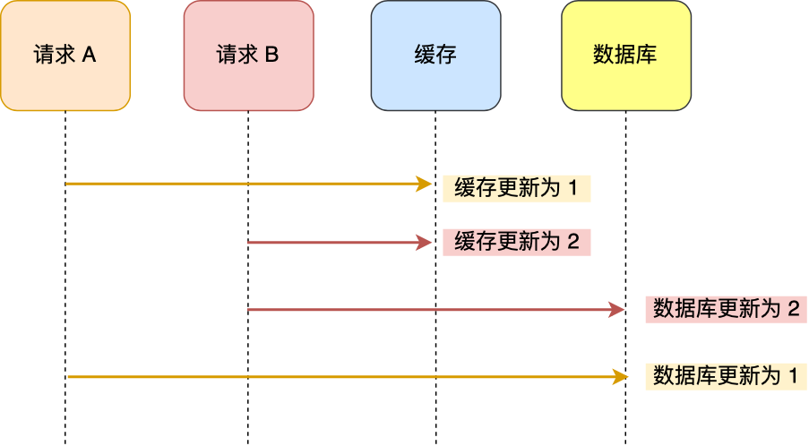
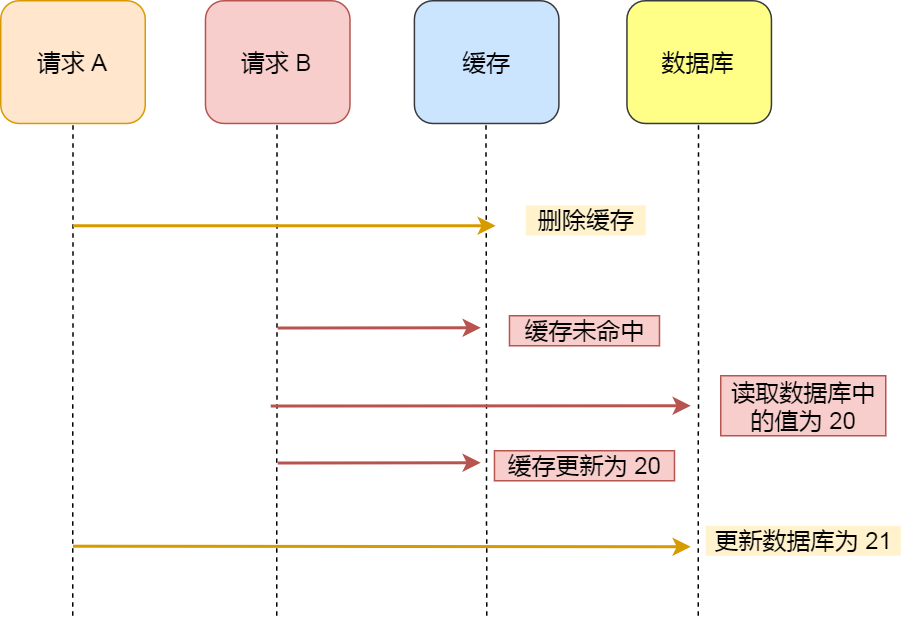
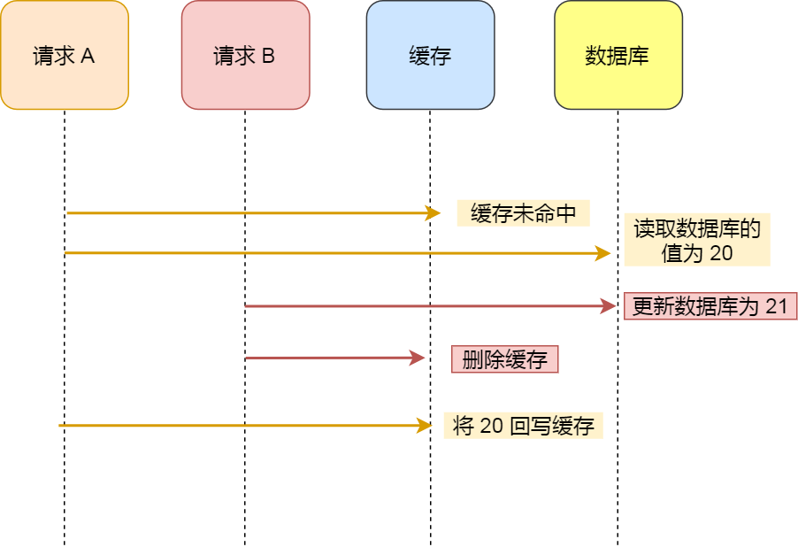
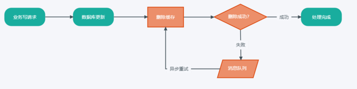

# 缓存模式

1、cache aside

读数据：先读cache，如果key不存在则回源读数据库，如果数据库成功读到则更新cache。

写数据：更新数据库，并删cache对应的key以保证不会出现数据的diff。

Cache-Aside 策略特别适合“读多”的应用场景。使用 Cache-Aside策略的系统可以在一定程度上抵抗缓存故障。如果缓存服务发生故障，系统仍然可以通过直接访问数据库进行操作。

2、Read/Write Throuth

cache aside模式由调用方维护cache和数据库的更新和查询，而在read/write through模式中，数据库的更新和回源查询则由缓存服务托管。

Read through：在读请求中，如果命中缓存则返回，如果没有命中，由缓存服务加载数据库的到缓存中，并将结果返回给调用方（查询时更新cache）。

Write through：在写请求时，当有数据更新的时候，如果没有命中缓存，直接更新数据库，然后返回。如果命中了缓存，则更新缓存，然后由缓存组件去更新数据库（这是一个同步操作）。

3、Write Behind Cache

Write Behind Cache 模式类似于Write Through模式，但是其更新数据库是**异步**的。这种模式的优势在于我们的同步请求完全在内存（cache）中进行，速度快性能好。缺点在于数据的同步有一定的延迟，只能保证最终一致，并且有可能丢失。

这种模式可以抵抗数据源故障，并可以容忍某些数据源停机时间。如果支持批处理或合并，则可以减少对数据源的总体写入，从而减少了负载并降低了成本。但是，一旦更新后的缓存数据还未被写入数据源时，出现系统断电的情况，数据将无法找回。

# 缓存面临的问题

## 缓存雪崩

- 现象：指缓存服务器宕机或者大量缓存集中在某一个时间段内失效，给后端数据库造成瞬时的负载升高的压力，甚至压垮数据库的情况。
- 原因：大量缓存采用了相同的过期时间，导致缓存在某一时刻同时失效或者缓存服务器因为宕机不能提供服务，请求全部转发到数据库，最终导致数据库瞬时压力过大而崩溃。

对于服务器宕机的问题：设计高可用架构

对于key同时过期的解决方案：

- 方案一：打散key的缓存过期时间。例如，我们要缓存 user 数据，会对每个用户的数据设置不同的缓存过期时间，可以定义一个基础时间，假设10秒，然后加上一个两秒以内的随机数，过期时间为10～12秒，就会避免缓存雪崩。
- 方案二：使用互斥锁的方式，保证同一时间内只有一个请求来构建缓存。互斥锁导致系统吞吐量会下降，因此需要结合业务考虑是否有必要采用这种方式。
- 方案三：双key策略，对缓存数据可以使用两个 key，一个是**主 key，会设置过期时间**，一个是**备 key，不会设置过期**，它们只是 key 不一样，但是 value 值是一样的，相当于给缓存数据做了个副本。当业务线程访问不到「主 key 」的缓存数据时，就直接返回「备 key 」的缓存数据，然后在更新缓存的时候，**同时更新「主 key 」和「备 key 」的数据。**
- 方案四：限流和熔断（应对宕机）。限流：根据存储层的最大QPS，限制可以发送到存储层的请求数。熔断：当错误率达到阈值时，丢弃一些请求。

## 缓存击穿

- 现象：当某一热点 key 失效时，造成大量请求到 db，尝试获取数据并回写到缓存中，这样会造成应用和数据库的负载增加，性能降低。若并发较高，甚至会导致数据库被压死。
- 原因：为了保证缓存数据的时效性，通常会设置一个失效时间，如果是热点 key，高并发时会有海量请求直接越过缓存层到数据库，这样就会给数据库造成的负担增大，造成宕机。

解决方案：

- 方案一：使用互斥锁，当缓存数据失效时，保证一个请求能够访问到数据库，并更新缓存，其他线程等待并重试。
- 方案二：缓存异步构建。缓存异步构建的方法将cache和数据库彻底解耦开，cache的读操作任何时候都不会影响到数据库，而缓存的构建与更新由数据库的binlog事件异步执行。

## 缓存穿透

缓存穿透：请求去查询一条数据库中不存在的数据，即缓存和数据库都查询不到这条数据，所以请求每次都会打到数据库上面去。这个 key 的每次请求都直接穿透缓存层，回源到数据库中，给数据库带来了巨大访问压力，甚至宕机。

**方案一**：缓存不存在的key，在存储层返回空结果后，把“key不存在”这个信息，保存在缓存层。这样下一次查询这个key时，请求就不会穿透到DB了。

问题：

第一个是大量的空结果会占用缓存空间。如果穿透是由于恶意攻击造成的，那占用空间的问题可能会更加严重。为了减缓缓存空间的问题，我们可以给空结果的value设置小一点，或者给空结果设置一个较短的过期时间。

第二个问题是可能会带来一段时间窗口的不一致。在缓存一个key的空结果后，如果存储层中新增了这个key的数据，那在这个key在缓存中的空结果过期之前，缓存和存储都是不一致的。这个就需要当存储更新时，可以删除缓存中空结果的标识。这个问题有2种解决方式：1. **给空结果设置一个较短的过期时间；2. 新增数据时，删除缓存。**

**方案二：**布隆过滤器

使用一个足够大的Map记录所有可能访问到的key，当key不存在时直接过滤。

# 缓存策略

常见的缓存策略主要有LFU、LRU、LRU-K等。

- **LFU** - LFU根据数据的历史访问频率来淘汰数据，其核心思想是，如果数据过去被访问多次，将来被访问的频率也更高；它的优势是，应对缓存污染的能力强，问题是需要更长时间来适应新的访问模式
- **LRU** - LRU根据数据的历史访问记录来淘汰数据，其核心思想是，如果数据最近被访问过，将来被访问的几率也更高；它的优势是，热点数据场景中效率高，问题是应对缓存污染的能力差，偶发的批量操作会导致命中率急剧下降
- **LRU-K** - LRU-K中的K代表最近使用的次数，主要目的是解决LRU的缓存污染问题，其核心思想是，将最近使用过1次的判断标准扩展为最近使用过K次；K值的选取需要权衡抗污染和适应性，K值越大，应对缓存污染的能力越强，但适应性也越差，需要更多次数据访问才能将热点数据换入；一般场景中采用LRU-2较为合适

# 设置缓存过期时间？

为什么必须要有过期时间？首先对于缓存来说，当它的命中率越高的时候，我们的系统性能也就越好。如果某个缓存项没有过期时间，而它命中的概率又很低，这就是在浪费缓存的空间。而如果有了过期时间，且在某个缓存项经常被命中的情况下，我们可以在每次命中的时候都刷新一下它的过期时间，这样也就保证了热点数据会一直在缓存中存在，从而保证了缓存的命中率，提高了系统的性能。

设置过期时间还有一个好处，就是当数据库跟缓存出现数据不一致的情况时，这个可以作为一个最后的兜底手段。也就是说，当数据确实出现不一致的情况时，过期时间可以保证只有在出现不一致的时间点到缓存过期这段时间之内，数据库跟缓存的数据是不一致的。

## 缓存与数据库一致性

删除缓存的优点：

- 当缓存的内容很多，或者需要进行复杂的计算，则更新缓存开销很大
- 更新的数据不一定会使用

### 先更新数据库，再更新缓存

问题：

### 先更新缓存，再更新数据库

问题：

同时，数据库的更新失败后，将导致缓存与数据库的不一致，缓存过期后数据丢失。

### 先删除缓存，再更新数据库

并发问题，容易读取到数据库的旧值（读请求比写请求快）

### 先更新数据库，再删除缓存

**因为缓存的写入通常要远远快于数据库的写入**，所以在实际中很难出现请求 B 已经更新了数据库并且删除了缓存，请求 A 才更新完缓存的情况。

### 如何防止删除缓存的操作失败导致的一致性问题？

#### 延时双删方案

从名字可以看出方案的本质在于在延迟一定时间后，再进行一次缓存的删除，来解决并发情况下缓存到老数据的问题，即使先操作缓存后操作数据库也可以保证最终数据的一致。

- 方案流程

1. 用户发起请求，需要写入更新数据
2. 业务服务首先进行删除缓存
3. 然后业务服务进行数据库的更新操作
4. 在延迟一定时间T后，再执行一次缓存删除。

- 方案分析

该方案的核心点在于**延迟时间T**，通常我们把T设置为相同业务中**一次查询操作耗时+几百毫秒**，这样保证了第二次的删除可以清除掉因并发导致的缓存脏数据。

该方案的劣势在于：

1. 需要针对也许评估延迟时间，并增加二次删除逻辑，代码强耦合，增加了复杂度。
2. 二次删除也可能出现缓存失败。

#### 缓存删除重试

为了保证缓存删除成功，需要在缓存失败时增加重试机制。可以借助消息队列，将删除失败的数据进行异步重试。

1. 用户发起请求，需要写入更新数据
2. 业务服务首先进行数据库更新操作
3. 然后业务服务进行缓存删除，因某些原因导致失败
4. 将删除失败缓存key进入消息队列
5. 消费消息队列中的消息，获取需要重试的缓存key
6. 重试缓存删除操作

- 方案分析

该方案虽然将重试逻辑拆除独立执行，但需要在正常业务逻辑中加入删除失败处理代码，侵入性很强。下面看借助MySQL BinLog实现缓存删除的方案

#### BinLog缓存删除方案

数据库的BinLog存储了对数据库的更改操作日志记录，通过订阅该日志，来进行缓存的更新，业务代码不再关心缓存更新操作。订阅bin log日志的组件，如阿里的canal，美团的puma等。

1. 用户发起请求，需要写入更新数据
2. 业务服务进行数据库更新操作完成业务请求
3. 数据库操作写入BinLog日志
4. 通过中间件订阅数据库BinLog日志（如：canel），获取需要更新缓存的key和数据
5. 根据解析结果进行缓存删除，如果删除失败则放入消息队列
6. 消费消息队列中的消息，获取需要重试的缓存key
7. 重试缓存删除操作

# redis和memcached的区别

## 集群

**redis 和memcached都支持集群，redis通过主从复制实现集群，memcached通过一致性哈希。**

## 数据类型

Redis支持的数据类型要丰富得多,Redis不仅仅支持简单的k/v类型的数据，同时还提供String，List,Set,Hash,Sorted Set,pub/sub,Transactions数据结构的存储。其中Set是HashMap实现的，value永远为null而已

memcache支持简单数据类型，需要客户端自己处理复杂对象 k/v

## 持久性

redis支持数据落地持久化存储,可以将内存中的数据保持在磁盘中，重启的时候可以再次加载进行使用。

memcache不支持数据持久存储

## 数据一致性不同

Redis只使用单核，而Memcached可以使用多核，所以平均每一个核上Redis在存储小数据时比Memcached性能更高。而在100k以上的数据中，Memcached性能要高于Redis，虽然Redis最近也在存储大数据的性能上进行优化，但是比起Memcached，还是稍有逊色。

redis使用的是单线程模型，保证了数据按顺序提交。

memcache需要使用cas保证数据一致性。

#
