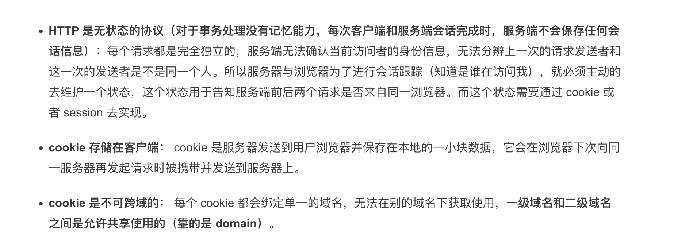
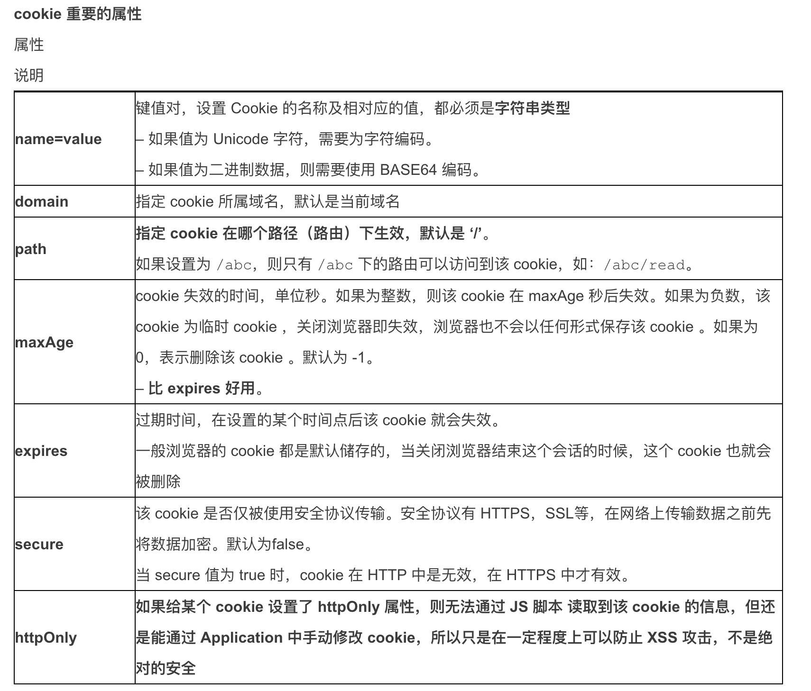
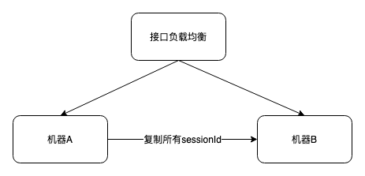
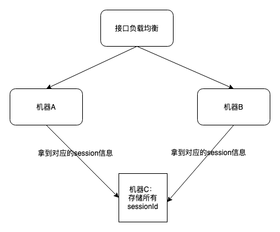
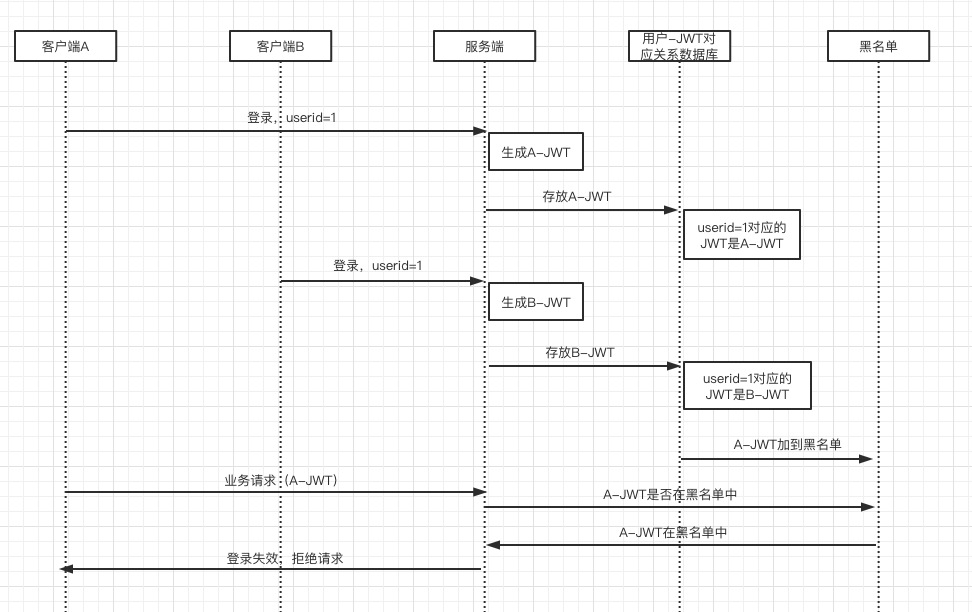
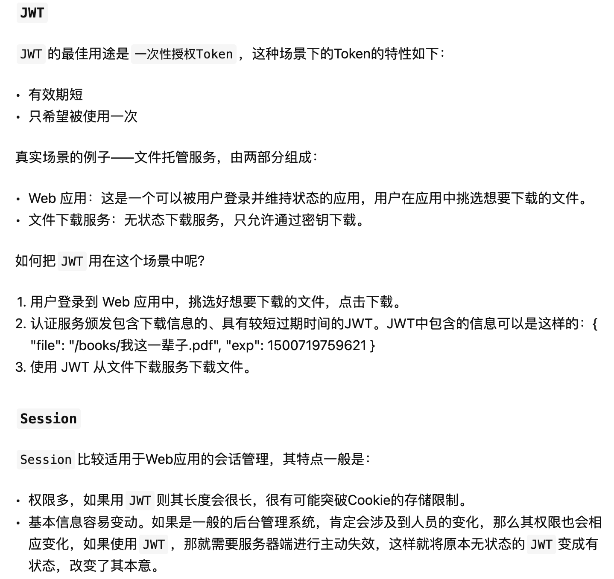
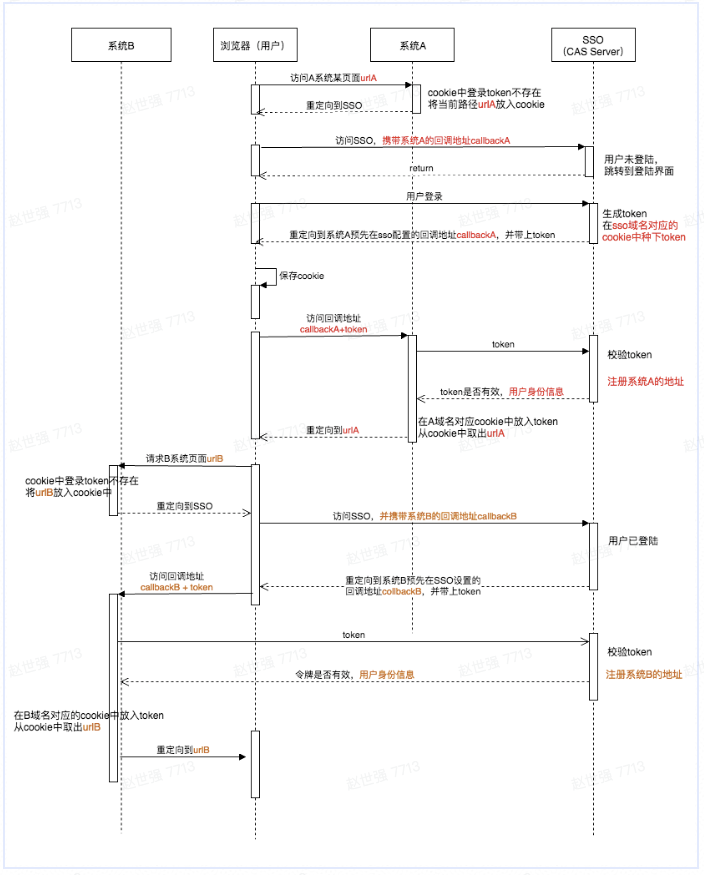

# cookie

随着前端业务逐渐复杂化，出现了表单等交互项，这就导致需要维护一个状态来保证是登录态，最简单的方式就是打一个标记。标记可以理解为用户唯一的标识。

对于前端而言，标记很好获得，在用户登录后拿到后端返回的字段就好了，主要问题在于存在哪里？

- 存在内存或sessionStroage中，刷新页面或重启浏览器都需要登录，相当于“临时卡”
- 存在localStroage中，无论怎么刷新都不需要登录，相当于“永久卡”

在有了标记后，只需每次请求接口时候带上这个标识，服务端就可以辨别出来。

但很显然以上两种都不是好的方案。两种方案都太过于极端并且对于前端而言，主动存数据，又得把数据带到接口里，是一件很麻烦且累赘的事情。这时就需要借助浏览器的帮助---Cookie。





Cookie作为前端存储数据的一种方式，相比于localStroage等存储方式，最方便的就在于它可以借助浏览器的能力，在前端无感知的情况下种下数据。

所以，一般网页鉴权的过程是：

- 在登录接口登陆成功后，通过HTTP返回头Response里的 Set-Cookie 字段，直接种到浏览器的当前域名下
- 之后浏览器发起的一系列请求，HTTP请求头Request里的Cookie字段会带上sessionId，后端去校验sessionId

Cookie的优势在于不用前端主动去存储标记，也不用去关心这个标记会存在多久，因为Cookie支持配置Expires / Max-Age字段，浏览器可以根据本地时间，决定 Cookie 是否过期。值得注意的是本地时间可能会存在不准，会导致Cookie无法在服务端规定时间后过期。

# Session

对于前端来说，Cookie种sessionId这个方案看起来还是挺理想的，解决了头疼的HTTP无状态问题；但对于服务端而言，可就不太友好了，每个人只需要保存自己的sessionId，而服务器要保存所有人的sessionId ！

这对服务器说是一个巨大的开销 ， 严重的限制了服务器扩展能力， 比如说我用两个机器组成了一个集群， 一个人通过机器A登录了系统， 那sessionId会保存在机器A上， 假设那个人的下一次请求被转发到机器B怎么办？机器B可没有这个人的 sessionId啊。这时会有两种解决方案：

1. 将机器A上的sessionId复制到机器B上



2. 将所有的sessionId存在单独一个机器上



可以看到方案1的花销过于大。尤其对于千万级别用户的应用来说，将每个机器之间的sessionId同步，耗时耗力还不能保证准确性；方案2看似解决了方案1同步问题，但新的问题又随之而来，如果机器C宕机了，我岂不是拿不到数据，所有用户都要重新登录。

所以这个sessionId看似不是一个好的鉴权方案，虽然方便了前端，但对于服务端的压力过于庞大。那有没有一种前后端都比较方便的鉴权方式呢？答案是肯定的。

# JWT

JSON Web Token（缩写 JWT）是目前最流行的跨域认证解决方案。

# 一、跨域认证的问题

互联网服务离不开用户认证。一般流程是下面这样。

1、用户向服务器发送用户名和密码。

2、服务器验证通过后，在当前对话（session）里面保存相关数据，比如用户角色、登录时间等等。

3、服务器向用户返回一个 session_id，写入用户的 Cookie。

4、用户随后的每一次请求，都会通过 Cookie，将 session_id 传回服务器。

5、服务器收到 session_id，找到前期保存的数据，由此得知用户的身份。

这种模式的问题在于，扩展性（scaling）不好。单机当然没有问题，如果是服务器集群，或者是跨域的服务导向架构，就要求 session 数据共享，每台服务器都能够读取 session。

举例来说，A 网站和 B 网站是同一家公司的关联服务。现在要求，用户只要在其中一个网站登录，再访问另一个网站就会自动登录，请问怎么实现？

一种解决方案是 session 数据持久化，写入数据库或别的持久层。各种服务收到请求后，都向持久层请求数据。这种方案的优点是架构清晰，缺点是工程量比较大。另外，持久层万一挂了，就会单点失败。

另一种方案是服务器索性不保存 session 数据了，所有数据都保存在客户端，每次请求都发回服务器。JWT 就是这种方案的一个代表。

在前后端分离项目中，用户登录后就会把token返回给前端，前端每次请求都会将token放在header中，后端根据header中的token确定用户的信息。 JWT使用流程：

- 前端将用户的用户名和密码传输给服务器
- 服务器校验用户名和密码正确性
- 校验成功后根据用户信息生成Token
- 前端存储Token，每次请求header携带token
- 服务端验证Token，返回数据

# 二、JWT 的原理

JWT 的原理是，服务器认证以后，生成一个 JSON 对象，发回给用户，就像下面这样。

```
{
  "姓名": "张三",
  "角色": "管理员",
  "到期时间": "2018年7月1日0点0分"
}
```

以后，用户与服务端通信的时候，都要发回这个 JSON 对象。服务器完全只靠这个对象认定用户身份。为了防止用户篡改数据，服务器在生成这个对象的时候，会加上签名（详见后文）。

服务器就不保存任何 session 数据了，也就是说，服务器变成无状态了，从而比较容易实现扩展。

# 三、JWT 的数据结构

实际的 JWT 大概就像下面这样。


它是一个很长的字符串，中间用点（.）分隔成三个部分。注意，JWT 内部是没有换行的，这里只是为了便于展示，将它写成了几行。

JWT 的三个部分依次如下。

- Header（头部）
- Payload（负载）
- Signature（签名）

写成一行，就是下面的样子。

`Header.Payload.Signature`

下面依次介绍这三个部分。

## Header

Header 部分是一个 JSON 对象，描述 JWT 的元数据，通常是下面的样子：

```
{
  "alg": "HS256",
  "typ": "JWT"
}
```

上面代码中，alg属性表示签名的算法（algorithm），默认是 HMAC SHA256（写成 HS256）；typ属性表示这个令牌（token）的类型（type），JWT 令牌统一写为JWT。

最后，将上面的 JSON 对象使用 Base64URL 算法（详见后文）转成字符串。

## Payload

Payload 部分也是一个 JSON 对象，用来存放实际需要传递的数据。JWT 规定了7个官方字段，供选用。

iss (issuer)：签发人

exp (expiration time)：过期时间

sub (subject)：主题

aud (audience)：受众

nbf (Not Before)：生效时间

iat (Issued At)：签发时间

jti (JWT ID)：编号

注意，JWT 默认是不加密的，任何人都可以读到，所以不要把秘密信息放在这个部分。

这个 JSON 对象也要使用 Base64URL 算法转成字符串。

## Signature

Signature 部分是对前两部分的签名，防止数据篡改。

首先，需要指定一个密钥（secret）。这个密钥只有服务器才知道，不能泄露给用户。然后，使用 Header 里面指定的签名算法（默认是 HMAC SHA256），按照下面的公式产生签名。

```
HMACSHA256(
  base64UrlEncode(header) + "." +
  base64UrlEncode(payload),
  secret)
```

算出签名以后，把 Header、Payload、Signature 三个部分拼成一个字符串，每个部分之间用"点"（.）分隔，就可以返回给用户。

## 互斥登录

使用JWT实现登录逻辑，要实现服务端主动登出功能，服务端需要在下发JWT前，就将该JWT存放到用户与JWT对应关系数据库中，等到服务端要主动注销该用户的时候，就将用户所对应的JWT加入到黑名单中。后续，该用户再请求服务的时候，传入的JWT已经在黑名单中了，请求会被拒绝。 

用户密码修改，服务端主动注销用户登录功能，基本上和互斥登录差不多。

# JWT的特点

（1）JWT 默认是不加密，但也是可以加密的。生成原始 Token 以后，可以用密钥再加密一次。

（2）JWT 不加密的情况下，不能将秘密数据写入 JWT。

（3）JWT 不仅可以用于认证，也可以用于交换信息。有效使用 JWT，可以降低服务器查询数据库的次数。

（4）JWT 的最大缺点是，由于服务器不保存 session 状态，因此无法在使用过程中废止某个 token，或者更改 token 的权限。也就是说，一旦 JWT 签发了，在到期之前就会始终有效，除非服务器部署额外的逻辑。

（5）JWT 本身包含了认证信息，一旦泄露，任何人都可以获得该令牌的所有权限。为了减少盗用，JWT 的有效期应该设置得比较短。对于一些比较重要的权限，使用时应该再次对用户进行认证。

（6）为了减少盗用，JWT 不应该使用 HTTP 协议明码传输，要使用 HTTPS 协议传输。



JWT 相对 Session 的优点：

- 节省了服务器的存储空间
- 规避了分布式系统中的状态数据的存储同步问题

JWT 相对 Session 的缺点：

- 增加 Cookie 的体积
- 耗费了服务器的算力，占用了服务器 CPU 资源

# CAS单点登录



整体流程为：

1. 用户未登录时访问系统 A，系统 A 服务器检测到用户没登录（ cookie 中没有登录 token ），于是通知浏览器跳转到 SSO 服务站点，并在当前域名对应 cookie 中种上当前页面地址，以便登录后自动跳转回本页。**值得注意的是**，在通过浏览器跳转到 SSO 服务站点时，会携带系统 A 的回调地址callbackA
2. sso 服务站点检测到用户没有登录，于是显示登录界面。用户提交登录请求到服务端，服务端验证通过，创建和账号对应的用户登录凭据（token）。然后，服务端通知浏览器把该 token 放入 sso 服务站点对应的 cookie 中，并跳转回系统 A 在 sso 提前设置好的回调地址，跳回系统 A 的 URL 参数中会带上这个 token。
3. 浏览器在写 sso 服务站点 cookie 后，跳转回系统 A。系统A服务端检测到浏览器请求的URL中带了单点登录的 token ，于是把这个 token 发到 SSO 服务站点验证。 sso 服务端站点验证通过后会返回该token 是否有效，以及用户的身份信息。系统 A 得到成功响应后，将 token 放入系统 A 域名对应的cookie 中，从而完成在本站的登入以及会话保持。之后用户访问系统 A 时，都会带上这个 cookie。
4. 用户再访问系统 B。系统 B 服务器检测到用户没登录，于是通知浏览器跳转到 SSO 服务站点。
5. 浏览器访问 SSO 服务站点时会带上上述步骤 2 创建的 sso 域名对应的 cookie（内有 token）。sso 服务站点根据该 token 能找到对应用户，于是通知浏览器跳转回系统 B，并在跳转回去的 URL 参数中带上这个 token。
6. 系统 B 服务端检测到浏览器请求的 URL 中带上了单点登录的 token，于是又会走上述对应步骤 3，完成用户在本站的自动登录。

【注】

1. SSO 系统登录后，跳回原业务系统时，带了个参数 token，业务系统为什么还要拿 token 再次访问SSO 进行验证？

- 这样做的目的是为了鉴权。从上面流程中我们可以看到，用户在给 CAS 服务端提供了用户名密码后，作为系统 A 并不知道这件事。那么，随便给系统A一个token，那么系统A是不能确定这个token是用户伪造还是真的有效，所以要拿着这个 token 去 CAS 服务端再问一下，是有效的token，才能让这个用户访问系统 A。

2. 上述时序图中是将 token 存在 cookie 中，实际上，很多时候是将 token 存在系统的 session 中。
