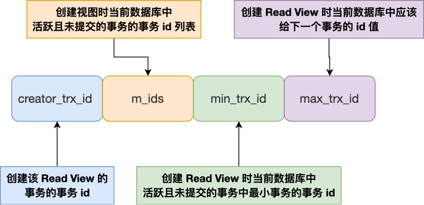
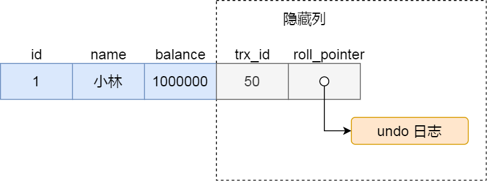
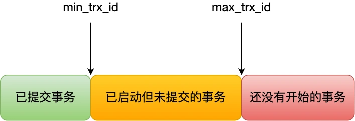

事务是数据库区分于文件系统的重要特性之一。事务会把数据库从一种一致状态转换为另一种一致状态。在数据库提交工作时，可以确保要么所有修改都已经保存了，要么所有修改都不保存。

`InnoDB`存储引擎中的事务完全符合ACID的特性：

- 原子性 atomicity
- 一致性 consistency
- 隔离性 isolation
- 持久性 durability

1 原子性

原子性指数据库事务是不可分割的最小工作单位，只有使事务中所有的数据库操作都执行成功，才算整个事务成功，事务中的操作要么全做要么全不做。

2 一致性

一致性是指事务将数据库从一种一致的状态转变为下一种一致的状态。在事务开始之前和事务结束以后，数据库的完整性约束没有被破坏。例如，表中的一个字段姓名满足唯一性，如果一个事务对姓名进行了修改，但是在事务提交或者回滚后，表中的姓名变得不唯一了，这就破坏了事务的一致性要求。因此，如果事务中某个动作失败了，系统会撤销事务，恢复初始状态。

**一致性是事务ACID四大特性中最重要的属性，而原子性、隔离性和持久性，都是作为保障一致性的手段。。**

3 隔离性

事务的隔离性要求多个事务并发执行时，一个事务的执行不应影响其他事务的执行。

4 持久性

事务一旦提交，其结果就是永久性的，即使发生宕机等故障，数据库也能将数据恢复。持久性保障事务系统的高可靠性，但不保障高可用性，如RAID损坏等。

# 事务的类型

## 扁平事务

所有操作都处在同一层次，由BEGIN WORK开始，ROLLBACK或COMMIT结束。

三种情况：


## 带有保存点的扁平事务

在事务中添加`Savepoint`，当发生错误后，回到某一个保存点。

## 链事务

链事务(Chained Transaction）可视为保存点模式的一种变种。带有保存点的扁平事务，当发生系统崩溃时，所有的保存点都将消失，因为其保存点是易失的（volatile)，而非持久的(persistent)。这意味着当进行恢复时，事务需要从开始处重新执行，而不能从最近的一个保存点继续执行。

链事务的思想是：在提交一个事务时，释放不需要的数据对象，将必要的处理上下文隐式地传给下一个要开始的事务。注意，提交事务操作和开始下一个事务操作将合并为一个原子操作。这意味着下一个事务将看到上一个事务的结果。

链事务和带有保存点的扁平事务的区别是：带有保存点的扁平事务能回滚到任意正确的保存点，而链事务只能回滚当前事务；链事务在执行COMMIT后即释放了当前事务持有的锁，而带有保存点的扁平事务一直持有锁。

# 事务的实现

事务的原子性要求事务失败时对数据库进行回滚，在`innoDB`中，回滚是通过undo log来实现的。

持久性是通过redo log实现的，在事务提交后，数据没写入磁盘就宕机时，在下次重启后能够根据redo log恢复数据。

## redo

重做日志用来实现事务的持久性，其由两部分组成：一是内存中的重做日志缓冲（redo log buffer），是易失的；二是重做日志文件（redo log file），是持久的。

`InnoDB`是事务的存储引擎，通过Force Log at Commit机制实现事物的持久性，即当事务提交时，必须先将事物的所有日志写入到重做日志文件中进行持久化。

为了确保每次日志都写入redo log file，在每次事务COMMIT后，`InnoDB`存储引擎都会调用一次`fsync`操作，将内核 page cache 中的 redo 日志刷新到磁盘中，磁盘的性能决定了事务提交的性能（如果不执行fsync，日志将存储在内核缓冲区，由操作系统决定何时刷盘）。

用户可以手动控制日志写入磁盘的策略，让数据库在事务提交时不强制将log刷新到磁盘，但这样做会破坏ACID特性。

将`innodb_flush_log_at_trx_commit`设置为0时，表示每次提交事务不会将日志刷新到磁盘，而是等待Master线程每隔一秒进行一次刷新操作；为1时，表示执行commit时进行一次日志文件的`fsync`操作，将日志刷新到磁盘；为2时，表示事务提交重做日志写入重做日志文件，但是只是写入到了操作系统的page cache，不执行fsync，此时mysql宕机不会丢失数据，而系统宕机会丢失数据。需要保证ACID中的持久性时，需要将该参数的值设置为1。

**某个事务未提交时，其redo log buffer也可能持久化到redo log文件中。**

在`InnoDB`中，重做日志都是以512字节进行存储的。若一个页中产生的重做日志大小大于512字节，则需要分割为多个redo log block进行存储。因为redo log block的大小与磁盘扇区一样，因此redo log的写入可以保证原子性。

**undo log的改动也会记录在redo log中。**

**binary log和redo log的区别：**

- 任何MySQL存储引擎的写入性操作都会记录到bin log中，而redo log只记录`innodb`对数据的修改记录。
- redo log采用循环写入的方式记录；bin log采用追加写入的方式记录，一个文件写满后会生成新的文件。
- redo log适用于数据库崩溃后进行恢复，bin log适用于主从复制和数据恢复。
- bin log只在事务提交前进行一次写入，无论事务多大；而redo log在一条事务执行过程中可能会多次写入。
- bin log记录一条事务的逻辑操作日志，一条事务对应一个记录；redo log记录物理页的修改记录，一条事务可能对应多条日志。

**当binary log比redo log的记录更多时，MySQL会废弃一部分binary log的记录：**例如，①事务提交时，MySQL会将事务的一系列日志按顺序写入磁盘；②然后将事务提交给`InnoDB`。如果在①和②的中间机器宕机，则`InnoDB`会对事务进行回滚，但此时binary log中会存在多余的记录，`InnoDB`会检查binary log中的记录，并将无效记录删除。

## undo

undo用来支持事务的回滚操作，存放在数据库内部的undo段中。undo segment位于共享表空间内。

undo操作会将数据库逻辑的恢复到执行事务之前的状态，所有修改都被逻辑地取消了（防止物理将数据库恢复到先前的状态时影响到其他事务）。例如，对每个INSERT，执行一个DELETE；对每个UPDATE，执行一个相反的UPDATE。

undo的另一个作用是MVCC，当用户读取一行记录时，若该记录已被其他事务占用，当前事务可以通过undo读取之前的行版本信息，实现一致性非锁定读。

## purge

delete和update的操作可能并不直接删除原有的数据，而是仅仅将列上的delete flag设置为1，记录仍然保存在B+树中，甚至没有产生undo log，真正删除这行记录的操作被延时到了purge操作中完成。

这是由于`InnoDB`支持MVCC，被删除的数据可能正在被其他事务使用，`InnoDB`需要保存删除时的历史版本，是否可以真正在物理上删除改行由purge操作进行判断，若该行记录不被任何其他事务引用，则可以安全的进行删除。

# 事务的隔离性

数据库的隔离性和一致性其实是一个需要开发者去权衡的问题，为数据库提供什么样的隔离性层级也就决定了数据库的性能以及可以达到什么样的一致性。

事务的四种隔离级别：

**1、READ UNCOMMITTED**

在该隔离级别，所有事务都可以看到其他未提交事务的执行结果。

本隔离级别很少用于实际应用，因为它的性能也不比其他级别好多少。读取未提交的数据，也被称之为脏读（Dirty Read）。

**2、READ COMMITTED**

这是大多数数据库系统的默认隔离级别（但不是MySQL默认的）。
它满足了隔离的简单定义：一个事务只能看见已经提交事务所做的改变。
这种隔离级别会导致不可重复读（`Nonrepeatable Read`）的问题，因为同一事务的其他实例在该实例处理期间可能会有新的commit，所以相同的 select 可能返回不同结果。

**3、REPEATABLE READ**

这是MySQL的默认事务隔离级别，指一个事务执行过程中看到的数据，一直跟这个事务启动时看到的数据是一致的。
不过理论上，这会导致另一个棘手的问题：幻读 （Phantom Read）。
幻读指当用户读取某一范围的数据行时，另一个事务又在该范围内插入了新行，当用户再读取该范围的数据行时，会发现有新的“幻影” 行。由于其他事务的INSERT操作，当前事务会产生幻读现象。

**4、SERIALIZABE**

这是最高的隔离级别，它通过强制事务排序，使之不可能相互冲突，从而解决幻读问题。
它会对记录加上读写锁，在多个事务对这条记录进行读写操作时，如果发生了读写冲突的时候，后访问的事务必须等前一个事务执行完成，才能继续执行；

四种隔离级别的问题：

|   |   |   |   |
|---|---|---|---|
|隔离级别|脏读（Dirty Read）|不可重复读（`NonRepeatable`<br><br>Read）|幻读（Phantom Read）|
|未提交读（Read uncommitted）|可能|可能|可能|
|已提交读（Read committed）|不可能|可能|可能|
|**可重复读（Repeatable read）**|**不可**能|**不可**能|**可能**|
|可串行化（Serializable ）|不可能|不可能|不可能|

## 隔离级别的实现

- 对于「读未提交」隔离级别的事务来说，因为可以读到未提交事务修改的数据，所以直接读取最新的数据就好了；
- 对于「串行化」隔离级别的事务来说，通过加读写锁的方式来避免并行访问；
- 对于「读提交」和「可重复读」隔离级别的事务来说，它们是通过 **Read View 来实现的，它们的区别在于创建 Read View 的时机不同，大家可以把 Read View 理解成一个数据快照，就像相机拍照那样，定格某一时刻的风景。「读提交」隔离级别是在「每个语句执行前」都会重新生成一个 Read View，而「可重复读」隔离级别是「启动事务时」生成一个 Read View，然后整个事务期间都在用这个 Read View**。

# MVCC

**多版本并发控制（MVCC）** 是通过保存数据在某个时间点的快照来实现并发控制的。也就是说，不管事务执行多长时间，事务内部看到的数据是不受其它事务影响的，根据事务开始的时间不同，每个事务对同一张表，同一时刻看到的数据可能是不一样的。

简单来说，**多版本并发控制** 的思想就是保存数据的历史版本，通过对数据行的多个版本管理来实现数据库的并发控制。这样我们就可以通过比较版本号决定数据是否显示出来，读取数据的时候不需要加锁也可以保证事务的隔离效果。

不加锁的简单的 SELECT 都属于**快照读**，例如：

```
`SELECT * FROM t WHERE id=1`
```

与 **快照读** 相对应的则是 **当前读**，**当前读**就是读取最新数据，而不是历史版本的数据。加锁的 SELECT 就属于当前读，例如：

```
# 共享锁
SELECT * FROM t WHERE id=1 LOCK IN SHARE MODE;
# 排他锁
SELECT * FROM t WHERE id=1 FOR UPDATE;
```

作用：

1.增强并发性。这样的一来查询就不用等待另一个事务释放锁。

2.在RR可重复读的隔离级别中，保障了单纯的select(不会加锁)的“可重复读”特性

这项技术在数据库领域并不是普遍使用的，其它的数据库产品，以及mysql其它的存储引擎并不支持它。

## ReadView

**在RR级别下，第一次执行SELECT时创建对应数据的ReadView，在RC级别下，每次SELECT都会创建最新的READVIEW。**



Read View 有四个重要的字段：

- m_ids ：指的是在创建 Read View 时，当前数据库中「活跃事务」的事务 id 列表，注意是一个列表，**“活跃事务”指的就是，启动了但还没提交的事务**。
- min_trx_id ：指的是在创建 Read View 时，当前数据库中「活跃事务」中事务 id 最小的事务，也就是 m_ids 的最小值。
- max_trx_id ：这个并不是 m_ids 的最大值，而是**创建 Read View 时当前数据库中应该给下一个事务的 id 值**，也就是全局事务中最大的事务 id 值 + 1；
- creator_trx_id ：指的是**创建该 Read View 的事务的事务 id**。

聚簇索引记录中的隐藏列：



对于使用 InnoDB 存储引擎的数据库表，它的聚簇索引记录中都包含下面两个隐藏列：

- trx_id，当一个事务对某条聚簇索引记录进行改动时，就会**把该事务的事务 id 记录在 trx_id 隐藏列里**；
- roll_pointer，每次对某条聚簇索引记录进行改动时，都会把旧版本的记录写入到 undo 日志中，然后**这个隐藏列是个指针，指向每一个旧版本记录**，于是就可以通过它找到修改前的记录。

在创建 Read View 后，我们可以将记录中的 trx_id 划分这三种情况：



一个事务去访问记录的时候，除了自己的更新记录总是可见之外，还有这几种情况：

- 如果记录的 trx_id 值小于 Read View 中的 min_trx_id 值，表示这个版本的记录是在创建 Read View **前**已经提交的事务生成的，所以该版本的记录对当前事务**可见**。
- 如果记录的 trx_id 值大于等于 Read View 中的 max_trx_id 值，表示这个版本的记录是在创建 Read View **后**才启动的事务生成的，所以该版本的记录对当前事务**不可见**。
- 如果记录的 trx_id 值在 Read View 的 min_trx_id 和 max_trx_id 之间，需要判断 trx_id 是否在 m_ids 列表中：

- 如果记录的 trx_id **在** m_ids 列表中，表示生成该版本记录时该事务未提交，所以该版本的记录对当前事务**不可见**。
- 如果记录的 trx_id **不在** m_ids列表中，表示生成该版本记录的活跃事务已经被提交，所以该版本的记录对当前事务**可见**。

**这种通过「版本链」来控制并发事务访问同一个记录时的行为就叫 MVCC（多版本并发控制）。**

## 快照读

快照读，也叫一致性的非锁定读（consistent nonlocking read）是指 `InnoDB`存储引擎通过行多版本控制的方法来读取当前执行时间数据库中行的数据，如果读取的行正在执行 DELETE 或 UPDATE 操作，这时读取操作不会因此去等待行上锁的释放。相反地，`InnoDB` 存储引擎会去读取行的快照数据。

这里的**一致性**是指，事务读取到的数据，要么是**事务开始前就已经存在的数据**，要么是**事务自身插入或者修改过的数据**。

快照数据是指该行的之前版本的数据，该实现是通过 undo 段来完成。而 undo 用来在事务中回滚数据，因此快照数据本身没有额外的开销。此外，读取快照数据不需要加锁，因为没有事务需要对历史的数据进行修改操作。

一行记录可能有多个版本，一般称这种技术为行多版本技术，由此带来的并发控制，称为多版本并发控制（MVCC）。

在事务隔离级别 READ COMMITED 和 REPEATABLE READ（`InnoDB`存储引擎的默认事务隔离级别）下，`InnoDB`存储引擎使用非锁定的一致性读。然而，在 READ COMMITED 事务隔离级别下，非一致性读总是读取被锁定行的最新一份快照数据（其他事务在该事务期间执行 COMMIT 后，将导致不可重复读问题）。而在 REPEATABLE READ 事务隔离级别下，对于快照数据，非一致性读总是读取事务开始时的行数据版本（其他事务在该事务执行期间做出的提交，不会导致该事务执行期间相同的 SQL 语句得到不同的结果）。

demo：

```
# Session A
mysql> BEGIN
Query OK, 0 rows affected (0.00 sec)
mysql> SELECT * FROM parent WHERE id = 1;
+----+
| id |
+----+
|  1 |
+----+
1 row in set (0.00 sec)

# Session B
mysql> BEGIN
Query OK, 0 rows affected (0.00 sec)
mysql> UPDATE parent SET id = 3 WHERE id = 1;
Query OK, 1 row affected (0.00 sec)
Rows matched: 1 Changed: 1 Warnings: 0
```

在会话 B 中修改 id 为 3，但是没有 COMMIT，这时相当于给 id = 1 的行加了一个 X 锁。如果这时在 A 中再次读取 id 为 1 的记录，当隔离级别为 READ COMMITED 和 REPEATABLE READ 时，数据库事务引擎会利用非锁定一致性读的特性读取数据：

```
mysql> SELECT * FROM parent WHERE id = 1;
+----+
| id |
+----+
|  1 |
+----+
1 row in set (0.00 sec)
```

在会话 B 中执行 COMMIT 后：

```
# Session B
mysql> COMMIT;
Query OK, 0 rows affected (0.00 sec)

# Session A
# READ-COMMITED 事务隔离级别下
mysql> SELECT * FROM parent WHERE id = 1;
Empty set (0.00 sec)

# Session A
# REPEATABLE READ 事务隔离级别下
mysql> SELECT * FROM parent WHERE id = 1;
+----+
| id |
+----+
|  1 |
+----+
1 row in set (0.00 sec)
```

对于 READ COMMITED 事务隔离级别而言，其违反了 ACID 特性的 I 特性，即同一时间只允许一个事务访问某一数据。

## 当前读

也叫一致性锁定读。MySQL 里除了普通查询是快照度，其他都是**当前读**，比如update、insert、delete，这些语句执行前都会查询最新版本的数据，然后再做进一步的操作。

在默认的 REPEATABLE READ 隔离级别下，对于 SELECT 语句，`InnoDB`存储引擎对 SELECT 操作会使用一致性非锁定读，但是在某些情况下，用户需要显式地对数据库的读取操作加锁来保证数据逻辑的一致性。

`InnoDB`对于 SELECT 语句支持两种一致性的锁定读操作：

- `SELECT … FOR UPDATE`：对读取的行记录加一个 X 锁，其他事务不能对已锁定的行加上任何锁。
- `SELECT … LOCK IN SHARE MODE`：对读取的行记录加一个 S 锁，其他事务可以向被锁定的行加 S 锁，不能加 X 锁。

这两种语句必须在一个事务中，当事务提交后，锁就释放了。

即使加锁后，一致性非锁定读也可以进行读取。

## 解决幻读问题

1、对于快照读

通过 MVCC 非锁定读机制，在第一次读取数据后，创建 read view（根据事务 ID），随后的快照读都基于该 read view，读取到同一个版本的数据。

2、对于当前读

在读写数据时，会申请排他锁（采用 next-key lock，锁记录和间隙），从而获取到数据的最新版本，直到事务结束后，才会释放锁，避免幻读问题。

next-key lock 锁的是索引，而不是数据本身，所以如果 update 语句的 where 条件没有用到索引列，那么就会全表扫描，在一行行扫描的过程中，不仅给行加上了行锁，还给行两边的空隙也加上了间隙锁，相当于锁住整个表，然后直到事务结束才会释放锁。

# 长事务的缺点

长事务会导致很老的事务快照的存在，由于这些事务随时可能访问数据库里面的任何数据，所以这个事务提交之前，数据库里面它可能用到的回滚记录都必须保留，这就会导致大量占用存储空间。同时长事务还占用锁资源，也可能拖垮整个库。
