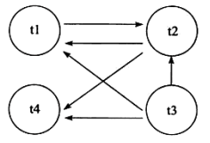

锁是数据库系统区分于文件系统的一个关键特性。锁机制用于管理对共享资源的并发访问。

# 为什么要加锁？

锁机制用于管理对共享资源的并发访问。

当多个用户并发地存取数据时，在数据库中就可能会产生多个事务同时操作同一行数据的情况，若对并发操作不加控制就可能会读取和存储不正确的数据，破坏数据的一致性。

一种典型的并发问题——丢失更新（其他锁问题及解决方法会在后面说到）：

注：RR默认隔离级别下，为更清晰体现时间先后，暂时忽略锁等待，不影响最终效果~

|   |   |   |
|---|---|---|
|时间点|事务A|事务B|
|1|开启事务A||
|2||开启事务B|
|3|查询当前商品S库存为100||
|4||查询当前商品S库存为100|
|5|业务逻辑处理，确定要将商品S库存增加10，故更新库存为110（`update stock set amount=110 where sku_id=S;`）||
|6||业务逻辑处理，确定要将商品S库存增加20，故更新<br><br>库存为120（`update stock set`<br><br>`amount=120` `where sku_id=S;`）|
|7|提交事务A||
|8||提交事务B|

**异常结果：**商品 S 库存更新为120，但实际上针对商品S进行了两次入库操作，最终商品S库存应为100+10+20=130，但实际结果为120，首先提交的事务A的更新丢失了！所以就需要锁机制来保证这种情况不会发生。

# `InnoDB`中的锁

## 锁的类型

按照锁的粒度，可以划分为：行锁、页锁、表锁

按照使用方式：共享锁、排他锁

按照思想：乐观锁、悲观锁

## 元数据锁

不需要显式的使用 MDL，因为当我们对数据库表进行操作时，会自动给这个表加上 MDL：

- 对一张表进行 CRUD 操作时，加的是 **MDL 读锁**；
- 对一张表做结构变更操作的时候，加的是 **MDL 写锁**；

MDL 是为了保证当用户对表执行 CRUD 操作时，防止其他线程对这个表结构做了变更。

当有线程在执行 select 语句（ 加 MDL 读锁）的期间，如果有其他线程要更改该表的结构（ 申请 MDL 写锁），那么将会被阻塞，直到执行完 select 语句（ 释放 MDL 读锁）。

反之，当有线程对表结构进行变更（ 加 MDL 写锁）的期间，如果有其他线程执行了 CRUD 操作（ 申请 MDL 读锁），那么就会被阻塞，直到表结构变更完成（ 释放 MDL 写锁）。

MDL 不需要显式调用，那它是在什么时候释放的?

MDL 是在事务提交后才会释放，这意味着**事务执行期间，MDL 是一直持有的**。

那如果数据库有一个长事务（所谓的长事务，就是开启了事务，但是一直还没提交），那在对表结构做变更操作的时候，可能会发生意想不到的事情，比如下面这个顺序的场景：

1. 首先，线程 A 先启用了事务（但是一直不提交），然后执行一条 select 语句，此时就先对该表加上 MDL 读锁；
2. 然后，线程 B 也执行了同样的 select 语句，此时并不会阻塞，因为「读读」并不冲突；
3. 接着，线程 C 修改了表字段，此时由于线程 A 的事务并没有提交，也就是 MDL 读锁还在占用着，这时线程 C 就无法申请到 MDL 写锁，就会被阻塞，

那么在线程 C 阻塞后，后续有对该表的 select 语句，就都会被阻塞，如果此时有大量该表的 select 语句的请求到来，就会有大量的线程被阻塞住，这时数据库的线程很快就会爆满了。

为什么线程 C 因为申请不到 MDL 写锁，而导致后续的申请读锁的查询操作也会被阻塞？

这是因为申请 MDL 锁的操作会形成一个队列，队列中**写锁获取优先级高于读锁**，一旦出现 MDL 写锁等待，会阻塞后续该表的所有 CRUD 操作。

所以为了能安全的对表结构进行变更，在对表结构变更前，先要看看数据库中的长事务，是否有事务已经对表加上了 MDL 读锁，如果可以考虑 kill 掉这个长事务，然后再做表结构的变更。

## 共享锁与排他锁

`InnoDB`实现了两种标准行级锁，一种是共享锁(shared locks，S锁)，一种是排它锁(exclusive locks，X锁)。

S锁允许当前持有该锁的事务读取行。X锁允许当前持有该锁的事务更新或删除行。

S锁：如果事务T1持有了行r上的S锁，则其他事务可以同时持有行r的S锁，但是不能对行r加X锁。

X锁：如果事务T1持有了行r上的X锁，则其他任何事务不能持有行r的X锁，必须等待T1在行r上的X锁释放。

如果事务T1在行r上保持S锁，则另一个事务T2对行r的锁的请求按如下方式处理：

- T2可以同时持有S锁；
- T2如果想在行r上获取X锁，必须等待其他事务对该行添加的S锁或X锁的释放。

## 意向锁

`InnoDB`支持多种粒度的锁，允许行级锁和表级锁的共存。例如 LOCK TABLES ... WRITE 等语句可以在指定的表上加上独占锁。`InnoDB`使用意向锁来实现多个粒度级别的锁定。意向锁是表级锁，表示 table 中的 row 所需要的锁( S 锁或 X 锁)的类型。

**为什么需要意向锁？**

某个事务申请表锁时，需要判断：

1. 其他事务是否持有该表的表锁
2. 是否有某一个事务持有该表中的某行的行锁（为此需要遍历每一行）

由于第二种操作的时间成本太高，设计了意向锁，用来快速判断是否有事务持有某个表中的行锁。

意向锁分为意向共享锁( IS 锁)和意向排它锁( IX 锁)。IS 锁表示当前事务意图在表中的行上设置共享锁，下面语句执行时会首先获取 IS 锁，因为这个操作在获取 S 锁：

`SELECT ... LOCK IN SHARE MODE`

IX 锁表示当前事务意图在表中的行上设置排它锁。下面语句执行时会首先获取 IX 锁，因为这个操作在获取 X 锁：

`SELECT ... FOR UPDATE`

事务要获取某个表上的 S 行锁和 X 行锁之前，必须先分别获取对应的IS锁和IX锁。

意向锁是由数据库引擎自己维护的，用户无法手动操作意向锁，在为数据行加共享 / 排他锁之前，`InooDB` 会先获取该数据行所在数据表的对应意向锁。

**锁的兼容性：**

意向锁之间互相兼容：

|   |   |   |
|---|---|---|
||IS|IX|
|IS|兼容|兼容|
|IX|兼容|兼容|

意向锁与表锁间有兼容问题（**这里的排他 / 共享锁指的都是表锁！意向锁不会与行级的共享 / 排他锁互斥！**）

|   |   |   |
|---|---|---|
||IS|IX|
|S|兼容|不兼容|
|X|不兼容|不兼容|

按照上面的兼容性，如果不同事务之间的锁兼容，则当前加锁事务可以持有锁，如果有冲突则会等待其他事务的锁释放。

如果一个事务请求锁时，请求的锁与已经持有的锁冲突而无法获取时，互相等待就可能会产生死锁。

意向锁不会阻止除了全表锁定请求之外的任何锁请求。 意向锁的主要目的是显示事务正在锁定某行或者正意图锁定某行。

总结：

1. `InnoDB` 支持多粒度锁，特定场景下，行级锁可以与表级锁共存。
2. 意向锁之间互不排斥，但除了 IS 与 S 兼容外，意向锁会与 共享锁 / 排他锁 互斥。
3. IX，IS是表级锁，不会和行级的X，S锁发生冲突。只会和表级的X，S发生冲突。
4. 意向锁在保证并发性的前提下，实现了行锁和表锁共存且满足事务隔离性的要求。

## 自增锁

AUTO-INC 锁是特殊的表锁机制，锁**不是在一个事务提交后才释放，而是在执行完插入语句后就会立即释放**。

**在插入数据时，会加一个表级别的 AUTO-INC 锁**，然后为被 AUTO_INCREMENT 修饰的字段赋值递增的值，等插入语句执行完成后，才会把 AUTO-INC 锁释放掉。

那么，一个事务在持有 AUTO-INC 锁的过程中，其他事务的如果要向该表插入语句都会被阻塞，从而保证插入数据时，被 AUTO_INCREMENT 修饰的字段的值是连续递增的。

但是， AUTO-INC 锁再对大量数据进行插入的时候，会影响插入性能，因为另一个事务中的插入会被阻塞。

因此， 在 MySQL 5.1.22 版本开始，InnoDB 存储引擎提供了一种**轻量级的锁**来实现自增。

一样也是在插入数据的时候，会为被 AUTO_INCREMENT 修饰的字段加上轻量级锁，**然后给该字段赋值一个自增的值，就把这个轻量级锁释放了，而不需要等待整个插入语句执行完后才释放锁**。

InnoDB 存储引擎提供了个 innodb_autoinc_lock_mode 的系统变量，是用来控制选择用 AUTO-INC 锁，还是轻量级的锁。

- 当 innodb_autoinc_lock_mode = 0，就采用 AUTO-INC 锁；
- 当 innodb_autoinc_lock_mode = 2，就采用轻量级锁；
- 当 innodb_autoinc_lock_mode = 1，这个是默认值，两种锁混着用，如果能够确定插入记录的数量就采用轻量级锁，不确定时就采用 AUTO-INC 锁。

不过，当 innodb_autoinc_lock_mode = 2 是性能最高的方式，但是会带来一定的问题。因为并发插入的存在，在每次插入时，自增长的值可能不是连续的，**这在有主从复制的场景中是不安全的**。

# 锁的算法

## 行锁的 3 种算法

`InnoDB`存储引擎有三种行锁算法：

- `Record Lock`：单个行记录上的锁
- `Gap Lock`：间隙锁，锁定一个范围，但不包括记录本身
- `Next-Key Lock`：`Gap Lock + Record Lock`，锁定范围+记录

`InnoDB`所有的行锁算法都是基于索引实现的，锁定的也都是索引或索引区间。

`Gap Lock`的作用是为了阻止多个事务将记录插入到同一个范围内，因为这会导致幻读问题（phantom Problem）的产生。

间隙锁锁住一个间隙以防止插入。假设索引列有2, 4, 8 三个值，如果对 4 加锁，会对 (2,4) 和 (4,8) 这两个间隙加锁。其他事务无法插入索引值在这两个间隙之间的记录。但是，间隙锁有个例外:

1. 如果索引列是唯一索引，那么对它的等值读那么只会锁住这条记录(只加行锁)，而不会锁住间隙（只有一条记录，不会幻读）。
2. 对于联合索引且是唯一索引，如果 where 条件只包括联合索引的一部分，那么依然会加间隙锁。

`Next-Key Lock` 是结合了 `Gap Lock` 和 `Record Lock` 的一种索引算法，这种锁定技术，不止锁定记录本身，还锁定一个范围。

例如一个索引有 10, 11, 13, 20 这四个值。`InnoDB`可以根据需要使用`Record Lock`将 10，11，13，20 四个索引锁住，也可以使用`Gap Lock`将`(-∞,10)，(10,11)，(11,13)，(13,20)，(20, +∞)`五个范围区间锁住。Next-Key Locking类似于上述两种锁的结合，它可以锁住的区间有为`(-∞,10]，(10,11]，(11,13]，(13,20]，(20, +∞)`，可以看出它即锁定了一个范围，也会锁定记录本身。

锁算法的一些规则：

- 在不通过索引条件查询时，`InnoDB` 会锁定表中的所有记录。所以，如果考虑性能，WHERE语句中的条件查询的字段都应该加上索引。
- `InnoDB`通过索引来实现行锁，而不是通过锁住记录。因此，当操作的两条不同记录拥有相同的索引时，也会因为行锁被锁而发生等待。
- 由于`InnoDB`的索引机制，数据库操作使用了主键索引，`InnoDB`会锁住主键索引；使用非主键索引时，`InnoDB`会先锁住非主键索引，再锁定主键索引。
- 当查询的索引是唯一索引(不存在两个数据行具有完全相同的键值)时，`InnoDB`存储引擎会将`Next-Key Lock`降级为`Record Lock`，即只锁住索引本身，而不是范围。
- `InnoDB`对于辅助索引有特殊的处理，不仅会锁住辅助索引值所在的范围，还会将其下一键值加上`Gap LOCK`。
- `InnoDB`使用`Next-Key Lock`机制来避免当前读的Phantom Problem（幻读问题）。

`InnoDB` 对于行的查询默认是采用 `Next-Key Lock` 算法（REPEATABLE READ级别下），当查询的索引含有唯一属性时（主键索引、唯一索引），`InnoDB` 存储引擎会对 `Next-Key Lock` 进行优化，将其降级为 `Record Lock`；而对于辅助索引，不仅会对索引列加 `Record Lock` ，还会对索引列前后的键值范围加上 `Gap Lock`。

```
CREATE TABLE e4 (a INT, b INT, PRIMARY KEY(a), KEY(b));
INSERT INTO e4 SELECT 1,1;
INSERT INTO e4 SELECT 3,1;
INSERT INTO e4 SELECT 5,3;
INSERT INTO e4 SELECT 7,6;
INSERT INTO e4 SELECT 10,8;
```

然后开启一个会话执行下面的语句。

```
SELECT * FROM e4 WHERE b=3 FOR UPDATE;
```

因为通过索引b来进行查询，所以`InnoDB`会使用`Next-Key Lock`进行加锁，并且索引 b 是非主键索引，所以还会对主键索引 a 进行加锁。对于主键索引 a，仅仅对值为 5 的索引加上 Record Lock（因为之前的规则）。而对于索引 b，需要加上`Next-Key Lock`索引，锁定的范围是 (1,3]。除此之外，还会对其下一个键值加上`Gap Lock`，即还有一个范围为`(3,6)`的锁。 再新开一个会话，执行下面的SQL语句，会发现都会被阻塞。

```
SELECT * FROM e4 WHERE a = 5 FOR UPDATE;  # 主键a被锁
INSERT INTO e4 SELECT 4,2;   # 插入行b的值为2，在锁定的(1,3]范围内
INSERT INTO e4 SELECT 6,5; # 插入行b的值为5，在锁定的(3,6)范围内
```

在 READ COMMITED 隔离级别下，仅使用 Record Lock，但是这破坏了事务的隔离性，还可能导致主从数据库的不一致。从性能上看，READ COMMITED 也不会优于默认的REPEATABLE READ。

# mysql8.0加锁规则

唯一索引等值查询：

- 当查询的记录是存在的，next-key lock 会退化成「记录锁」。
- 当查询的记录是不存在的，next-key lock 会退化成「间隙锁」。

非唯一索引等值查询：

- 当查询的记录存在时，除了会加 next-key lock 外，还额外加间隙锁，也就是会加两把锁。
- 当查询的记录不存在时，只会加 next-key lock，然后会退化为间隙锁，也就是只会加一把锁。

非唯一索引和主键索引的范围查询的加锁规则不同之处在于：

- 唯一索引在满足一些条件的时候，next-key lock 退化为间隙锁和记录锁。
- 非唯一索引范围查询，next-key lock 不会退化为间隙锁和记录锁。

# 锁的问题

## 阻塞

由于不同锁之间的兼容关系，在有些时刻一个事务中的锁需要等待另一个事务中的锁释放它所占用的资源，这就是阻塞。

参数`innodb_lock_wait_timeout`参数用来控制阻塞超时的时间，`innodb_rollback_on_timeout`参数用来设定是否在等待超时时对进行中的事务进行回滚操作。

## 死锁

死锁是并发系统中常见的问题，同样也会出现在数据库MySQL的并发读写请求场景中。当两个及以上的事务，双方都在等待对方释放已经持有的锁或因为加锁顺序不一致造成循环等待锁资源，就会出现“死锁”。常见的报错信息为 `Deadlock found when trying to get lock...`。

举例来说 A 事务持有 X1 锁 ，申请 X2 锁，B事务持有 X2 锁，申请 X1 锁。A 和 B 事务持有锁并且申请对方持有的锁进入循环等待，就造成了死锁。

从死锁的定义来看，MySQL 出现死锁的几个要素为：

1. 两个或者两个以上事务
2. 每个事务都已经持有锁并且申请新的锁
3. 锁资源同时只能被同一个事务持有或者不兼容
4. 事务之间因为持有锁和申请锁导致彼此循环等待

解决死锁最简单的一种方法是超时，即当两个事务互相等待时，当一个事务的等待时间超过设置的某一阈值时，其中一个事务进行回滚，另一个等待的事务就能继续进行。在 `InnoDB` 存储引擎中，参数 `innodb_lock_wait_timeout`用来设置超时的时间。

超时机制的问题：根据 FIFO 顺序对事务进行回滚，当事务很大时（执行了很多语句，占用较多 undo log），这时会存在很大的性能问题。

`Innodb`采用 **wait-for graph** 的方式来进行死锁检测，它要求数据库保存一下两种信息：

- 锁的信息链表
- 事务等待链表

通过上述链表可以构造出一张图，若在这个图里存在回路，就代表存在死锁。

demo：


wait-for graph：



wait-for graph 是一种较为主动的死锁检测机制，在每个事务申请锁并发生等待时都会判断是否存在回路，若存在则有死锁。通常 `InnoDB`回选择回滚 undo 量最小的事务。
