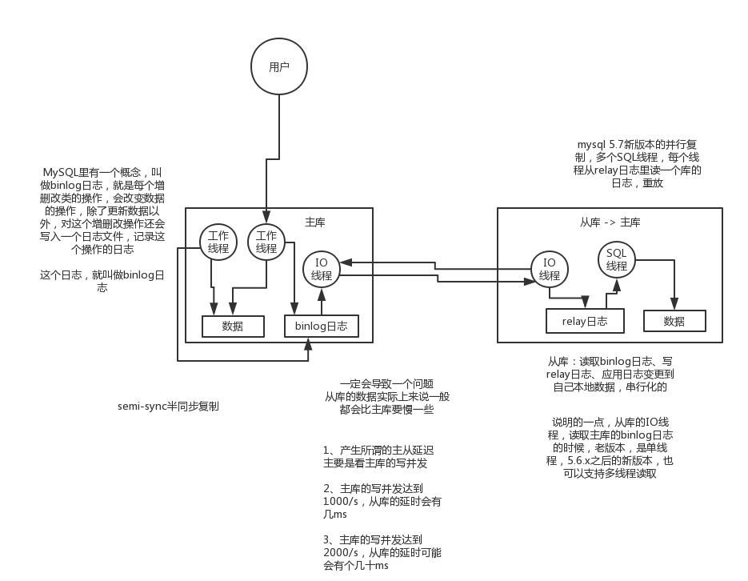

# [SELECT *] 和[SELECT 全部字段]有何优缺点？

- 前者要解析数据字典，后者不需要
- 结果输出顺序，前者与建表列顺序相同，后者按指定字段顺序。
- 表字段改名，前者不需要修改，后者需要改
- 后者可以建立索引进行优化，前者无法优化
- 后者的可读性比前者要高

# 如何提高insert 的性能？

答：有如下方法：

a) 合并多条 insert  为一条，即： insert into t values(a,b,c),	(d,e,f) ,,,

原因分析：主要原因是多条 insert 合并后日志量（MySQL 的 `binlog` 和 `innodb` 的事务日志） 减少了，**降低日志刷盘的数据量和频率，**从而提高效率。通过合并 SQL 语句，同时也能减少 SQL 语句解析的次数，减少网络传输的 IO。

b) 修改参数 bulk_insert_buffer_size， **调大批量插入的缓存**；

c) 设置 `innodb_flush_log_at_trx_commit` = 0 ，相对于`innodb_flush_log_at_trx_commit` = 1 可以十分明显的提升导入速度；

用户可以手动控制日志写入磁盘的策略，让数据库在事务提交时不强制将log刷新到磁盘，但这样做会破坏ACID特性。

将`innodb_flush_log_at_trx_commit`设置为0时，表示每次提交事务不会将日志刷新到磁盘，而是等待Master线程每隔一秒进行一次刷新操作；为1时，表示执行commit时进行一次日志文件的`fsync`操作，将日志刷新到磁盘；为2时，表示仅将redo log在缓冲区进行修改。需要保证ACID中的持久性时，需要将该参数的值设置为1。

d）手动使用事务

因为 `mysql` 默认是 `autocommit` 的，这样每插入一条数据，都会进行一次commit；

所以，为了减少创建事务的消耗，我们可用手工使用事务，一般 1000 条 insert 提交一次。

# MySQL主从复制，读写分离

随着业务量的扩展、如果是单机部署的MySQL，会导致I/O频率过高。采用**主从复制、读写分离可以分担主库的压力，提高并发量**。

读写分离最基本原则：

- 对于延迟敏感业务必须在主库读取，或采取主从验证机制，可在从库读取
- 报表，统计类，查询可以通过从库读取

## （1）如何实现mysql的读写分离？

其实很简单，就是基于主从复制架构，简单来说，就搞一个主库，挂多个从库，然后我们就单单只是写主库，然后主库会自动把数据给同步到从库上去。

## （2）MySQL主从复制原理的是啥？

**基于Bin Log的主从复制过程：**

1. Master将数据改变记录到二进制日志(binary log)中
2. Worker上的IO进程连接Master，并请求从指定日志文件的指定位置（或者从最开始的日志）之后的日志内容
3. Master接收到来自Worker的IO进程的请求后，负责复制的IO进程会根据请求信息读取日志指定位置之后的日志信息，返回给Worker的IO进程。
     返回信息中除了日志所包含的信息之外，还包括本次传输中，Master端传输的最后的bin-log文件的名称以及bin-log的位置。
4. Worker的IO进程接收到信息后，将接收到的日志内容依次添加到Worker端的relay-log文件的最末端，并将读取到的Master端的bin-log的文件名和位置记录到master-info文件中，以便在下一次读取的时候能够告诉Master需要读取从某个bin-log的哪个位置开始往后的日志内容。
5. Worker的`Sql`进程检测到relay-log中新增加了内容后，会马上解析relay-log的内容成为在Master端真实执行时候的那些可执行的内容，并在自身执行。

这里有一个非常重要的一点，就是从库同步主库数据的过程是**串行化**的，也就是说主库上并行的操作，在从库上会串行执行。所以这就是一个非常重要的点了，由于从库从主库拷贝日志以及串行执行SQL的特点，在高并发场景下，从库的数据一定会比主库慢一些，是有延时的。所以经常出现，刚写入主库的数据可能是读不到的，要过几十毫秒，甚至几百毫秒才能读取到。

而且这里还有另外一个问题，就是如果主库突然宕机，然后恰好数据还没同步到从库，那么有些数据可能在从库上是没有的，有些数据可能就丢失了。

所以`mysql`实际上在这一块有两个机制，一个是**半同步复制**，用来解决主库数据丢失问题；一个是**并行复制**，用来解决主从同步延时问题（多个库级别的并行）。

这个所谓半同步复制，semi-sync复制，指的就是主库写入`binlog`日志之后，就会将强制此时立即将数据同步到从库，从库将日志写入自己本地的`relay log`之后，接着会返回一个ack给主库，主库接收到至少一个从库的`ack`之后才会认为写操作完成了。

所谓并行复制，指的是从库开启多个线程，并行读取relay log中不同库的日志，然后并行重放不同库的日志，这是库级别的并行。

## （3）`mysql`主从同步延时问题（精华）

 线上确实处理过因为主从同步延时问题，导致的线上的bug，小型的生产事故

show status，Seconds_Behind_Master，你可以看到从库复制主库的数据落后了几`ms`

其实这块东西我们经常会碰到，就比如说用了`mysql`主从架构之后，可能会发现，刚写入库的数据结果没查到，结果就完蛋了。。。。

所以实际上你要考虑好应该在什么场景下来用这个`mysql`主从同步，建议是一般在读远远多于写，而且读的时候一般对数据时效性要求没那么高的时候，用`mysql`主从同步

所以这个时候，我们可以考虑的一个事情就是，你可以用`mysql`的并行复制，但是问题是那是库级别的并行，所以有时候作用不是很大

所以这个时候。通常来说，我们会对于那种写了之后立马就要保证可以查到的场景，采用强制读主库的方式，这样就可以保证你肯定的可以读到数据了吧。其实用一些数据库中间件是没问题的。

一般来说，如果主从延迟较为严重

1、分库，将一个主库拆分为4个主库，每个主库的写并发就500/s，此时主从延迟可以忽略不计

2、打开`mysql`支持的并行复制，多个库并行复制，如果说某个库的写入并发就是特别高，单库写并发达到了2000/s，并行复制还是没意义。28法则，很多时候比如说，就是少数的几个订单表，写入了2000/s，其他几十个表10/s。

3、重写代码，写代码的同学，要慎重，当时我们其实短期是让那个同学重写了一下代码，插入数据之后，直接就更新，不要查询

4、如果确实是存在必须先插入，立马要求就查询到，然后立马就要反过来执行一些操作，对这个查询设置直连主库。不推荐这种方法，你这么搞导致读写分离的意义就丧失了

# 分库分表

数据库扩展解决了什么问题？

1. 热备份，多活，故障切换
2. 负载均衡、读写分离

分库，就是把一个数据库拆分成多个数据库；分表，就是把一张表拆成多张表。

**分库分表的原因**

1、随着单库中的数据量越来越大，相应的，查询所需要的时间也越来越多，相当于数据的处理遇到了瓶颈
2、单库发生意外的时候，需要修复的是所有的数据，而多库中的一个库发生意外的时候，只需要修复一个库（当然，也可以用物理分区的方式处理这种问题）

## 垂直拆分

如果你有10张表，拆成2两个库，每个库5个表，这样的操作叫做垂直分库。因此垂直拆分，是业务导向的。比如你要把一个数据库拆分成交易数据库和商品库。

垂直分表也是如此，比如你要把一张表中若干的列拆分成另一张表。

你要把一个订单表拆分成订单的主要信息表，和备注表，还有额外信息表，这就是垂直拆分。

## 水平拆分

那么什么是水平拆分呢？

水平拆分是一个空间的拆分概念。

我们将一张表，在不改变结构的情况下，将一部分行放入表1，另一部分行放入表2，依次类推——这就是水平拆分。

**1.有瑕疵的简单分库分表（按id的大小分库分表）**

这样的分库分表，因为新的数据总在一个库里，很可能导致热点过于集中（读写可能集中在一个库中），这是采取这种方式需要考虑的事情。

**2.比较方便的取模分库**
一般的取模分库分表是就是将id mod n，然后放入数据库中，这样能够使数据分散，不会有热点的问题，那么，剩下的是，在扩容的时候，是否会有数据迁移的问题，一般的扩容，当然是会有数据迁移的。
