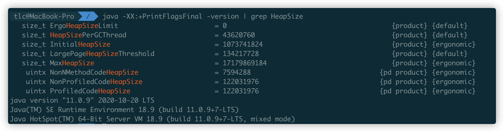
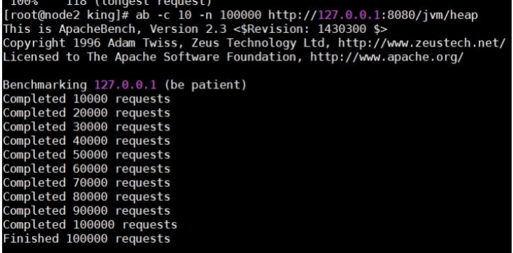
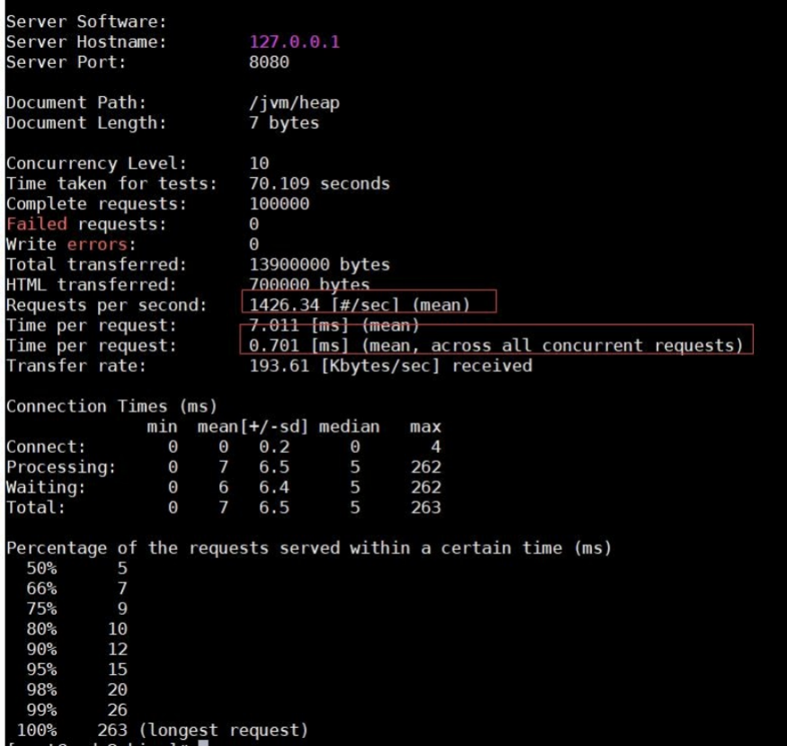
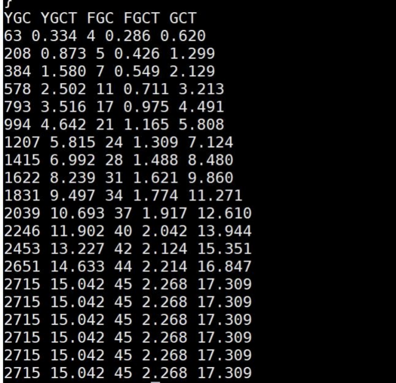
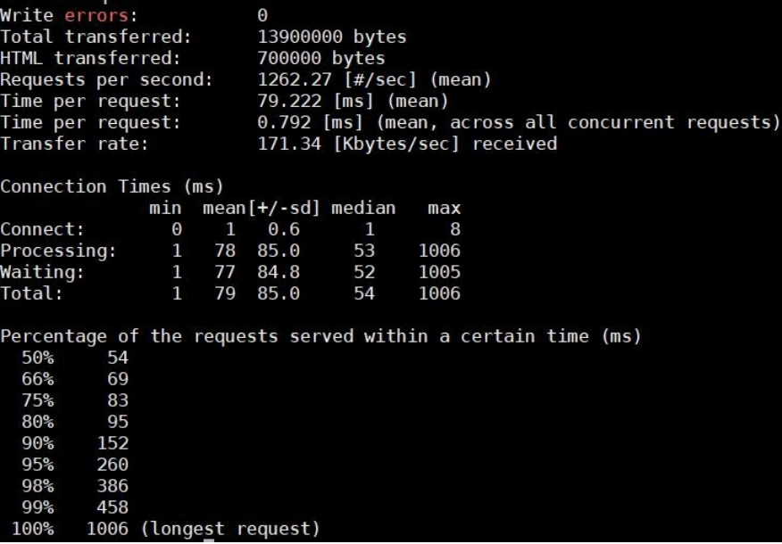
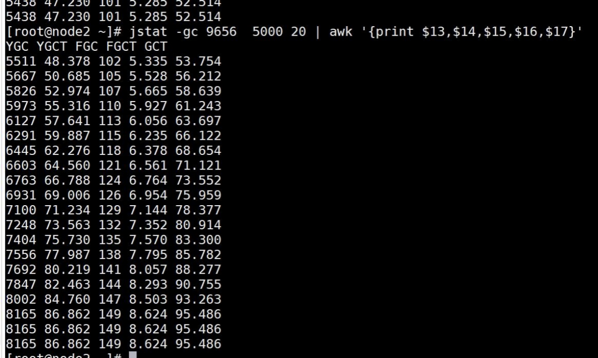

# GC调优实战

## 堆空间监控

在默认不配置 JVM 堆内存大小的情况下，JVM 根据默认值来配置当前内存大小。我们可以通过以下命令来查看堆内存配置的默认值：

java -XX:+PrintFlagsFinal -version | grep HeapSize

- InitialHeapSize 初始堆内存大小
- MaxHeapSize 最大堆内存大小



## 使用 AB 进行压力测试

### 1、10 个并发用户/10 万请求量（总）

ab -c 10 -n 100000 http://127.0.0.1:8080/jvm/heap





统计 GC 情况

jstat -gc 9656	5000 20 | awk '{print $13,$14,$15,$16,$17}'



测试结果显示：

- 用户的吞吐量大于在 1426/每秒左右
- JVM 服务器平均请求处理时间 0.7ms 左右
- JVM 服务器发生了 2700 多次 YGC,耗时 15 秒 ，还有 45 次 FGC, 2.3 秒左右，加在一起 GC 耗时 17 秒

### 2、100 个并发用户/10 万请求量（总）

ab -c 100 -n 100000 http://127.0.0.1:8080/jvm/heap



测试结果显示：

- 用户的吞吐量大于在 1262/每秒左右
- JVM 服务器平均请求处理时间 0.8ms 左右
- JVM 服务器发生了 2700 多次 YGC,耗时 30 秒 ，还有 56 次 FGC,3 秒左右，加在一起 GC 耗时 33 秒

### 3、1000 个并发用户/10 万请求量（总）

ab -c 1000 -n 100000 http://127.0.0.1:8080/jvm/heap



测试结果显示：

- 用户的吞吐量大于在 1145/每秒左右
- JVM 服务器平均请求处理时间 0.8ms 左右
- JVM 服务器发生了 2700 多次 YGC,耗时 38 秒 ，还有 47 次 FGC,3 秒左右，加在一起 GC 耗时 42 秒

## 结果分析

### GC 频率

高频的FullGC会给系统带来非常大的性能消耗，虽然 MinorGC 相对 FullGC 来说好了许多，但过多的 MinorGC 仍会给系统带来压力。

从数据看到FullGC 消耗的时间短，表示回收的效率高，也就是说大部分的对象是可以回收的，所以要考虑增大新生代空间

### 内存

这里的内存指的是堆内存大小，堆内存又分为年轻代内存和老年代内存。堆内存不足，会增加 MinorGC ，影响系统性能。

### 吞吐量

频繁的GC将会引起线程的上下文切换，增加系统的性能开销，从而影响每次处理的线程请求，最终导致系统的吞吐量下降。

### 延时

JVM 的GC持续时间也会影响到每次请求的响应时间。

------

### 调整方案一：加大堆空间

```
java -jar -Xms1500m -Xmx1500m jvm-1.0-SNAPSHOT.jar
```

调整堆内存空间减少 GC：通过分析，堆内存基本被用完了，而且存在大量 MinorGC 和 FullGC，这意味着我们的堆内存严重不足，这个时候我们需要调大堆内存空间。堆空间加大到 1.5G

### 调整方案二：加大新生代

```
java -jar -Xms1500m -Xmx1500m -Xmn1000m -XX:SurvivorRatio=8 jvm-1.0-SNAPSHOT.jar
```

| **VM** **参数配置**                                          | **性能指标** | **10** **个并发****/10** **万总请求** | **100** **个并发****/10** **万总请求** | **1000** **个并发****/10** **万总请求** |
| ------------------------------------------------------------ | ------------ | ------------------------------------- | -------------------------------------- | --------------------------------------- |
| 最大堆内存为 480MB初始化大小为 32MBEden 区 103mFrom、To 3~4M OLd =18M | 吞吐量       | 1426/s                                | 1262/s                                 | 1145/s                                  |
| 平均处理时间                                                 | 0.7ms        | 0.8ms                                 | 0.8ms                                  |                                         |
| GC 耗时                                                      | GC 耗时      | 33s                                   | 42s                                    |                                         |
| 最大堆内存为 1.5G， 初始化大小为 1.5G Eden 区 375mFrom、To 62M OLd =1000M | 吞吐量       | 1205/s                                | 989/s                                  | 749/s                                   |
| 平均处理时间                                                 | 0.83ms       | 1.01ms                                | 1.3ms                                  |                                         |
| GC 耗时                                                      | 34s          | 52s                                   | 75s                                    |                                         |
| 最大堆内存为 1.5G， 初始化大小为 1.5G Eden 区 800mFrom、To 100M OLd =500M | 吞吐量       | 1780/s                                | 1927/s                                 | 1657/s                                  |
| 平均处理时间                                                 | 0.56ms       | 0.51ms                                | 0.6ms                                  |                                         |
| GC 耗时                                                      | 6s           | 11s                                   | 17s                                    |                                         |

------

一般情况下，高并发业务场景中，需要一个比较大的堆空间，而默认参数情况下，堆空间不会很大。所以我们有必要进行调整。   但是不要单纯的调整堆的总大小，要调整新生代和老年代的比例，以及 Eden 区还有 From 区，还有 To 区的比例。

所以在我们上述的测试中，调整方案二，得到结果是最好的。在三种测试情况下都能够有非常好的性能指标，同时 GC 耗时相对控制也较好。

方案一：就是单纯的加大堆空间，里面的比例不适合高并发场景，反而导致堆空间变大，没有明显减少 GC 的次数，但是每次 GC 需要检索对象的堆空间更大，所以 GC 耗时更长。

方案二：调整为一个很大的新生代和一个较小的老年代.原因是,这样可以尽可能回收掉大部分短期对象,减少中期的对象,而老年代尽存放长期存活对象。由于新生代空间较小，Eden 区很快被填满，就会导致频繁 Minor GC，因此我们可以通过增大新生代空间来降低 Minor GC 的频率。

**单次 Minor GC 时间是由两部分组成：T1（扫描新生代）和 T2（复制存活对象）**。

默认情况：一个对象在 Eden 区的存活时间为 500ms，Minor GC 的时间间隔是 300ms，因为这个对象存活时间>间隔时间，那么正常情况下，Minor GC 的时间为 ：T1+T2。

方案一：整堆空间加大，但是新生代没有增大多少，对象在 Eden 区的存活时间为 500ms，Minor GC 的时间可能会扩大到 400ms，因为这个对象存活时间>间隔时间，那么正常情况下，Minor GC 的时间为 ：T1*1.5（Eden 区加大了）+T2

方案二：当我们增大新生代空间，Minor GC 的时间间隔可能会扩大到 600ms，此时一个存活 500ms 的对象就会在 Eden 区中被回收掉，此时就不存在复制存活对象了，所以再发生 Minor GC 的时间为：即 T1*2（空间大了）+T2*0

可见，扩容后，Minor GC 时增加了 T1，但省去了 T2 的时间。

在 JVM 中，复制对象的成本要远高于扫描成本。如果在堆内存中存在较多的长期存活的对象，此时增加年轻代空间，反而会增加 Minor GC 的时间。如果堆中的短期对象很多，那么扩容新生代，单次 Minor GC 时间不会显著增加。因此，单次 Minor GC 时间更多取决于 GC 后存活对象的数量，而非 Eden 区的大小。

这个就解释了之前的内存调整方案中，方案一为什么性能还差些，但是到了方案二话，性能就有明显的上升。

# GC优化策略

## GC 性能衡量指标

### 1. 吞吐量

这里的衡量吞吐量是指应用程序所花费的时间和系统总运行时间的比值。我们可以按照这个公式来计算 GC 的吞吐量：系统总运行时间 = 应用程序耗时+GC 耗时。如果系统运行了 100 分钟，GC 耗时 1 分钟，则系统吞吐量为 99%。GC 的吞吐量一般不能低于 95%。

### 2. 停顿时间

指垃圾回收器正在运行时，应用程序的暂停时间。对于串行回收器而言，停顿时间可能会比较长；而使用并发回收器，由于垃圾收集器和应用程序交替运行，程序的停顿时间就会变短，但其效率很可能不如独占垃圾收集器，系统的吞吐量也很可能会降低。

### 3. 垃圾回收频率

通常垃圾回收的频率越低越好，增大堆内存空间可以有效降低垃圾回收发生的频率，但同时也意味着堆积的回收对象越多，最终也会增加回收时的停顿时间。所以我们需要适当地增大堆内存空间，保证正常的垃圾回收频率即可。

------

## 推荐策略

### 1.新生代大小选择

- 响应时间优先的应用:尽可能设大,直到接近系统的最低响应时间限制(根据实际情况选择).在此种情况下,新生代收集发生的频率也是最小   的.同时,减少到达老年代的对象.
- 吞吐量优先的应用:尽可能的设置大,可能到达 Gbit 的程度.因为对响应时间没有要求,垃圾收集可以并行进行,一般适合 8CPU 以上的应用.
- 避免设置过小.当新生代设置过小时会导致:1.MinorGC 次数更加频繁 2.可能导致 MinorGC 对象直接进入老年代,如果此时老年代满了,会触发 FullGC.

### 2.老年代大小选择

### 响应时间优先的应用

老年代使用并发收集器,所以其大小需要小心设置,一般要考虑并发会话率和会话持续时间等一些参数.

如果堆设置小了,可以会造成内存碎片,高回收频率以及应用暂停而使用传统的标记清除方式;

如果堆大了,则需要较长的收集时间.

最优化的方案,一般需要参考以下数据获得:

并发垃圾收集信息、持久代并发收集次数、传统 GC 信息、花在新生代和老年代回收上的时间比例。

### 吞吐量优先的应用

一般吞吐量优先的应用都有一个很大的新生代和一个较小的老年代.原因是,这样可以尽可能回收掉大部分短期对象,减少中期的对象,而老年代尽存放长期存活对象。

------

## GC 调优策略

### 1. 降低 Minor GC 频率

由于新生代空间较小，Eden 区很快被填满，就会导致频繁 Minor GC，因此我们可以通过增大新生代空间来降低 Minor GC 的频率。单次 Minor GC 时间是由两部分组成：T1（扫描新生代）和 T2（复制存活对象）。

情况 1：假设一个对象在 Eden 区的存活时间为 500ms，Minor GC 的时间间隔是 300ms，因为这个对象存活时间>间隔时间，那么正常情况下，Minor GC 的时间为 ：T1+T2。

情况 2：当我们增大新生代空间，Minor GC 的时间间隔可能会扩大到 600ms，此时一个存活 500ms 的对象就会在 Eden 区中被回收掉，此时就不存在复制存活对象了，所以再发生 Minor GC 的时间为：即 T1*2（空间大了）+T2*0

可见，扩容后，Minor GC 时增加了 T1，但省去了 T2 的时间。

在 JVM 中，复制对象的成本要远高于扫描成本。如果在堆内存中存在较多的长期存活的对象，此时增加年轻代空间，反而会增加 Minor GC 的时间。如果堆中的短期对象很多，那么扩容新生代，单次 Minor GC 时间不会显著增加。因此，单次 Minor GC 时间更多取决于 GC 后存活对象的数量，而非 Eden 区的大小。

这个就解释了之前的内存调整方案中，方案一为什么性能还差些，但是到了方案二话，性能就有明显的上升。

### 2. 降低 Full GC 的频率

由于堆内存空间不足或老年代对象太多，会触发 Full GC，频繁的 Full GC 会带来上下文切换，增加系统的性能开销。

减少创建大对象：在平常的业务场景中，我们一次性从数据库中查询出一个大对象用于 web 端显示。比如，一次性查询出 60 个字段的业务操作，这种大对象如果超过年轻代最大对象阈值，会被直接创建在老年代；即使被创建在了年轻代，由于年轻代的内存空间有限，通过 Minor GC  之后也会进入到老年代。这种大对象很容易产生较多的 Full GC。

增大堆内存空间：在堆内存不足的情况下，增大堆内存空间，且设置初始化堆内存为最大堆内存，也可以降低 Full GC 的频率。

### 3. 选择合适的 GC 回收器

如果要求每次操作的响应时间必须在 500ms 以内。这个时候我们一般会选择响应速度较快的 GC 回收器，堆内存比较小的情况下（<6G）选择 CMS（Concurrent Mark Sweep）回收器和堆内存比较大的情况下（>8G）G1 回收器.

### 总结

GC 调优是个很复杂、很细致的过程，要根据实际情况调整，不同的机器、不同的应用、不同的性能要求调优的手段都是不同的，这些都需要大家平时去积累，去观察，去实践。
