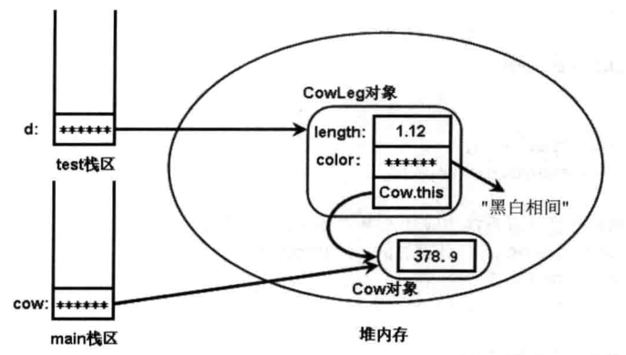

内部类：把一个类的定义放在另一个类的定义内部。
内部类的优点：

- 内部类被当作外部类的成员，因此内部类的成员可以访问外部类中的数据，包括私有的数据。但外部类不能访问内部类中的实现细节，例如成员变量。
- 内部类提供了更好的封装，可以把内部类隐藏在外部类之内，不允许同一个包内的其他类访问该类。假设需要创建`Cow`类，并需要组合一个`CowLeg`对象，`CowLeg`类只有在`Cow`类中才有意义，此时就可以把`CowLeg`类定义类`Cow`的内部类，不允许其他类访问`CowLeg`。
- 当想要定义一个回调函数且不想编写大量代码时，使用匿名内部类比较便捷。

内部类和外部类的区别：

- 内部类比外部类可以多使用三个修饰符：private、protected和static。
- 非静态内部类不能拥有静态成员。

# 非静态内部类

内部类可以在类内部的任何位置定义。在方法中定义的内部类叫局部内部类，在成员变量与成员函数处定义的内部类为成员内部类。

大多数时候内部类都作为成员内部类被定义，成员内部类是一种类成员，而局部内部类和匿名内部类不是类成员。

没有static修饰的成员内部类为非静态内部类。

> 外部类的上一级程序单元是包，因此它只有两个作用域：同一个包内和任何位置。因此只需要两种访问权限：包访问权限和公开访问权限。对应public和缺省访问修饰符。而内部类的上一级程序单元是外部类，它有四个作用域：同一个类、同一个包、父子类和任意位置，因此可以使用4中访问控制权限。

下面的程序在`Cow`中创建了`CowLeg`内部类并直接访问其私有变量。

```java
public class Cow
{
    private double weight;
    //外部类的两个重载的构造器
    public Cow(){}
    public Cow(double weight)
    {
        this.weight=weight;
    }
    //定义一个非静态内部类
    private class CowLeg{
        //非静态内部类的两个Field
        private double length;
        private String color;
        //非静态内部类的两个重载的构造器
        public CowLeg(){}
        public CowLeg(double length , String color){
            this.length=length;
            this.color=color;
        }
        // 非静态内部类的实例方法
        public void info(){
            System.out.println("当前牛腿颜色是："+ color + ", 高：" + length);
            // 直接访问外部类的private修饰的Field
            System.out.println("本牛腿所在奶牛重：" + weight);// ①
        }
    }
    public void test()
    {
        CowLeg cl=new CowLeg(1.12 , "黑白相间");
        cl.length = 100;
        cl.info();
    }
    public static void main(String[] args)
    {
        Cow cow=new Cow(378.9);
        cow.test();
    }
}
```

程序编译后会产生两个class文件，一个是`Cow.class`，一个是`Cow$CowLeg.class`。成员内部类（静态或非静态）的class文件总是`OuterClass$InnerClass.class`形式。

在非静态内部类中保存了一个它所依赖的外部类对象的引用，因此可以访问外部类中的private成员。

其内存示意图如下：



在非静态内部类的方法中访问某个变量时，系统的查找顺序为：方法体内的局部变量->内部类的成员变量->外部类的成员变量。

当外部类成员变量、内部类成员变量和方法内局部变量名字相同时，可以通过this、外部类类名.this作为限定来区分这三种变量。

**非静态内部类中，  外部类类名.this指针  指向其外部类对象**

当外部类需要访问非静态内部类的成员时，必须先实例化一个内部类的对象，之后通过该对象访问内部类的成员（可以访问私有或protected成员）。外部类对象不依赖于内部类，因此外部类实例化后，其非静态内部类并没有实例化，必须手动实例化之后才能访问内部类对象的成员。

> Java语言规范要求外部类和内部类可以互相访问对方的private/protected成员，但没有规定实现方式。由各个编译器来实现该规范，在这一点上，`javac`会通过生成合适的access方法来避开访问权限的限制。
>
> 对于：
>
> ```java
> public class Outer {
>   private int outProp = 8;
>   class Inner {
>     private int inProp = 5;
>   }
>
>   public void accessInnerProp() {
>     System.out.println(new Inner().inProp);
>   }
>
>   public static void main(String[] args) {
>     Outer p = new Outer();
>     p.accessInnerProp();
>   }
> }
> ```
>
> `javac`会将程序编译为：
>
> ```java
> public class Outer {
>   private int outProp;
>
>   public Outer() {
>     super();
>     this.outProp = 8;
>   }
>
>   public void accessInnerProp() {
>     System.out.println(Outer$Inner.access$000(new Outer$Inner(this)));
>   }
>
>   public static void main(String[] args) {
>     Outer p = new Outer();
>     p.accessInnerProp();
>   }
> }
>
> class Outer$Inner {
>   private int inProp;
>   final /* synthetic */ Outer this$0;
>
>   Outer$Inner(Outer outer) {
>     this.this$0 = outer;
>     super();
>     this.inProp = 5;
>   }
>
>   static /* synthetic */ int access$000(Outer$Inner self) {
>     return self.inProp;
>   }
> }
> ```
>
> 类似于在类中添加合适的getter和setter来解决读写权限的问题。

外部类的静态方法、静态代码块不能访问非静态内部类。

# 静态内部类

静态内部类（类内部类）：static修饰的内部类。

静态内部类中可以包含静态成员和普通成员。静态内部类只能访问外部类的类成员（静态内部类支持有外部类的类引用，没有其对象引用）。

外部类不能直接访问静态内部类的成员，可以通过静态内部类类名作为调用者来访问静态内部类的类成员，或者使用静态内部类对象作为调用者来访问静态内部类的实例成员。

```java
public class AccessStaticInnerClass
{
    static class StaticInnerClass
    {
        private static int prop1=5;
        private int prop2=9;
    }
    public void accessInnerProp()
    {
//        System.out.println(prop1);
        //上面代码出现错误，应改为如下形式
        //通过类名访问静态内部类的类成员
         System.out.println(StaticInnerClass.prop1);
//         System.out.println(prop2);
        //上面代码出现错误，应改为如下形式
        //通过实例访问静态内部类的实例成员
        System.out.println(new StaticInnerClass().prop2);
    }
}
```

Java允许在接口中定义内部类，其默认修饰符为public static，也就是说，接口的内部类只能是静态内部类。

# 内部类的使用

## 在外部类内部使用内部类

和使用普通的类没有区别，即通过类名定义引用，通过new关键字实例化一个内部类对象。

tips：外部类的非静态成员不能访问静态内部类。

## 在外部类以外使用非静态内部类

如果希望在外部类以外的地方访问内部类，则内部类不能使用private访问控制权限。

- 省略访问控制符的内部类，只能被与外部类处于一个包中的其他类所访问。
- 使用protected修饰的内部类，可被与外部类处于同一个包中的类和外部类的子类所访问。
- 使用public修饰的内部类，可以在任何地方被访问。

在外部类以外的地方定义内部类的格式为：

`OuterClass.InnerClass varName`

在外部类以外的地方创建非静态内部类的实例有两种方式：

1. 在外部类类体内定义一个函数，返回一个内部类对象。
2. 首先创建外部类的对象，再通过`OuterInstance.new InnerConstructor`来调用内部类的构造方法。

内部类有一个隐式引用指向创建它的外部类对象，因此在创建内部类之前必须先声明并初始化一个外部类对象。

例如：
```java
public class Parcel {
	class Contents {
		private int i = 11;
		public int value() {
			return i;
		}
	}
	class Destination {
		private String label;
		Destination(String whereTo) {
			label = whereTo;
		}
		String readLabel() {
			return label;
		}
	}
	//方式一，定义函数返回内部类对象
	public Destination to(String s) {
		return new Destination(s);
	}
	//方式一，定义函数返回内部类对象
	public Contents contents() {
		return new Contents();
	}
	public void ship(String dest) {
		Contents c = contents();
		Destination d = to(dest);
		System.out.println(d.readLabel);
	}
	public static void main(String[] args) {
		Parcel p = new Parcel();
		p.ship("Tasmania");
		Parcel q = new Parcel();
		//方式一
		Parcel.Contents c = q.contents();
		Parcel.Destination d = q.to("New York");
		//方式二
		Parcel.Contents c2 = q.new Contents();
		Parcel.Destination d2 = q.new Destination("China");
	}
}
```

当创建一个子类时，子类必须调用父类的构造器，因此创建非静态内部类的子类时，必须保证子类构造器拥有一个非静态内部类的外部类对象的引用。

```java
public class SubClass extends Out.In
{
    //显式定义SubClass的构造器
    public SubClass(Out out)
    {
        //通过传入的Out对象显式调用In的构造器
         out.super("hello");
     }
}
```

非静态内部类In对象和`SubClass`对象都必须保留有指向Outer对象的引用，区别是创建两种对象时传入Out对象的方式不同：当创建非静态内部类In类的对象时，必须通过Outer对象来调用new关键字；当创建`SubClass`类的对象时，必须使用Outer对象作为调用者来调用In类的构造器。

## 在外部类以外使用静态内部类

```java
class StaticOut
{
    //定义一个静态内部类，不使用访问控制符
    //即同一个包中的其他类可访问该内部类
    static class StaticIn
    {
        public StaticIn()
        {
            System.out.println("静态内部类的构造器");
        }
    }
}
public class CreateStaticInnerInstance
{
    public static void main(String[] args)
    {
        StaticOut.StaticIn in=new StaticOut.StaticIn();
    }
}
```

# 局部内部类

# 内部类与向上转型
在以下的例子中，protected内部类可以被外部类的子类访问，但是内部类的成员不一定可以被访问，想要访问内部类的方法（如构造方法），需要把内部类的构造方法声明为public（编译器默认添加的方法同类的访问权限相同），并将方法设置为public。
内部类的类型是不可见的，其他类只能使用接口类型来接收内部对象，这样，就实现了内部类中接口实现的完全隐藏。
```java
/* // in separate package:
* public interface Ex6Interface {
*	String say();
* }
*
* // and in a second package:
* public class Ex6Base {
*	protected class Ex6BaseInner implements Ex6Interface {
*		// need public constructor to create one in Ex6Base child:
*       // 显式声明构造方法为public
*		public Ex6BaseInner() { }
*		public String say() { return "Hi"; }
*	}
* }
*/

import innerclasses.ex6Interface.*;
import innerclasses.ex6Base.*;

public class Ex6 extends Ex6Base {
	Ex6Interface getBaseInner() {
		return this.new Ex6BaseInner();
	}
	public static void main(String[] args) {
		Ex6 ex = new Ex6();
		System.out.println(ex.getBaseInner().say());
	}
}
```
外部类可以直接访问内部类的任何成员。
# 在方法和作用域内的内部类
局部内部类（方法的作用域）
```java
/**
*public interface Destination {
*     String readLabel();
*}
**/
public class Parcel5 {
    public Destination destination (Strng s) {
        class PDestination implements Destination {
            private String label;
            private PDestination(String whereTo) {
                label = whereTo;
            }
            public String readLabel() {
                return label;
            }
        }
        return new PDestination(s);
    }
}
```
`PDestination`是destination方法的一部分，而不是Parcel5的一部分，只有destination方法可以访问该类。

# 匿名内部类

匿名内部类适合创建那种只需要使用一次的类，例如排序时需要用到的Comparator对象。

定义匿名内部类的格式为：

```java
new 实现接口()
{
    //匿名内部类的类体部分
}
```

- 匿名内部类不能是抽象类。
- 匿名内部类不能定义构造器。

匿名内部类必须继承一个父类或实现一个接口，但最多只能继承一个父类或实现一个接口。

最常用的创建内部类的方式是需要创建某个接口类型的对象，如：

```java
interface Product {
    double getPrice();
    String getName();
}
public class AnonymousTest {
    public void test(Product p) {
        System.out.println("p: name="+p.getName()+", price="+p.getPrice());
    }

    public static void main(String[] args) {
        AnonymousTest anonymousTest = new AnonymousTest();
        anonymousTest.test(new Product() {
            @Override
            public double getPrice() {
                return 100;
            }

            @Override
            public String getName() {
                return "GTX3090TI";
            }
        });
    }
}
```

上述程序的`AnonymousTest`类的test方法需要一个Product对象作为参数，但是Product只是一个接口，无法直接创建对象，因此此处创建了一个Product接口实现类的对象传入该方法---如果这个Product接口需要多次使用，可定义一个独立的类，但如果只使用一次，匿名内部类更加适用。

定义匿名内部类时不需要class关键字，而是在定义匿名内部类时直接生成该匿名内部类的对象。

由于匿名内部类不能是抽象类，因此它必须实现它的抽象父类或接口中的所有抽象方法。

上述程序中创建匿名内部类的代码等价于：

```java
class AnonymousTest implements Product {
    @Override
    public double getPrice() {
        return 100;
    }

    @Override
    public String getName() {
        return "GTX3090TI";
    }
}
anonymousTest.test(new AnonymousTest());
```

通过接口创建匿名内部类时，类体内只有一个隐式的无参构造器，new接口名后的括号不能传入参数值。

通过继承父类来创建匿名内部类时，匿名内部类将拥有和父类相似的构造器，即相同的形参列表。

示例：

```java
abstract class Device {
    private String name;
    public abstract double getPrice();
    public Device() {}
    public Device(String name) {
        this.name = name;
    }

    public String getName() {
        return name;
    }
}
public class AnonymousInner {
    public void test(Device d) {
        System.out.println("p: name="+d.getName()+", price="+d.getPrice());
    }

    public static void main(String[] args) {
        AnonymousInner anonymousInner = new AnonymousInner();
        anonymousInner.test(new Device("示波器") {
            @Override
            public double getPrice() {
                return 67;
            }
        });
        Device d = new Device() {
            //初始化块
            {
                System.out.println("init block");
            }
            @Override
            public double getPrice() {
                return 5555555;
            }
            public String getName() {
                return "brother";
            }
        };
        anonymousInner.test(d);
    }
}

//output：
//p: name=示波器, price=67.0
//init block
//p: name=brother, price=5555555.0

//Process finished with exit code 0
```

上面程序创建了一个抽象父类 Device类，这个抽象父类里包含两个构造器：一个无参数的，一个有参数的。当创建以Device为父类的匿名内部类时，既可以传入参数，代表调用父类带参数的构造器;也可以不传入参数，代表调用父类无参数的构造器。

**匿名内部类访问其外部的变量时，其变量自动是final的。**
