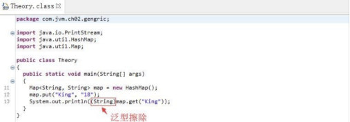

# 一、什么是泛型

JAVA推出泛型以前，程序员可以构建一个元素类型为Object的集合，该集合能够存储任意的数据类型对象，而在使用该集合的过程中，需要程序员明确知道存储每个元素的数据类型，否则很容易引发`ClassCastException`异常。

Java泛型（generics）是JDK5中引入的一个新特性，泛型提供了编译时类型安全监测机制，该机制允许我们在编译时检测到非法的类型数据结构。泛型的本质就是参数化类型，也就是所操作的数据类型被指定为一个参数。

好处：

- 类型安全

- 消除了强制类型的转换

类型：

- E - Element (在集合中使用，因为集合中存放的是元素)
- T - Type（表示Java 类，包括基本的类和我们自定义的类）
- K - Key（表示键，比如Map中的key）
- V - Value（表示值）
- N - Number（表示数值类型）
- ？ - （表示不确定的java类型）
- S、U、V - 2nd、3rd、4th types

# 二、泛型类、接口

## 1.泛型类

（1）使用语法
`类名<具体的数据类型> 对象名 = new 类名<具体的数据类型>();`

（2）Java1.7以后，后面的<>中的具体的数据类型可以省略不写
`类名<具体的数据类型> 对象名 = new 类名<>(); 菱形语法`

## 2.泛型类注意事项

- 泛型类，如果没有指定具体的数据类型，此时，操作类型是Object

- 泛型的类型参数只能是类类型，不能是基本数据类型

- 泛型类型在逻辑上可以看成是多个不同的类型，但实际上都是相同类型

```java
有Generic<T>这个类
Generic<String> strGeneric = new Generic<String>,
Generic<Integer> intGeneric = new Generic<Integer>
intGeneric.getClass() == strGeneric.getClass()，
结果是true
```

可以结合后面的泛型擦除理解，泛型擦除之后 Generic < String > 和Generic< Integer >都是Generic类。

## 3.从泛型类派生子类

子类也是泛型类，子类和父类的泛型类型要一致

`class ChildGeneric<T> extends Generic<T>`

```java
//父类
public class Parent<E> {
    private E value;
    public E getValue() {
        return value;
    }
    public void setValue(E value) {
        this.value = value;
    }
}

/**
 * 泛型类派生子类，子类也是泛型类，那么子类的泛型标识要和父类一致。
 * @param <T>
 */
public class ChildFirst<T> extends Parent<T> {
    @Override
    public T getValue() {
        return super.getValue();
    }
}
```

- 子类不是泛型类，父类要明确泛型的数据类型
  `class ChildGeneric extends Generic<String>`

```java
/**
 * 泛型类派生子类，如果子类不是泛型类，那么父类要明确数据类型
 */
public class ChildSecond extends Parent<Integer> {
    @Override
    public Integer getValue() {
        return super.getValue();
    }
    @Override
    public void setValue(Integer value) {
        super.setValue(value);
    }
}
```

## 4.泛型接口

 泛型接口的定义语法：

```java
interface 接口名称 <泛型标识，泛型标识，…> {
	泛型标识 方法名();
	.....
}
```

## 5.泛型接口的使用

- 实现类也是泛型类，实现类和接口的泛型类型要一致

```java
/**
 * 泛型接口
 * @param <T>
 */
public interface Generator<T> {
    T getKey();
}
/**
 * 泛型接口的实现类，是一个泛型类，
 * 那么要保证实现接口的泛型类泛型标识包含泛型接口的泛型标识
 * @param <T>
 * @param <E>
 */
public class Pair<T,E> implements Generator<T> {

    private T key;
    private E value;

    public Pair(T key, E value) {
        this.key = key;
        this.value = value;
    }

    @Override
    public T getKey() {
        return key;
    }

    public E getValue() {
        return value;
    }
}
```

- 实现类不是泛型类，接口要明确数据类型

```java
/**
 * 实现泛型接口的类，不是泛型类，需要明确实现泛型接口的数据类型。
 */
public class Apple implements Generator<String> {
    @Override
    public String getKey() {
        return "hello generic";
    }
}
```

# 三、类型通配符

## 1.什么是类型通配符

- 类型通配符一般是使用"?"代替具体的类型实参。

- 所以，类型通配符是类型实参，而不是类型形参。

## 2.类型通配符的上限

- 语法：
  `类/接口<? extends 实参类型>`
  要求该泛型的类型，只能是实参类型，或实参类型的子类类型。

## 3.类型通配符的下限

- 语法：
  `类/接口<? super 实参类型>`
  要求该泛型的类型，只能是实参类型，或实参类型的父类类型。

# 四、泛型擦除

Java 语言中的泛型，它只在程序源码中存在，在编译后的字节码文件中，就已经替换为原来的原生类型（Raw Type，也称为裸类型）了，并且在相应的地方插入了强制转型代码，因此，对于运行期的 Java 语言来说，`ArrayList＜int＞`与 `ArrayList＜String＞`就是同一个类，所以泛型技术实际上是 Java 语言的一颗语法糖，Java 语言中的泛型实现方法称为类型擦除，基于这种方法实现的泛型称为伪泛型。

将一段 Java 代码编译成 Class 文件，然后再用字节码反编译工具进行反编译后，将会发现泛型都不见了，程序又变回了 Java 泛型出现之前的写法，泛型类型都变回了原生类型。

```java
public class Theory {
    public static void main(String[] args) {
        Map<String,String> map = new HashMap<>();
        map.put("King","18");
        System.out.println(map.get("King"));
    }
}
```



JDK1.5 以前，**为了确保泛型的兼容性**，JVM 除了擦除，其实还是保留了泛型信息(Signature 是其中最重要的一项属性，它的作用就是存储一个方法在字节码层面的特征签名，这个属性中保存的参数类型并不是原生类型，而是包括了参数化类型的信息) 弱记忆

另外，从 Signature 属性的出现我们还可以得出结论，擦除法所谓的擦除，仅仅是对方法的 Code 属性中的字节码进行擦除，实际上元数据中还是保留了泛型信息，这也是我们能通过反射手段取得参数化类型的根本依据。
