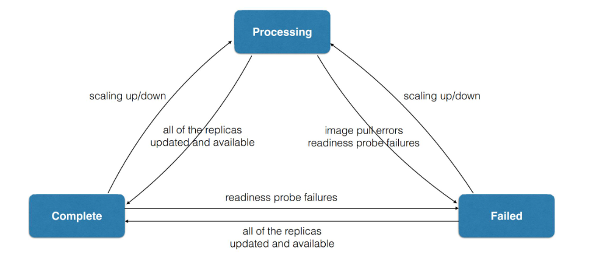
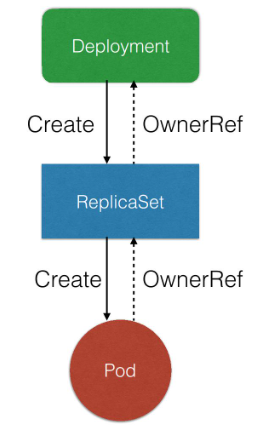
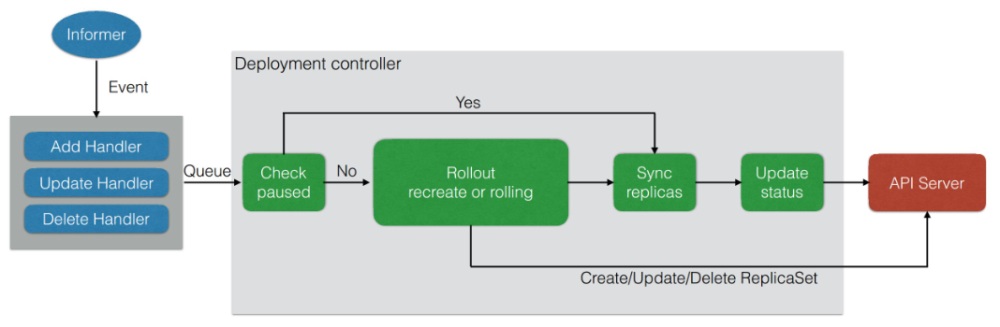
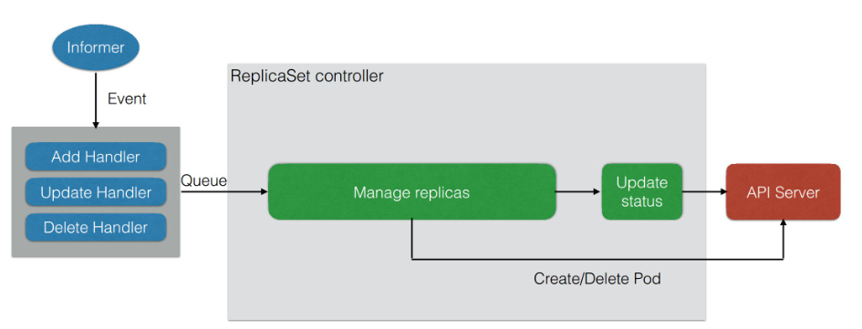
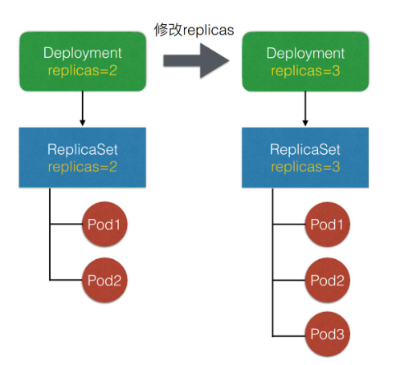
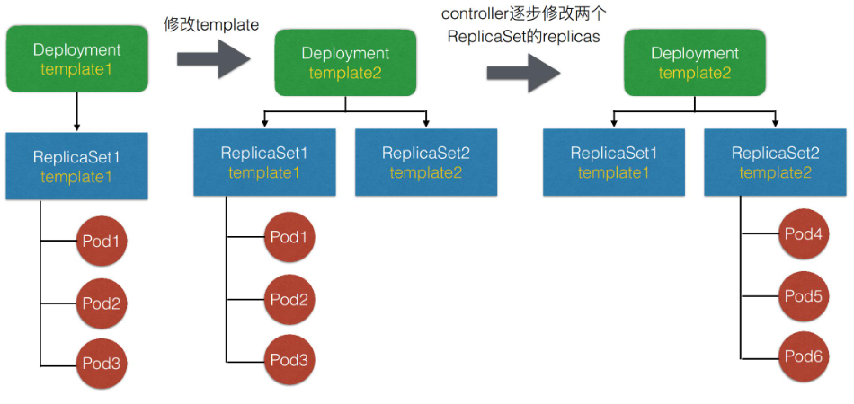
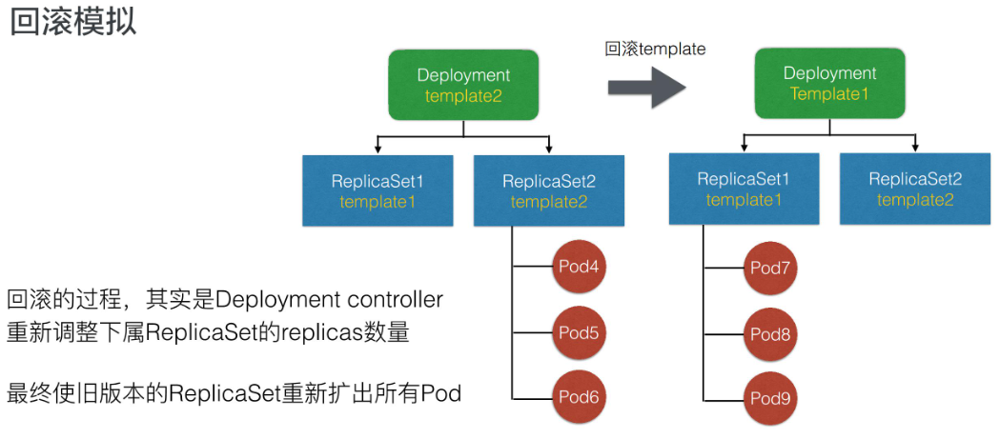

# 背景
为什么需要Deployment：

- 如何方便的对同一个应用的pod数量进行管理
- 在更新过程中，如何保证服务可用性
- 如何支持回滚

作用：

- 定义一组Pod的期望数量，Controller维持Pod数量与期望数量一致
- 配置Pod发布方式，controller会按照给定策略更新Pod，保证更新过程中不可用的Pod在限定范围内
- 如果发布有问题，支持一键回滚

部署三个Nginx应用的Deployment示例：

```
apiVersion: apps/v1
kind: Deployment
# 元信息
metadata:
  name: nginx-deployment
  labels:
    app: nginx
spec:
  # 期望的Pod数量
  replicas: 3
  # Pod选择器
  selector:
    matchLabels:
        app: nginx
  # Pod模板
  template:
    metadata:
      labels:
        app: nginx
    spec:
      containers:
      - name: nginx
        image: nginx:1.7.9
        imagePullPolicy: IfNotPresent
        ports:
        - containerPort: 80
```

```
[root@master deployment]# kubectl create -f nginx-deployment.yaml 
deployment.apps/nginx-deployment created
[root@master deployment]# kubectl get po
NAME                                READY   STATUS    RESTARTS   AGE
nginx-deployment-558fc78868-5n8s9   1/1     Running   0          5s
nginx-deployment-558fc78868-hl4m2   1/1     Running   0          5s
nginx-deployment-558fc78868-rf45c   1/1     Running   0          5s
[root@master deployment]# kubectl get deployment
NAME               READY   UP-TO-DATE   AVAILABLE   AGE
nginx-deployment   3/3     3            3           21s
[root@master deployment]# kubectl get rs
NAME                          DESIRED   CURRENT   READY   AGE
nginx-deployment-558fc78868   3         3         3       27s
```

除了使用系统自动调度算法完成一组Pod的部署，用户还可以通过在Pod的定义中使用`NodeSelector`、`NodeAffinity`、`PodAffinity`、Pod驱逐等更加细粒度的调度策略设置完成Pod的精准调度。

更新deployment镜像的版本：

`kubectl set image deployment.v1.apps/nginx-deployment nginx=nginx:1.9.1`

首先 `kubectl` 后面有一个 set image 固定写法，这里指的是设定镜像；

其次是一个 deployment.v1.apps，这也是一个固定写法，写的是要操作的资源类型，deployment 是资源名、v1 是资源版本、apps 是资源组，这里也可以简写为 deployment 或者 `deployment.apps`，写为 deployment 的时候，默认将使用 apps 组 v1 版本。

第三部分是要更新的 deployment 的 name；

再往后的 `nginx` 指的是 template，也就是 Pod 中的 container.name；这里我们可以注意到：一个 Pod 中，其实可能存在多个 container，而我们需要指定想要更新的镜像的 container.name，就是 `nginx`。

最后，指定我们这个容器期望更新的镜像版本。

快速回滚：

回滚到deployment上一个版本：`kubectl rollout undo deployment/nginx-deployment`

回滚到deployment的指定版本（需要先查询版本列表）：

```
# 查询版本列表
kubectl rollout history deployment.v1.apps/nginx-deployment
# 回滚
kubectl rollout undo deployment.v1.apps/nginx-deployment --to-revision=2
```

Deployment的状态：



# 管理模式

Deployment 只负责管理不同版本的 `ReplicaSet`，由 `ReplicaSet` 来管理具体的 Pod 副本数，每个 `ReplicaSet` 对应 Deployment template 的一个版本。每个`ReplicaSet`管理的Pod均是同一个版本。



Deployment控制器的实现：



`ReplicaSet`控制器的实现：



扩容：



发布：

修改template后，controller会创建一个新的RS，并逐渐修改两个RS的数量。



回滚：



spec字段解析：

`MinReadySeconds`：判断Pod available的最小ready时间（保持ready状态的时间）。

`revisionHistoryLimit`：保留多少个历史版本的RS。

`paused`：标识Deployment只做数量维持，不做新的发布。

`progressDeadlineSeconds`：当 Deployment 处于扩容或者发布状态时，它会处于 processing 的状态，processing 可以设置一个超时时间。如果超过超时时间还处于 processing，那么 controller 将认为这个 Pod 会进入 failed 的状态。

升级策略字段解析：

`MaxUnavailable`：滚动升级过程最多有多少个Pod不可用（百分比）。

`MaxSurge`：滚动过程中最多存在多少个 Pod 超过预期 replicas 数量（某些Pod在删除，某些在创建，总数量超过预期replicas）。

可以根据用户实际场景来做设置。比如当用户的资源足够，且更注重发布过程中的可用性，可设置 `MaxUnavailable` 较小、`MaxSurge` 较大。但如果用户的资源比较紧张，可以设置 `MaxSurge` 较小，甚至设置为 0，这里要注意的是 `MaxSurge` 和 `MaxUnavailable` 不能同时为 0。

# 回滚重启
```shell

kubectl rollout restart deploy xxx -n xxx
```
