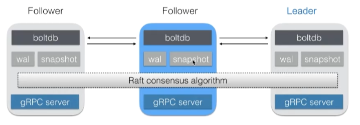
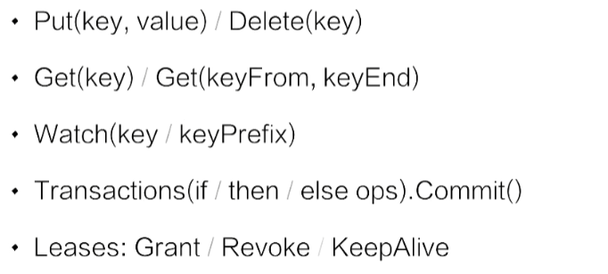
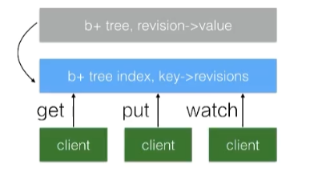

高可用、强一致的分布式KV数据库，底层使用Raft算法保证一致性，主要用于共享配置和服务发现。

特点：

- 简单：支持 REST 风格的 HTTP+JSON API
- 安全：支持 HTTPS 方式的访问
- 快速：支持并发 1k/s 的写操作
- 可靠：支持分布式结构，基于 Raft 的一致性算法，Raft 是一套通过选举主节点来实现分布式系统一致性的算法。

使用场景：

- 服务发现
- 发布订阅
- 分布式锁

n个节点的集群，要求（n+1）/2个节点健康。

ETCD的APIs：

数据版本号机制：

- term：全局单调激增，64bits，代表leader变更记录（全局版本号）
- revision：全局单调激增，64bits，数据每次发生更改，revision+1（支持MVCC）
- KeyValue：

- create_revision：创建时的revision
- mod_revision：修改后变成全局revision
- version：每次修改+1

查询时指定版本号时可以获得一个key的历史版本

