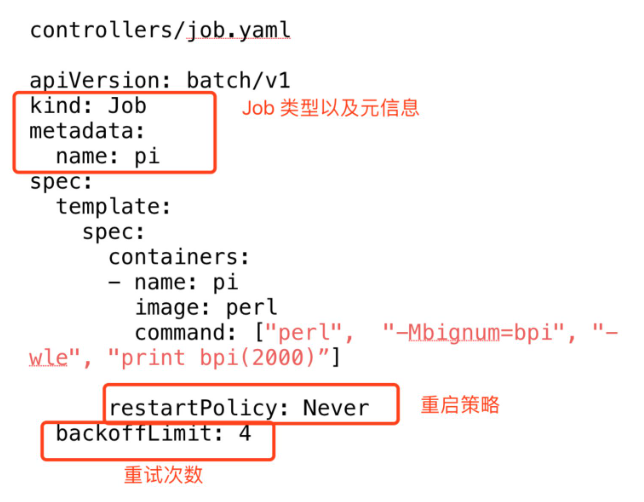
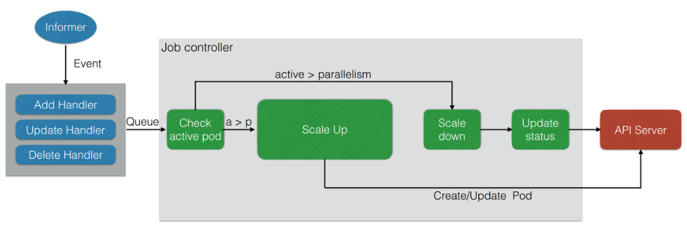

# Job

## 为什么需要Job？

K8s 里面，最小的调度单元是 Pod，我们可以直接通过 Pod 来运行任务进程。但是这样做将会产生以下几种问题：

- 如何保证 Pod 内进程正确的结束？
- 如何保证进程运行失败后重试？
- 如何管理多个任务，且任务之间有依赖关系？
- 如何并行地运行任务，并管理任务的队列大小？

## Job的作用：

- 创建一个或多个 Pod 确保数量的Pod可以成功地运行终止；
- 跟踪Pod状态，根据配置及时重试失败的Pod；
- 确定依赖关系，保证上一个任务运行完成之后再运行下一个任务；
- 控制任务的并行度，根据并行度来确保 Pod 运行过程中的并行次数和总体队列大小。

示例：



示例：

`yaml`文件：

```
apiVersion: batch/v1
kind: Job
metadata:
  name: pi
spec:
  template:
    spec:
      containers:
      - name: pi
        image: perl
        command: ["perl", "-Mbignum=bpi", "-wle", "print bpi(2000)"]
      restartPolicy: Never
  backoffLimit: 10
```

演示：

```
# 创建Job
[root@fmaster test]# kubectl create -f job.yaml 
job.batch/pi created
[root@fmaster test]# kubectl get job
NAME   COMPLETIONS   DURATION   AGE
pi     0/1           15s        15s
[root@fmaster test]# kubectl get po
NAME                                      READY   STATUS              RESTARTS   AGE
nfs-client-provisioner-6f567b4dd7-rdz66   1/1     Running             7          32h
pi-qrq4x                                  0/1     ContainerCreating   0          30s
# 查看Pod日志
[root@fmaster test]# kubectl logs pi-qrq4x 
3.141592653589793238462643383279502884197169399375105820974944592307816406286208998628034825342117067982148086513282306647093844609550582231725359408128481117450284102701938521105559644622948954930381964428810975665933446128475648233786783165271...
[root@fmaster test]# kubectl get job
NAME   COMPLETIONS   DURATION   AGE
pi     1/1           2m4s       4m28s
[root@fmaster test]# kubectl get po
NAME                                      READY   STATUS      RESTARTS   AGE
nfs-client-provisioner-6f567b4dd7-rdz66   1/1     Running     7          32h
pi-qrq4x                                  0/1     Completed   0          4m39s
```

并行Job示例：

```
apiVersion: batch/v1
kind: Job
metadata:
  name: para-1
spec:
  completions: 8
  parallelism: 2
  template:
    spec:
      containers:
      - name: param
        image: centos:7
        imagePullPolicy: IfNotPresent
        command: ["/bin/sh"]
        args: ["-c","sleep 30;date"]
      restartPolicy: OnFailure
```

演示：

```
[root@fmaster test]# kubectl get job
NAME     COMPLETIONS   DURATION   AGE
para-1   2/8           48s        48s
# 每次同时运行两个Job，当一个Job完成后再启动新的Job
[root@fmaster test]# kubectl get po
NAME                                      READY   STATUS      RESTARTS   AGE
nfs-client-provisioner-6f567b4dd7-rdz66   1/1     Running     7          32h
para-1-cntz9                              0/1     Completed   0          55s
para-1-hhvlh                              1/1     Running     0          23s
para-1-l5wtd                              1/1     Running     0          23s
para-1-nnsvg                              0/1     Completed   0          55s
```

## 管理模式

1. Job Controller负责根据配置创建Pod；
2. Job Controller跟踪Job状态，并根据配置即使重启Pod或继续创建Pod；
3. Job Controller会自动添加label来跟踪对应的Pod，并根据配置并行或串行创建Pod。



# `CronJob`

定时任务。`CronJob`的表达式与Linux `Cron`的表达式相同：

格式如下：

`Minutes Hours DayOfMonth Month DayOfWeek`

其中每个域都可出现的字符如下。

- Minutes：可出现`',''-','/','*'`这4个字符，有效范围为0～59的整数。*
- *Hours：可出现`',''-','/','*'`这4个字符，有效范围为0～23的整数。
- `DayofMonth`：可出现`',''-','/','*','?','L','W','C'`这8个字符，有效范围0-31的整数。
- Month：可出现`',''-','/','*'`这4个字符，有效范围为1-12的整数。
- `DayofWeek`：可出现`',''-','/','*','?','L','C','#'`这8个字符，有效范围为1～7的整数或SUN～SAT。1表示星期天，2表示星期一，以此类推。  
    表达式中的特殊字符`*`与`/`的含义如下。  
    ◎　*：表示匹配该域的任意值，假如在Minutes域使用*，则表示每分钟都会触发事件。  
    ◎　/：表示从起始时间开始触发，然后每隔固定时间触发一次，例如在Minutes域设置为5/20，则意味着第1次触发在第5min时，接下来每20min触发一次，将在第25min、第45min等时刻分别触发。  
    比如，每隔1min执行一次任务，则`Cron`表达式为：`*/1 * * * *`

`CronJob`示例：

```
apiVersion: batch/v1beta1
kind: CronJob
metadata:
  name: hello
spec:
  schedule: "*/1 * * * *"
  jobTemplate: 
    spec:
      template:
        spec:
          containers:
          - name: hello
            image: busybox
            args:
            - /bin/sh
            - -c
            - date; echo Hello from k8s cluster
            imagePullPolicy: IfNotPresent
          restartPolicy: OnFailure
  startingDeadlineSeconds: 10
  concurrencyPolicy: Allow
  successfulJobsHistoryLimit: 3
```

演示：

```
[root@fmaster test]# kubectl get job
NAME               COMPLETIONS   DURATION   AGE
hello-1611135420   1/1           15s        2m30s
hello-1611135480   1/1           2s         90s
hello-1611135540   1/1           2s         29s
[root@fmaster test]# kubectl logs hello-1611135480-lqjcw 
Wed Jan 20 09:38:09 UTC 2021
Hello from k8s cluster
```

字段解释：

- `startingDeadlineSeconds`：Job最长启动时间。单位是秒，表示如果Job因为某种原因无法按调度准时启动，在`startingDeadlineSeconds`时间段之内，`CronJob`仍然试图重新启动Job，如果在`startingDeadlineSeconds`时间之内没有启动成功，则不再试图重新启动。如果`startingDeadlineSeconds`的值没有设置，则没有按时启动的任务不会被尝试重新启动。`startingDeadlineSeconds`同时也影响到`CronJob`计算任务损失率。如果指定，那么`CronJob`计算有多少Job没有按时启动时是从当前时间向后推`startingDeadlineSeconds`秒数，如果没有指定，那么是从当前时间向后推到最后一次成功调度的时间。无论那种算法，如果损失的按时任务超过一定个数，那么`CronJob`会报错并停止运行。
- `concurrencyPolicy`：是否允许并行运行。
- `successfulJobsHistoryLimit`：允许留存历史Job个数。

# `DaemonSet`

作用：

- 保证集群内的每一个节点都运行一组相同的 pod；
- 跟踪集群节点状态，保证新加入的节点自动创建对应的 pod；
- 跟踪集群节点状态，保证移除的节点删除对应的Pod；
- 跟踪Pod状态，保证每个节点Pod处于运行状态。

`DaemonSet`的Pod调度策略与RC类似，`DaemonSet`也可以在Pod的定义中使用`NodeSelector`和`NodeAffinity`来指定满足条件的Node范围进行调度。
