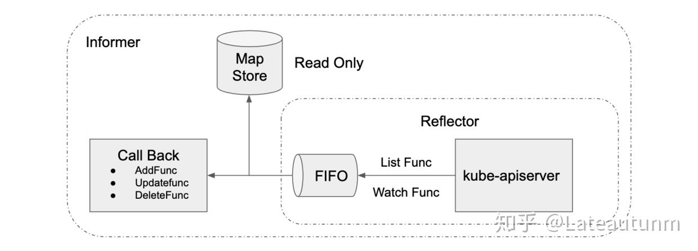
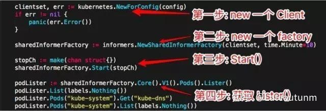
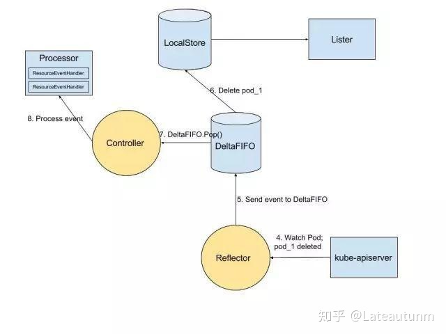
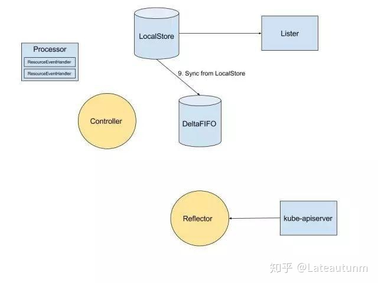

## 1. 前言

最近想深入了解一下K8S的内部通信机制，因此读了几遍K8S的源码，感慨很深。至今清楚的记得，当了解到K8S组件之间仅采用HTTP 协议通信，没有依赖中间件时，我非常好奇它是如何做到的。

在K8S内部通信中，肯定要保证消息的实时性。之前以为方式有两种：

1. 客户端组件(kubelet,scheduler,controller-manager等)轮询 apiserver，
2. apiserver通知客户端。  
    如果采用轮询，势必会大大增加apiserver的压力，同时实时性很低。  
    如果apiserver主动发HTTP请求，又如何保证消息的可靠性，以及大量端口占用问题？

当阅读完list-watch源码后，先是所有的疑惑云开雾散，进而为K8S的设计理念所折服。List-watch是K8S统一的异步消息处理机制，保证了消息的实时性，可靠性，顺序性，性能等等，为声明式风格的API奠定了良好的基础，它是优雅的通信方式，是K8S 架构的精髓。

## 2. List-Watch 机制具体是什么样的

Etcd存储集群的数据信息，apiserver作为统一入口，任何对数据的操作都必须经过apiserver。客户端(kubelet/scheduler/controller-manager)通过list-watch监听apiserver中资源(pod/rs/rc等等)的create,update和delete事件，并针对事件类型调用相应的事件处理函数。

那么list-watch具体是什么呢，顾名思义，list-watch有两部分组成，分别是list和watch。list非常好理解，就是调用资源的list API罗列资源，基于HTTP短链接实现；watch则是调用资源的watch API监听资源变更事件，基于HTTP 长链接实现，也是本文重点分析的对象。以pod 资源为例，它的list和watch API分别为： [List API]，返回值为 [PodList]，即一组pod`。

GET /api/v1/pods

[Watch API](https://link.zhihu.com/?target=https%3A//v1-10.docs.kubernetes.io/docs/reference/generated/kubernetes-api/v1.10/%23watch-list-all-namespaces-66)，往往带上watch=true，表示采用HTTP 长连接持续监听pod 相关事件，每当有事件来临，返回一个[WatchEvent](https://link.zhihu.com/?target=https%3A//v1-10.docs.kubernetes.io/docs/reference/generated/kubernetes-api/v1.10/%23watchevent-v1-meta)。

GET /api/v1/watch/pods

K8S的informer模块封装list-watch API，用户只需要指定资源，编写事件处理函数，AddFunc,UpdateFunc和DeleteFunc等。如下图所示，informer首先通过list API罗列资源，然后调用watch API监听资源的变更事件，并将结果放入到一个FIFO 队列，队列的另一头有协程从中取出事件，并调用对应的注册函数处理事件。Informer还维护了一个只读的Map Store缓存，主要为了提升查询的效率，降低apiserver的负载。



## 3.Watch 是如何实现的

List的实现容易理解，那么Watch是如何实现的呢？Watch是如何通过HTTP 长链接接收apiserver发来的资源变更事件呢？

秘诀就是[Chunked transfer encoding(分块传输编码)](https://link.zhihu.com/?target=https%3A//zh.wikipedia.org/zh-hans/%25E5%2588%2586%25E5%259D%2597%25E4%25BC%25A0%25E8%25BE%2593%25E7%25BC%2596%25E7%25A0%2581)，它首次出现在HTTP/1.1。正如维基百科所说：

HTTP 分块传输编码允许服务器为动态生成的内容维持 HTTP 持久链接。通常，持久链接需要服务器在开始发送消息体前发送Content-Length消息头字段，但是对于动态生成的内容来说，在内容创建完之前是不可知的。使用分块传输编码，数据分解成一系列数据块，并以一个或多个块发送，这样服务器可以发送数据而不需要预先知道发送内容的总大小。

当客户端调用watch API时，apiserver 在response的HTTP Header中设置Transfer-Encoding的值为chunked，表示采用分块传输编码，客户端收到该信息后，便和服务端该链接，并等待下一个数据块，即资源的事件信息。例如：

```
$ curl -i http://{kube-api-server-ip}:8080/api/v1/watch/pods?watch=yes
HTTP/1.1 200 OK
Content-Type: application/json
Transfer-Encoding: chunked
Date: Thu, 02 Jan 2019 20:22:59 GMT
Transfer-Encoding: chunked

{"type":"ADDED", "object":{"kind":"Pod","apiVersion":"v1",...}}
{"type":"ADDED", "object":{"kind":"Pod","apiVersion":"v1",...}}
{"type":"MODIFIED", "object":{"kind":"Pod","apiVersion":"v1",...}}
```

## 4. 谈谈 List-Watch 的设计理念

当设计优秀的一个异步消息的系统时，对消息机制有至少如下四点要求：

- 消息可靠性
- 消息实时性
- 消息顺序性
- 高性能

首先消息必须是可靠的，list和watch一起保证了消息的可靠性，避免因消息丢失而造成状态不一致场景。具体而言，list API可以查询当前的资源及其对应的状态(即期望的状态)，客户端通过拿期望的状态和实际的状态进行对比，纠正状态不一致的资源。Watch API和apiserver保持一个长链接，接收资源的状态变更事件并做相应处理。如果仅调用watch API，若某个时间点连接中断，就有可能导致消息丢失，所以需要通过list API解决消息丢失的问题。从另一个角度出发，我们可以认为list API获取全量数据，watch API获取增量数据。虽然仅仅通过轮询list API，也能达到同步资源状态的效果，但是存在开销大，实时性不足的问题。

消息必须是实时的，list-watch机制下，每当apiserver的资源产生状态变更事件，都会将事件及时的推送给客户端，从而保证了消息的实时性。

消息的顺序性也是非常重要的，在并发的场景下，客户端在短时间内可能会收到同一个资源的多个事件，对于关注最终一致性的K8S来说，它需要知道哪个是最近发生的事件，并保证资源的最终状态如同最近事件所表述的状态一样。K8S在每个资源的事件中都带一个resourceVersion的标签，这个标签是递增的数字，所以当客户端并发处理同一个资源的事件时，它就可以对比resourceVersion来保证最终的状态和最新的事件所期望的状态保持一致。

List-watch还具有高性能的特点，虽然仅通过周期性调用list API也能达到资源最终一致性的效果，但是周期性频繁的轮询大大的增大了开销，增加apiserver的压力。而watch作为异步消息通知机制，复用一条长链接，保证实时性的同时也保证了性能。

## 5. Informer介绍

Informer是Client-go中的一个核心工具包。在Kubernetes源码中，如果Kubernetes的某个组件，需要List/Get Kubernetes中的Object，在绝大多 数情况下，会直接使用Informer实例中的Lister()方法（该方法包含 了 Get 和 List 方法），而很少直接请求Kubernetes API。Informer最基本 的功能就是List/Get Kubernetes中的Object。

如下图所示，仅需要十行左右的代码就能实现对Pod的List和Get。



## 6. Informer 设计思路

## 6.1 Informer 设计中的关键点

为了让Client-go更快地返回List/Get请求的结果、减少对Kubenetes API的直接调用，Informer被设计实现为一个依赖Kubernetes List/Watch API、可监听事件并触发回调函数的二级缓存工具包。

## 6.2 更快地返回 List/Get 请求，减少对 Kubenetes API 的直接调用

使用Informer实例的Lister()方法，List/Get Kubernetes中的Object时，Informer不会去请求Kubernetes API，而是直接查找缓存在本地内存中的数据(这份数据由Informer自己维护)。通过这种方式，Informer既可以更快地返回结果，又能减少对Kubernetes API的直接调用。

## 6.3 依赖 Kubernetes List/Watch API

Informer只会调用Kubernetes List和Watch两种类型的API。Informer在初始化的时，先调用Kubernetes List API获得某种resource的全部Object，缓存在内存中; 然后，调用Watch API去watch这种resource，去维护这份缓存; 最后，Informer就不再调用Kubernetes的任何 API。

用List/Watch去维护缓存、保持一致性是非常典型的做法，但令人费解的是，Informer只在初始化时调用一次List API，之后完全依赖Watch API去维护缓存，没有任何resync机制。

笔者在阅读Informer代码时候，对这种做法十分不解。按照多数人思路，通过resync机制，重新List一遍resource下的所有Object，可以更好的保证Informer 缓存和Kubernetes中数据的一致性。

咨询过Google内部Kubernetes开发人员之后，得到的回复是:

在Informer设计之初，确实存在一个relist无法去执resync操作， 但后来被取消了。原因是现有的这种List/Watch机制，完全能够保证永远不会漏掉任何事件，因此完全没有必要再添加relist方法去resync informer的缓存。这种做法也说明了Kubernetes完全信任etcd。

## 6.4 可监听事件并触发回调函数

Informer通过Kubernetes Watch API监听某种resource下的所有事件。而且，Informer可以添加自定义的回调函数，这个回调函数实例(即ResourceEventHandler实例)只需实现OnAdd(obj interface{})OnUpdate(oldObj, newObj interface{}) 和OnDelete(obj interface{}) 三个方法，这三个方法分别对应informer监听到创建、更新和删除这三种事件类型。

在Controller的设计实现中，会经常用到informer的这个功能。

## 6.5 二级缓存

二级缓存属于Informer的底层缓存机制，这两级缓存分别是DeltaFIFO和LocalStore。

这两级缓存的用途各不相同。DeltaFIFO用来存储Watch API返回的各种事件 ，LocalStore只会被Lister的List/Get方法访问 。

虽然Informer和Kubernetes之间没有resync机制，但Informer内部的这两级缓存之间存在resync机制。

## 6.6 关键逻辑介绍






1. Informer 在初始化时，Reflector 会先 List API 获得所有的 Pod
2. Reflect 拿到全部 Pod 后，会将全部 Pod 放到 Store 中
3. 如果有人调用 Lister 的 List/Get 方法获取 Pod， 那么 Lister 会直接从 Store 中拿数据
4. Informer 初始化完成之后，Reflector 开始 Watch Pod，监听 Pod 相关 的所有事件;如果此时 pod_1 被删除，那么 Reflector 会监听到这个事件
5. Reflector 将 pod_1 被删除 的这个事件发送到 DeltaFIFO
6. DeltaFIFO 首先会将这个事件存储在自己的数据结构中(实际上是一个 queue)，然后会直接操作 Store 中的数据，删除 Store 中的 pod_1
7. DeltaFIFO 再 Pop 这个事件到 Controller 中
8. Controller 收到这个事件，会触发 Processor 的回调函数
9. LocalStore 会周期性地把所有的 Pod 信息重新放到 DeltaFIFO 中
