# 为什么需要Pod？

**容器的本质实际上是一个进程，是一个视图被隔离，资源受限的进程。**

容器里面 PID=1 的进程就是应用本身，这意味着管理虚拟机等于管理基础设施，因为我们是在管理机器，但管理容器却等于直接管理应用本身。

`Helloworld`程序由四个进程组成，这些进程之间会共享一些资源和文件。那么现在有一个问题：假如现在把 `Helloworld` 程序用容器跑起来，你会怎么去做？

最自然的一个解法就是，启动一个 Docker 容器，里面运行四个进程。可是这样会有一个问题，这种情况下容器里面 PID=1 的进程该是谁? 比如说，它应该是main 进程，那么问题来了，“谁”又负责去管理剩余的 3 个进程呢？

这个核心问题在于，容器的设计本身是一种“单进程”模型，不是说容器里只能起一个进程，由于容器的应用等于进程，所以只能去管理 PID=1 的这个进程，其他再起来的进程其实是一个托管状态。 所以说服务应用进程本身就具有“进程管理”的能力。

比如说 `Helloworld` 的程序有 `systemd` 的能力，或者直接把容器里 PID=1 的进程直接改成 `systemd`，否则这个应用，或者是容器是没有办法去管理很多个进程的。因为 PID=1 进程是应用本身，如果现在把这个 PID=1 的进程给 kill 了，或者它自己运行过程中死掉了，那么剩下三个进程的资源就没有人回收了，这个是非常非常严重的一个问题。

而反过来真的把这个应用本身改成了 `systemd`，或者在容器里面运行了一个 `systemd`，将会导致另外一个问题：使得管理容器，不再是管理应用本身了，而等于是管理 `systemd`，这里的问题就非常明显了。比如说我这个容器里面 run 的程序或者进程是 `systemd`，那么接下来，这个应用是不是退出了？是不是 fail 了？是不是出现异常失败了？实际上是没办法直接知道的，因为容器管理的是 `systemd`。这就是为什么在容器里面运行一个复杂程序往往比较困难的一个原因。

Kubernetes 是云时代的操作系统：

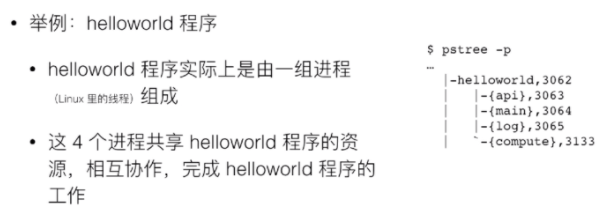

**由于容器实际上是一个“单进程”模型**，所以如果你在容器里启动多个进程，只有一个可以作为 PID=1 的进程，而这时候，如果这个 PID=1 的进程挂了，或者说失败退出了，那么其他三个进程就会自然而然的成为孤儿，没有人能够管理它们，没有人能够回收它们的资源，这是一个非常不好的情况。

注意：Linux 容器的“单进程”模型，指的是容器的生命周期等同于 PID=1 的进程（容器应用进程）的生命周期，而不是说容器里不能创建多进程。当然，一般情况下，容器应用进程并不具备进程管理能力，所以你通过 exec 或者 `ssh` 在容器里创建的其他进程，一旦异常退出（比如 `ssh` 终止）是很容易变成孤儿进程的。

反过来，其实可以在容器里面 run 一个 `systemd`，用它来管理其他所有的进程。这样会产生第二个问题：实际上没办法直接管理我的应用了，因为我的应用被 `systemd` 给接管了，那么这个时候应用状态的生命周期就不等于容器生命周期。这个管理模型实际上是非常非常复杂的。

## 理解Pod

我们通过一个例子来解释。

假如现在有两个容器，它们是紧密协作的，所以它们应该被部署在一个 Pod 里面。具体来说，第一个容器叫做 App，就是业务容器，它会写日志文件；第二个容器叫做 `LogCollector`，它会把刚刚 App 容器写的日志文件转发到后端的 `ElasticSearch` 中。

两个容器的资源需求是这样的：App 容器需要 1G 内存，`LogCollector` 需要 0.5G 内存，而当前集群环境的可用内存是这样一个情况：Node_A：1.25G 内存，Node_B：2G 内存。

假如说现在没有 Pod 概念，就只有两个容器，这两个容器要紧密协作、运行在一台机器上。可是，如果调度器先把 App 调度到了 Node_A 上面，`LogCollector`实际上是没办法调度到 Node_A 上的，因为资源不够。其实此时整个应用本身就已经出问题了，调度已经失败了，必须去重新调度。

亲密关系：

- 两个应用需要运行在同一台宿主机上，由调度器负责。

超亲密关系：

- 两个进程之间会发生文件交换，前面提到的例子就是这样，一个写日志，一个读日志；

- 两个进程之间需要通过 localhost 或者本地的 Socket 进行通信；

- 两个容器或者是微服务之间，需要发生非常频繁的 RPC 调用，出于性能的考虑，希望它们是超亲密关系；

- 两个容器或者是应用，它们需要共享某些 Linux Namespace。比如一个容器需要加入另一个容器的 Network Namespace。

# Pod的实现机制

容器之间原本是被 Linux Namespace 和 `cgroups` 隔开的，所以现在实际要解决的是怎么去打破这个隔离，然后共享某些事情和某些信息。这就是 Pod 的设计要解决的核心问题所在。

## 共享网络

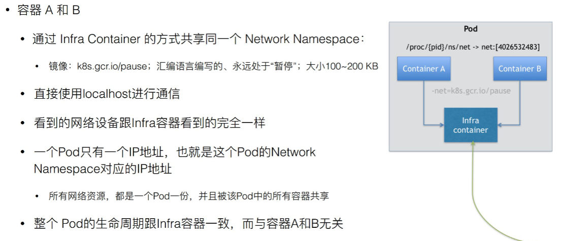

## 共享存储

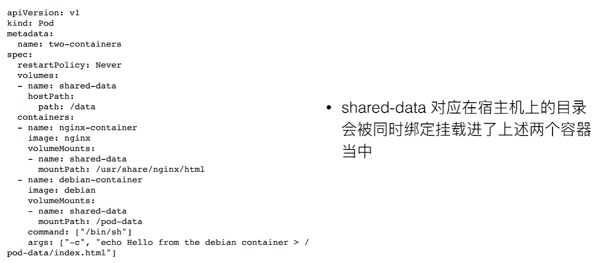

# 容器设计模式

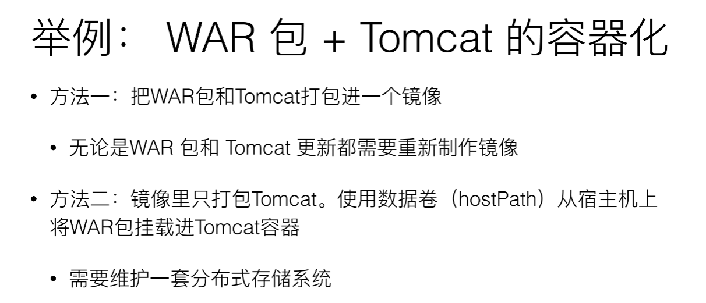

更简单的方式（通过`init`容器）：

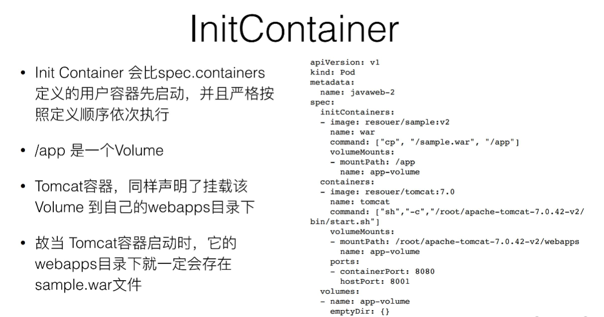

## sidecar

Sidecar容器设计模式：通过在Pod里定义专门的容器，执行主业务容器需要的辅助工作。

例如：

- 原本需要SSH执行的脚本

- 日志收集

- Debug应用

- 应用监控

- …

优势：

- 将辅助功能同主业务容器解耦，实现独立发布和能力重用。

Sidecar容器的使用场景：

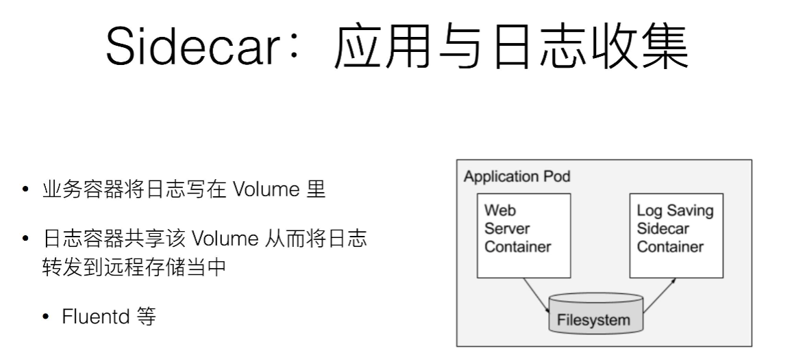

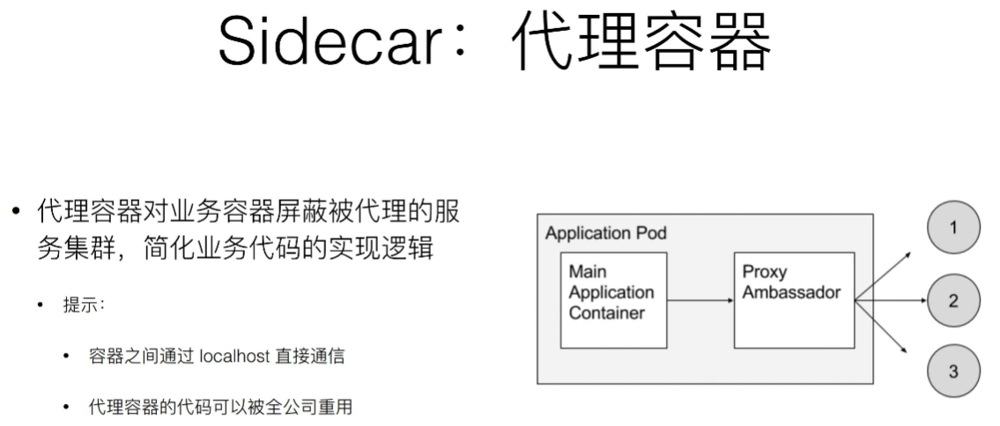

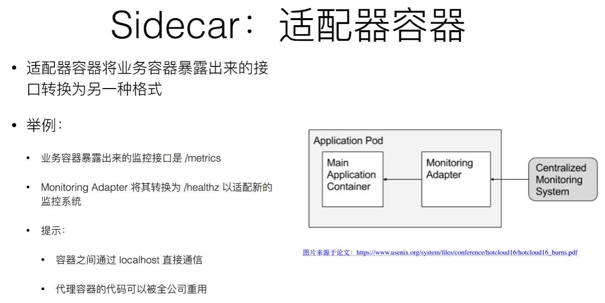

总结：

- Pod 是 Kubernetes 项目里实现“容器设计模式”的核心机制；

- “容器设计模式”是 Google Borg 的大规模容器集群管理最佳实践之一，也是 Kubernetes 进行复杂应用编排的基础依赖之一；

- 所有“设计模式”的本质都是：解耦和重用。

# Pod定义文件

YAML格式的Pod定义文件的完整内容：

```
apiVersion: v1
kind: Pod
metadata:
  name: string
  namaspace: string
  labels:
  - name: string
  annotations:
  - name: string
spec:
  containers:
  - name: string
    images: string
    imagePullPolice: [Always | Never | IfNotPresent]
    command: [string]
    args: [string]
    workingDir: string
    volumeMounts:
    - name: string
      mountPath: string
      readOnly: boolean
    ports:
    - name: string
      containerPort: int
      hostPort: int
      protocol: string
    env:
    - name: string
      value: string
    resources:
      limits:
        cpu: string
        memory: string
      requests:
        cpu: string
        memory: string
    livenessProbe:
      exec:
        command: [string]
      httpGet:
        path: string
        port: int
        host: string
        scheme: string
        httpHeaders:
        - name: string
          value: string
      tcpSocket:
        port: int
      initialDelaySeconds: number
      timeoutSeconds: number
      periodSeconds: number
      successThreshold: 0
      failureThreshold: 0
    securityContext:
      privileged: false
  restartPolicy: [Always | Never | OnFailure]   
  nodeSelector: object
  imagePullSecrets:
  - name: string
  hostNetwork: false
  volumes:
  - name: string
    emptyDir: {}
    hostPath:
      path: string
    secret:
      secretName: string
      items:
      - key: string
        path: string
    configMap:
      name: string
      items:
      - key: string
        path: string
```

# Pod创建的过程

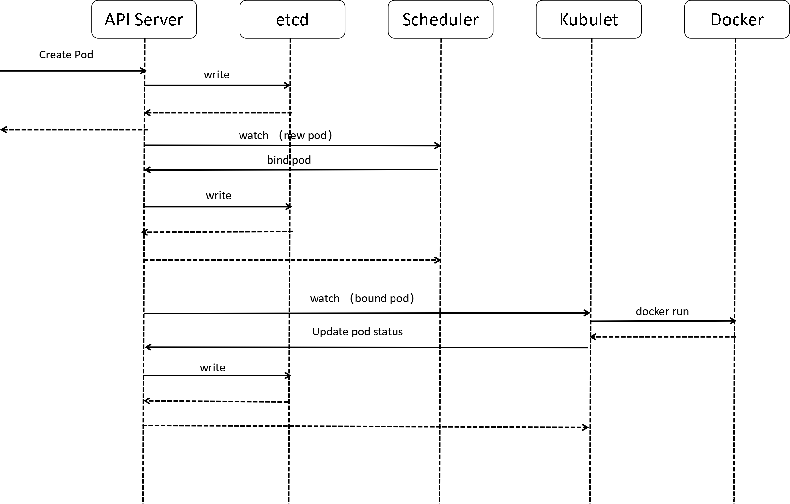

# Pod生命周期

Pod的状态如下表所示：

|   |   |
|---|---|
|状态值|说明|
|Pending|API Server已经创建了该Pod,但Pod中的一个或多个容器的镜像还没有创建，包括镜像下载过程|
|Running|Pod内所有容器已创建，且至少一个容器处于运行状态、正在启动状态或正在重启状态|
|Succeeded|Pod内所有容器均成功执行后退出，且不会再重启，一般用于Job|
|Failed|Pod内所有容器均已退出，但至少一个容器退出为失败状态|
|Unknown|由于某种原因无法获取该Pod的状态，例如网络通信不畅|

Pod的重启策略定义于Pod的spec中，作用域Pod中的所有容器，并且仅在Pod所处的Node上由Kubelet进行判断和重启操作。默认为Always。

|   |   |
|---|---|
|重启策略|说明|
|Always|当容器失效时，由kubelet自动重启该容器|
|OnFailure|当容器终止运行且退出码不为0时，由kubelet自动重启该容器|
|Never|不论容器运行状态如何，kubelet都不会重启该容器|

可以管理Pod的控制器有Replication Controller，Job，DaemonSet，及kubelet（静态Pod）。

1. RC和DaemonSet：必须设置为Always，需要保证该容器持续运行。

2. Job：OnFailure或Never，确保容器执行完后不再重启。

3. kubelet：在Pod失效的时候重启它，不论RestartPolicy设置为什么值，并且不会对Pod进行健康检查。

# 应用存储与持久化数据卷

重新绑定PVC：[https://blog.51cto.com/u_14086194/2718317](https://blog.51cto.com/u_14086194/2718317)

**PV属于集群级别资源，不属于任何的Namespace。**

为什么需要Volumes？

1. 如果一个Pod中某一个容器异常退出，被`kubelet`拉起如何保证之前的数据不丢失？

2. 同一个Pod中的多个容器如何共享数据？

Kubernetes中Volume的类型：

1. 本地存储：`emptydir`/`hostpath`

2. 网络存储：

- in-tree：`awsElasticBlockStore`/`gcePersistentDisk`/`nfs`…

- out-of-tree：`flexvolume`/`csi`等网络存储

3. Projected Volume：`secret`/`configmap`/`downwardAPI`/`serviceAccountToken`

4. PVC和PV体系

Persistent Volumes可以解决Pod Volume在以下场景中的不足：

1. pod 重建销毁（如Deployment管理的Pod镜像升级）

2. 宿主机故障迁移

3. 多个Pod共享同一个volume

4. 数据volume的扩展功能

Persistent Volume的作用：将Pod与Volume解耦。

## Persistent Volume Claim：

- PVC中只需要声明自己需要的存储size、access mode（单node或多node，只读或读写）等业务真正关心的存储需求，不用关系实现细节，PV与其对应的后端存储信息由cluster admin统一运维和管控，安全访问策略更容易控制。

- PVC简化了User对存储的需求，PV是存储实际信息的载体。`kube-controller-manager`中的`PersistentVolumeController`将PVC和合适的PV绑定到一起，从而满足用户对存储的实际需求。

- PVC类似于接口，而PV是接口对应的实现。

有两种方式提供Volume：

一、静态方式

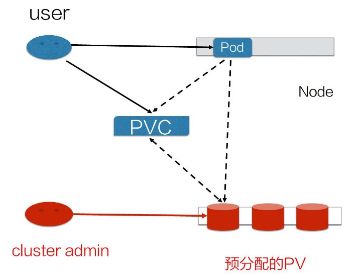

Cluster Admin预创建若干个PV，用户提交PVC后由k8s将PVC和合适的PV进行绑定。

缺点：用户的真实需求很难预测，有时PVC无法绑定合适的PV。

示例：

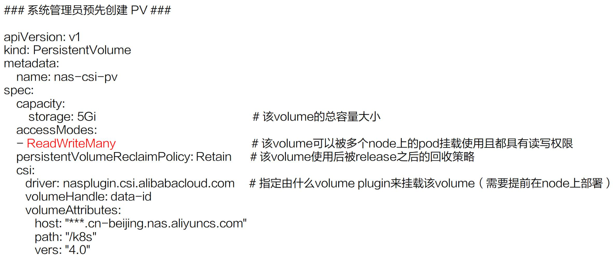

字段解释：

- `AccessModes`：PV访问策略控制列表，必须同PVC的访问策略匹配才能绑定。

- `ReadWriteOnce`：只允许单node访问

- `ReadOnlyMany`：允许多个node只读访问

- `ReadWriteMany`：允许多个node读写访问

- `StorageClassName`：PVC可以通过该字段找到相同值的PV，也可以通过该字段的SC动态生成新的PV对象。

- `PersistentVolumeReclaimPolicy`：

- `Delete`：volume被release后直接删除。

- `Retain`：默认策略，由管理员手动管理该Volume。

PV状态转换：

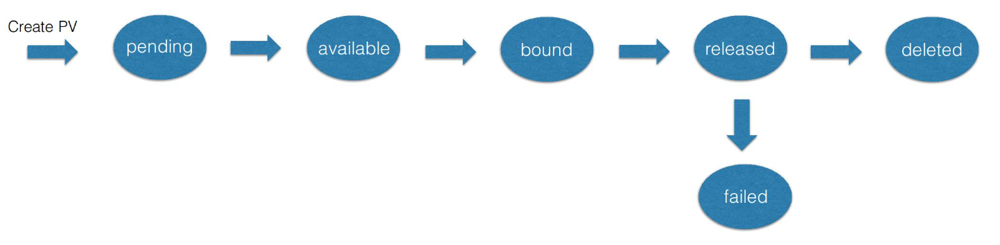

说明：PV到达Released状态后无法根据`ReclaimPolicy`回到Available状态并绑定新的PVC。如果想复用原来的PV中的数据，有两种方式：

1. 复用原PV中记录的存储信息新建PV对象。

2. 直接从PVC对象复用，不解绑PVC和PV。

用户根据自己的需求创建PVC：

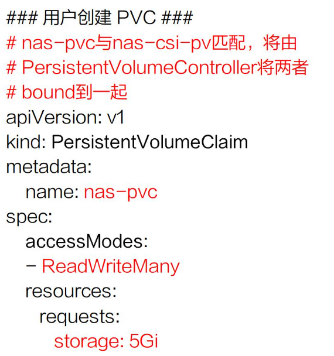

之后pod中使用该PVC。

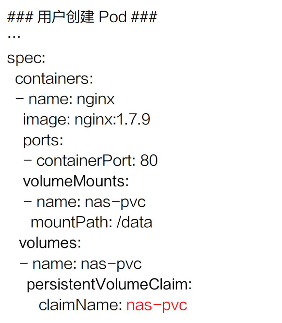

二、动态方式

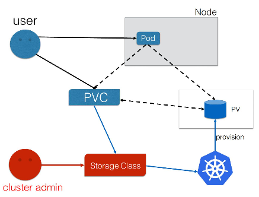

Cluster Admin只创建不同类型存储的模板(Storage Class)，用户在PVC中决定要使用哪种存储模板以及需要的大小、访问方式等参数，然后K8S自动生成相应的PV对象。

Storage Class示例：

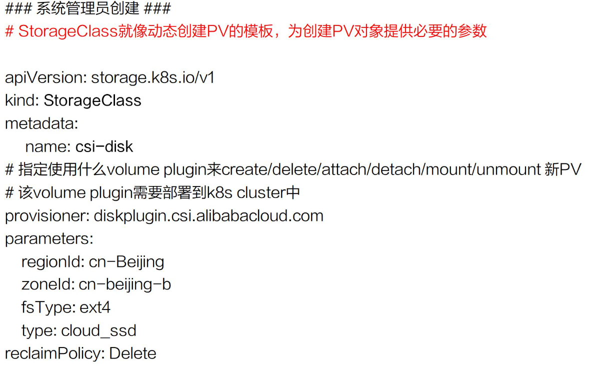

用户使用PVC：

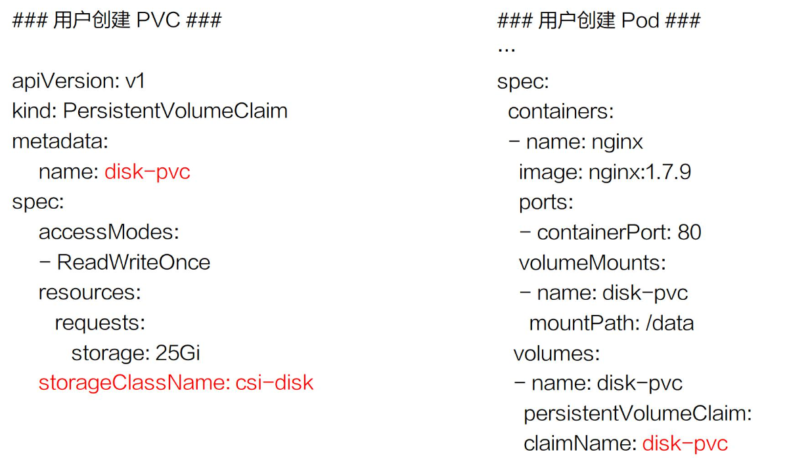

总体架构：

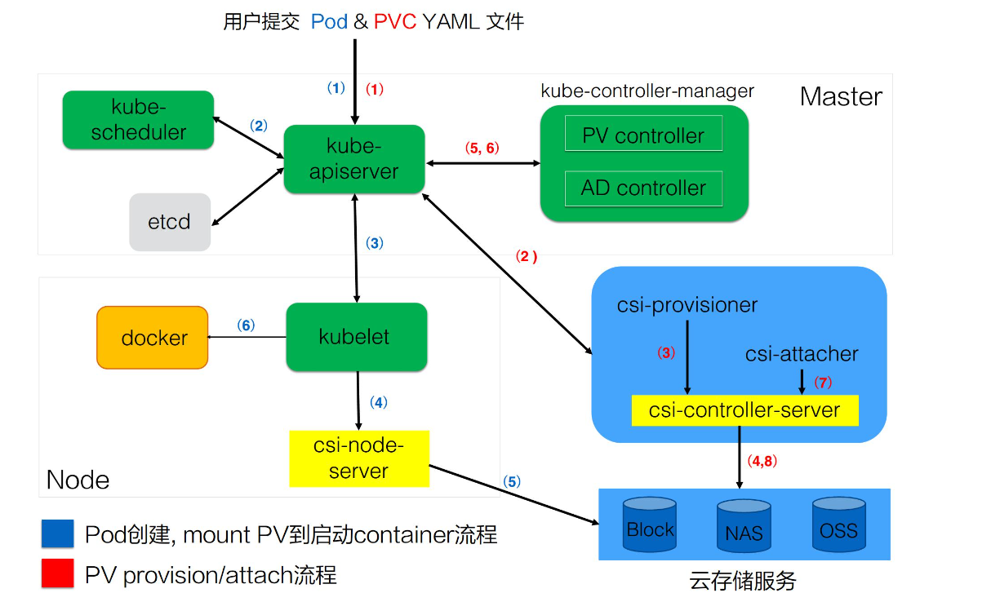

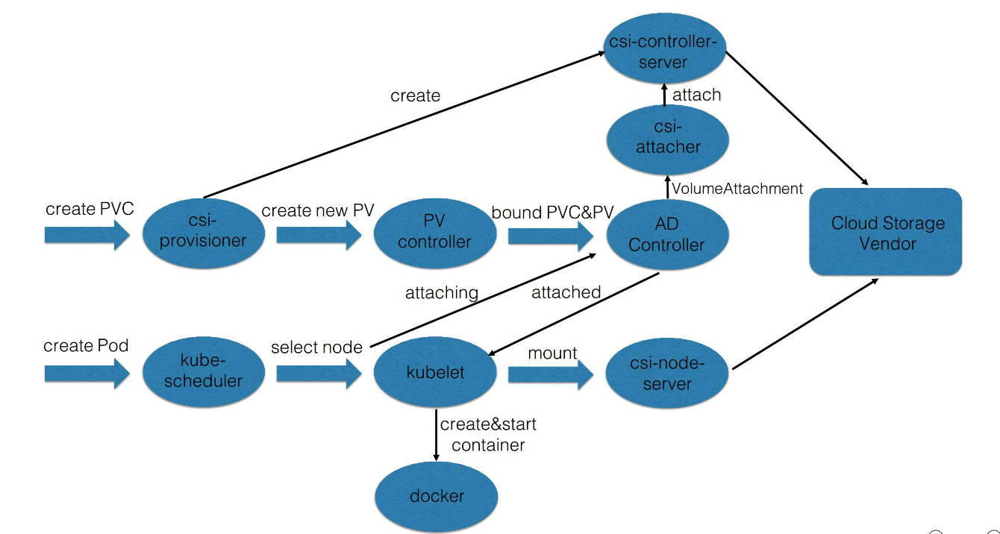

## Pod Volume

- `.spec.volumes`声明pod的volumes信息

- `.spec.containers.volumeMounts`声明容器如何使用pod的volumes

- 多个容器共享同一个volume时，可以通过`.spec.containers.volumeMounts.subPath`隔离不同容器在同一个Volume上数据存储的路径。

示例：

```
apiVersion: v1
kind: Pod
metadata:
  name: test-pod
spec:
  containers:
    - name: container-1
      image: ubuntu:18.04
      volumeMounts:
        - name: cache-volume
          mountPath: /cache   # 容器内挂载路径
          subPath: cache1     # 在cache下建立子目录cache1
        - name: hostpath-volume
          mountPath: /data
          readOnly: true      # 只读挂载
    - name: container-2
      image: ubuntu:18.04
      volumeMounts:
        - name: cache-volume
          mountPath: /cache
          subPath: cache2
  volumes:
    - name: cache-volume
      # 宿主机路径： 
      # /var/lib/kubelet/pods/<podUID>/volumes/kubernetes.io~empty-dir/cache-volume
      # 该路径下还有两个子目录cache1和cache2，pod删除后该目录也会被删除
      emptyDir: {}
    - name: hostpath-volume
      hostPath:
        path: /tmp/data # 宿主机目录，pod删除之后仍然存在
```

## 存储快照

## 拓扑调度

# Pod的配置管理

背景问题：

- 容器的可变配置
- 敏感信息的存储和使用
- 集群中Pod的自我认证
- 容器运行资源的配置管理
- 容器的运行安全管控
- 容器启动前置条件校验等

在k8s中，配置管理功能由Spec字段中的以下组件完成：

|   |   |
|---|---|
|组件|功能|
|`ConfigMap`|可变配置|
|`Secret`|敏感信息|
|`ServiceAccount`|身份认证|
|`Resources.limits/requests`|资源配置|
|`SecuritContext`|安全管控|
|`InitContainers`|前置校验|

## `ConfigMap`

`ConfigMap`对k8s集群中的多个容器进行配置管理，其典型用法：

1. 生成容器内的环境变量。

2. 设置容器启动命令的启动参数。

3. 管理容器运行需要的配置文件。

4. 以Volume的形式挂载为容器内部的文件或目录。

`ConfigMap`以多个键值对的形式保存在k8s系统中供应用使用（存储在ETCD）。用于解耦容器镜像和可变配置，从而保证工作负载Pod的可移植性。

### 创建`ConfigMap`

**1. 通过YAML配置文件的方式创建**

下面的例子`cm-appvars.yaml`描述了将几个应用所需的变量定义为`ConfigMap`的方式。

```
apiVersion: v1
kind: ConfigMap
metadata:
  name: cm-appvars
  namespace: default
data:
  apploglevel: info
  appdatadir: /var/data
```

执行`kubectl create -f cm-appvars.yaml`创建该`ConfigMap`。

详细信息：

```
[root@master configMap]# kubectl describe configmap
Name:         cm-appvars
Namespace:    default
Labels:       <none>
Annotations:  <none>

Data
====
appdatadir:
----
/var/data
apploglevel:
----
info
Events:  <none>
```

详细内容：

```
[root@master configMap]# kubectl get configmap cm-appvars -o yaml
apiVersion: v1
data:
  appdatadir: /var/data
  apploglevel: info
kind: ConfigMap
metadata:
  creationTimestamp: "2020-10-27T08:02:51Z"
  managedFields:
  - apiVersion: v1
    fieldsType: FieldsV1
    fieldsV1:
      f:data:
        .: {}
        f:appdatadir: {}
        f:apploglevel: {}
    manager: kubectl
    operation: Update
    time: "2020-10-27T08:02:51Z"
  name: cm-appvars
  namespace: default
  resourceVersion: "71687"
  selfLink: /api/v1/namespaces/default/configmaps/cm-appvars
  uid: 34726ac1-7452-409c-b758-41cb46a23727
```

**2. 通过**`**kubectl**`**命令行方式创建**

例1：当前目录下含有`server.xml`

```
#创建名称为cm-server的configmap
kubectl create configmap cm-server --from-file=server.xml
```

例2：在`configfiles`文件夹下包含两个配置文件`server.xml`和`logging.properties`，创建包含这两个文件的`configmap`。

```
kubectl create configmap cm-appconfig --from-file=configfiles
```

例3：使用--from-literal参数创建：

```
kubectl create configmap cm-appenv --from-literal=loglevel=info --from-literal=appdatadir=/var/data
```

### 在Pod中使用`ConfigMap`

通过环境变量方式使用`ConfigMap`：

创建测试Pod，将`cm-appvars`中的变量添加为Pod的环境变量。

```
apiVersion: v1
kind: Pod
metadata:
  name: cm-test-pod
spec:
  containers:
  - name: cm-test
    image: busybox
    imagePullPolicy: IfNotPresent
    command: ["/bin/sh", "-c", "env | grep APP"]
    env:
    - name: APPLOGLEVEL
      valueFrom: 
        configMapKeyRef:
          name: cm-appvars
          key: apploglevel
    - name: APPDATADIR
      valueFrom:
        configMapKeyRef:
          name: cm-appvars
          key: appdatadir
  restartPolicy: Never
```

查看Pod日志，可见Pod正确的读取了`ConfigMap`中的数据。

```
[root@master configMap]# kubectl get po
NAME          READY   STATUS      RESTARTS   AGE
cm-test-pod   0/1     Completed   0          19s
[root@master configMap]# kubectl logs cm-test-pod
APPDATADIR=/var/data
APPLOGLEVEL=info
```

在k8s1.6版本开始，可试用`envFrom`字段自动将`ConfigMap`中的所有数据设置为环境变量。YAML文件如下：

```
apiVersion: v1
kind: Pod
metadata:
  name: cm-test-pod
spec:
  containers:
  - name: cm-test
    image: busybox
    imagePullPolicy: Never
    command: ["/bin/sh", "-c", "env | grep APP"]
    envFrom:
    - configMapRef
      name: cm-appvars
  restartPolicy: Never
```

将生成如下结果：

```
appdatadir=/var/data
apploglevel=info
```

注意：使用 `envFrom` 的方式。把 `ConfigMap` 里面所有的信息导入成环境变量时，如果 `ConfigMap` 里有些 key 是无效的，比如 key 的名字里面带有数字，那么这个环境变量其实是不会注入容器的，它会被忽略。但是这个 pod 本身是可以创建的。

### 通过`volumeMount`方式使用`ConfigMap`

首先，需要通过文件的形式创建`ConfigMap`。

之后，将`ConfigMap`中的文件的内容挂载到Pod定义的卷中，登录容器即可查看到挂载路径下的配置文件。

### 使用`ConfigMap`的条件

- `ConfigMap`必须在Pod创建之前创建，Pod引用的ConfigMap不存在时，Pod无法创建成功。

- `ConfigMap`文件大小限制：1MB（`etcd`限制）。

- 和`ConfigMap`处于同一namespace的Pod才能引用`ConfigMap`。

- 不受`ApiServer`管理的静态Pod无法使用`ConfigMap`。

- Pod只能将`ConfigMap`在容器内挂载为目录，如果目录中原本存在文件，将会覆盖原本的目录。

## Secret

Secret是在集群中用于存储密码，token等敏感信息用的资源对象。其中的敏感数据采用base-64编码保存，相比存储在明文的`ConfigMap`中更规范，更安全。

Secret主要有以下类型：

- `type=Opaque`：普通Secret文件。

- `type=kubernetes.io/service-account-token`：用于service-account认证的Secret。

- `type=kubernetes.io/dockerconfigjson`：拉取私有镜像仓库用的Secret。

- …

Secret的注意点：

- Secret文件大小限制为1MB
- Secret采用base64处理，安全性比较低

K8s会为每一个namespace的默认用户（default ServiceAccount）创建一个Secret

Secret的YAML文件示例：

```
apiVersion: v1
kind: Secret
metadata: 
  name: mysecret
  # 只有同一个namespace的Pod才能使用该Secret
  namespace: kube-system
type: Opaque
# Secret存储的数据
data:
  username: YWRtaW4=
  password: MWYyZDFlMmU2N2Rm
```

ServiceAccount在Pod创建时会自动挂载到固定目录下（生成ca.crt和token两个文件）

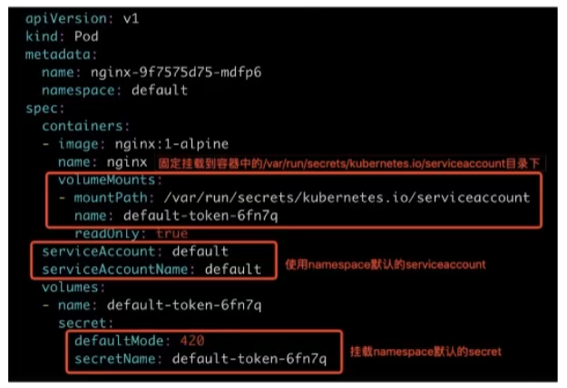

### 创建用于拉取私有镜像的Secret

私有镜像仓库的信息可以通过Secret存储在集群中，Pod如果需要使用私有镜像仓库，可以通过两种方式来配置：

- Pod.spec.imagePullSecrets指定secret
- ServiceAccount中设置imagePullSecrets，然后为使用该SA的Pod注入imagePullSecrets

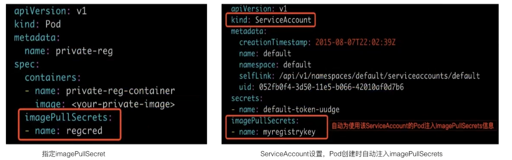

## ServiceAccount

ServiceAccount用于解决Pod在集群中的身份认证问题。其中认证使用的授权信息，使用secret管理。

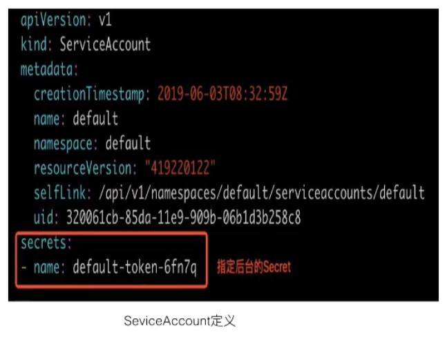

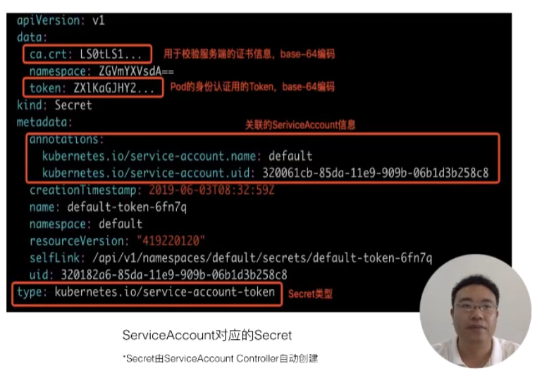

Pod中的应用如何访问它所属的K8s集群：

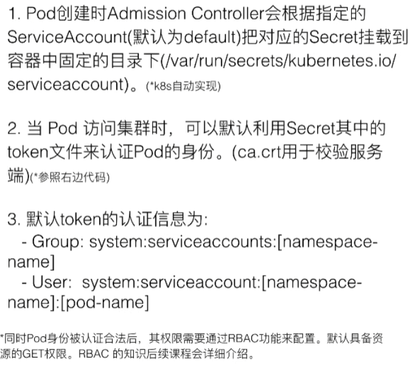

## Resource资源配置

支持资源类型：

- CPU 单位：millicore（1 Core = 1000 millicore）
- Memory 单位：Byte
- 临时存储
- 自定义资源（如GPU）：单位必须为整数

配置方法：

- CPU：

`spec.containers[].resources.limits.cpu`

`spec.containers[].resources.requests.cpu`

- Memory：

`spec.containers[].resources.limits.memory`

`spec.containers[].resources.requests.memory`

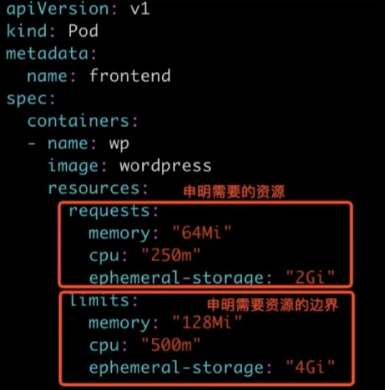

## securityContext

## `Init Container`

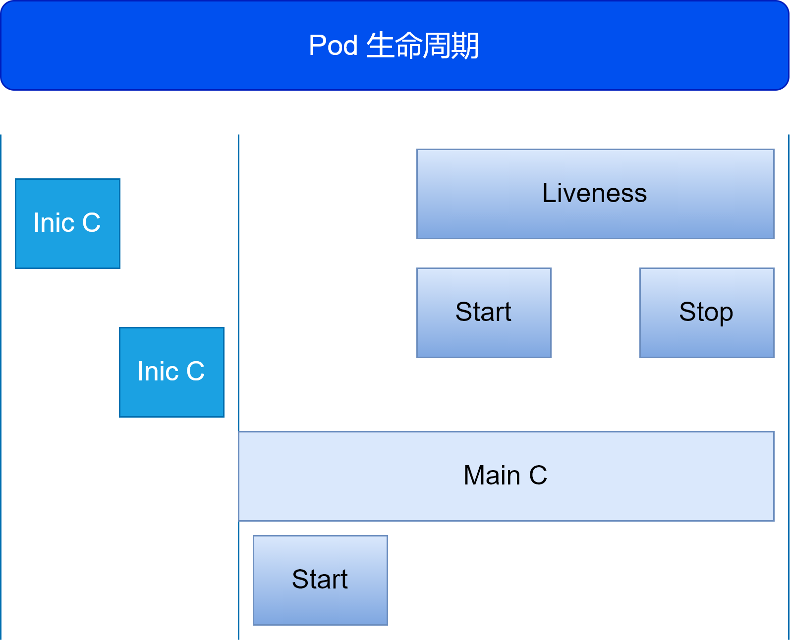

Init Container的主要作用是在主容器启动之前进行一系列初始化操作，完成容器应用所需的预置条件。一个Pod可以有多个Init容器，Init容器先于Pod中的其他容器启动。

Init容器与普通容器的区别：

- Init容器总是运行到成功完成为止。

- 每个Init容器都必须在下一个Init容器启动之前成功完成。

如果Pod的Init容器失败，则k8s会不断地重启该Pod，直到Init容器成功为止，除非Pod的重启策略设置为Never。

**示例：**

以Nginx应用为例，通过Init容器busybox为Nginx创建一个index.html。这里busybox和nginx共享一个volume，以读取和写入index.html文件。

nginx-init-containers.yaml

http://kubernetes.io可能无法访问，需要替换成可访问的网址。

```
apiVersion: v1
kind: Pod
metadata: 
  name: nginx-busybox-app
spec:
  initContainers:
    - name: install
      image: busybox
      imagePullPolicy: IfNotPresent
      command: 
        - wget
        - "-O"
        - "/html/index.html"
        - http://www.baidu.com
      volumeMounts:
        - name: workdir
          mountPath: "/html"
  containers:
    - name: nginx-busybox-app
      image: nginx
      imagePullPolicy: IfNotPresent
      ports:
        - containerPort: 8080
      volumeMounts: 
        - name: workdir
          mountPath: /usr/share/nginx/html
  dnsPolicy: Default
  volumes:	
    - name: workdir
      emptyDir: {}
```

创建Pod：

```
[root@master initC]# kubectl create -f nginx-init-containers.yaml 
pod/nginx-busybox-app created
[root@master initC]# kubectl exec nginx-busybox-app -- cat /usr/share/nginx/html/index.html
<!DOCTYPE html>
<!--STATUS OK--><html> <head><meta http-equiv=content-type content=text/html;charset=utf-8><meta http-equiv=X-UA-Compatible content=IE=Edge><meta content=always name=referrer><link rel=stylesheet type=text/css href=http://s1.bdstatic.com/r/www/cache/bdorz/baidu.min.css><title>百度一下，你就知道</title></head> <body link=#0000cc> <div id=wrapper> <div id=head> <div class=head_wrapper> <div class=s_form> <div class=s_form_wrapper> <div id=lg>  </div> <form id=form name=f action=//www.baidu.com/s class=fm> <input type=hidden name=bdorz_come value=1> <input type=hidden name=ie value=utf-8> <input type=hidden name=f value=8> <input type=hidden name=rsv_bp value=1> <input type=hidden name=rsv_idx value=1> <input type=hidden name=tn value=baidu><span class="bg s_ipt_wr"><input id=kw name=wd class=s_ipt value maxlength=255 autocomplete=off autofocus></span><span class="bg s_btn_wr"><input type=submit id=su value=百度一下 class="bg s_btn"></span> </form> </div> </div> <div id=u1> <a href=http://news.baidu.com name=tj_trnews class=mnav>新闻</a> <a href=http://www.hao123.com name=tj_trhao123 class=mnav>hao123</a> <a href=http://map.baidu.com name=tj_trmap class=mnav>地图</a> <a href=http://v.baidu.com name=tj_trvideo class=mnav>视频</a> <a href=http://tieba.baidu.com name=tj_trtieba class=mnav>贴吧</a> <noscript> <a href=http://www.baidu.com/bdorz/login.gif?login&amp;tpl=mn&amp;u=http%3A%2F%2Fwww.baidu.com%2f%3fbdorz_come%3d1 name=tj_login class=lb>登录</a> </noscript> <script>document.write('<a href="http://www.baidu.com/bdorz/login.gif?login&tpl=mn&u='+ encodeURIComponent(window.location.href+ (window.location.search === "" ? "?" : "&")+ "bdorz_come=1")+ '" name="tj_login" class="lb">登录</a>');</script> <a href=//www.baidu.com/more/ name=tj_briicon class=bri style="display: block;">更多产品</a> </div> </div> </div> <div id=ftCon> <div id=ftConw> <p id=lh> <a href=http://home.baidu.com>关于百度</a> <a href=http://ir.baidu.com>About Baidu</a> </p> <p id=cp>&copy;2017&nbsp;Baidu&nbsp;<a href=http://www.baidu.com/duty/>使用百度前必读</a>&nbsp; <a href=http://jianyi.baidu.com/ class=cp-feedback>意见反馈</a>&nbsp;京ICP证030173号&nbsp;  </p> </div> </div> </div> </body> </html>
```

InitContainer与应用容器的主要区别是：

1. Init container必须先于应用容器执行完成，当设置了多个init container时，它们将按顺序逐个运行，并且只有前一个initC运行成功，才会运行下一个。全部InitC运行成功后，K8S才会初始化Pod的各种信息并创建和运行应用容器。

2. 在Init container的定义中也可以设置资源限制、Volume的使用策略等。但资源限制的设置与应用容器略有不同：

- 如果多个initC容器都设置了资源请求或资源限制，则取它们的最大值作为所有initC的资源请求值或资源限制值。

- Pod的有效资源请求值/资源限制值取以下二者中的较大值：

- 所有应用容器的资源请求值/资源限制值之和

- initC的有效资源请求值/资源限制值。

- 调度算法将基于Pod的有效资源请求值/资源限制值进行计算。

- Pod的有效QoS等级适用于initC和应用容器。

3. initC不能设置就绪探针。

Pod重新启动时，InitC会重新运行一遍，常见的Pod重启场景：

- initC的镜像更新后，initC将重启，导致Pod重启。应用容器的镜像更新时仅应用容器会重启。

- Pod的infrastructure容器更新时，Pod会重启。

- Pod中所有应用容器都停止后，RestartPolicy为Always时Pod将重启。

# 在容器内获取Pod信息

通过DownwardAPI，可以在Pod的容器内获取Pod的重要信息。DownwardAPI通过以下两种方式将Pod信息注入容器内部：

- 环境变量：用于单个变量。

- Volume挂载：将数组类信息生成为文件并挂载到容器内部。

## 将Pod信息注入为环境变量

下面的例子通过DownwardAPI将Pod的IP、名称和所在的NameSpace注入容器内部的环境变量中，容器应用使用env命令将全部环境变量打印到StdOut中：

```
apiVersion: v1
kind: Pod
metadata:
  name: dapi-test-pod
spec:
  containers:
    - name: test-cpmtainer
      image: busybox
      command: ["/bin/sh","-c","env"]
      env:
        - name: MY_POD_NAME
          valueFrom:
            fieldRef:
              fieldPath: metadata.name
        - name: MY_POD_NAMESPACE
          valueFrom:
            fieldRef:
              fieldPath: metadata.namespace
        - name: MY_POD_IP
          valueFrom:
            fieldRef:
              fieldPath: status.podIP
  restartPolicy: Never
```

创建该Pod：`kubectl create -f dapi-test-pod.yaml`

查看该Pod的日志：`kubectl logs dapi-test-pod`

输出为：

```
[root@master downwardAPI]# kubectl logs dapi-test-pod
KUBERNETES_SERVICE_PORT=443
KUBERNETES_PORT=tcp://10.96.0.1:443
HOSTNAME=dapi-test-pod
MYWEB_SERVICE_HOST=10.97.179.4
MYWEB_PORT_8080_TCP_ADDR=10.97.179.4
SHLVL=1
HOME=/root
MYWEB_PORT_8080_TCP_PORT=8080
...
```

Pod环境变量中包含其他服务的IP和端口等信息。

## 将容器资源信息注入为环境变量

下面的例子通过DownwardAPI将Container的资源请求和限制信息注入容器的环境变量中，容器应用使用printenv命令将设置的资源请求和资源限制环境变量打印到标准输出中：

```
apiVersion: v1
kind: Pod
metadata:
  name: dapi-test-pod-container-vars
spec:
  restartPolicy: Never
  containers:
    - name: test-container
      image: busybox
      imagePullPolicy: Never
      command: ["sh", "-c"]
      args:
      - while true; do
        echo -en '\n';
        printenv MY_CPU_REQUEST MY_CPU_LIMIT;
        printenv MY_MEM_REQUEST MY_MEM_LIMIT;
        sleep 3600;
        done;
      resources:
        requests:
          memory: "32Mi"
          cpu: "125m"
        limits:
          memory: "64Mi"
          cpu: "250m"
      env:
        - name: MY_CPU_REQUEST
          valueFrom:
            resourceFieldRef:
              containerName: test-container
              resource: requests.cpu
        - name: MY_CPU_LIMIT
          valueFrom:
            resourceFieldRef:
              containerName: test-container
              resource: limits.cpu
        - name: MY_MEM_REQUEST
          valueFrom:
            resourceFieldRef:
              containerName: test-container
              resource: requests.memory
        - name: MY_MEM_LIMIT
          valueFrom:
            resourceFieldRef:
              containerName: test-container
              resource: limits.memory
```

通过设置containerName字段，可以获取resources中的字段。

```
[root@master downwardAPI]# kubectl create -f dapi-test-pod-container-vars.yaml 
pod/dapi-test-pod-container-vars created
[root@master downwardAPI]# kubectl logs dapi-test-pod-container-vars 

1
1
33554432
67108864
```

## Volume挂载方式

下面的例子通过Downward API将Pod的Label、Annotation列表通过Volume挂载为容器中的一个文件，容器使用echo命令将文件内容输出到StdOut。

```
# 书中例子运行不了
```

**Downward API的作用：**在某些集群中，集群中的节点需要将自身标识以及进程绑定的IP地址等信息预习写入配置文件，进程启动时读取这些信息，然后发布到类似于服务注册中心中，做集群的节点的自动发现功能。那么Downward API就大有用处，它可以先编写一个预启动脚本或者init container，通过环境变量或者文件的方式获取pod自身的名称、IP地址等信息，然后写入主程序配置中。

# Pod健康检查和服务可用性检查

Kubernetes对容器的健康状态可以通过两类探针来检查：LivenessProbe和ReadinessProbe，Kubelet定期执行这两类探针来诊断容器的健康状况。

1. LivenessProbe：用于判断容器是否存活。如果LivenessProbe探测到容器不健康，则kubelet将杀掉该容器，并根据其重启策略做相应的处理。如果一个容器不包含LivenessProbe，则kubelet认为该容器的LivenessProbe返回的值永远为success。

2. ReadinessProbe：用于判断容器服务是否可用（Ready状态），达到Ready状态的Pod才可以接收请求。对于被Service管理的Pod，Service与Pod Endpoint的关联关系也将基于Pod是否Ready进行调整。如果在运行过程中Ready状态变为False，则系统自动将其从Service的后端Endpoint列表中隔离出去，后续再把恢复到Ready状态的Pod加回后端Endpoint列表。这样就能保证客户端在访问Service时不会被转发到服务不可用的Pod实例上。

LivenessProbe和ReadinessProbe均可配置以下三种实现方式。

**一、ExecAction：在容器内部执行一个命令，如果该命令的返回码为0，则表明容器健康。**

示例：

下面的例子通过`cat /tmp/health`命令判断容器是否正常运行。该Pod运行后，会创建`/tmp/health`并在十秒后删除该文件，而LivenessProbe在第十五秒检测到该错误，随后kubelet会杀掉这个容器并重启它。

```
apiVersion: v1
kind: Pod
metadata:
 name: liveness
spec:
  containers:
  - name: liveness
    image: liveness
    args: 
    - /bin/sh
    - -c
    - echo ok > /tmp/health: sleep 10; rm - rf /tmp/healthy; sleep 600
    livenessProbe:
      exec:
        command:
        - cat
        - /tmp/health
    initialDelaySeconds: 15
    timeoutSeconds: 1
```

**二、TCPSocketAction：通过容器的IP地址和端口号执行TCP检查，如果能够建立TCP连接，则表明容器健康。**

```
apiVersion: v1
kind: Pod
metadata:
 name: pod-with-healthcheck
spec:
  containers:
  - name: nginx
    image: nginx
    ports:
    - containerPort: 80
    livenessProbe:
    # 如果能与容器内的80端口建立TCP连接，则说明容器是健康的
      tcpSocket:
        port: 80
    initialDelaySeconds: 15
    timeoutSeconds: 1
```

**三、HTTPGetAction：通过容器的IP地址、端口号及路径调用HTTP Get方法，如果响应的状态码大于等于200且小于400，则认为容器健康。**

```
apiVersion: v1
kind: Pod
metadata:
 name: pod-with-healthcheck
spec:
  containers:
  - name: nginx
    image: nginx
    ports:
    - containerPort: 80
    livenessProbe:
      httpGet:
        path: /_status/healthz  //请求路径
        port: 80
    initialDelaySeconds: 15
    timeoutSeconds: 1
```

对于每种探测方式，都需要设置initialDelaySeconds和timeoutSeconds两个参数，它们的含义分别如下：

- initialDelaySeconds：启动容器后进行首次健康检查的等待时间，单位为s。

- timeoutSeconds：健康检查发送请求后等待响应的超时时间，单位为s。当超时发生时，kubelet会认为容器已经无法提供服务，将会重启该容器。

Kubernetes的ReadinessProbe机制可能无法满足某些复杂应用对容器内服务可用状态的判断，所以Kubernetes从1.11版本开始，引入Pod Ready++特性对Readiness探测机制进行扩展，在1.14版本时达到GA稳定版，称其为Pod Readiness Gates。

通过Pod Readiness Gates机制，用户可以将自定义的ReadinessProbe探测方式设置在Pod上，辅助Kubernetes设置Pod何时达到服务可用状态（Ready）。为了使自定义的ReadinessProbe生效，用户需要提供一个外部的控制器（Controller）来设置相应的Condition状态。

# Pod调度

在`kubernetes`系统中，pod在大部分场景下都只是容器的载体而已，通常需要通过`Deployment`，`DaemonSet`，`Job`等对象来完成Pod的调度与自动控制功能。

RC独立于所控制的Pod，并通过Label标签这个松耦合关系来控制目标Pod实例的创建与销毁，但其标签选择器只能选择一个标签。RS是RC的升级版，拥有集合式的标签选择器，可以选择多个Pod标签。例如：

```
selector:
  #matchLabels和matchExpression是与的关系
  matchLabels:
    tier: frontend
  matchExpressions:
    - {key: tier, operator: In, values: {frontend}}
```

## `NodeSelector`: 定向调度

Kubernetes Master 上的 Scheduler 服务(kube-scheduler进程)负责实现 Pod 的调度，整个调度过程通过执行一系列复杂的算法，最终为每个 Pod 都计算出一个最佳的目标节点。在实际情况下，可以通过 Node 的标签和 Pod 的 nodeSelector 属性相匹配来达成上述目的。

（1）首先通过kubectl label命令给目标Node打上一些标签：  
`kubectl label nodes <node-name> <label-key>=<label-value>`  
例如：

```
[root@master ~]# kubectl label nodes worker dog=right
node/worker labeled
```

（2）在Pod的定义中加上nodeSelector的设置：

```
apiVersion: apps/v1
kind: Deployment
metadata:
  name: nginx-deployment
spec:
  replicas: 3
  selector:
    matchLabels:
        app: nginx
  template:
    metadata:
      labels:
        app: nginx
    spec:
      containers:
      - name: nginx
        image: nginx
        imagePullPolicy: IfNotPresent
        ports:
        - containerPort: 80
      nodeSelector:
        dog: right
```

创建deployment：

`kubectl create -f deploy-nodeSelector.yaml`

查看节点调度情况：

```
[root@master deployment]# kubectl get po -o wide
NAME                                READY   STATUS    RESTARTS   AGE   IP            NODE     NOMINATED NODE   READINESS GATES
nginx-deployment-558fdcf67c-5j4lb   1/1     Running   0          15s   10.244.1.89   worker   <none>           <none>
nginx-deployment-558fdcf67c-5mwhx   1/1     Running   0          15s   10.244.1.91   worker   <none>           <none>
nginx-deployment-558fdcf67c-88nqc   1/1     Running   0          15s   10.244.1.90   worker   <none>           <none>
```

**注意**：当指定了 NodeSelector 的规则但是集群中没有满足条件的 Node 时，即使有空闲 Node，K8S 也不会把 Pod 调度到空闲节点上。

## NodeAffinity

NodeAffinity 意为 Node 亲和性的调度策略，是用于替换 NodeSelector 的全新调度策略。

- RequiredDuringSchedulingIgnoredDuringExecution：功能类似 NodeSelector，语法不同，相当于硬限制。

- PreferredDuringSchedulingIgnoredDuringExecution：软限制。

IgnoredDuringExecution 的意思是：如果一个 Pod 所在的节点在 Pod 运行期间标签发生了变更，不再符合该 Pod 的节点亲和性需求，则系统将忽略 Node 上 Label 的变化，该Pod能继续在该节点运行。

下面的例子设置了NodeAffinity调度的如下规则。

- requiredDuringSchedulingIgnoredDuringExecution 要求只运行在 amd64 的节点上（beta.kubernetes.io/arch In amd64）。

- preferredDuringSchedulingIgnoredDuringExecution 的要求是尽量运行在磁盘类型为 ssd（disk-type In ssd）的节点上。

```
apiVersion: v1
kind: Pod
metadata:
  name: with-node-affinity
spec:
  affinity:               # 1
    nodeAffinity:         # 2
      requiredDuringSchedulingIgnoredDuringExecution:   # 3
        nodeSelectorTerms:
        - matchExpressions:
          - key: beta.kubernetes.io/arch
            operator: In
            values:
            - amd64
      preferredDuringSchedulingIgnoredDuringExecution:  # 4
      - weight: 1
        preference:
          matchExpressions:
          - key: disk-type
            operator: In
            values:
            - ssd
  containers:
  - name: with-node-affinity
    image: gcr.io/google_containers/pause:2.0
```

从上面的配置中可以看到 In 操作符，NodeAffinity语法支持的操作符包括 In、NotIn、Exists、DoesNotExist、Gt、Lt。虽然没有节点排斥功能，但是用 NotIn 和 DoesNotExist 就可以实现排斥的功能了。

NodeAffinity 规则设置的注意事项如下。

- 如果同时定义了 nodeSelector 和 nodeAffinity，那么必须两个条件都得到满足，Pod才能最终运行在指定的Node上。

- 如果 nodeAffinity 指定了多个 nodeSelectorTerms，那么其中一个能够匹配成功即可。

- 如果在 nodeSelectorTerms 中有多个 matchExpressions，则一个节点必须满足所有 matchExpressions 才能运行该Pod。

## PodAffinity

PodAffinity 指的是 Pod 亲和与互斥调度策略。

这一功能让用户从另一个角度来限制 Pod 所能运行的节点：根据在节点上正在运行的 Pod 的标签而不是节点的标签进行判断和调度，要求对节点和 Pod 两个条件进行匹配。这种规则可以描述为：如果在具有标签 X 的 Node 上运行了一个或者多个符合条件 Y 的 Pod，那么 Pod 应该（如果是互斥的情况，那么就变成拒绝）运行在这个 Node 上（用于让某些 Pod 在相同节点上运行）。

- preferredDuringSchedulingIgnoredDuringExecution：软亲和性
- requiredDuringSchedulingIgnoredDuringExecution：硬亲和性

podAffinity--Pod与指定Pod同一拓扑域：

```
apiVersion: v1

kind: Pod

metadata:

  name: pod-3

  labels:

    app: pod-3

spec:

  containers:

  - name: pod-3

    image: hub.atguigu.com/library/myapp:v1

  affinity:

    #想让两个pod运行在同一个node上

    podAffinity:

      #硬策略

      requiredDuringSchedulingIgnoredDuringExecution:

      - labelSelector:  #标签选择

          matchExpressions:

          - key: app #当app存在node-affinity-pod时就选择

            operator: In

            values: 

            - node-affinity-pod

        topologyKey: kubernetes.io/hostname 

        #hostname判断是否在同一个pod，唯一
```

podAntiAffinity--Pod与指定Pod不在同一拓扑域

```
apiVersion: v1

kind: Pod

metadata:

  name: pod-4

  labels:

    app: pod-4

spec:

  containers:

  - name: pod-4

    image: hub.atguigu.com/library/myapp:v1

  affinity:

    #不想让两个pod运行在同一个node上

    #匹配标签如果app=pod-2，那么则不运行在这个节点

    podAntiAffinity:

      #软策略

      preferredDuringSchedulingIgnoredDuringExecution:

      - weight: 1

        podAffinityTerm:

          labelSelector:

            matchExpressions:

            - key: app #匹配app=node-affinity-pod

              operator: In

              values:

              - node-affinity-pod

          topologyKey: kubernetes.io/hostname
```

## Taints与Tolerations

Taints用于让Node拒绝Pod的运行。

Taint需要和Toleration配合使用。在Node上设置了一个或多个Taint之后，除非Pod明确声明能容忍这些Taint，否则无法在该Node运行。Toleration是Pod的属性，让Pod能够（不是必须）运行在标注了Taint的Node上。

可以使用kubectl taint命令为Node设置Taint信息：

`kubectl taint nodes node-name key=value:NoSchedule`

这条命令为Node添加了一个taint，键为key，值为value，taint的效果为NoSchedule。即除非Pod明确声明能够容忍这个taint，否则不能调度到该node上。

Pod声明Tolerations的方法为：

```
tolerations:
  - key: "key"
    operator: "Equal"
    value: "value"
    effect: "NoSchedule"
```

或

```
tolerations:
  - key: "key"
    operator: "Exists"
    effect: "NoSchedule"
```

如果不指定operator，默认为Equal。

特例：

- 空的key配合Exists可以匹配所有taint。

- 空的effect匹配所有effect。

effect还可以取值为PreferNoSchedule，是NoSchedule的软限制版本。

系统允许在同一个Node上设置多个Taint，也可以在Pod上设置多个Toleration。Kubernetes调度器处理多个Taint和Toleration的逻辑顺序为：首先列出节点中所有的Taint，然后忽略Pod的Toleration能够匹配的部分，剩下的没有忽略的Taint就是对Pod的效果了。下面是几种特殊情况：

- 如果在剩余的Taint中存在effect=NoSchedule，则调度器不会把该Pod调度到这一节点上。

- 如果在剩余的Taint中没有NoSchedule效果，但是有PreferNoSchedule效果，则调度器会尝试不把这个Pod指派给这个节点。

- 如果在剩余的Taint中有NoExecute效果，并且这个Pod已经在该节点上运行，则会被驱逐；如果没有在该节点上运行，则也不会再被调度到该节点上。

例如，我们则以对一个节点进行Taint设置：

```
kubectl taint nodes k8s-node1 key1=value1:NoSchedule
kubectl taint nodes k8s-node1 key1=value1:NoExecute
kubectl taint nodes k8s-node1 key2=value2:NoSchedule
```

之后在Pod上设置两个Toleration：

```
tolerations:
- key: "key1"
  operator: "Equal"
  value: "value1"
  effect: "NoSchedule"
- key: "key1"
  operator: "Equal"
  value: "value1"
  effect: "NoExecute"
```

这样的结果是该Pod无法被调度到node1上，这是因为第3个Taint没有匹配的Toleration。但是如果该Pod已经在node1上运行了，那么在运行时设置第3个Taint，它还能继续在node1上运行，这是因为Pod可以容忍前两个Taint。

一般来说，如果给Node加上effect=NoExecute的Taint，那么在该Node上正在运行的所有无对应Toleration的Pod都会被立刻驱逐，而具有相应Toleration的Pod永远不会被驱逐。不过，系统允许给具有NoExecute效果的Toleration加入一个可选的tolerationSeconds字段，这个设置表明Pod可以在Taint添加到Node之后还能在这个Node上运行多久（单位为s）：

```
tolerations:
- key: "key1"
  operator: "Equal"
  value: "value1"
  effect: "NoExecute"
  tolerationSeconds: 3600
```

上述定义的意思是，如果Pod正在运行，所在节点都被加入一个匹配的Taint，则这个Pod会持续在这个节点上存活3600s后被逐出。如果在这个宽限期内Taint被移除，则不会触发驱逐事件。

Taint和Toleration是一种处理节点并且让Pod进行规避或者驱逐Pod的弹性处理方式，下面列举一些常见的用例。

**1.独占节点**

如果想要拿出一部分节点专门给一些特定应用使用，则可以为节点添加这样的Taint：

```
kubectl taint nodes <nodename> dedlicated=groupName:NoSchedule
```

然后给这些应用的Pod加入对应的Toleration。这样，带有合适Toleration的Pod就会被允许同使用其他节点一样使用有Taint的节点。

通过自定义Admission Controller也可以实现这一目标。如果希望让这些应用独占一批节点，并且确保它们只能使用这些节点，则还可以给这些Taint节点加入类似的标签dedicated=groupName，然后Admission Controller需要加入节点亲和性设置，要求Pod只会被调度到具有这一标签的节点上。

**2.具有特殊硬件设备的节点**

在集群里可能有一小部分节点安装了特殊的硬件设备（如GPU芯片），用户自然会希望把不需要占用这类硬件的Pod排除在外，以确保对这类硬件有需求的Pod能够被顺利调度到这些节点。

可以用下面的命令为节点设置Taint：

```
kubectl taint nodes <nodename> special=true:NoSchedule
kubectl taint nodes <nodename> special=true:PreferNoSchedule
```

然后在Pod中利用对应的Toleration来保障特定的Pod能够使用特定的硬件。

和上面的独占节点的示例类似，使用Admission Controller来完成这一任务会更方便。

**3.定义Pod驱逐行为，以应对节点故障（为Alpha版本的功能）**

前面提到的NoExecute这个Taint效果对节点上正在运行的Pod有以下影响。

- 没有设置Toleration的Pod会被立刻驱逐。

- 配置了对应Toleration的Pod，如果没有为tolerationSeconds赋值，则会一直留在这一节点中。

- 配置了对应Toleration的Pod且指定了tolerationSeconds值，则会在指定时间后驱逐。

Kubernetes从1.6版本开始引入一个Alpha版本的功能，即把节点故障标记为Taint（目前只针对node unreachable及node not ready，相应的NodeCondition "Ready"的值分别为Unknown和False）。激活TaintBasedEvictions功能后（在--feature-gates参数中加入TaintBasedEvictions=true），NodeController会自动为Node设置Taint，而在状态为Ready的Node上，之前设置过的普通驱逐逻辑将会被禁用。注意，在节点故障的情况下，为了保持现存的Pod驱逐的限速（rate-limiting）设置，系统将会以限速的模式逐步给Node设置Taint，这就能避免在一些特定情况下（比如Master暂时失联）大量的Pod被驱逐。这一功能兼容tolerationSeconds,允许Pod定义节点故障时持续多久才被逐出。

例如，一个包含很多本地状态的应用可能需要在网络发生故障时，还能持续在节点上运行，期望网络能够快速恢复，从而避免被从这个节点上驱逐。

Pod的Toleration可以这样定义：

```
tolerations：
- key： "node.alpa.kubernetes.io/nureachable"
  operator: "Exists"
  effect: "NoExecute"
  tolerationSeconds:6000
```

对于Node未就绪状态，可以把Key设置为node.alpha.kubernetes.io/notReady。

如果没有为Pod指定node.alpha.kubernetes.io/notReady的Toleration，那么Kubernetes会自动为Pod加入tolerationSeconds=300的node.alpha.kubernetes.io/notReady类型的Toleration。

同样，如果Pod没有定义node.alpha.kubernetes.io/unreachable的Toleration，那么系统会自动为其加入tolerationSeconds=300的node.alpha.kubernetes.io/unreachable类型的Toleration。

这些系统自动设置的toleration在Node发现问题时，能够为Pod确保驱逐前再运行5min。这两个默认的Toleration由Admission Controller“`DefaultTolerationSeconds`”自动加入。

## Pod Priority Preemption

Pod优先级调度，当集群资源不足时，可以驱逐优先级低的Pod释放集群资源，然后部署优先级较高的Pod。

具体：待添加

## 集群中的拓扑约束

```yaml
apiVersion: apps/v1
kind: Deployment
metadata:
  name: example-deployment
spec:
  replicas: 3
  selector:
    matchLabels:
      app: example
  template:
    metadata:
      labels:
        app: example
    spec:
      topologySpreadConstraints:
      - maxSkew: 1
        topologyKey: "kubernetes.io/hostname"
        whenUnsatisfiable: DoNotSchedule
        labelSelector:
          matchLabels:
            app: example
      containers:
      - name: example-container
        image: nginx:latest

```

- `maxSkew`：指定了每个拓扑域中允许的最大不平衡度(不同节点pod数量差异)。在这个例子中，`maxSkew: 1` 表示每个节点中允许的最大 Pod 不平衡度为 1。
- `topologyKey`：指定了用于拓扑分析的键。在这个例子中，使用节点的主机名作为拓扑分析的键。
- `whenUnsatisfiable`：指定了当拓扑约束无法满足时的行为。在这个例子中，`DoNotSchedule` 表示当拓扑约束无法满足时，不要调度 Pod。
- `labelSelector`：指定了应用于拓扑分析的标签选择器。在这个例子中，只有带有 `app: example` 标签的 Pod 才会被考虑在内。

# Pod的升级和回滚

当集群中的某个服务需要升级时，我们需要停止目前与该服务相关的所有Pod，然后下载新版本镜像并创建新的Pod。如果集群规模比较大，则这个工作变成了一个挑战，并且先全部停止然后逐步升级的方式会导服务在较长时间是不可用的。k8s提供了滚动升级来解决这个问题。

如果Pod是通过Deployment创建的，则用户可以在运行时修改Deployment的Pod定义或镜像名称，并应用到Deployment对象上，系统既可完成Deployment的自动更新操作。如果在更新过程中发生了错误，则可以通过回滚操作恢复Pod的版本。

# Pod的扩缩容

Kubernetes对Pod的扩缩容提供了手动和自动两种方式，手动模式通过执行`kubectl scale`或RSETful API对一个Deployment或RC进行Pod副本数量的设置；自动模式根据用户的自定义配置，由系统对Pod数量进行调整。

## 手动扩容机制

示例：Deployment nginx

```
apiVersion: apps/v1
kind: Deployment
metadata:
  name: nginx-deployment
spec:
  replicas: 3
  selector:
    matchLabels:
        app: nginx
  template:
    metadata:
      labels:
        app: nginx
    spec:
      containers:
      - name: nginx
        image: nginx
        imagePullPolicy: IfNotPresent
        ports:
        - containerPort: 80
```

创建deployment并查看Pod数量：

```
[root@master deployment]# kubectl get po
NAME                                READY   STATUS    RESTARTS   AGE
nginx-deployment-558fdcf67c-5j4lb   1/1     Running   1          19h
nginx-deployment-558fdcf67c-5mwhx   1/1     Running   1          19h
nginx-deployment-558fdcf67c-88nqc   1/1     Running   1          19h
```

使用kubectl scale对Pod数量进行修改：

```
[root@master deployment]# kubectl scale deploy nginx-deployment --replicas=6
deployment.apps/nginx-deployment scaled
[root@master deployment]# kubectl get po -o wide
NAME                                READY   STATUS    RESTARTS   AGE   IP            NODE     NOMINATED NODE   READINESS GATES
nginx-deployment-558fdcf67c-5j4lb   1/1     Running   1          19h   10.244.1.94   worker   <none>           <none>
nginx-deployment-558fdcf67c-5mwhx   1/1     Running   1          19h   10.244.1.92   worker   <none>           <none>
nginx-deployment-558fdcf67c-88nqc   1/1     Running   1          19h   10.244.1.93   worker   <none>           <none>
nginx-deployment-558fdcf67c-btnr9   1/1     Running   0          16s   10.244.1.96   worker   <none>           <none>
nginx-deployment-558fdcf67c-j7ggg   1/1     Running   0          16s   10.244.1.95   worker   <none>           <none>
nginx-deployment-558fdcf67c-rgdjw   1/1     Running   0          16s   10.244.1.97   worker   <none>           <none>
```

## 自动扩缩容机制

Horizontal Pod Autoscaler（HPA）可以实现基于Pod资源性能指标进行自动Pod扩缩容的功能。HPA控制器基于Master节点的kube-controller-manager服务启动参数--horizontal-pod-autoscaler-sync-period定义的探测周期（默认15s），周期性的检测Pod的性能指标，并与HPA控制器中的扩缩容条件作比较，在满足条件时调整Pod数量。

### HPA的工作原理

Kubernetes中的某个Metics Server持续采集所有Pod副本的指标数据。HPA控制器通过API Server的API获取这些数据，然后基于用户自定义的扩缩容规则进行计算，得到理论上的目标Pod数量。当理论上的目标Pod数量与当前实际的目标Pod数量不同时，HPA控制器就向Pod的副本控制器发起scale操作，调整Pod数量完成扩缩容。

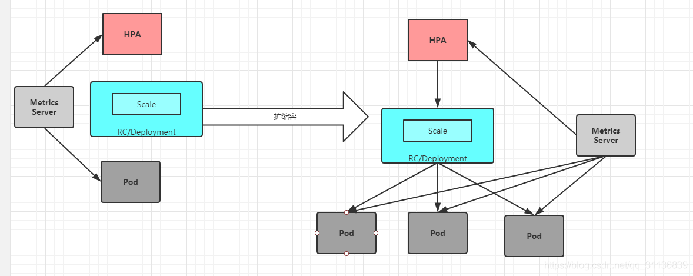

### 指标的类型

Master中的kube-controller-manager服务持续监测Pod的某种性能指标，以计算是否需要调整Pod数量。目前K8S支持的指标有：

- Pod资源使用率：Pod级别的性能指标，通常是一个比率，比如CPU使用率。

- Pod自定义指标：Pod级别的性能指标，通常是一个数值，例如接受的请求数量。

- Object 自定义指标或外部自定义指标：通常是一个数值，需要容器应用以某种方式提供，例如通过HTTP URL "/metrics"提供。

Metrics Server将采集到的Pod性能指标数据通过聚合API提供给HPA控制器查询。
