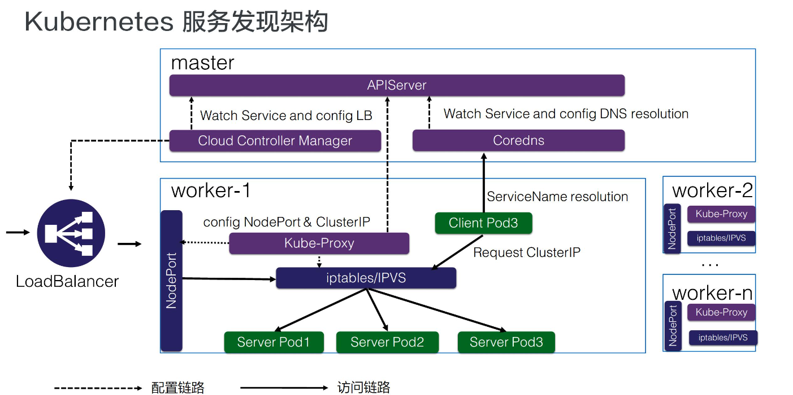

# Service

Service是Kubernetes的核心概念，通过创建Service，可以为一组具有相同功能的容器应用提供一个统一的入口地址，并且把请求负载分发到后端的各个容器应用上。



## Service的基本用法

示例webapp-rc.yaml，通过定义Pod中容器的containerPort，实现通过PodIP+containerIP访问服务。

```
apiVersion: v1
kind: ReplicationController
metadata: 
  name: webapp
spec:
  replicas: 2
  template:
    metadata: 
      name: webapp
      labels:
        app: webapp  # 选择具有该label的Pod作为后端Pod
    spec:
      containers:
      - name: webapp
        images: tomcat
        imagePullPolicy: IfNotPresent
        ports:
        - containerPort: 8080
```

创建该rc：

`kubectl create -f webapp-rc.yaml`

获取Pod的IP地址：

```
[root@master basicSerivceUse]# kubectl get pods -l app=webapp -o yaml | grep podIP:
          f:podIP: {}
    podIP: 10.244.1.12
          f:podIP: {}
    podIP: 10.244.1.11
```

然后即可通过这两个IP+Port访问服务：

```
[root@master basicSerivceUse]# curl 10.244.1.32:8080
<!DOCTYPE html>
<html lang="en">
    <head>
        <meta charset="UTF-8" />
        <title>Apache Tomcat/8.0.35</title>
        <link href="favicon.ico" rel="icon" type="image/x-icon" />
        <link href="favicon.ico" rel="shortcut icon" type="image/x-icon" />
        <link href="tomcat.css" rel="stylesheet" type="text/css" />
......
```

但是Pod的IP地址是不可靠的，当Pod所在的Node发生故障时，Pod将被Kubernetes调度到另一个Node，其IP地址也会发生改变。Service的存在就是为了解决这一问题。

创建Service有两种方式：

**1. 通过kubectl创建**

```
[root@master basicSerivceUse]# kubectl expose rc webapp --name=webapp-from-kubectl
service/webapp-from-kubectl exposed
[root@master basicSerivceUse]# kubectl get svc
NAME                  TYPE        CLUSTER-IP       EXTERNAL-IP   PORT(S)    AGE
kubernetes            ClusterIP   10.96.0.1        <none>        443/TCP    13m
webapp                ClusterIP   10.104.147.184   <none>        8001/TCP   9m46s
webapp-from-kubectl   ClusterIP   10.108.48.231    <none>        8080/TCP   5s
```

默认创建的服务信息如下：

```
[root@master basicSerivceUse]# kubectl get svc webapp-from-kubectl -o wide
NAME                  TYPE        CLUSTER-IP      EXTERNAL-IP   PORT(S)    AGE    SELECTOR
webapp-from-kubectl   ClusterIP   10.108.48.231   <none>        8080/TCP   3m6s   app=webapp
```

可在执行kubectl expose时执行服务的相关参数。

**2. 通过YAML文件创建**

编写文件webapp-svc.yaml

```
apiVersion: v1
kind: Service
metadata:
  name: webapp
spec:
  ports:
  - port: 8001
    targetPort: 8080
  selector:
    app: webapp
```

执行`kubectl create -f webapp-svc.yaml`发布到集群。

port指访问服务的端口，targetPort指访问其对应的Pod的端口。

之后，执行`kubectl get svc -o wide`查看服务的clusterIP，通过clusterIP+8001访问服务。

当服务对应多个Pod时，k8s会自动将请求负载到后端的Pod之一。目前k8s的负载分发策略包括：

- RoundRobin：轮询分发

- SessionAffinity：一段时间内，来源相同的请求被分发到相同的Pod。

Kubernetes默认采用RoundRobin策略，可以通过设置`service.spec.sessionAffinity=ClientIP`启动SessionAffinity策略。

### 多端口Service

有时一个容器应用可能提供多个端口的服务，此时需要在Service的定义中设置将多个端口对应到多个应用服务。例如：

```
apiVersion: v1
kind: Service
metadata:
  name: webapp
spec:
  ports:
  - port: 8080
    targetPort: 8080
    name: web
  - port: 8005
    targetPort: 8005
    name: management
  selector:
    app: webapp
```

另一个例子是同一个端口用两种协议：

```
...
ports:
- name: dns
  port: 53
  protocol: UDP
- name: dns
  port: 53
  protocol: TCP
...
```

### 外部服务Service

在某些环境下，应用系统需要将一个外部数据作为后端服务进行连接，或将另一个集群或Namespace中的服务作为服务的后端，这里可以通过创建一个无Label Selector的Service来实现。

```
apiVersion: v1
kind: Service
metadata:
  name: outer-service
spec:
  ports: 
  - port: 80
    protocol: TCP
    targetPort: 80
```

该服务没有Label Selector，无法选择后端Pod，需要手动创建一个与该Service同名的Endpoint对象。

```
apiVersion: v1
kind: Endpoints
metadata:
  name: outer-service
subsets:
- addresses:
  - ip: 1.2.3.4
  ports:
  - port: 80
```

## Headless Service

在某些应用场景中，开发人员希望自己控制负载均衡的策略，不适用Service默认提供的负载均衡功能，或者应用程序需要获取提供服务的Pod列表（包含Pod的IP等信息）。K8S提供了Headless Service来实现这种功能，即不为Service设置ClusterIP，仅通过LabelSelector将Pod列表返回给调用者。例如：

```
apiVersion: v1
kind: Service
metadata:
  name: nginx
  labels:
    app: nginx
spec:
  ports:
  - port: 80
  clusterIP: None
  selector:
    app: nginx
```

这样，Service就不再具有ClusterIP，对Service进行访问将获得Label对应的Pod列表。例如：StatefulSet就是使用Headless Service为客户端返回多个服务地址的。

Apache Cassamdra是一套开源分布式NoSQL数据库系统，是由一组数据库节点组成的分布式的集群数据库。示例通过运行一个在Cassamdra的节点上运行JAVA程序调用K8S的API，来发现新产生的提供Cassamdra服务的Pod并添加到集群中。

主要步骤为：自定义SeedProvider；通过Headless Service自动查找后端Pod；自动添加新Cassamdra节点。

# 集群内部访问Service

集群内访问Service主要有三种方法：

- Service的Cluster IP

- 访问服务名，依靠DNS解析。同一个namespace下直接通过servicename访问，不同namespace下通过：`{servicename}.{namespace}`

- 通过Pod中的环境变量访问

# 从集群外部访问Pod或Service
