### 计算机网络系统的演进

从多台计算机开始通信以来，服务间通信是应用最为广泛的模式。以下图为例，ServiceA 和 ServiceB 可以是我们提供应用的服务端与客户端。在开发者开发这些服务的时候，需要借助底层的网络硬件和协议进行通信。这张图只是一个简化的视图，省略了在代码操作的数据和通过线路发送接收的电信号之间转换的很多层。

[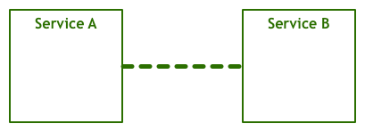](https://cosmos-1251905798.cos.ap-beijing.myqcloud.com/blog/2020-09-08_service-mesh-svc2svc.png)

更加具体一点，把底层的网络协议栈加入，我们会看到下图：

[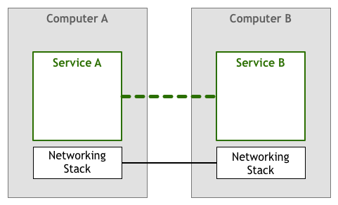](https://cosmos-1251905798.cos.ap-beijing.myqcloud.com/blog/2020-09-08_service-mesh-svc2svc-stack.png)

从上世纪50年代起，上述的模型就一直在使用。最开始，由于计算机系统规模相对较小，每个节点之间的链路协议都是经过专门设计和维护的。随着计算机规模的迅速扩大，很多个小的网络系统开始连接起来。在这个过程中，不同主机间如何找到彼此，跨网络间如何路由转发，如何实现流量控制等问题，成了摆在网络系统设计人员面前亟需解决的难题。

为了实现各个网络节点的路由转发，屏蔽链路层协议，人们发明了IP网络协议。然而，IP网络协议还不能够解决流量控制的问题。这里的流量控制，指的是防止一台服务器发送过多的数据包，超出下游服务器的处理能力。在最开始，编写网络服务和应用程序的开发者来负责处理上述流量控制的问题。这就意味着在编写应用程序过程中，网络处理的逻辑和应用自身的业务逻辑被耦合在一起，如下图所示。

[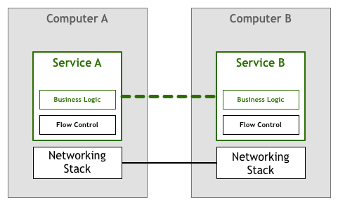](https://cosmos-1251905798.cos.ap-beijing.myqcloud.com/blog/2020-09-08_service-mesh-flow-control.png)

然而，这种每个开发人员都要去考虑流量处理等传输层的问题太过复杂，程序开发的成本太高。随着技术的快速发展，流量处理和其他网络问题相关的解决方案被整合到网络协议栈，TCP/IP席卷了世界，成为互联网事实上的协议标准。流量控制等网络问题的代码仍在，但是你不再需要自己去开发与维护这段代码，而是直接调用系统提供的网络协议栈。

[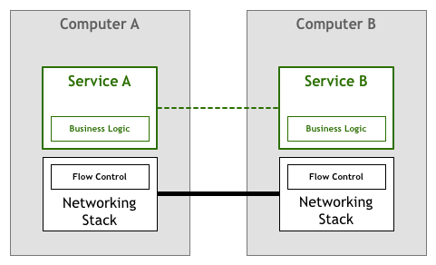](https://cosmos-1251905798.cos.ap-beijing.myqcloud.com/blog/2020-09-08_service-mesh-tcp.png)

### 微服务架构的演进

确定于上世界80年代的TCP/IP网络协议栈和通用的网络模型对于互联网的发展发挥了巨大的作用，极大了促进了互联网应用的繁荣。网络应用的功能逐渐复杂起来，人们把所有的组件都集中在一个应用当中，这即是单体应用 Monolithic。单体应用基于相同技术栈开发、访问共享的数据库、共同部署运维和扩容。同时，组件之间的通信也趋于频繁和耦合，所有的交互都是以函数调用的形式来实现。

然而，随着互联网的迅猛发展，网络应用中需要添加越来越多的功能，应用的复杂度不断提升，参与软件开发的协作人数也越来越多，单体应用开始爆发出其固有局限性。在这种背景下，微服务的思潮降临，让软件开发重新变得小而美：

- 单⼀职责：拆分后的单个微服务，通常只负责单个高内聚自闭环功能，因此很易于开发、理解和维护。
- 架构灵活：不同微服务应用之间在技术选型层面几乎是独立的，可以⾃由选择最适合的技术栈。
- 部署隔离：相比巨无霸单体应用，单个微服务应用的代码和产物体积大大减少，更容易持续集成和快速部署；同时，通过进程级别的隔离，也不再像单体应用一样只能同生共死，故障隔离效果显著提升。
- 独⽴扩展：单体应用时代，某个模块如果存在资源瓶颈（e.g. CPU/内存），只能跟随整个应用一起扩容，白白浪费很多资源。微服务化后，扩展的粒度细化到了微服务级别，可以更精确地按需独立扩展。

然而，微服务也不是银弹，在微服务落地的过程中，也产生了很多的问题，其中主要的问题就是服务间通信：

- **如何找到服务的提供⽅？**微服务通讯必须走远程过程调用（HTTP/REST本质上也属于RPC），当其中一个应用需要消费另一个应用的服务时，无法再像单体应用一样通过简单的进程内机制（e.g. Spring的依赖注入）就能获取到服务实例；你甚至都不知道有没有这个服务方。
- **如何保证远程调⽤的可靠性?**既然是RPC，那必然要走IP网络，而我们都知道网络（相比计算和存储）是软件世界里最不可靠的东西。虽然有TCP这种可靠传输协议，但频繁丢包、交换机故障甚至电缆被挖断也常有发生；即使网络是好的，如果对方机器宕机了，或者进程负载过高不响应呢？
- **如何降低服务调⽤的延迟？**网络不只是不可靠，还有延迟的问题。虽然相同系统内的微服务应用通常都部署在一起，同机房内调用延迟很小；但对于较复杂的业务链路，很可能一次业务访问就会包括数十次RPC调用，累积起来的延迟就很可观了。
- **如何保证服务调⽤的安全性？**网络不只是不可靠和有延迟，还是不安全的。互联网时代，你永远不知道屏幕对面坐的是人还是狗；同样，微服务间通讯时，如果直接走裸的通讯协议，你也永远不知道对端是否真的就是自己人，或者传输的机密信息是否有被中间人偷听。

为了解决上述微服务引入的问题，最早需要工程师独立去完成对应的服务，在业务逻辑中实现下列逻辑：

- 服务发现（Service Discovery）：解决“我想调用你，如何找到你”的问题。
- 服务熔断（Circuit Breaker）：缓解服务之间依赖的不可靠问题。
- 负载均衡（Load Balancing）：通过均匀分配流量，让请求处理更加及时。
- 安全通讯：包括协议加密（TLS）、身份认证（证书/签名）、访问鉴权（RBAC）等

#### 服务通信：独立Library

为了解决重复造轮子的问题，集成了服务通信中各种问题的Library开始变得十分流行，包括 Apache Dubbo、Spring Cloud、Netflix OSS、gRPC 等等。

[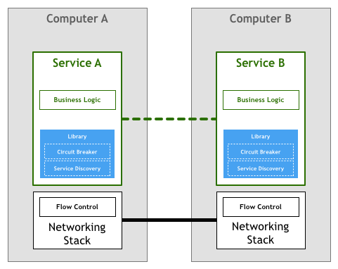](https://cosmos-1251905798.cos.ap-beijing.myqcloud.com/blog/2020-09-08_service-mesh-micro-service-lib.png)

这些可复用的类库和框架，确确实实带来了质量和效率上的大幅提升，但是也存在着下列问题：

- 并非完全透明：程序员们仍然需要正确理解和使⽤这些库，上手成本和出错概率依然很高。
- 限制技术选择：使用这些技术后，应用很容易就会被对应的语⾔和框架强绑定（vendor-lock）。
- 维护成本高：库版本升级，需要牵连应⽤一起重新构建和部署；麻烦不说，还要祈祷别出故障。

#### 服务通信：Sidecar

像网络协议栈发展的过程一样，将大规模分布式服务所需要的功能剥离出来集成到底层平台是一个众望所归的选择。人们通过应用层的协议(例如HTTP)写出了很多复杂的应用程序和服务，甚至不用考虑TCP是如何控制数据包在网络上传输的。这就是我们微服务所需要的，从事服务开发的工程师们可以专注于业务逻辑的开发，避免浪费时间去编写服务基础设施代码或者管理这些库和框架。

在这个想法下，我们可以得到类似于如下的图：

[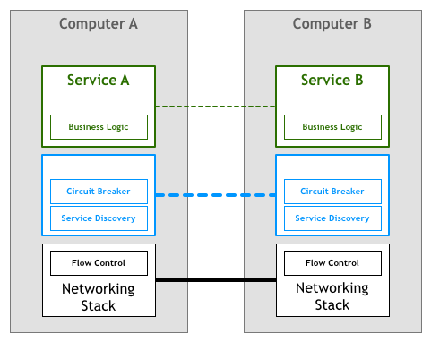](https://cosmos-1251905798.cos.ap-beijing.myqcloud.com/blog/2020-09-08_service-mesh-protocol.png)

不幸的是，更改协议栈来增加微服务的功能不是一个可行的方案，许多开发者是通过一组代理来实现此功能。这里的设计思想是**服务不需要和下游服务直连，所有的流量都通过该代理透明的来实现对应的功能**。这里的透明代理，通过一种叫做 Sidecar 的模式来运行，Sidecar将上述类库和框架要干的事情从应用中彻底剥离了出来，并统一下沉到了基础设施层，这其中的典型代表就是 Linkerd 和 Envoy。

[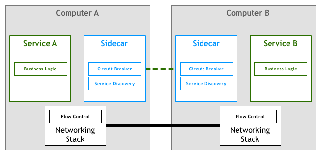](https://cosmos-1251905798.cos.ap-beijing.myqcloud.com/blog/2020-09-08_service-mesh-sidecar.png)

#### 服务通信：Service Mesh

在这种模型中，每个服务都会有一个配套的代理SideCar。考虑到服务之间的通信仅仅通过SideCar代理，我们最终得到如下的部署图：

[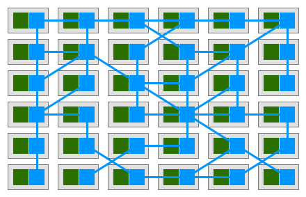](https://cosmos-1251905798.cos.ap-beijing.myqcloud.com/blog/2020-09-08_service-mesh-data.png)

Buoyant的CEO William Morgan ，发现了各个SideCar代理之间互联组成了一个网状网络，称为服务网格。

Service Mesh是一个用于服务和服务之间通信的专用基础设施层。它负责服务请求能够在复杂的服务拓扑(组成了云原生应用)中可靠的进行投递。在实践中，Serivce Mesh的典型实现是作为轻量级网络代理阵列，部署在应用程序旁边，不需要业务进程感知到。

William关于Service Mesh的定义中，最有说服力的一点是，他不再将SideCar代理视为一个独立组件，而是承认了**它们组成的网络像它们自身一样是有价值的**

[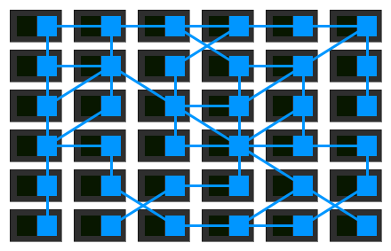](https://cosmos-1251905798.cos.ap-beijing.myqcloud.com/blog/2020-09-08_service-mesh-data2.png)

随着很多公司将它们的微服务部署到更复杂的系统运行环境中，例如Kubernetes和Mesos，人们开始使用这些平台提供的工具来实现合适的Serivce Mesh的想法。它们将独立的SideCar代理从独立的工作环境中转移到一个适当的，有集中的控制面。

[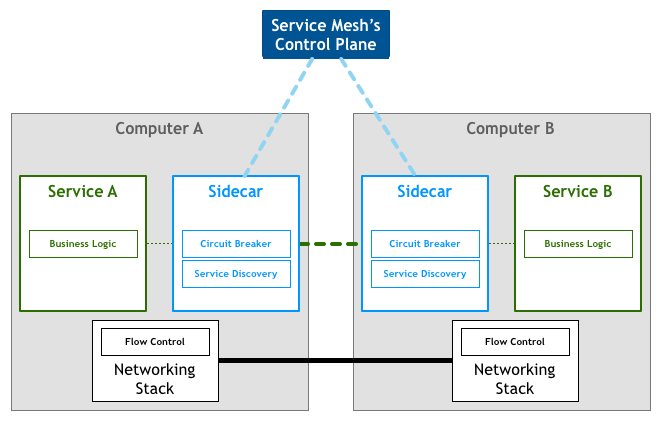](https://cosmos-1251905798.cos.ap-beijing.myqcloud.com/blog/2020-09-08_service-mesh-control.png)

看下我们的鸟瞰图，服务之间的流量仍然是通过SideCar代理来进行转发，但是控制平面知道每个SideCar实例。控制平面能够让代理实现例如访问控制，指标收集等需要协作完成的事情。Istio是这个模型的典型实现。

[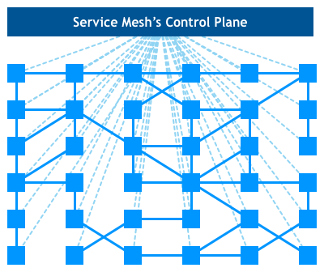](https://cosmos-1251905798.cos.ap-beijing.myqcloud.com/blog/2020-09-08_service-mesh-control2.png)

如果用一句话来解释什么是Service Mesh，**可以将其比作微服务间的TCP/IP层**，负责服务之间的调用、限流、熔断和监控等。PS：如果你熟悉linux内核，就不会把协程和线程认为是两个东西。类似的，如果你熟悉通信协议分层，就不会把Service Mesh 和TCP 认为是两个东西。

### Kube-proxy vs Sidecar

下图展示的是 Kubernetes 与 Service Mesh 中的的服务访问关系：

[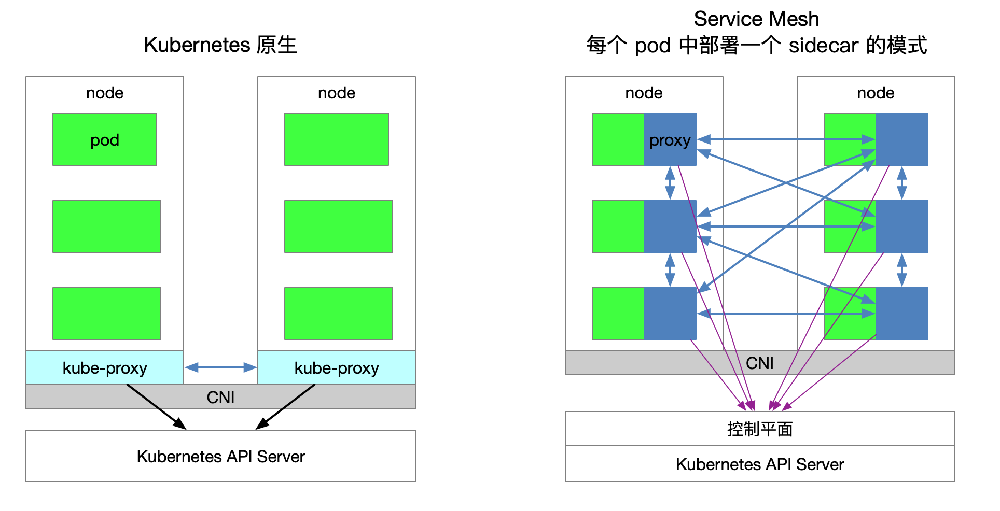](https://cosmos-1251905798.cos.ap-beijing.myqcloud.com/blog/2020-09-08_k8s-vs-service-mesh.png)

- Kubernetes 集群的每个节点都部署了一个 kube-proxy 组件，该组件会与 Kubernetes API Server 通信，获取集群中的 Service 信息，然后设置 iptables 规则，直接将对某个 Service 的请求发送到对应的 Endpoint（属于同一组 Service 的 Pod）上。
- Kube-proxy 实现了流量在 Kubernetes Service 多个 Pod 实例间的负载均衡，但是如何对这些 Service 间的流量做细粒度的控制，比如按照百分比划分流量到不同的应用版本（这些应用都属于同一个 Service，但位于不同的 deployment 上），做金丝雀发布（灰度发布）和蓝绿发布？

kube-proxy 的设置都是全局生效的，无法对每个服务做细粒度的控制，而 Service Mesh 通过 Sidecar proxy 的方式将 Kubernetes 中对流量的控制从 Service 一层抽离出来，可以做更多的扩展。
