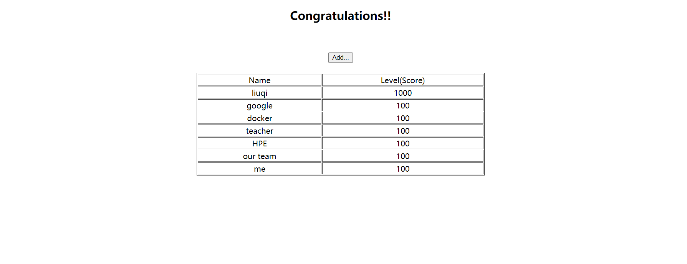

# 一个简单的例子

1. 安装k8s集群

2. 下载相关镜像

```
docker pull kubeguide/tomcat-app:v2
#需要下载5.7版本的mysql镜像，否则可能出现兼容性问题
docker pull mysql:5.7
#使用docker images查看镜像
docker images
```

3. 创建mysql的rc文件mysql-rc.yaml

```
apiVersion: v1
kind: ReplicationController
metadata:
  name: mysql
spec:
  replicas: 1
  selector:
    app: mysql
  template:
    metadata:
      labels:
        app: mysql
    spec:
      containers:
      - name: mysql
        image: mysql
        imagePullPolicy: IfNotPresent
        ports:
        - containerPort: 3306
        env:
        - name: MYSQL_ROOT_PASSWORD
          value: "123456"
```

执行以下命令将rc发布到集群(需要进入该文件所在的目录执行)：

`kubectl create -f mysql-rc.yaml`

4. 等待容器创建完成，可使用以下命令查看创建状态

```
kubectl get po
kubectl get rc
kubectl descirbe po pod名称
```

5. 创建mysql Service文件mysql-svc.yaml

```
apiVersion: v1
kind: Service
metadata:
  name: mysql
spec:
  ports:
    - port: 3306
  selector:
    app: mysql
```

执行以下命令将服务发布到集群：

`kubectl create -f mysql-svc.yaml`

6. 构建Tomcat的rc文件，myweb-rc.yaml

```
apiVersion: v1
kind: ReplicationController
metadata:
  name: myweb
spec:
# Pod的数量
  replicas: 1
  selector:
    app: myweb
  template:
    metadata:
      labels:
        app: myweb
#   容器组的定义
    spec:
      containers:
#       容器名称
        - name: myweb
#         容器对应的镜像
          image: kubeguide/tomcat-app:v1
          imagePullPolicy: IfNotPresent
          ports:
#         在8080端口上启动容器进程，PodIP与容器端口组成Endpoint，代表着一个服务进程对外通信的地址
          - containerPort: 8080
          env:
#此处如果在未安装域名解析的情况下，会无法将mysql对应的IP解析到env环境变量中，因此先注释掉！
#          - name: MYSQL_SERVICE_HOST
#            value: 'mysql'
          - name: MYSQL_SERVICE_PORT
            value: '3306'
```

7. 构建Tomcat的Service文件myweb-svc.yaml

```
apiVersion: v1
kind: Service
metadata: 
  name: myweb
spec:
  type: NodePort
  ports:
    - port: 8080
      nodePort: 30001
  selector:
    app: myweb
```

使用以下命令发布到集群：

`kubectl create -f myweb-svc.yaml`

8. 等待Pod成功启动，之后在浏览器输入`虚拟机IP:30001`即可访问Tomcat主页，输入`虚拟机IP:30001/demo`即可看到：



可点击add向数据库添加记录。
