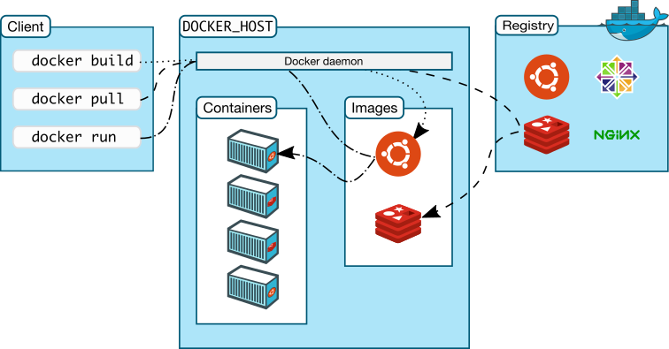
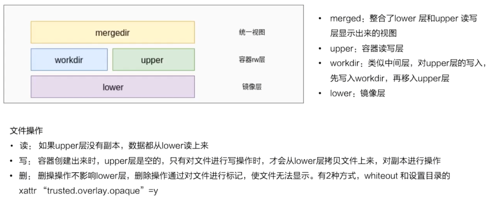

原理：cgroup+namespace+docker image

# 资源隔离与限制

如果要自己实现一个资源隔离的容器，应该从哪些方面下手呢？

也许你第一反应可能就是 chroot 命令，这条命令给用户最直观的感觉就是使用后根目录 / 的挂载点切换了，即文件系统被隔离了。

然后，为了在分布式的环境下进行通信和定位，容器必然需要一个独立的 IP、端口、路由等等，自然就想到了网络的隔离。

同时，你的容器还需要一个独立的主机名以便在网络中标识自己。

想到网络，顺其自然就想到通信，也就想到了进程间通信的隔离。

可能你也想到了权限的问题，对用户和用户组的隔离就实现了用户权限的隔离。

最后，运行在容器中的应用需要有自己的 PID, 自然也需要与宿主机中的 PID 进行隔离。

## namespace

mount：容器见到的文件系统的隔离

uts：hostname和domain name的隔离

pid：保证容器中进程是1号进程启动的

network：网络空间隔离，网络设备，网络栈，端口等

user：用户uid和gid在容器内部和虚拟机上的映射，实现用户和用户组的隔离

ipc：进程间通信的信号量等的隔离

namespace相关API：

- 可以通过clone函数在创建进程的同时，创建namespace
- 查看/proc/[pid]/ns 文件，可以看到指向不同namespace号的文件，如果两个pid指向相同的namespace，则他们位于同一个namespace下

```

$ ls -l /proc/$$/ns         <<-- $$ 表示应用的 PID
total 0
lrwxrwxrwx. 1 mtk mtk 0 Jan  8 04:12 ipc -> ipc:[4026531839]
lrwxrwxrwx. 1 mtk mtk 0 Jan  8 04:12 mnt -> mnt:[4026531840]
lrwxrwxrwx. 1 mtk mtk 0 Jan  8 04:12 net -> net:[4026531956]
lrwxrwxrwx. 1 mtk mtk 0 Jan  8 04:12 pid -> pid:[4026531836]
lrwxrwxrwx. 1 mtk mtk 0 Jan  8 04:12 user->user:[4026531837]
lrwxrwxrwx. 1 mtk mtk 0 Jan  8 04:12 uts -> uts:[4026531838]
```

- 通过setns可以加入一个已经存在的namespace

### UTS namespace

UNIX-Time-sharing System namespace，提供了主机名和域名的隔离，这样每个容器就可以拥有单独的主机名和域名，在网络上被视为一个独立的节点而非宿主机的一个进程。

UTS隔离demo：

```

//[...]
int child_main(void* arg) {
    printf(" 在子进程中!\n");
    sethostname("Changed Namespace", 12);
    execv(child_args[0], child_args);
    return 1;
}

int main() {
    //[...]
    int child_pid = clone(child_main, child_stack+STACK_SIZE,
                          CLONE_NEWUTS | SIGCHLD, NULL);
    //[...]
}
```

输出：

```
 
root@local:~# gcc -Wall namespace.c -o main.o && ./main.o
程序开始:
在子进程中!
root@NewNamespace:~# exit
exit
已退出
root@local:~#  <- 回到原来的 hostname
```

如果没有创建新的namespace，那么将直接修改宿主机的hostname。

### IPC namespace

interprocess communication namespace

目前使用 IPC namespace 机制的系统不多，其中比较有名的有 PostgreSQL。Docker 本身通过 socket 或 tcp 进行通信。

### PID namespace

PID namespace 隔离非常实用，它对进程 PID 重新标号，即两个不同 namespace 下的进程可以有同一个 PID。每个 PID namespace 都有自己的计数程序。内核为所有的 PID namespace 维护了一个树状结构，最顶层的是系统初始时创建的，我们称之为 root namespace。他创建的新 PID namespace 就称之为 child namespace（树的子节点），而原先的 PID namespace 就是新创建的 PID namespace 的 parent namespace（树的父节点）。通过这种方式，不同的 PID namespaces 会形成一个等级体系。所属的父节点可以看到子节点中的进程，并可以通过信号等方式对子节点中的进程产生影响。反过来，子节点不能看到父节点 PID namespace 中的任何内容。

每个 PID namespace 中的第一个进程“PID 1“，都会像传统 Linux 中的 init 进程一样拥有特权，起特殊作用。

一个 namespace 中的进程，不可能通过 kill 或 ptrace 影响父节点或者兄弟节点中的进程，因为其他节点的 PID 在这个 namespace 中没有任何意义。

如果你在新的 PID namespace 中重新挂载 /proc 文件系统，会发现其下只显示同属一个 PID namespace 中的其他进程。

在 root namespace 中可以看到所有的进程，并且递归包含所有子节点中的进程。

```

//[...]
int child_pid = clone(child_main, child_stack+STACK_SIZE,
          CLONE_NEWPID | CLONE_NEWIPC | CLONE_NEWUTS 
          | SIGCHLD, NULL);
//[...]
```

ouput：

```

root@local:~# gcc -Wall pid.c -o pid.o && ./pid.o
程序开始:
在子进程中!
root@NewNamespace:~# echo $$   # 当前shell的pid
1                      <<-- 注意此处看到 shell 的 PID 变成了 1
root@NewNamespace:~# exit
exit
已退出
```

### MOUNT namespace

Mount namespace 通过隔离文件系统挂载点对隔离文件系统提供支持，它是历史上第一个 Linux namespace，所以它的标识位比较特殊，就是 CLONE_NEWNS。隔离后，不同 mount namespace 中的文件结构发生变化也互不影响。你可以通过 /proc/[pid]/mounts 查看到所有挂载在当前 namespace 中的文件系统，还可以通过 /proc/[pid]/mountstats 看到 mount namespace 中文件设备的统计信息，包括挂载文件的名字、文件系统类型、挂载位置等等。

进程在创建 mount namespace 时，会把当前的文件结构复制给新的 namespace。新 namespace 中的所有 mount 操作都只影响自身的文件系统，而对外界不会产生任何影响。这样做非常严格地实现了隔离，但是某些情况可能并不适用。

### Network namespace

Network namespace 主要提供了关于网络资源的隔离，包括网络设备、IPv4 和 IPv6 协议栈、IP 路由表、防火墙、/proc/net 目录、/sys/class/net 目录、端口（socket）等等。一个物理的网络设备最多存在在一个 network namespace 中，你可以通过创建 veth pair（虚拟网络设备对：有两端，类似管道，如果数据从一端传入另一端也能接收到，反之亦然）在不同的 network namespace 间创建通道，以此达到通信的目的。

在建立起veth pair之前，新旧 namespace 通过管道通信。

创建一个新的network namespace 时会默认创建一个回环设备，确保network namespace不被回收。

### User namespace

提供用户和用户组的隔离

一个普通用户的进程通过clone() 创建的新进程在新user namespace 中可以拥有不同的用户和用户组。这意味着一个进程在容器外属于一个没有特权的普通用户，但是他创建的容器进程却属于拥有所有权限的超级用户，这个技术为容器提供了极大的自由。

## cgroups

[https://www.infoq.cn/article/docker-kernel-knowledge-cgroups-resource-isolation](https://www.infoq.cn/article/docker-kernel-knowledge-cgroups-resource-isolation)

cgroups 是Linux内核提供的一种可以限制单个进程或者多个进程所使用资源的机制，可以对 cpu，内存等资源实现精细化的控制，Docker 就使用了 cgroups 提供的资源限制能力来完成cpu，内存等部分的资源控制。

cgroups 的全称是control groups，cgroups为每种可以控制的资源定义了一个子系统。

典型的子系统介绍如下：

1. cpu 子系统，主要限制进程的 cpu 使用率。
2. cpuacct 子系统，可以统计 cgroups 中的进程的 cpu 使用报告。
3. cpuset 子系统，可以为 cgroups 中的进程分配单独的 cpu 节点或者内存节点。
4. memory 子系统，可以限制进程的 memory 使用量。
5. blkio 子系统，可以限制进程的块设备 io。
6. device 子系统，可以控制进程能够访问某些设备。
7. net_cls 子系统，可以标记 cgroups 中进程的网络数据包，然后可以使用 tc 模块（traffic control）对数据包进行控制。
8. freezer 子系统，可以挂起或者恢复 cgroups 中的进程。
9. ns 子系统，可以使不同 cgroups 下面的进程使用不同的 namespace。

两种cgroup驱动：

- systemd
- cgroupfs

容器中用到的cgroup：

- cpu
- memory
- device
- freezer
- blkio

使用：创建不同的配置节点，挂载到进程上。

# 容器镜像

- 基于联合文件系统
- 不同的层可以被其他镜像复用
- 容器的可写层可以做成镜像新的一层（通过commit操作）

联合文件系统：允许文件放在不同的层，但是可以通过一个统一的视图看到这些层级上面的所有文件。

## overlay文件系统



workdir：相当于临时文件目录

# 容器引擎
