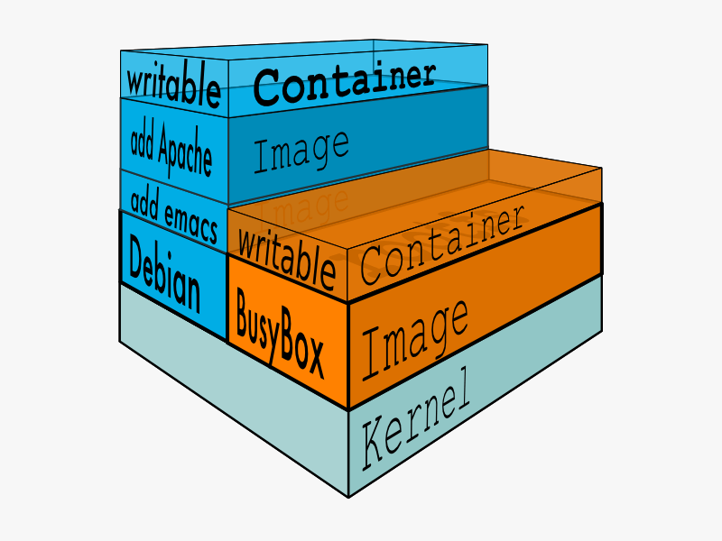
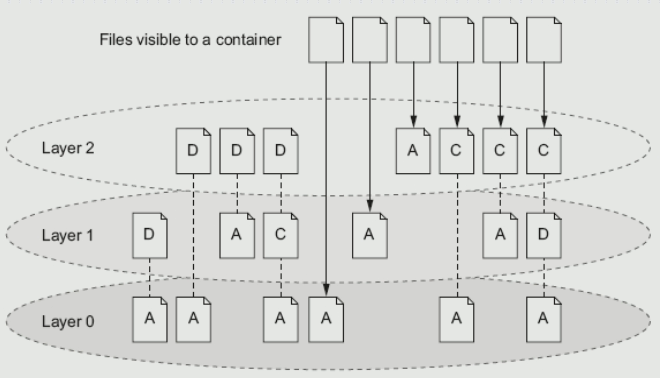
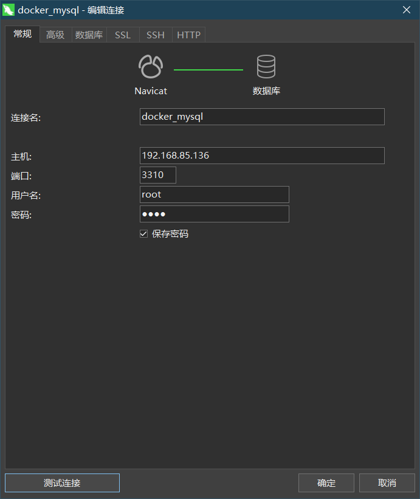
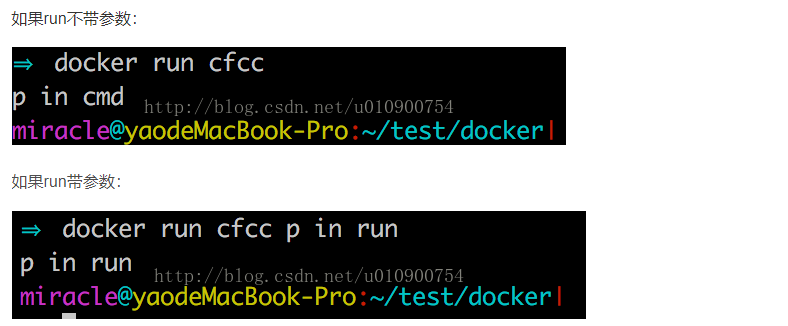

Docker是一个开发人员与运维人员使用容器来构建，运行和分享自己的应用程序的平台。使用容器来部署应用被称为容器化。

容器化技术的优点有：

- 灵活

- 轻量级

- 可移植性

- 低耦合

- 可伸缩

- 安全

# Overview

由于不同的机器有不同的操作系统，以及不同的库和组件，在将一个应用部署到多台机器上需要进行大量的环境配置操作。

Docker 主要解决环境配置问题，它是一种虚拟化技术，对进程进行隔离，被隔离的进程独立于宿主操作系统和其它隔离的进程。使用 Docker 可以不修改应用程序代码，不需要开发人员学习特定环境下的技术，就能够将现有的应用程序部署在其它机器上。

docker能够将应用构建成统一的镜像，方便部署。

# Docker安装

1. 安装Centos7

2. 编写并运行以下Shell脚本，可根据实际情况修改Docker版本

```
# Install Docker CE
## Set up the repository
### Install required packages.
yum install -y yum-utils device-mapper-persistent-data lvm2

### Add Docker repository.
yum-config-manager --add-repo \
  http://mirrors.aliyun.com/docker-ce/linux/centos/docker-ce.repo

## Install Docker CE, change version according to your need.
## docker-ce-cli containerd.io will be downloaded automatically as depends
yum makecache fast&&yum update -y && yum install -y docker-ce-19.03.4 

## Create /etc/docker directory.
mkdir /etc/docker

# Setup daemon
# https://q7mzry7x.mirror.aliyuncs.com is my address, visit aliyun, get your own aliyun key and edit the script accordingly.
cat > /etc/docker/daemon.json <<EOF
{
    "exec-opts": ["native.cgroupdriver=systemd"],
    "log-driver": "json-file",
    "log-opts": {
        "max-size": "100m",
        "max-file": "10"
    },
    "oom-score-adjust": -1000,
    "registry-mirrors": ["https://q7mzry7x.mirror.aliyuncs.com"],
    "storage-driver": "overlay2",
    "storage-opts":["overlay2.override_kernel_check=true"],
    "live-restore": false
}
EOF

mkdir -p /etc/systemd/system/docker.service.d

# Restart Docker,  enable docker
systemctl daemon-reload
systemctl enable docker
systemctl restart docker
```

# 制作helloworld镜像(C language)

1. 创建文件夹

```
cd ~
mkdir hello-image
```

2. 写c程序hello-world并编译

```
vi hello.c
#include <stdio.h>
int main()
{
	printf("hello,world!");
}
:wq
gcc -static hello.c -o hello
```

3. 创建dockerfile并build

```
vim dockerfile

FROM centos
ADD hello /
CMD "\hello"
:wq

[root@docker hello-image]# docker build -t hello .
Sending build context to Docker daemon  864.8kB
Step 1/3 : FROM centos
 ---> 0d120b6ccaa8
Step 2/3 : ADD hello /
 ---> d88421b7e0b0
Step 3/3 : CMD "/hello"
 ---> Running in b693d6a033b0
Removing intermediate container b693d6a033b0
 ---> 15b859fbca54
Successfully built 15b859fbca54
Successfully tagged hello:latest
```

4. 运行

```
[root@docker hello-image]# docker run hello
hello,world!
```

# Docker 常用命令

官方地址：[https://docs.docker.com/reference/](https://docs.docker.com/reference/)

## 帮助命令

```
docker version  #docker版本
docker info		#docker详细信息
docker xxx --help #关于某命令的帮助信息
```

## 镜像命令

镜像是一种静态的结构，可以看成面向对象里面的类，而容器是镜像的一个实例。

镜像包含着容器运行时所需要的代码以及其它组件，它是一种分层结构，每一层都是只读的（read-only layers）。构建镜像时，会一层一层构建，前一层是后一层的基础。镜像的这种分层存储结构很适合镜像的复用以及定制。

构建容器时，通过在镜像的基础上添加一个可写层（writable layer），用来保存着容器运行过程中的修改。



### docker images

查看所有本地的主机上的镜像，按创建时间由近到远排序

```
[root@docker ~]# docker images
REPOSITORY          TAG                 IMAGE ID            CREATED             SIZE
tomcat              latest              f796d3d2c195        12 days ago         647MB
nginx               latest              7e4d58f0e5f3        2 weeks ago         133MB
hello-world         latest              bf756fb1ae65        8 months ago        13.3kB
```

可选项：

|   |   |
|---|---|
|docker images -a或者 --all|只显示镜像的ID|
|**docker images --filter "xxx"或者 -f "xxx"`**|**显示符合条件的镜像**|

查看本地所有镜像

`docker images -q`或者`docker images --quiet`

```
[root@docker ~]# docker images -q
f796d3d2c195
7e4d58f0e5f3
bf756fb1ae65
```

列出满足某条件的容器

```
$ docker images --filter "label=com.example.version"

REPOSITORY          TAG                 IMAGE ID            CREATED              SIZE
match-me-1          latest              eeae25ada2aa        About a minute ago   188.3 MB
match-me-2          latest              dea752e4e117        About a minute ago   188.3 MB
```

### docker search

在docker hub搜索镜像。

```
[root@docker ~]# docker search redis
NAME                             DESCRIPTION                                     STARS               OFFICIAL            AUTOMATED
redis                            Redis is an open source key-value store that…   8604                [OK]                
bitnami/redis                    Bitnami Redis Docker Image                      162                                     [OK]
sameersbn/redis                                                                  81                                      [OK]
grokzen/redis-cluster            Redis cluster 3.0, 3.2, 4.0, 5.0, 6.0           71                                      
rediscommander/redis-commander   Alpine image for redis-commander - Redis man…   47                                      [OK]
kubeguide/redis-master           redis-master with "Hello World!"                33                                      
redislabs/redis                  Clustered in-memory database engine compatib…   27                                      
redislabs/redisearch             Redis With the RedisSearch module pre-loaded…   24                                      
oliver006/redis_exporter          Prometheus Exporter for Redis Metrics. Supp…   22                                      
.......
```

|   |   |
|---|---|
|`docker search --filter stars = 100`|只显示Star超过100的镜像|
|`**docker search --limit 10**`|**仅显示排名前十的镜像**|

### docker pull

从镜像仓库下载指定镜像

```
#下载最新版本star数最高的activemq
[root@docker ~]# docker pull webcenter/activemq
Using default tag: latest
latest: Pulling from webcenter/activemq
7dcf5a444392: Pull complete 
9eebba75a87f: Pull complete 
1f0440d87cc7: Pull complete 
dacd0555c1b4: Pull complete 
b0f19aa05a94: Pull complete 
4796f64423b2: Pull complete 
5d994b710cb9: Pull complete 
313a84c05d3c: Pull complete 
1d6a562461f1: Pull complete 
e25558998b21: Pull complete 
1423ae5a1b0b: Pull complete 
8d4e082d1ca6: Pull complete 
098d68aaa4ae: Pull complete 
Digest:
# 签名
sha256:35015988c4047a2ab1888466f5aae30420f7addde4c467e5db9ae64eea6b47b0
Status: Downloaded newer image for webcenter/activemq:latest
docker.io/webcenter/activemq:latest

#下载指定版本的activemq（需要先到dockerHub查询可下载的activemq版本）
docker pull rmohr/activemq:5.10.1
```

### docker rmi

删除容器

`docker rmi [OPTIONS] IMAGE [IMAGE...]`

```
#-f 强制删除
docker rmi -f hello-world
#批量删除
docker rmi -f $(docker images -aq)
```

### docker history

`docker history imageID`:查看容器构建过程

```
[root@docker docker_test_volume]# docker history ef08065b0a30 
IMAGE               CREATED             CREATED BY                                      SIZE                COMMENT
ef08065b0a30        5 weeks ago         /bin/sh -c #(nop)  CMD ["mysqld"]               0B                  
<missing>           5 weeks ago         /bin/sh -c #(nop)  EXPOSE 3306 33060            0B                  
<missing>           5 weeks ago         /bin/sh -c #(nop)  ENTRYPOINT ["docker-entry…   0B                  
<missing>           5 weeks ago         /bin/sh -c ln -s usr/local/bin/docker-entryp…   34B                 
<missing>           5 weeks ago         /bin/sh -c #(nop) COPY file:7cbb26bbdb8e71b3…   13.2kB              
<missing>           5 weeks ago         /bin/sh -c #(nop)  VOLUME [/var/lib/mysql]      0B                  
<missing>           5 weeks ago         /bin/sh -c {   echo mysql-community-server m…   313MB               
<missing>           5 weeks ago         /bin/sh -c echo "deb http://repo.mysql.com/a…   55B                 
<missing>           5 weeks ago         /bin/sh -c #(nop)  ENV MYSQL_VERSION=5.7.31-…   0B                  
<missing>           5 weeks ago         /bin/sh -c #(nop)  ENV MYSQL_MAJOR=5.7          0B                  
<missing>           5 weeks ago         /bin/sh -c set -ex;  key='A4A9406876FCBD3C45…   2.61kB              
<missing>           5 weeks ago         /bin/sh -c apt-get update && apt-get install…   52.2MB              
<missing>           5 weeks ago         /bin/sh -c mkdir /docker-entrypoint-initdb.d    0B                  
<missing>           5 weeks ago         /bin/sh -c set -eux;  savedAptMark="$(apt-ma…   4.17MB              
<missing>           5 weeks ago         /bin/sh -c #(nop)  ENV GOSU_VERSION=1.12        0B                  
<missing>           5 weeks ago         /bin/sh -c apt-get update && apt-get install…   9.34MB              
<missing>           5 weeks ago         /bin/sh -c groupadd -r mysql && useradd -r -…   329kB               
<missing>           5 weeks ago         /bin/sh -c #(nop)  CMD ["bash"]                 0B                  
<missing>           5 weeks ago         /bin/sh -c #(nop) ADD file:e7407f2294ad23634…   69.2MB
```

## 容器命令

镜像是容器的基础，有了镜像才可以创建容器，为了测试容器命令，先下载一个centos镜像，`docker pull centos`。

### docker run

形式：`$ docker run [OPTIONS] IMAGE[:TAG|@DIGEST] [COMMAND] [ARG...]`

参数：

|   |   |
|---|---|
|参数|描述|
|--name = "xxx"|指定容器名，用来区分容器|
|-it或者--interactive --terminal|以交互模式通过终端查看容器|
|-d或者--detach|后台运行容器并打印其ID|
|-p或者--publish|向host映射容器的端口|
|-P或者--publish-all , -P|将容器暴露的端口随即映射到主机的端口|

示例：

```
[root@docker ~]# docker run -it centos /bin/bash
[root@53e748e96156 /]# ls
bin  dev  etc  home  lib  lib64  lost+found  media  mnt  opt  proc  root  run  sbin  srv  sys  tmp  usr  var
[root@53e748e96156 /]# exit
exit
```

后台启动容器：

```
docker run -d centos
#运行后会返回容器ID，但之后由于没有前台进程，容器会立即停止
#向外提供服务的容器不会自动停止，例如nginx，activemq...
```

### docker ps

列出当前正在运行的容器。

查看所有容器：`docker ps -a`(包括曾经运行但已经退出的容器)。

查看最近创建的10个容器：`docker ps -n 10`

查看当前正在运行的容器的ID：`docker ps -q`或`docker ps --quiet`

容器参数：

- CONTAINER ID：容器ID，是一个64位的十六进制整数，能够唯一的标识一个容器。

- IMAGE：创建容器时使用的镜像。

- COMMAND：容器最后运行的命令。

- CREATED：容器创建时间。

- STATUS：容器状态。

- PORTS：容器对外开放的端口。

- NAMES：容器名。

### 退出容器

|   |   |
|---|---|
|名称|描述|
|exit|退出并停止容器|
|Ctrl+P+Q|退出容器，但不停止容器|

### docker rm

删除指定的容器

|   |   |
|---|---|
|名称|描述|
|--force,-f|强制删除正在运行中的容器|

删除所有容器：`docker rm -f $(docker ps -aq)`

### 启动和停止容器

|   |   |
|---|---|
|命令|描述|
|docker start|启动一个容器|
|docker restart|重启一个容器|
|docker stop|停止一个容器|
|docker kill|强制停止一个容器|

### docker logs

查看日志

|   |   |
|---|---|
|参数|描述|
|--follow或者-f|控制台一直打印日志|
|--tail|打印最近的若干条日志|

示例：

```
[root@docker ~]# docker logs --tail 3 nginx1 
10-listen-on-ipv6-by-default.sh: Enabled listen on IPv6 in /etc/nginx/conf.d/default.conf
/docker-entrypoint.sh: Launching /docker-entrypoint.d/20-envsubst-on-templates.sh
/docker-entrypoint.sh: Configuration complete; ready for start up
```

### docker inspect

查看容器的所有信息

```
[root@docker ~]# docker inspect nginx1
[
    {
        "Id": "d8f904dee613058ec2108a898fdc969e02367acd23173a890b2dd1c284e59695",
        "Created": "2020-09-29T01:51:59.407435006Z",
        "Path": "/docker-entrypoint.sh",
        "Args": [
            "nginx",
            "-g",
            "daemon off;"
        ],
        "State": {
            "Status": "running",
            "Running": true,
            "Paused": false,
            "Restarting": false,
            "OOMKilled": false,
            "Dead": false,
            "Pid": 2118,
            "ExitCode": 0,
            "Error": "",
......
```

### docker exec

`docker exec [OPTIONS] CONTAINER COMMAND [ARG...]`

在一个运行中的容器中执行命令

```
# 进入一个正在运行的centos容器(执行centos中的bash命令),开启一个新的终端
docker exec -it centos1 /bin/bash
# 之后使用exit并不会停止容器，因为容器还有一个终端在运行
```

### docker attach

进入容器正在执行的终端

```
docker attach 容器ID|容器名
#使用exit会停止容器
```

### docker save

```
docker save -o a.tar mynginx:v1
```

### docker load

```
docker load -i a.tar
```

## 可视化

- Portainer

- Rancher

# 数据持久化

## 背景

docker镜像由**多个只读层叠加而成**，启动容器时，docker会**加载所有只读镜像层并在镜像栈顶部加一个读写层；**如果运行中的容器修改了现有的一个只读镜像层已经存在的文件，那该文件将会从下面的只读层复制到读写层，文件在只读层仍然存在，只是已经被读写层中该文件的副本所隐藏，此即“**写时复制(COW)”机制**。当删除该容器，并通过镜像重新启动一个容器后，之前的数据会消失，因此，需要一种机制，实现Docker镜像中数据的持久化存储，让新产生的容器依然能访问之前容器产生的数据。

**也可以通过 commit 操作，将对容器做出的更改添加到镜像层去。**

示意图：



## Volume数据卷

为了能够保存（持久化）数据以及共享容器间的数据，Docker提出了Volume数据卷的概念。Volume是容器上的一个或多个“目录”，此类目录**可绕过联合文件系统，与宿主机上的某个目录“绑定（关联）”。**

类似于挂载，宿主机的/data/web目录与容器中的/container/data/web目录绑定关系，然后容器中的进程向这个目录中写数据时，是直接写在宿主机的目录上的，绕过容器文件系统与宿主机的文件系统建立关联关系，让容器直接在宿主机的目录进行存取操作。

将两个容器的目录挂载到宿主机的同一Volume，即可实现容器间的数据共享。

在宿主机上能够被共享的目录(可以是文件)就被称为volume。

### 数据卷的作用

优点是容器中进程所生成的数据，都保存在存储卷上，从而脱离容器文件系统自身后，当容器被关闭甚至被删除时，都不用担心数据被丢失，实现数据可以**脱离容器生命周期而持久化保存**。当重新构造容器时，将它关联到与之前相同的存储卷上后，虽然不是之前的容器，但是数据还是之前的数据。特别类似于进程的运行逻辑，进程本身不保存任何的数据，数据都在进程之外的文件系统上，或者是专业的存储服务之上，所以进程每次停止，只是保存程序文件，对于容器也是一样；容器就是一个有生命周期的动态对象来使用，容器关闭就是容器删除的时候，但是它底层的镜像文件还是存在的，可以基于镜像再重新启动容器。

但是容器有一个问题，就是容器启动时选项比较多，下次再启动时，很容易忘记它启动时的配置，因此需要一个配置文件来保存容器的启动状态，这就是容器编排工具的作用。容器编排工具根据节点状况，用户需求等情况自动管理容器，在创建容器时读取配置文件，这样构造出来的容器和之前停止的容器能提供完全一样的服务。

数据卷的另一个优势是容器可以摆脱主机的限制，如几台主机后面挂载一个NFS，在各自主机上创建容器，把容器的目录挂载到NFS上，容器停止后就可以在另一台集群中的节点上重新启动，可以实现全集群范围内调试容器的使用，当再分配存储、计算资源时，就不会再局限于单机之上，可以在集群范围内建立起来，基本各种docker的编排工具都能实现此功能，但是后面严重依赖于共享存储的使用。

## 数据卷分类

Docker有两种数据卷

- Bind Mount Volume（绑定数据卷）：指定宿主机与容器中的两个特定目录进行绑定。

- Docker-managed Volume（Docker管理卷）：只需指定容器内的挂载路径，容器外路径由Docker指定。

### Bind Mount Volume

命令：`docker run -it -v 主机目录:容器目录`

示例：

```
[root@docker ~]# docker run -it -v /home/volume_test:/home --name c1 centos
[root@39fc513b4979 /]# ls
bin  dev  etc  home  lib  lib64  lost+found  media  mnt  opt  proc  root  run  sbin  srv  sys  tmp  usr  var
[root@39fc513b4979 /]# cd home
[root@39fc513b4979 home]# ls
[root@39fc513b4979 home]# touch nanshou.txt
[root@docker home]# cd /home/volume_test
[root@docker volume_test]# ls
nanshou.txt
[root@docker volume_test]# touch painful.txt
[root@docker volume_test]# docker start f1548075f8fe
f1548075f8fe
[root@docker volume_test]# docker attach f1548075f8fe
[root@f1548075f8fe /]# cd /home
[root@f1548075f8fe home]# ls
nanshou.txt  painful.txt
```

使用docker inspect查看容器挂载信息，可查找到以下信息：

```
"Mounts": [
            {
                "Type": "bind",
                "Source": "/home/volume_test",
                "Destination": "/home",
                "Mode": "",
                "RW": true,
                "Propagation": "rprivate"
            }
        ],
```

### Docker-managed Volume

命令：`docker run -it -v 容器目录`，也叫匿名挂载

命令：`docker run -it -v 卷名:容器目录`，具名挂载

示例：

```
#匿名挂载
#使用docker volume ls列出所有卷
[root@docker data]# docker volume ls
DRIVER              VOLUME NAME
local               2af6b01b362b7feee5a182fdac53de9e2a9cbeec162933525284edd69d3ae992
# 使用docker inspect 查看卷的详细信息
[root@docker data]# docker inspect 2af6b01b362b7feee5a182fdac53de9e2a9cbeec162933525284edd69d3ae992
[
    {
        "CreatedAt": "2020-09-29T19:18:02+08:00",
        "Driver": "local",
        "Labels": null,
        "Mountpoint": "/var/lib/docker/volumes/2af6b01b362b7feee5a182fdac53de9e2a9cbeec162933525284edd69d3ae992/_data",
        "Name": "2af6b01b362b7feee5a182fdac53de9e2a9cbeec162933525284edd69d3ae992",
        "Options": null,
        "Scope": "local"
    }
]
```

三种挂载方式

|   |   |
|---|---|
|挂载方式|命令|
|匿名挂载|-v 容器内路径|
|具名挂载|-v 卷名：容器内路径|
|指定路径挂载|-v 容器外路径：容器内路径|

**通过--volumes-from 可以实现两个容器共享卷**

### MYSQL安装

tips：数据持久化问题

1. 下载mysql镜像

2. 挂载数据卷

```
#需要配置密码，定义两个数据卷映射
#-v volume -e environment -p port -d daemon
docker run -d -p 3310:3306 -v /home/mysql/conf:/etc/mysql/conf.d -v /home/mysql/data:/var/lib/mysql -e MYSQL_ROOT_PASSWORD=root --name mysql001 mysql:5.7
```

3. 使用navicat连接数据库，主机为虚拟机地址，端口为-p后虚拟机3306映射到主机的端口，密码为-e后环境变量的值。



4. 查看本地/home/mysql下的文件

# Dockerfile

编写脚本生成docker镜像，步骤：

1. 编写Dockerfile

2. docker build构建

3. docker run运行

4. docker push发布镜像

## Dockerfile命令

**basis**：

- 每个指令都必须是大写的

- 从上到下顺序执行

- ‘#’表示注释

**将文件命名为Dockerfile时，docker build不需要指定-f+文件名**

**FROM：指定基础镜像**

```
#格式：
　　FROM <image>
　　FROM <image>:<tag>
　　FROM <image>@<digest>
#示例：
　　FROM mysql:5.6
#注：tag或digest是可选的，如果不使用这两个值时，会使用latest版本的基础镜像
```

**MAINTAINER：维护者信息(已废弃，推荐LABEL)**

```
#格式：
    MAINTAINER <name>
#示例：
    MAINTAINER Jasper Xu
    MAINTAINER sorex@163.com
    MAINTAINER Jasper Xu <sorex@163.com>   #推荐
```

**LABEL：用于为镜像添加元数据**

示例：

```
LABEL version="1.0" description="这是一个Web服务器" by="IT笔录"

docker inspect itbilu/test
"Labels": {
    "version": "1.0",
    "description": "这是一个Web服务器",
    "by": "IT笔录"
},
```

**RUN：构建镜像时执行的命令**

```
#格式：
#Shell执行：
    RUN <command>
#exec执行
    RUN ["executable", "param1", "param2"]
#示例：
    RUN ["executable", "param1", "param2"]
    RUN apk update
    RUN ["/etc/execfile", "arg1", "arg1"]
#注：RUN指令创建的中间镜像会被缓存，并会在下次构建中使用。如果不想使用这些缓存镜像，可以在构建时指定--no-cache参数，如：docker build --no-cache
```

**ADD：将本地文件添加到容器中，tar类型文件会自动解压(网络压缩资源不会被解压)，可以访问网络资源，类似wget**

```
#格式：
    ADD <src>... <dest>
    ADD ["<src>",... "<dest>"] 用于支持包含空格的路径
#示例：
    ADD hom* /mydir/          # 添加所有以"hom"开头的文件
    ADD hom?.txt /mydir/      # ? 替代一个单字符,例如："home.txt"
    ADD test relativeDir/     # 添加 "test" 到 `WORKDIR`/relativeDir/
    ADD test /absoluteDir/    # 添加 "test" 到 /absoluteDir/
```

**COPY：功能类似ADD，但是是不会自动解压文件，也不能访问网络资源**

**CMD：容器启动后执行的默认命令**

The main purpose of a CMD is to provide defaults for an executing container. These defaults can include an executable, or they can omit the executable, in which case you must specify an ENTRYPOINT instruction as well.

CMD是在没有ENTRYPOINT时，容器启动后执行的默认命令。

当docker run指令中指定了命令，CMD中的命令同样会被覆盖。

```
#格式：
    CMD ["executable","param1","param2"] (命令行模式，官方推荐)
    CMD ["param1","param2"] (设置了ENTRYPOINT，则直接调用ENTRYPOINT添加参数)
    CMD command param1 param2 (执行shell内部命令)
#示例：
	#shell形式的命令(默认添加了/bin/sh -c 作为前缀)
    CMD echo "This is a test." 
    #命令行模式
    CMD ["/bin/bash","-c","echo 'hello world!'"]
#注:CMD不同于RUN，CMD用于指定在容器启动时所要执行的命令，而RUN用于指定镜像构建时所要执行的命令。
```

**ENTRYPOINT：指定容器启动时运行的命令，可以追加命令**

An ENTRYPOINT allows you to configure a container that will run as an executable.

```
#格式
	ENTRYPOINT ["executable", "param1", "param2"] (exec form, preferred)
	ENTRYPOINT command param1 param2 (shell form)
#示例
	#命令行模式
	#使用命令行模式时，如果docker run中有参数或者CMD中中括号内有参数，则会将参数追加到ENTRYPOINT中
	CMD["yes"]
	ENTRYPOINT ["echo"]
	#shell模式，这种模式下CMD和docker run的参数不会被传递给ENTRYPOINT
	ENTRYPOINT echo "here you are"
```



**WORKDIR：工作目录，启动容器后进入的默认目录**

```
#格式：
    WORKDIR /path/to/workdir
#示例：
    WORKDIR /a  (这时工作目录为/a)
    WORKDIR b  (这时工作目录为/a/b)
    WORKDIR c  (这时工作目录为/a/b/c)
#通过WORKDIR设置工作目录后，Dockerfile中其后的命令RUN、CMD、ENTRYPOINT、ADD、COPY等命令都会在该目录下执行。在使用docker run运行容器时，可以通过-w参数覆盖构建时所设置的工作目录。
```

**VOLUME：用于指定持久化目录**

```
#格式：
    VOLUME /path/to/dir
#示例：
    VOLUME /data
    VOLUME /var/www, /var/log/apache2, /etc/apache2
```

**EXPOSE：指定于外界交互的端口**

```
#格式：
    EXPOSE <port> [<port>...]
#示例：
    EXPOSE 80 443
    EXPOSE 8080    
    EXPOSE 11211/tcp 11211/udp
```

**ENV：设置环境变量**

```
ENV LANG en_US.UTF-8
ENV LC_ALL en_US.UTF-8
```

## Test

Scratch镜像是DockerHub大多数镜像的基础镜像
