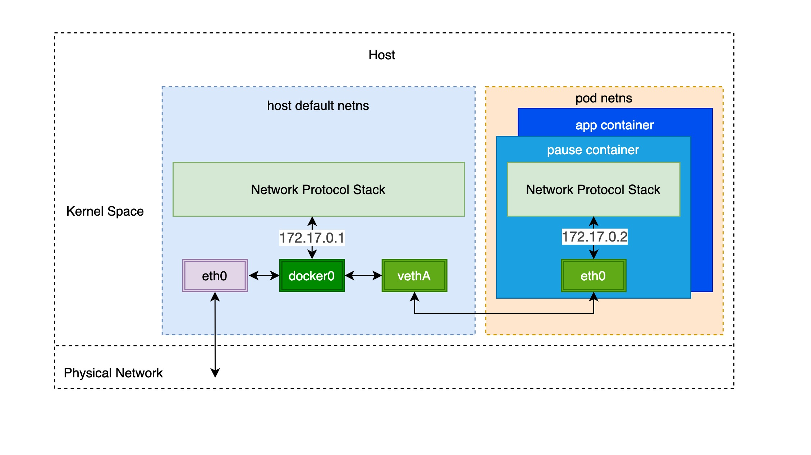
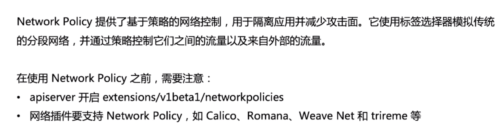
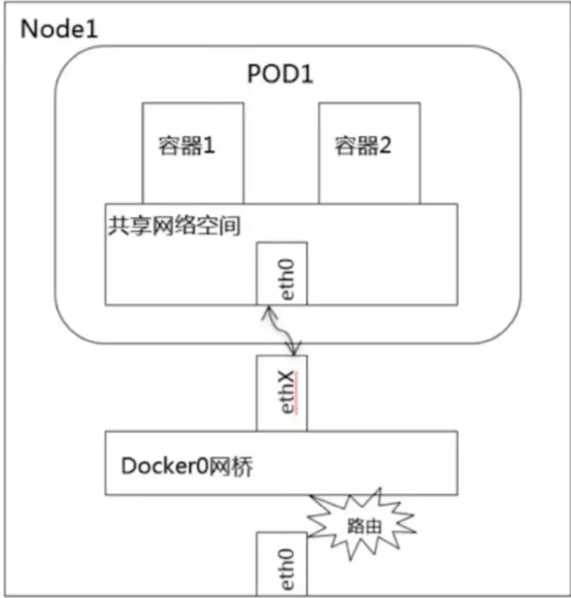
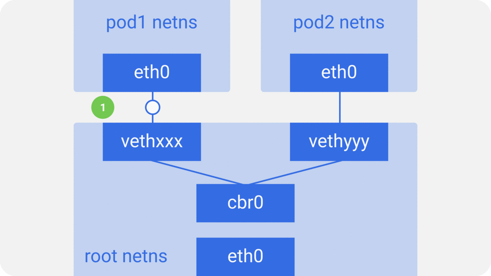
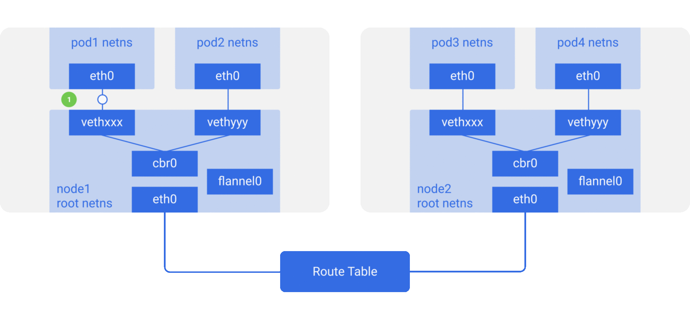
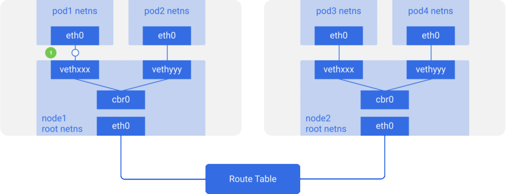
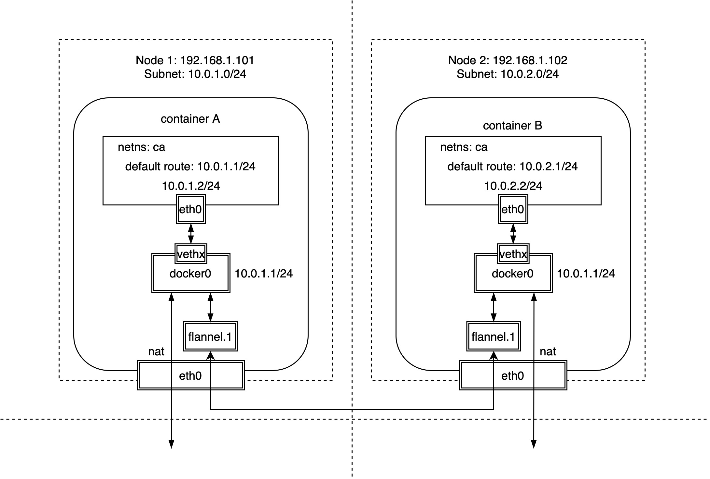
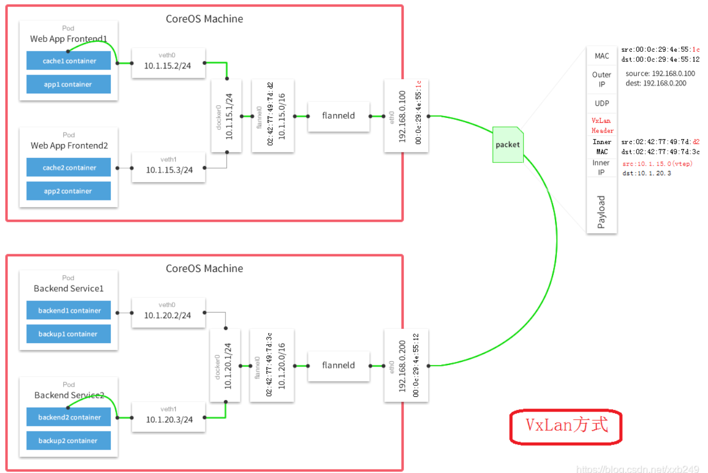
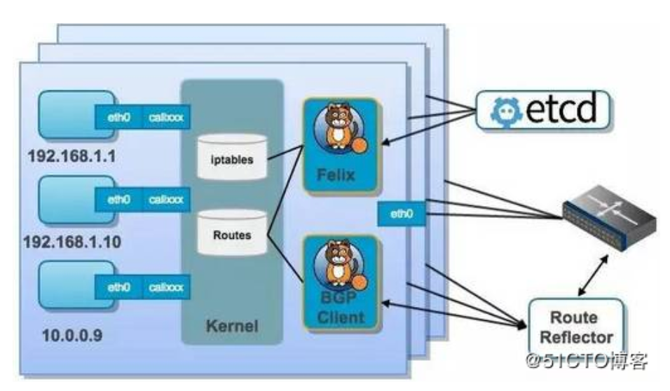
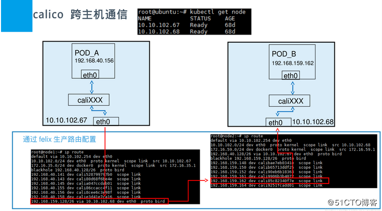

要解决的问题：

1. Pod间通信
2. Pod与Service通信
3. 集群外部与Service通信
4. Pod和集群外通信

# 容器网络

容器网络方案可分为Underlay/Overlay两大派别。

# NetNS



# Network Policy

用来对Pod之间的通信做限制。

k8s网络的基本模型是Pod之间全互通，因此需要做网络限制时，需要使用Network Policy做自定义限制。



# 容器通信

## Pod内容器通信



## 同节点间pod的通信

以docker举例，docker单机网络的模式主要有host（容器不拥有自己的网络空间，共享主机的，不同网络空间的容器仍然不通），container（把容器放进已有容器的网络空间内，其他文件系统、进程仍然隔离），none（容器拥有自己的Network Namespace，但是，并不为Docker容器进行任何网络配置。也就是说，这个Docker容器没有网卡、IP、路由等信息），bridge（容器连接到一个虚拟网桥上）

默认和最主要的方式是bridge。实现方式为veth pair（相当于网线）+网桥（相当于交换机），Pod1和Pod2都是通过Veth连接到同一个docker0网桥上的，它们的IP地址IP1、IP2都是从docker0的网段上动态获取的，它们和网桥本身的IP3是同一个网段的。Docker 会从 RFC1918 所定义的私有 IP 网段中，选择一个和宿主机不同的IP地址和子网分配给 docker0，如一般 Docker 会使用 172.17.0.0/16 这个网段，并将 172.17.42.1/16 分配给 docker0 网桥（在主机上使用 ifconfig 命令是可以看到 docker0 的，可以认为它是网桥的管理接口，在宿主机上作为一块虚拟网卡使用）



## 跨节点POD通信

docker0网段与宿主机网卡是两个完全不同的IP网段，并且不同Node之间的通信只能通过宿主机的物理网卡进行，因此要想实现不同Node上Pod容器之间的通信，就必须想办法通过主机的这个IP地址进行寻址和通信，所以就需要将Pod的IP和所在Node的IP关联起来，通过这个关联让Pod可以互相访问。

跨主机的Pod之间的相互通信也主要有以下两个思路：

1. 修改底层网络设备配置，加入容器网络IP地址的管理，修改路由器网关等，该方式主要和SDN(Software define networking)结合。
2. 完全不修改底层网络设备配置，复用原有的underlay平面网络，解决容器跨主机通信，主要有如下两种方式:

- 隧道传输(Overlay)： 将容器的数据包封装到原主机网络的三层或者四层数据包中，然后使用主机网络的IP或者TCP/UDP传输到目标主机，目标主机拆包后再转发给目标容器。Overlay隧道传输常见方案包括Vxlan、ipip等，目前使用Overlay隧道传输技术的主流容器网络有Flannel等；



- 修改主机路由：把容器网络加到主机路由表中，把主机网络设备当作容器网关，通过路由规则转发到指定的主机，实现容器的三层互通。目前通过路由技术实现容器跨主机通信的网络如Flannel host-gw、Calico等；



### CNI的具体实现举例：flannel

[https://blog.51cto.com/u_2010293/2781912](https://blog.51cto.com/u_2010293/2781912)

Flannel之所以可以搭建Kubernetes依赖的底层网络，是因为它能实现以下两点。

（1）它能协助Kubernetes，给每一个Node上的Docker容器都分配互相不冲突的IP地址，实现IP-PER-POD。

（2）它能在这些IP地址之间建立一个**覆盖网络（Overlay Network**），通过这个覆盖网络，将数据包原封不动地传递到目标容器内。

overlay：Overlay网络是指在不改变现有网络基础设施的前提下，通过某种约定通信协议，把二层报文封装在IP报文之上的新的数据格式。实现技术有vxlan、nvgre、stt，最主流的是vxlan，在UDP包内封装vxlan的包头。可以用隧道的模型理解vxlan，vxlan在两个需要通信的设备之间建立了一条隧道，隧道的两端是vtep设备，隧道里面的传输过程需要通信的设备是不需要感知。

VTEP（VXLAN Tunnel Endpoints）：vxlan 网络的边缘设备，隧道的出入口，用来进行 vxlan 报文的处理（封包和解包）。vtep 可以是网络设备（比如交换机），也可以是一台机器（比如虚拟化集群中的宿主机）。

Flannel 网络是目前最主流的容器网络之一，同时支持overlay和修改主机路由两种模式。 Flannel和Docker原生Overlay网络不同的是，后者的所有Node节点共享一个子网，而Flannel初始化时通常指定一个16位的网络，然后每个Node单独分配一个独立的24位子网。由于Node都在不同的子网，跨节点通信本质为三层通信，也就不存在二层的ARP广播问题了。对于overlay的数据包封装，可以使用用户态的UDP，内核态的Vxlan(性能相对较好)，甚至在集群规模不大，且处于同一个二层域时可以采用host-gw的方式修改主机路由表

另外，Flannel之所以被认为非常简单优雅的是，不像Docker原生overlay网络需要在容器内部再增加一个网桥设备专门用于overlay网络的通信，Flannel只需要使用Docker最原生的docker0网络，除了需要为每个Node配置subnet外，几乎不改变原有的Docker网络模型。



#### vxlan 隧道

查看主机node1的本地静态路由：

```
# node1
# ip route show
...
10.0.1.0/24 dev docker0 proto kernel scope link src 10.0.1.1
10.0.2.0/24 via 10.0.2.0 dev flannel.1 onlink
# node2
# ip route show
...
10.0.2.0/24 dev docker0 proto kernel scope link src 10.0.2.1
10.0.1.0/24 via 10.0.1.0 dev flannel.1 onlink
```

可以看到，对于每个主机，当前子网都可以直接通过docker0网桥直接访问，而其他的子网则需要特殊的网络设备flannel.1来访问，它是一个Linux的vxlan网络设备，其中.1为VNI值，默认值为1。

因为同一主机的容器处于同一子网，因此直接通过ARP学习即可，而不同主机上的容器处于不同的子网，所以不涉及ARP广播泛洪的问题。但是，vxlan网络设备flannel.1如何知道对端VTEP地址呢？我们来看一下转发表fdb：

```
# bridge fdb | grep flannel
82:fa:1d:48:14:00 dev flannel.1 dst 192.168.1.102 self permanent
```

其中192.168.1.102是另外一个Node的IP地址，即VTEP地址，而82:fa:1d:48:14:00是对端网络设备flannel.1的MAC地址，从permanent可以看出转发表是由Flannel静态添加的，这些信息可以保存在etcd中。

相对于docker原生的overlay来说，除了增加或者减少Node，需要Flannel配合配置静态路由以及fdb表，容器的创建与删除完全不需要Flannel干预，事实上Flannel也不需要知道有没有新的容器创建或者删除。

Flannel之间的底层通信协议的可选技术包括UDP、VxLan、AWS VPC等多种方式。通过源flanneld封包、目标flanneld解包，最终docker0收到的就是原始的数据，对容器应用来说是透明的，感觉不到中间Flannel的存在。

flanneld进程并不简单，它上连etcd，利用etcd来管理可分配的IP地址段资源，同时监控etcd中每个Pod的实际地址，并在内存中建立了一个Pod节点路由表；它下连docker0和物理网络，使用内存中的Pod节点路由表，将docker0发给它的数据包包装起来，利用物理网络的连接将数据包投递到目标flanneld上，从而完成Pod到Pod之间的直接地址通信。



### CNI的具体实现举例：calico

calico的实现理念简单粗暴，完全利用路由规则实现动态组网，通过BGP协议通告路由。

简单来说，Calico 在主机上创建了一堆的 veth pair，其中一端在主机上，另一端在容器的网络命名空间里，然后在容器和主机中分别设置几条路由，来完成网络的互联。

如何捕获网络包：网卡代理ARP的方式，calico会在容器内的路由表上写一个非实际存在设备IP地址169.254.1.1，作为对外的默认网关，通过ARP代理的方式，将针对该地址的ARP请求都反馈calico网络设备的MAC地址（甚至都不是实际的MAC地址只是ee:ee:ee:eeee:ee）,这样所有的ARP请求都会止步于calico网络设备，不会造成ARP风暴

calico组网的核心原理就是IP路由，每个容器或者虚拟机会分配一个workload-endpoint(wl)。





结合上面这张图，我们来过一遍 Calico 的核心组件：

- Felix，Calico agent，跑在每台需要运行 workload 的节点上，主要负责配置路由及 ACLs 等信息来确保 endpoint 的连通状态；
- etcd，分布式键值存储，主要负责网络元数据一致性，确保 Calico 网络状态的准确性；
- BGP Client(BIRD), 主要负责把 Felix 写入 kernel 的路由信息分发到当前 Calico 网络，确保 workload 间的通信的有效性；
- BGP Route Reflector(BIRD), 大规模部署时使用，摒弃所有节点互联的 mesh 模式，通过一个或者多个BGP Route Reflector来完成集中式的路由分发；
- 通过将整个互联网的可扩展 IP 网络原则压缩到数据中心级别，Calico 在每一个计算节点利用Linux kernel实现了一个高效的vRouter来负责数据转发而每个vRouter通过BGP
- 协议负责把自己上运行的 workload 的路由信息像整个 Calico 网络内传播 － 小规模部署可以直接互联，大规模下可通过指定的
- BGP route reflector 来完成。

calico的优缺点：

- calico是一个比较有趣的虚拟网络解决方案，完全利用路由规则实现动态组网，通过BGP协议通告路由。
- calico的好处是endpoints组成的网络是单纯的三层网络，报文的流向完全通过路由规则控制，没有overlay等额外开销。
- calico的endpoint可以漂移，并且实现了acl。
- calico的缺点是路由的数目与容器数目相同，非常容易超过路由器、三层交换、甚至node的处理能力，从而限制了整个网络的扩张。
- calico的每个node上会设置大量（海量)的iptables规则、路由，运维、排障难度大。
- calico的原理决定了它不可能支持VPC，容器只能从calico设置的网段中获取ip。
- calico目前的实现没有流量控制的功能，会出现少数容器抢占node多数带宽的情况。
- calico的网络规模受到BGP网络规模的限制。

K8s 对于集群 Pod 的网络模型只有下面两点简单的要求：

- 节点上的 Pod 可以不通过 NAT 和其他任何节点上的 Pod 通信
- 节点上的代理（比如：系统守护进程、kubelet）可以和节点上的所有 Pod 通信
