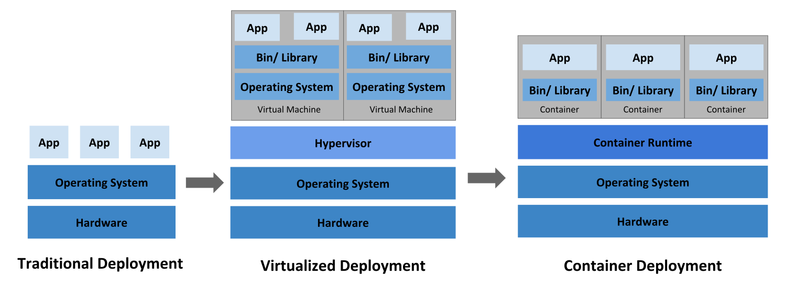
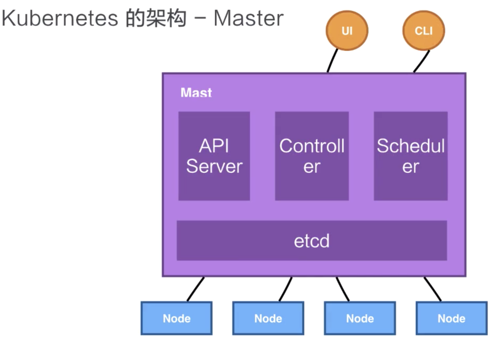
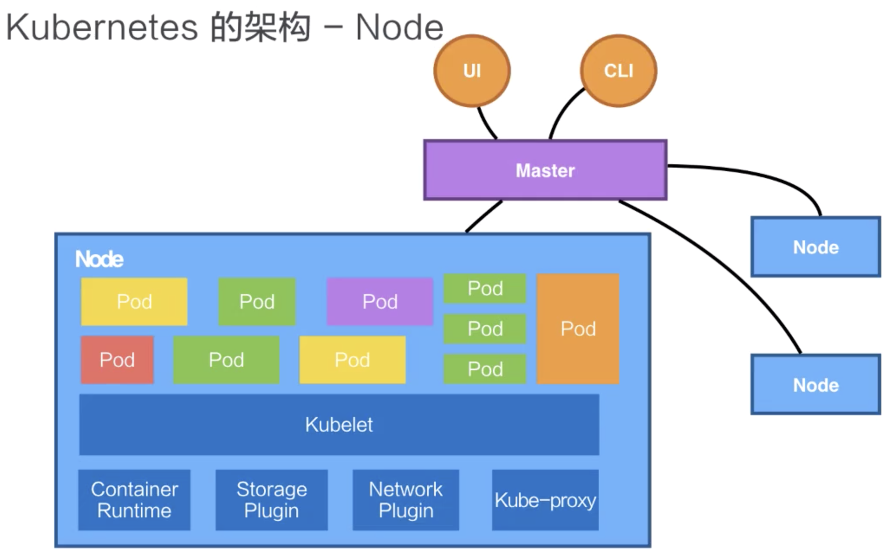
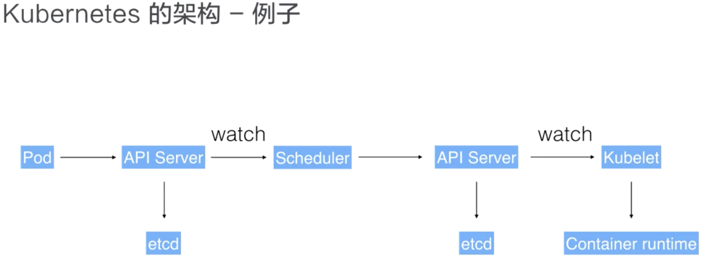
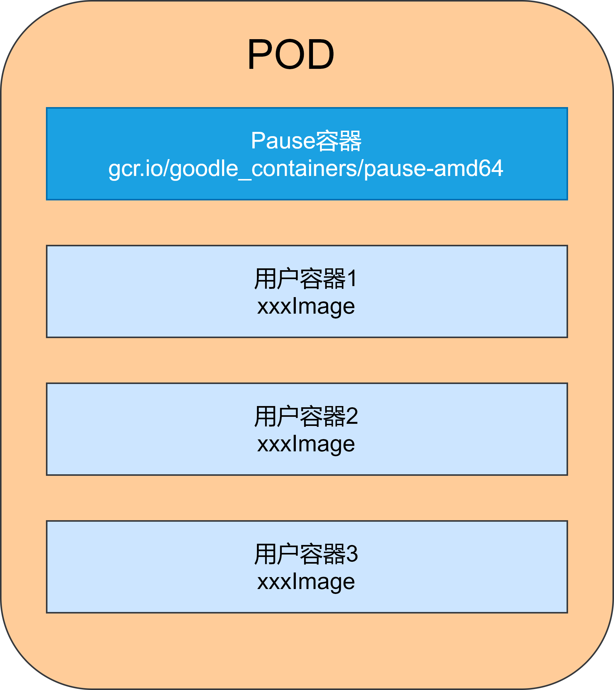
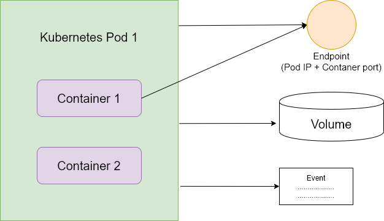
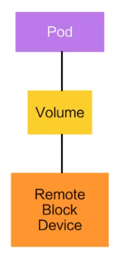
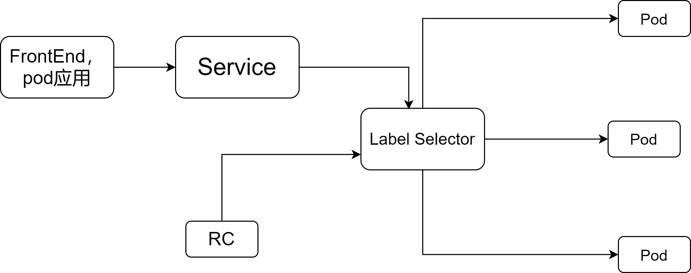

# 控制器模式

1. Kubernetes 所采用的控制器模式，是由声明式 API 驱动的。确切来说，是基于对 Kubernetes 资源对象的修改来驱动的；

2. Kubernetes 资源之后，是关注该资源的控制器。这些控制器将异步的控制系统向设置的终态驱近；

3. 这些控制器是自主运行的，使得系统的自动化和无人值守成为可能；

4. 因为 Kubernetes 的控制器和资源都是可以自定义的，因此可以方便的扩展控制器模式。特别是对于有状态应用，我们往往通过自定义资源和控制器的方式，来自动化运维操作。

# Overview



传统部署方式：

早期，各个组织机构在物理服务器上运行应用程序。无法为物理服务器中的应用程序定义资源边界，这会导致资源分配问题。 例如，如果在物理服务器上运行多个应用程序，则可能会出现一个应用程序占用大部分资源的情况， 结果可能导致其他应用程序的性能下降。 一种解决方案是在不同的物理服务器上运行每个应用程序，但是由于资源利用不足而无法扩展， 并且维护许多物理服务器的成本很高。

虚拟化部署时代：

作为解决方案，引入了虚拟化。虚拟化技术允许在单个物理服务器的 CPU 上运行多个虚拟机（VM）。 虚拟化允许应用程序在 VM 之间隔离，并提供一定程度的安全，因为一个应用程序的信息 不能被另一应用程序随意访问。

虚拟化技术能够更好地利用物理服务器上的资源，并且因为可轻松地添加或更新应用程序 而可以实现更好的可伸缩性，降低硬件成本等等。

每个 VM 是一台完整的计算机，在虚拟化硬件之上运行所有组件，包括其自己的操作系统。

容器部署时代：

容器类似于 VM，但是它们具有被放宽的隔离属性，可以在应用程序之间共享操作系统（OS）。 因此，容器被认为是轻量级的。容器与 VM 类似，具有自己的文件系统、CPU、内存、进程空间等。 由于它们与基础架构分离，因此可以跨云和 OS 发行版本进行移植。

容器因具有许多优势而变得流行起来。下面列出的是容器的一些好处：

- 敏捷应用程序的创建和部署：与使用 VM 镜像相比，提高了容器镜像创建的简便性和效率。

- 持续开发、集成和部署：通过快速简单的回滚（由于镜像不可变性），支持可靠且频繁的容器镜像构建和部署。

- 关注开发与运维的分离：在构建/发布时而不是在部署时创建应用程序容器镜像， 从而将应用程序与基础架构分离。

- 可观察性：不仅可以显示操作系统级别的信息和指标，还可以显示应用程序的运行状况和其他指标信号。

- 跨开发、测试和生产的环境一致性：在便携式计算机上与在云中相同地运行。

- 跨云和操作系统发行版本的可移植性：可在 Ubuntu、RHEL、CoreOS、本地、 Google Kubernetes Engine 和其他任何地方运行。

- 以应用程序为中心的管理：提高抽象级别，从在虚拟硬件上运行 OS 到使用逻辑资源在 OS 上运行应用程序。

- 松散耦合、分布式、弹性、解放的微服务：应用程序被分解成较小的独立部分， 并且可以动态部署和管理 - 而不是在一台大型单机上整体运行。

- 资源隔离：可预测的应用程序性能。

- 资源利用：高效率和高密度。

Kubernetes的功能：

- **服务发现和负载均衡**  
    Kubernetes 可以使用 DNS 名称或自己的 IP 地址公开容器，如果进入容器的流量很大， Kubernetes 可以负载均衡并分配网络流量，从而使部署稳定。

- **存储编排**  
    Kubernetes 允许你自动挂载你选择的存储系统，例如本地存储、公共云提供商等。

- **自动部署和回滚**  
    你可以使用 Kubernetes 描述已部署容器的所需状态，它可以以受控的速率将实际状态 更改为期望状态。例如，你可以自动化 Kubernetes 来为你的部署创建新容器， 删除现有容器并将它们的所有资源用于新容器。

- **自动完成装箱计算**  
    Kubernetes 允许你指定每个容器所需 CPU 和内存（RAM）。 当容器指定了资源请求时，Kubernetes 可以做出更好的决策来管理容器的资源。

- **自我修复**  
    Kubernetes 重新启动失败的容器、替换容器、杀死不响应用户定义的 运行状况检查的容器，并且在准备好服务之前不将其通告给客户端。

- **密钥与配置管理**  
    Kubernetes 允许你存储和管理敏感信息，例如密码、OAuth 令牌和 ssh 密钥。 你可以在不重建容器镜像的情况下部署和更新密钥和应用程序配置，也无需在堆栈配置中暴露密钥。

# Kubernetes节点

## Master



Master节点是Kubernetes中的集群控制节点，负责整个集群的管理和控制，基本上所有的控制命令都由Master节点来执行。

在Master节点上运行着以下进程：

- Kubernetes API Server（kube-apiserver）：提供了Http Rest接口的关键服务进程，是k8s集群里所有资源的增删改查等操作的唯一入口，也是集群控制的入口进程，决定着集群的性能瓶颈。

- Kubernetes Controller Manager（kube-controller-manager）：k8s里所有资源对象的**自动化**控制中心。**负责控制集群中某个资源的数量（包括滚动更新时动态调整新版本pod与旧版本pod的数量，负载过重时完成pod的自动伸缩，pod数量与期望值不同时启动新的pod或终止一个pod）。**

- Kubenetes Scheduler（kube-scheduler）：负责Pod调度的进程，根据Pod调度策略为Pod选择一个最合适的Node。

- **etcd：**是一个分布式的一个存储系统，API Server 中所需要的这些原信息都被放置在 etcd 中，etcd 本身是一个高可用系统，通过 etcd 保证整个 Kubernetes 的 Master 组件的高可用性。

## Node节点



Node是k8s集群中的工作负载节点，每个节点都会被master分配一些工作负载（docker容器），并且在Node节点宕机时自动转移到其他Node节点。

Kubernetes 并不会直接进行网络存储的操作，他们会靠 Storage Plugin 或者是网络的 Plugin 来进行操作。用户自己或者云厂商都会去写相应的 **Storage Plugin** 或者 **Network Plugin**，例如flannel和nfs等，去完成存储操作或网络操作。

Node节点上运行着以下的关键进程：

- kubelet：负责Pod中容器的创建，启停等任务，同时与Master紧密协作，实现集群管理的基本功能。

- kube-proxy：实现k8s服务之间的通信和负载均衡机制的重要组件。

- docker：负责容器的创建和管理。

Node可以在系统运行期间动态的加入到集群中，当Node加入集群后，kubelet进程会向Master汇报自身的情况，例如操作系统，Docker版本，机器的CPU和内存情况，以及当前有哪些Pod在运行等。Master节点根据Node汇报的状态进行负载均衡，一旦Node节点在超过指定时间不上报信息时，会被标记为NotReady，master节点会开始转移Node上的工作负载。

查看Node数量:

```
[root@master ~]# kubectl get nodes
NAME     STATUS   ROLES    AGE   VERSION
master   Ready    master   76d   v1.18.0
worker   Ready    <none>   62d   v1.18.0
```

通过kubectl describe node  <node_name>可查看某个Node的详细信息：

```
[root@master ~]# kubectl describe node worker
Name:               worker
Roles:              <none>
Labels:             beta.kubernetes.io/arch=amd64
                    beta.kubernetes.io/os=linux
                    kubernetes.io/arch=amd64
                    kubernetes.io/hostname=worker
                    kubernetes.io/os=linux
Annotations:        flannel.alpha.coreos.com/backend-data: {"VtepMAC":"2e:f3:94:53:b5:72"}
                    flannel.alpha.coreos.com/backend-type: vxlan
                    flannel.alpha.coreos.com/kube-subnet-manager: true
                    flannel.alpha.coreos.com/public-ip: 192.168.85.135
                    kubeadm.alpha.kubernetes.io/cri-socket: /var/run/dockershim.sock
                    node.alpha.kubernetes.io/ttl: 0
                    volumes.kubernetes.io/controller-managed-attach-detach: true
CreationTimestamp:  Tue, 25 Aug 2020 14:46:49 +0800
Taints:             <none>
Unschedulable:      false
Lease:
  HolderIdentity:  worker
  AcquireTime:     <unset>
  RenewTime:       Tue, 27 Oct 2020 11:11:27 +0800
Conditions:
  Type             Status  LastHeartbeatTime                 LastTransitionTime                Reason                       Message
  ----             ------  -----------------                 ------------------                ------                       -------
  MemoryPressure   False   Tue, 27 Oct 2020 11:09:53 +0800   Tue, 25 Aug 2020 14:46:49 +0800   KubeletHasSufficientMemory   kubelet has sufficient memory available
  DiskPressure     False   Tue, 27 Oct 2020 11:09:53 +0800   Tue, 25 Aug 2020 14:46:49 +0800   KubeletHasNoDiskPressure     kubelet has no disk pressure
  PIDPressure      False   Tue, 27 Oct 2020 11:09:53 +0800   Tue, 25 Aug 2020 14:46:49 +0800   KubeletHasSufficientPID      kubelet has sufficient PID available
  Ready            True    Tue, 27 Oct 2020 11:09:53 +0800   Tue, 25 Aug 2020 14:58:32 +0800   KubeletReady                 kubelet is posting ready status
Addresses:
  InternalIP:  192.168.85.135
  Hostname:    worker
Capacity:
  cpu:                2
  ephemeral-storage:  49250820Ki
  hugepages-1Gi:      0
  hugepages-2Mi:      0
  memory:             1863040Ki
  pods:               110
Allocatable:
  cpu:                2
  ephemeral-storage:  45389555637
  hugepages-1Gi:      0
  hugepages-2Mi:      0
  memory:             1760640Ki
  pods:               110
System Info:
......
```

k8s组件之间通信示例：



用户可以通过 UI 或者 CLI 提交一个 Pod 给 Kubernetes 进行部署，这个 Pod 请求首先会通过 CLI 或者 UI 提交给 Kubernetes API Server，下一步 API Server 会把这个信息写入到它的存储系统 etcd，之后 Scheduler 会通过 API Server 的 watch 或者叫做 notification 机制得到这个信息：有一个 Pod 需要被调度。

这个时候 Scheduler 会根据它的内存状态进行一次调度决策，在完成这次调度之后，它会向 API Server report 说：“OK！这个 Pod 需要被调度到某一个节点上。”

这个时候 API Server 接收到这次操作之后，会把这次的结果再次写到 etcd 中，然后 API Server 会通知相应的节点进行这次 Pod 真正的执行启动。相应节点的 kubelet 会得到这个通知，kubelet 就会去调 Container runtime 来真正去启动配置这个容器和这个容器的运行环境，去调度 Storage Plugin 来去配置存储，network Plugin 去配置网络。

# Kuberntetes资源对象

Kubernetes资源对象中：

- Spec：定义资源期望的状态。

- Status：资源观测到的状态。

- Matadata：

- Lables： 用来识别资源；

- Annotations：用来描述资源的注解；

- OwnerReference：用来描述多个资源之间的相互关系；

## Label

Label时kubernetes系统中的另外一个核心概念。一个Label是一个key=value的键值对，其中key和value由用户自己指定。Label可以被附加到各种资源对象上，例如Node，Pod，Service，RC等，一个资源对象可以定义任何数量的Label，同一个Label也可以被添加到任意数量的资源对象上。

常用标签：

- 版本：“Release”：“stable”、“release”：“canary”

- 环境：“environment”：“dev”、“environment”：“qa”、“environment”：“production”

- 架构：“tier”：“fronted”、“tier”：“backend”、“tier”：“middleware”

- 分区：“partition”：“customerA”、“partition”：“customerB”

- 质量管控：“track”：“daily”、“track”：“weekly”

Kubernetes通过标签实现了类似SQL的简单又通用的对象查询机制。

例如：`name = redis-slave`可以类比为`select * from pod where pod's name = 'redis-slave`这样的语句。

示例：

- 基于等式的Label Selector表达式

- `name = redis-slave`：匹配所有具有name=redis-slave标签的资源对象。

- `env!=production`：匹配所有不具有标签env=production的资源对象。

- 基于集合的Label Selector表达式

- `name in (redis-master, redis-slave)`：匹配具有name = redis-master或者name = redis-slave的资源对象。

- `name not in (php-fronted)`：匹配所有不具有name = php-fronted的资源对象。

多个Label Selector表达式组合可以实现复杂的条件选择，之间用“，”进行分割。

示例：

pod定义

```
apiVersion: v1
kind: Pod
metadata: 
	name: myweb
	labels:
	  app: myweb
```

RC和Service使用selector字段来设置需要关联的Pod的Label

```
apiVersion: v1
kind: ReplicationController
metadata:
  name: myweb
spec:
  replicas: 1
  selector: 
    app: myweb
  template:
  .......
  
---

apiVersion: v1
kind: Service
metadata:
  name: myweb
spec:
  selector: 
    app: myweb
  template:
  ......
```

其他管理对象如Deployment，ReplicaSet，DaemonSet和Job则可以在Selector中使用基于集合的筛选条件定义，例如：

```
	selector:
	  matchLabels: 
	    app: myweb
	  matchExpressions:
	    - {key: tier, operator: In, values: [frontend]}
	    - {key: environment, operator: Notin, values: [dev]}
```

可使用的operator包括：In Notin Exists 和 DoesNotExist

同时存在matchLabels于matchExpression时，它们之间是AND关系。

Label Selector在Kubernetes中的作用：

- kube-controller进程通过在RC上定义的Label Selector来筛选需要监控的Pod。

- kube-proxy通过Service的Label Selector来选择对应的Pod，自动建立Service到对应Pod的请求转发路由表。

- 通过在Node上定义Label，并在Pod中设置Node Selector字段，kube-scheduler可以实现Pod定向调度。

使用kubectl删除或添加lable：

```
# 展示pod标签
kubectl get po -n [namespace] --show-lables
# 添加标签
kubectl label po nginx1 -n [namespace] env=dev
# 修改标签
kubectl label po nginx1 -n [namespace] env=test --overwrite
# 删除标签
kubectl label po nginx1 -n [namespace] env-
# 使用相等型表达式筛选label
kubectl get po -n [namespace] --show-lables -l env=test,tie=front
# 使用集合性表达式筛选label
kubectl get po -n [namespace] --show-lables -l 'env in (test,dev)'
```

## Annotations

作用：

- 存储资源的非标识性信息；

- 扩展资源的spec/status；

特点：

- 一般比label更大

- 可以包含特殊字符

- 可以结构化也可以非结构化

修改Pod的Annotation：

```
# 添加注解
kubectl annotate pods nginx1 my-annotate='my fsao.r21$21@$%@3'
```

## OwnerReference

所有者，一般就是指集合类的资源，比如说 Pod 集合，就有 replicaset、statefulset。

集合类资源的控制器会创建对应的归属资源。比如：replicaset 控制器在操作中会创建 Pod，被创建 Pod 的 Ownereference 就指向了创建 Pod 的 replicaset，Ownereference 使得用户可以方便地查找一个创建资源的对象，另外，还可以用来实现级联删除的效果。

## Pod

**Pod是k8s最重要的基本概念，下图所示是Pod的组成示意图。**Pod 是 k8s 系统中可以创建和管理的最小单元，是资源对象模型中由用户创建或部署的最 小资源对象模型，也是在 k8s 上运行容器化应用的资源对象，其他的资源对象都是用来支撑或者扩展 Pod 对象功能的，比如控制器对象是用来管控 Pod 对象的，Service 或者 Ingress 资源对象是用来暴露 Pod 引用对象的，PersistentVolume 资源对象是用来为 Pod 提供存储等等，k8s 不会直接处理容器，它只会操作Pod，Pod 由一个或多个 container 组成 ，每一个 Pod 都有一个特殊的被称为”根容器“的 Pause 容器。Pause 容器对应的镜像属于 Kubernetes 平台的一部分，除了 Pause 容器，每个 Pod 还包含一个或多个紧密相关的用户业务容器（可以方便的互相访问）。



Kubernetes引入Pod的原因：

- 由于k8s将一组紧密相关的容器作为一个管理单元，因此很难判断一个容器组是否是“整体”死亡还是单个容器死亡，引入业务无关的Pause容器代表整个Pod的状态解决了这个问题。

- Pod里的多个容器共享Pause容器的IP地址和其挂载的volume，使得同一个Pod内的容器可以方便的共享数据和通信。

kubernetes要求集群内任意两个pod之间都可以直接通信，这通常是通过虚拟二层网络技术实现，例如Flannel，Open vSwitch等。

pod可以分为两类：

- 普通Pod：一旦被创建就会存储到ETCD中，由Master节点调度到某个Node上绑定，随后被Node上的kubelet实例化为一组docker容器并启动，当Pod内的某个容器停止时，k8s会自动检测出问题并重启Pod，Node宕机时，Master会重新为Pod规划节点。

- 静态Pod：不存储于ETCD，而是在Node的一个文件夹存放，也只在当前Node运行。

Pod资源定义文件示例：

```
#版本，required（必须有的字段）
apiVersion: v1
#类型，required，表示这是一个Pod，还可以写Service，ReplicaSet，Deployment等
kind: Pod
#元数据，required
metadata:
	#name为必选字段，需要符合RFC-1035规范
	name: myweb
	#可选，Pod管理器可根据labels来管理一组Pod
	labels:
		name: myweb
#Pod包含的容器组的定义，required
spec:
	#containers为一个数组，在yaml中，其每个元素前要加-
	containers:
	- name: myweb	#required
	  images: kubeguide/tomcat-app:v1
	  #容器的imagePullPolicy默认值为always，即每次都尝试重新拉取镜像，建议设置为IfNotPresent
	  imagePullPolicy: IfNotPresent
	  ports:		#数组
	  - containerPort: 8080			#该容器向外暴露的端口
	  env: 			#数组
	  - name: MYSQL_SERVICE_HOST
	  	value: 'mysql'
	  - name: MYSQL_SERVICE_PORT
	  	value: '3306'
```

通过kubectl describe pod xxx可查看某pod的具体信息：

```
[root@master ~]# kubectl describe pod 
Name:         activemq-test-fd64ccd6c-tw6sn
Namespace:    default
Priority:     0
Node:         worker/192.168.85.135
Start Time:   Tue, 25 Aug 2020 15:15:15 +0800
Labels:       app=activemq-test
              pod-template-hash=fd64ccd6c
Annotations:  <none>
Status:       Running
IP:           10.244.1.4
IPs:
  IP:           10.244.1.4
Controlled By:  ReplicaSet/activemq-test-fd64ccd6c
......
```

**每一个Pod都可以对其能使用的服务器上的计算资源设置限额**

- 对CPU的限额通常以千分之一个CPU配额为最小单位，用m来表示。

- Memory配额的单位是内存字节数

在k8s中，对一个计算资源进行配额限定时需要设定以下两个参数：

- Requests：该资源的最小申请量，系统必须满足要求。

- Limits：该资源最大允许使用的量，不能被突破，容器试图使用超过这个量的资源时，可能会被k8s“杀掉”并重启。

示例：

```
spec:
	containers: 
	- name: db
	  image: mysql
	  resources: 
	    requests:
	      memory: "64Mi"
	      cpu: "250m"
	    limits:
	      memory: "128Mi"
	      cpu: "500m"
```

Pod及周边对象示意图：



## Volume

Volume 就是卷的概念，它是用来管理 Kubernetes 存储的，是用来声明在 Pod 中的容器可以访问文件目录的，一个卷可以被挂载在 Pod 中一个或者多个容器的指定路径下面。

而 Volume 本身是一个抽象的概念，一个 Volume 可以支持多种后端的存储。比如说 Kubernetes 的 Volume 就支持了很多存储插件，它可以支持本地的存储，可以支持分布式的存储，比如说像 ceph，GlusterFS ；它也可以支持云存储，比如说阿里云上的云盘、AWS 上的云盘、Google 上的云盘等等。



## Replication Controller

RC定义了一个期待的场景，即声明某种Pod的数量在任何时刻都符合某个预期值，RC的定义包含了以下几个部分：

- Pod期待的副本数量

- 用于筛选目标Pod的Label Selector

- 当Pod数量小于预期时，用于创建Pod的模板（Template字段）

示例（确保拥有tie=fronted标签的Pod在整个k8s集群只有一个副本）：

```
apiVersion: v1
kind: ReplicationController
metadata:
  name: frontend
spec:
  replicas: 1
  selector: 
    tier: frontend
  template:
    metadata: 
      labels: 
        app: app-demo
        tier: frontend
    spec:
      containers:
      - name: tomcat-demo
        image: tomcat
        imagePullPolicy: IfNotPresent
        env: 
        - name: GET_HOSTS_FROM
          value: dns
        ports:
        - containerPort: 80
```

创建RC后，kube-controller-manager会根据RC的配置调整Pod数量。

可以通过--all参数删除所有rc：

```
kubectl delete rc --all
```

使用kubectl scale命令可在运行时修改RC规定的Pod副本数：

```
$ kubectl scale rc redis-slave --replicas=30
```

ReplicaSet，即RS，与RC唯一的区别是RS支持基于集合的Label选择器，RS一般不单独使用，而是由Deployment管理，以上的命令对rs同样可用。

## Deployment

Deployment的引入是为了更好地解决Pod的编排问题，可以看作是RC的一次升级。Deployment通过创建RS进而管理Pod。

Deployment的典型使用场景：

- 创建一个Deployment对象来生成对应的RS并完成Pod副本的创建。

- 检查Deployment的状态来查看部署动作是否完成。

- 滚动升级Pod。

- 版本回滚。

- 暂停Deployment以便于一次性修改多个PodTemplateSpec的配置项，之后恢复Deployment并进行新的发布。

- 扩展Deployment以应对高负载。

- 查看Deployment的状态。

- 清理不再需要的旧版本RS。

示例（部署tomcat的deployment文件）：

```
apiVersion: apps/v1
kind: Deployment
metadata:
  name: frontend
spec:
  replicas: 1
  selector:
    matchLabels:
      tier: frontend
    matchExpressions:
      - {key: tier, operator: In, values: {frontend}}
  template:
    metadata: 
      labels:
        app: app-demo
        tier: frontend
    spec:
      containers:
      - name: tomcat-demo
        image: tomcat
        imagePullPolicy: IfNotPresent
        ports:
        - containerPort: 8080
```

创建Deployment：

`kubectl create -f tomcat-deployment.yaml`

查看Deployment的信息：

`kubectl get deploy`

查看RS的信息：

`kubectl get rs`

## StatefulSet

在kubernetes系统中，Pod的管理对象RC、Deployment、DaemonSet和Job都是面向无状态服务，但是一些复杂的中间件集群是有状态的，例如MySQL集群、MongoDB集群、Akka集群、ZooKeeper集群等。StatefulSet可用来管理有状态服务的Pod。

StatefulSet具有以下特性：

- StatefulSet里的每个Pod都有稳定、唯一的网络标识，可以用来发现集群内的其他成员，基于Headless Service。

- StatefulSet控制的Pod副本的启停顺序是受控的。

- StatefulSet里的Pod采用稳定的持久化存储卷，通过PV或PVC来实现。

StatefulSet除了要与PV卷捆绑使用以存储Pod的状态数据，还需要与Headless Service配合使用。

## DaemonSet

DaemonSet确保全部或部分Node上运行一个Pod的副本，有符合条件的Node加入集群时，DaemonSet会在该Node上启动一个对应Pod。DaemonSet被删除时，它创建的所有Pod也会被删除。

DeamonSet的典型应用场景：

- 在每个Node上运行存储进程。

- 在每个Node上运行日志收集进程。

- 在每个Node上运行监控进程。

## Job

Job负责批处理任务，即只执行一次的任务，它保证批处理任务的一个或多个Pod成功结束。

CronJob管理基于时间的Job，即：

- 在特定时间点运行一次

- 周期性地在指定时间点运行

## Service

Kubernetes中的每个Service都是一个微服务。



前端应用通过Service定义的服务入口地址访问集群内的一组由Pod副本组成的集群实例，Service与其后端Pod副本是通过Label Selector来实现无缝对接的。

Kubernetes使用kube-proxy对客户端请求进行负载均衡。

**Kubernetes的服务发现机制：**

Kubernetes使用Service的name和ClusterIP做一个DNS映射来解决服务发现的问题。

**外部系统访问Service：**

- NodeIP：节点的物理网卡的地址。

- PodIP：是Docker Engine通过docker0网桥的IP地址段进行分配的，通常是一个虚拟的二层网络。

- ClusterIP：k8s集群内布的IP地址。

用户可以通过NodePort访问集群内的服务，NodePort的实现方式是集群中的每一个Node上都为需要外部访问的服务开放一个监听端口，外部系统只要访问任意一个Node的IP+NodePort端口即可访问服务。通常采用一个外部的负载均衡器，如Nginx来为外部访问提供NodeIP。
