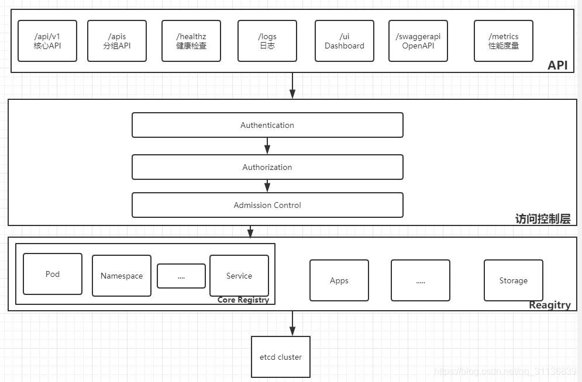
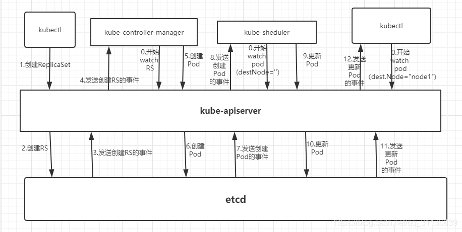
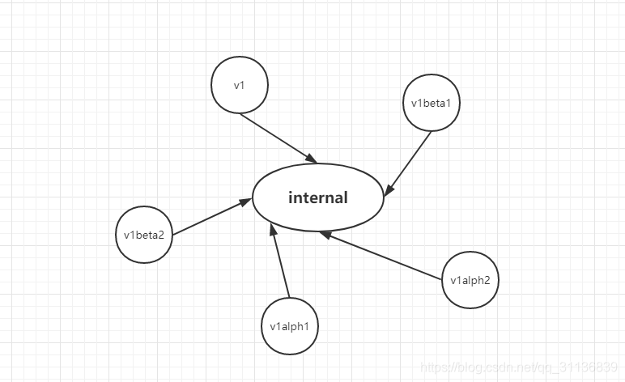
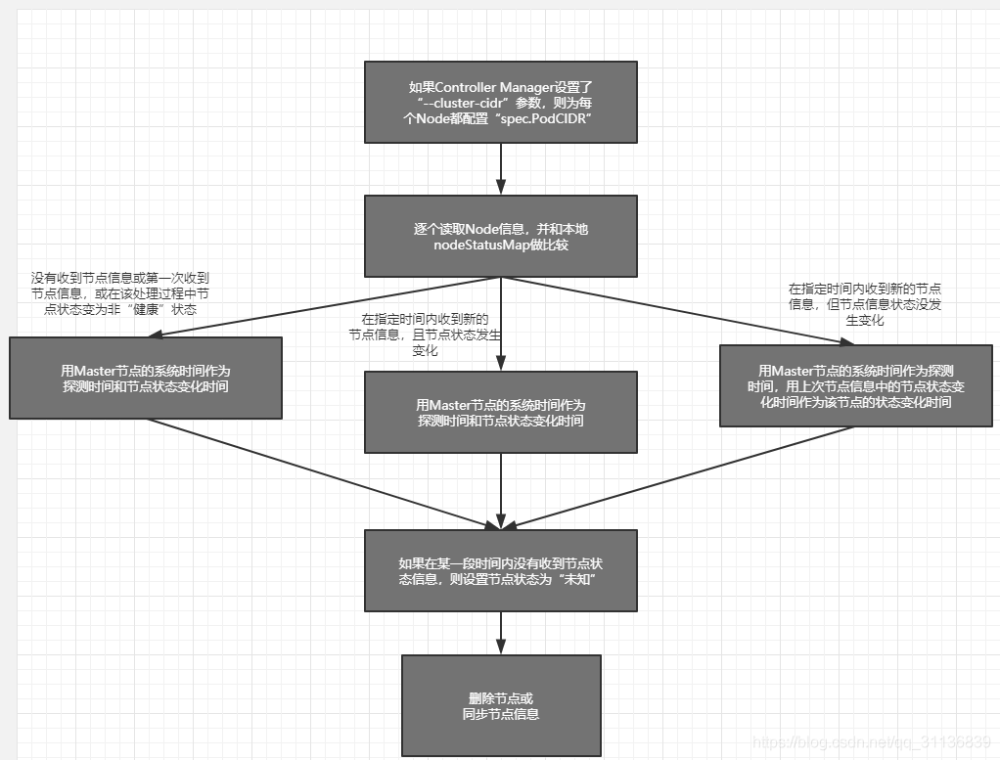

# API Server

Kubernetes API Server的核心功能是提供Kubernetes各类资源对象的增、删、改、查及Watch等HTTP Rest端口，称为集群内各个功能模块之间数据交互和通信的中心枢纽，是整个系统的数据总线和数据中心。

- 是集群管理的API入口。

- 是资源配额控制的入口。

- 提供了完备的集群安全机制。

Kubernetes API Server通过运行在Master上的kube-apiserver进程提供服务。默认情况下，kube-apiserver进程在本机的8080端口（需要在配置文件中设置insecure-port为80）提供REST服务。可以通过kubectl来与API Server进行交互，它们之间的接口时Restful API。

```
[root@master ~]# curl localhost:8080/api
{
  "kind": "APIVersions",
  "versions": [
    "v1"
  ],
  "serverAddressByClientCIDRs": [
    {
      "clientCIDR": "0.0.0.0/0",
      "serverAddress": "192.168.10.47:6443"
    }
  ]
}
```

返回API Server支持的资源对象的种类：`curl localhost:8080/api/v1`

返回Pod列表：`curl localhost:8080/api/v1/pods`

返回Service列表：`curl localhost:8080/api/v1/services`

由于API Server是Kubernetes集群数据的唯一访问入口，因此安全性和高性能是API Server设计和实现的两大核心目标。通过采用HTTPS安全传输通道和CA签名数字证书强制双向认证的方式，API Server的安全性得以保障。此外，为了更细粒度地控制用户或应用对Kubernetes资源对象的访问权限，Kubernetes采用了RBAC访问控制策略。

API Server的性能是决定Kubernetes整体性能的关键因素。

1. API Server拥有大量高性能的底层代码。在API Server源码中使用协程（Coroutine）+队列（Queue）这种轻量级的高性能并发代码，使得单进程的API Server具备了超强的多核处理能力，从而以很快的速度并发处理大量的请求。

2. 普通List接口结合异步Watch接口，不但完美解决了Kubernetes中各种资源对象的高性能同步问题，也极大提升了Kubernetes集群实时响应各种事件的灵敏度。

3. 采用了高性能的etcd数据库而非传统的关系数据库，不仅解决了数据的可靠性问题，也极大提升了API Server数据访问层的性能。在常见的公有云环境中，一个3节点的etcd集群在轻负载环境中处理一个请求的时间可以低于1ms，在重负载环境中可以每秒处理超过30000个请求。

## API Server架构

API Server的架构可以分为以下四层：

1. API层：主要以REST方式提供各种API接口，除了有Kubernetes资源对象的CRUD和Watch等主要API，还有健康检查、UI、日志、性能指标等运维监控相关的API。Kubernetes从1.11版本开始废弃Heapster监控组件，转而使用Metrics Server提供Metrics API接口，进一步完善了自身的监控能力。

2. 访问控制层：当客户端访问API接口时，访问控制层负责对用户身份鉴权，验明用户身份，核准用户对Kubernetes资源对象的访问权限，然后根据配置的各种资源访问许可逻辑（Admission Control），判断是否允许访问。

3. 注册表层：Kubernetes把所有资源对象都保存在注册表（Registry）中，针对注册表中的各种资源对象都定义了：资源对象的类型、如何创建资源对象、如何转换资源的不同版本，以及如何将资源编码和解码为JSON或ProtoBuf格式进行存储。

4. etcd数据库：用于持久化存储Kubernetes资源对象的KV数据库。etcd的watch API接口对于API Server来说至关重要，因为通过这个接口，API Server 创新性地设计了List-Watch这种高性能的资源对象实时同步机制，使Kubernetes可以管理超大规模的集群，及时响应和快速处理集群中的各种事件。



API Server与常见系统中的Dao层类似，下图以一个完整的Pod调度过程为例解释List-Watch机制：



首先，借助etcd提供的Watch API接口，API Server可以监听（Watch）在etcd上发生的数据操作事件，比如Pod创建事件、更新事件、删除事件等，在这些事件发生后，etcd会及时通知API Server。图中API Server与etcd之间的交互箭头表明了这个过程：当一个ReplicaSet对象被创建并被保存到etcd中后,etcd会立即发送一个对应的Create事件给API Server（图中的3.Send RepliatSet Create Event箭头），与其类似的6、7、10、11箭头都是针对Pod的创建、更新事件的。

然后，为了让Kubernetes中的其他组件在不访问底层etcd数据库的情况下，也能及时获取资源对象的变化事件，API Server模仿etcd的Watch API接口提供了自己的Watch接口，这样一来，这些组件就能近乎实时地获取它们感兴趣的任意资源对象的相关事件通知了。

图中controller-manager、scheduler、kublet等组件与API Server之间的有0.Watch的表明了这个过程。同时，在监听自己感兴趣的资源的时候，客户端可以增加过滤条件，以第二个kubect为例，node1节点上的kubelet进程只对自己节点上的Pod事件感兴趣。

最后，Kubernetes List-Watch用于实现数据同步的代码逻辑。客户端首先调用API Server的List接口获取相关资源对象的全量数据并将其缓存到内存中，然后启动对应资源对象的Watch协程，在接收到Watch事件后，再根据事件的类型（比如新增、修改或删除）对内存中的全量资源对象列表做出相应的同步修改，从实现上来看，这是一种全量结合增量的、高性能的、近乎实时的数据同步方式。

我们知道，对于不断迭代更新的系统，对象的属性一定是在不断变化的，API接口的版本也在不断升级，此时就会面临版本问题，即同一个对象不同版本之间的数据转换问题及API接口版本的兼容问题。后面这个问题解决起来比较容易，即定义不同的API版本号（比如v1alpha1、v1beta1）来加以区分，但前面的问题就有点麻烦了，比如数据对象经历v1alpha1、v1beta1、v1beta1、v1beta2等变化后最终变成v1版本，此时该数据对象就存在5个版本，如果这5个版本之间的数据两两直接转换，就存在很多种逻辑组合，变成一种典型的网状网络，为此我们不得不增加很多重复的转换代码。

上述直接转换的设计模式还存在另一个不可控的变数，即每增加一个新的对象版本，之前每个版本的对象就都需要增加一个到新版本对象的转换逻辑。如此一来，对直接转换的实现就更难了。于是，API Server针对每种资源对象都引入了一个相对不变的internal版本，每个版本只要支持转换为internal版本，就能够与其他版本进行间接转换。



本节最后简单说说Kubernetes中的CRD在API Server中的设计和实现机制。根据Kubernetes的设计，每种官方内建的资源对象如Node、Pod、Service等的实现都包含以下主要功能。

（1）资源对象的元数据（Schema）的定义：可以将其理解为数据库Table的定义，定义了对应资源对象的数据结构，官方内建资源对象的元数据定义是固化在源码中的。  
（2）资源对象的校验逻辑：确保用户提交的资源对象的属性的合法性。  
（3）资源对象的CRUD操作代码：可以将其理解为数据库表的CRUD代码，但比后者更难，因为API Server对资源对象的CRUD操作都会保存到etcd数据库中，对处理性能的要求也更高，还要考虑版本兼容性和版本转换等复杂问题。

（4）资源对象相关的“自动控制器”（如RC、Deployment等资源对象背后的控制器）：这是很重要的一个功能。因为Kubernetes是一个以自动化为核心目标的平台，用户给出期望的资源对象声明，运行过程中则由资源背后的“自动控制器”负责，确保对应资源对象的数量、状态、行为都始终符合用户的预期。

类似地，每个自定义CRD的开发人员都需要实现上面这些功能。为了减小编程的难度与工作量，API Server的设计者们做出了大量的努力，使得上面前3个功能无须编程实现，直接编写YAML定义文件即可实现。对于唯一需要编程的第4个功能来说，由于API Server提供了大量的基础API库，特别是易用的List-Watch的编程框架，也使得CRD自动控制器的编程难度大大减小。

## KubernetesProxy接口

面讲到，Kubernetes API Server最主要的REST接口是资源对象的增、删、改、查接口，除此之外，它还提供了一类很特殊的REST接口—Kubernetes Proxy API接口，这类接口的作用是代理REST请求，即Kubernetes API Server把收到的REST请求转发到某个Node上的kubelet守护进程的REST端口，由该kubelet进程负责响应。  
首先来说说Kubernetes Proxy API里关于Node的相关接口。该接口的REST路径为/api/v1/proxy/nodes/{name}，其中{name}为节点的名称或IP地址，包括以下几个具体接口：

```
/api/v1/proxy/nodes/{name}/pods/   #列出指定节点内所有Pod的信息


/api/v1/proxy/nodes/{name}/stats/   #列出指定节点内物理资源的统计信息


/api/v1/proxy/nodes/{name}/spec/    #列出指定节点的概要信息
```

例如，当前Node的名称为k8s-node1，用下面的命令即可获取该节点上所有运行中的Pod

```
curl localhost:8080/api/v1/proxy/nodes/k8s-node1/pods
```

需要说明的是：这里获取的Pod的信息数据来自Node而非etcd数据库，所以两者可能在某些时间点有所偏差。此外，如果kubelet进程在启动时包含--enable-debugginghandlers =true参数，那么Kubernetes Proxy API还会增加下面的接口：

```
/api/v1/proxy/nodes/{name}/run           #在节点上运行某个容器


/api/v1/proxy/nodes/{name}/exec          # 在节点上的某个容器中运行某条命令


/api/v1/proxy/nodes/{name}/attach        # 在节点上attach 某个容器


/api/v1/proxy/nodes/{name}/prorFoward    # 在节点上的Pod端口转发


/api/v1/proxy/nodes/{name}/logs          # 列出节点的各类日志信息


/api/v1/proxy/nodes/{name}/metrics       # 列出和该节点相关的Metrics信息


/api/v1/proxy/nodes/{name}/runingpods    # 列出节点内运行的pod信息


/api/v1/proxy/nodes/{name}/debug/pprof   # 包括CPU占用情况和内存使用情况
```

   接下来说说Kubernetes Proxy API 里关于Pod的相关接口，通过这些接口，我们可以访问Pod里某个容器提供的服务（如 Tomcat在8080端口的服务）：

```
/api/v1/proxy/namespaces/{namespace}/pods/{name}/{path:*}  # 访问pod的某个服务接口


/api/v1/proxy/namespaces/{namespace}/pods/{name}             #访问Pod


/api/v1/namespaces/{namespace}/pods/{name}/proxy/{path:*}  # 访问pod的某个服务接口


/api/v1/namespaces/{namespace}/pods/{name}/proxy    # 访问pod
```

在上面的4个接口里，后面两个接口的功能与前面两个完全一样，只是写法不同。下

Pod的Proxy接口的作用和意义了：在Kubernetes集群之外访问某个Pod容器的服务（HTTP服务）时，可以用Proxy API实现，这种场景多用于管理目的，比如逐一排查Service的Pod副本，检查哪些Pod的服务存在异常。

最后说说Service。Kubernetes Proxy API也有Service的Proxy接口，其接口定义与Pod的接口定义基本一样：/api/v1/proxy/namespaces/{namespace}/services/{name}。比如，若我们想访问MyWeb这个Service，则可以在浏览器里输入http://192.168.18.131:8080/api/v1/proxy/namespaces/default/services/myweb/demo/。

## 集群功能模块之间的通信

Kubernetes API Server作为集群的核心，负责集群各功能模块之间的通信。集群内的各个功能模块通过API Server将信息存入etcd，当需要获取和操作这些数据时，则通过API Server提供的REST接口（用GET、LIST或WATCH方法）来实现，从而实现各模块之间的信息交互。

常见的一个交互场景是kubelet进程与API Server的交互。每个Node上的kubelet每隔一个时间周期，就会调用一次API Server的REST接口报告自身状态，API Server在接收到这些信息后，会将节点状态信息更新到etcd中。此外，kubelet也通过API Server的Watch接口监听Pod信息，如果监听到新的Pod副本被调度绑定到本节点，则执行Pod对应的容器创建和启动逻辑；如果监听到Pod对象被删除，则删除本节点上相应的Pod容器；如果监听到修改Pod的信息，kubelet就会相应地修改本节点的Pod容器。  
另一个交互场景是kube-controller-manager进程与API Server的交互。kube-controller-manager中的Node Controller模块通过API Server提供的Watch接口实时监控Node的信息，并做相应处理。  
还有一个比较重要的交互场景是kube-scheduler与API Server的交互。Scheduler通过API Server的Watch接口监听到新建Pod副本的信息后，会检索所有符合该Pod要求的Node列表，开始执行Pod调度逻辑，在调度成功后将Pod绑定到目标节点上。  
为了缓解集群各模块对API Server的访问压力，各功能模块都采用缓存机制来缓存数据。各功能模块定时从API Server获取指定的资源对象信息（通过List-Watch方法），然后将这些信息保存到本地缓存中，功能模块在某些情况下不直接访问API Server，而是通过访问缓存数据来间接访问API Server。

# Controller Manager原理解析

一般来说，智能系统和自动系统通常会通过一个“操作系统”来不断修正系统的工作状态。在Kubernetes集群中，每个Controller都是这样的一个“操作系统”，它们通过API Server提供的（List-Watch）接口实时监控集群中特定资源的状态变化，当发生各种故障导致某资源对象的状态发生变化时，Controller会尝试将其状态调整为期望的状态。比如当某个Node意外宕机时，Node Controller会及时发现此故障并执行自动化修复流程，确保集群始终处于预期的工作状态。Controller Manager是Kubernetes中各种操作系统的管理者，是集群内部的管理控制中心，也是Kubernetes自动化功能的核心

Controller Manager内部包含Replication Controller、Node Controller、ResourceQuota Controller、Namespace Controller、ServiceAccount Controller、Token Controller、Service Controller及Endpoint Controller这8种Controller，每种Controller都负责一种特定资源的控制流程，而Controller Manager正是这些Controller的核心管理者。  
由于ServiceAccount Controller与Token Controller是与安全相关的两个控制器，并且与Service Account、Token密切相关，所以我们将对它们的分析放到后面讲解。

在Kubernetes集群中与Controller Manager并重的另一个组件是Kubernetes Scheduler，它的作用是将待调度的Pod（包括通过API Server新创建的Pod及RC为补足副本而创建的Pod等）通过一些复杂的调度流程计算出最佳目标节点，然后绑定到该节点上。

## Replication Controller

为了区分Controller Manager中的Replication Controller（副本控制器）和资源对象Replication Controller，我们将资源对象Replication Controller简写为RC，而本节中的Replication Controller是指“副本控制器”，以便于后续分析。

   Replication Controller的核心作用是确保在任何时候集群中某个RC关联的Pod副本数量都保持预设值。如果发现Pod的副本数量超过预期值，则Replication Controller会销毁一些Pod副本；反之，Replication Controller会自动创建新的Pod副本，直到符合条件的Pod副本数量达到预设值。需要注意：只有当Pod的重启策略是Always时（RestartPolicy=Always），Replication Controller才会管理该Pod的操作（例如创建、销毁、重启等）。在通常情况下，Pod对象被成功创建后不会消失，唯一的例外是当Pod处于succeeded或failed状态的时间过长（超时参数由系统设定）时，该Pod会被系统自动回收，管理该Pod的副本控制器将在其他工作节点上重新创建、运行该Pod副本。   RC中的Pod模板就像一个模具，模具制作出来的东西一旦离开模具，它们之间就再也没关系了。同样，一旦Pod被创建完毕，无论模板如何变化，甚至换成一个新的模板，也不会影响到已经创建的Pod了。此外，Pod可以通过修改它的标签来脱离RC的管控。该方法可以用于将Pod从集群中迁移、数据修复等调试。对于被迁移的Pod副本，RC会自动创建一个新的副本替换被迁移的副本。需要注意的是，删除一个RC不会影响它所创建的Pod。如果想删除一个被RC所控制的Pod，则需要将该RC的副本数（Replicas）属性设置为0，这样所有的Pod副本就都会被自动删除。

最好不要越过RC直接创建Pod，因为Replication Controller会通过RC管理Pod副本，实现自动创建、补足、替换、删除Pod副本，这样能提高系统的容灾能力，减少由于节点崩溃等意外状况造成的损失。即使你的应用程序只用到一个Pod副本，我们也强烈建议你使用RC来定义Pod。

总结一下Replication Controller的职责，如下所述。  
（1）确保在当前集群中有且仅有N个Pod实例，N是在RC中定义的Pod副本数量。  
（2）通过调整RC的spec.replicas属性值来实现系统扩容或者缩容。  
（3）通过改变RC中的Pod模板（主要是镜像版本）来实现系统的滚动升级。

最后总结一下Replication Controller的典型使用场景，如下所述。

（1）重新调度（Rescheduling）。如前面所述，不管想运行1个副本还是1000个副本，副本控制器都能确保指定数量的副本存在于集群中，即使发生节点故障或Pod副本被终止运行等意外状况。  
（2）弹性伸缩（Scaling）。手动或者通过自动扩容代理修改副本控制器的spec.replicas属性值，非常容易实现增加或减少副本的数量。  
（3）滚动更新（Rolling Updates）。副本控制器被设计成通过逐个替换Pod的方式来辅助服务的滚动更新。推荐的方式是创建一个只有一个副本的新RC，若新RC副本数量加1，则旧RC的副本数量减1，直到这个旧RC的副本数量为0，然后删除该旧RC。通过上述模式，即使在滚动更新的过程中发生了不可预料的错误，Pod集合的更新也都在可控范围内。在理想情况下，滚动更新控制器需要将准备就绪的应用考虑在内，并保证在集群中任何时刻都有足够数量的可用Pod。

## Node Controller

kubelet进程在启动时通过API Server注册自身的节点信息，并定时向API Server汇报状态信息，API Server在接收到这些信息后，会将这些信息更新到etcd中。在etcd中存储的节点信息包括节点健康状况、节点资源、节点名称、节点地址信息、操作系统版本、Docker版本、kubelet版本等。节点健康状况包含“就绪”（True）“未就绪”（False）和“未知”（Unknown）三种。  
Node Controller通过API Server实时获取Node的相关信息，实现管理和监控集群中的各个Node的相关控制功能，Node Controller的核心工作流程如图所示。



对流程中关键点的解释如下。  
（1）Controller Manager在启动时如果设置了--cluster-cidr参数，那么为每个没有设置Spec.PodCIDR的Node都生成一个CIDR地址，并用该CIDR地址设置节点的Spec.PodCIDR属性，这样做的目的是防止不同节点的CIDR地址发生冲突。  
（2）逐个读取Node信息，多次尝试修改nodeStatusMap中的节点状态信息，将该节点信息和Node Controller的nodeStatusMap中保存的节点信息做比较。如果判断出没有收到kubelet发送的节点信息、第1次收到节点kubelet发送的节点信息，或在该处理过程中节点状态变成非“健康”状态，则在nodeStatusMap中保存该节点的状态信息，并用Node Controller所在节点的系统时间作为探测时间和节点状态变化时间。如果判断出在指定时间内收到新的节点信息，且节点状态发生变化，则在nodeStatusMap中保存该节点的状态信息，并用Node Controller所在节点的系统时间作为探测时间和节点状态变化时间。如果判断出在指定时间内收到新的节点信息，但节点状态没发生变化，则在nodeStatusMap中保存该节点的状态信息，并用Node Controller所在节点的系统时间作为探测时间，将上次节点信息中的节点状态变化时间作为该节点的状态变化时间。如果判断出在某段时间（gracePeriod）内没有收到节点状态信息，则设置节点状态为“未知”，并且通过API Server保存节点状态。  
（3）逐个读取节点信息，如果节点状态变为非“就绪”状态，则将节点加入待删除队列，否则将节点从该队列中删除。如果节点状态为非“就绪”状态，且系统指定了Cloud Provider，则Node Controller调用Cloud Provider查看节点，若发现节点故障，则删除etcd中的节点信息，并删除和该节点相关的Pod等资源的信息。

## ResourceQuota Controller

作为完备的企业级的容器集群管理平台，Kubernetes也提供了ResourceQuota Controller（资源配额管理）这一高级功能，资源配额管理确保了指定的资源对象在任何时候都不会超量占用系统物理资源，避免了由于某些业务进程的设计或实现的缺陷导致整个系统运行紊乱甚至意外宕机，对整个集群的平稳运行和稳定性有非常重要的作用。  
目前Kubernetes支持如下三个层次的资源配额管理。  
（1）容器级别，可以对CPU和Memory进行限制。  
（2）Pod级别，可以对一个Pod内所有容器的可用资源进行限制。  
（3）Namespace级别，为Namespace（多租户）级别的资源限制，包括：  
◎　Pod数量；  
◎　Replication Controller数量；  
◎　Service数量；  
◎　ResourceQuota数量；  
◎　Secret数量；  
◎　可持有的PV数量。  
Kubernetes的配额管理是通过Admission Control（准入控制）来控制的，Admission Control当前提供了两种方式的配额约束，分别是LimitRanger与ResourceQuota。其中LimitRanger作用于Pod和Container，ResourceQuota则作用于Namespace，限定一个Namespace里的各类资源的使用总额。

如果在Pod定义中同时声明了LimitRanger，则用户通过API Server请求创建或修改资源时，Admission Control会计算当前配额的使用情况，如果不符合配额约束，则创建对象失败。对于定义了ResourceQuota的Namespace，ResourceQuota Controller组件则负责定期统计和生成该Namespace下的各类对象的资源使用总量，统计结果包括Pod、Service、RC、Secret和Persistent Volume等对象实例个数，以及该Namespace下所有Container实例所使用的资源量（目前包括CPU和内存），然后将这些统计结果写入etcd的resourceQuotaStatusStorage目录（resourceQuotas/status）下。写入resourceQuotaStatusStorage的内容包含Resource名称、配额值（ResourceQuota对象中spec.hard域下包含的资源的值）、当前使用值（ResourceQuota Controller统计出来的值）。随后这些统计信息被Admission Control使用，以确保相关Namespace下的资源配额总量不会超过ResourceQuota中的限定值。

## Namespace Controller

   用户通过API Server可以创建新的Namespace并将其保存在etcd中，Namespace Controller定时通过API Server读取这些Namespace的信息。如果Namespace被API标识为优雅删除（通过设置删除期限实现，即设置DeletionTimestamp属性），则将该NameSpace的状态设置成Terminating并保存到etcd中。同时Namespace Controller删除该Namespace下的ServiceAccount、RC、Pod、Secret、PersistentVolume、ListRange、ResourceQuota和Event等资源对象。   在Namespace的状态被设置成Terminating后，由Admission Controller的NamespaceLifecycle插件来阻止为该Namespace创建新的资源。同时，在Namespace Controller删除该Namespace中的所有资源对象后，Namespace Controller对该Namespace执行finalize操作，删除Namespace的spec.finalizers域中的信息。如果Namespace Controller观察到Namespace设置了删除期限，同时Namespace的spec.finalizers域值是空的，那么Namespace Controller将通过API Server删除该Namespace资源。

## Service Controller与Endpoints Controller

本节讲解Endpoints Controller，在这之前，让我们先说下Service、Endpoints与Pod的关系，Endpoints表示一个Service对应的所有Pod副本的访问地址，Endpoints Controller就是负责生成和维护所有Endpoints对象的控制器。  
它负责监听Service和对应的Pod副本的变化，如果监测到Service被删除，则删除和该Service同名的Endpoints对象。如果监测到新的Service被创建或者修改，则根据该Service信息获得相关的Pod列表，然后创建或者更新Service对应的Endpoints对象。如果监测到Pod的事件，则更新它所对应的Service的Endpoints对象（增加、删除或者修改对应的Endpoint条目）。  
那么，Endpoints对象是在哪里被使用的呢？答案是每个Node上的kube-proxy进程，kube-proxy进程获取每个Service的Endpoints，实现了Service的负载均衡功能。在后面的章节中会深入讲解这部分内容。  
接下来说说Service Controller的作用，它其实是属于Kubernetes集群与外部的云平台之间的一个接口控制器。Service Controller监听Service的变化，如果该Service是一个LoadBalancer类型的Service（externalLoadBalancers=true），则Service Controller确保在外部的云平台上该Service对应的LoadBalancer实例被相应地创建、删除及更新路由转发表（根据Endpoints的条目）。

# Scheduler 原理解析

前面深入分析了Controller Manager及它所包含的各个组件的运行机制，本节将继续对Kubernetes中负责Pod调度的重要功能模块—Kubernetes Scheduler的工作原理和运行机制做深入分析。  
Kubernetes Scheduler在整个系统中承担了“承上启下”的重要功能，“承上”是指它负责接收Controller Manager创建的新Pod，为其安排一个落脚的“家”—目标Node；“启下”是指安置工作完成后，目标Node上的kubelet服务进程接管后继工作，负责Pod生命周期中的“下半生”。

具体来说，Kubernetes Scheduler的作用是将待调度的Pod（API新创建的Pod、Controller Manager为补足副本而创建的Pod等）按照特定的调度算法和调度策略绑定（Binding）到集群中某个合适的Node上，并将绑定信息写入etcd中。在整个调度过程中涉及三个对象，分别是待调度Pod列表、可用Node列表，以及调度算法和策略。简单地说，就是通过调度算法调度为待调度Pod列表中的每个Pod从Node列表中选择一个最适合的Node。

随后，目标节点上的kubelet通过API Server监听到Kubernetes Scheduler产生的Pod绑定事件，然后获取对应的Pod清单，下载Image镜像并启动容器。

Kubernetes Scheduler当前提供的默认调度流程分为以下两步。

（1）预选调度过程，即遍历所有目标Node，筛选出符合要求的候选节点。为此，Kubernetes内置了多种预选策略（xxx Predicates）供用户选择。  
（2）确定最优节点，在第1步的基础上，采用优选策略（xxx Priority）计算出每个候选节点的积分，积分最高者胜出。

Kubernetes Scheduler的调度流程是通过插件方式加载的“调度算法提供者”（AlgorithmProvider）具体实现的。一个AlgorithmProvider其实就是包括了一组预选策略与一组优先选择策略的结构体，它包含三个参数：name string为算法名；predicateKeys为算法用到的预选策略集合；priorityKeys为算法用到的优选策略集合。  
Scheduler中可用的预选策略包含：NoDiskConflict、PodFitsResources、PodSelectorMatches、PodFitsHost、CheckNodeLabelPresence、CheckServiceAffinity和PodFitsPorts策略等。其默认的AlgorithmProvider加载的预选策略Predicates包括：PodFitsPorts（PodFitsPorts）、PodFitsResources（PodFitsResources）、NoDiskConflict（NoDiskConflict）、MatchNodeSelector（PodSelectorMatches）和HostName（PodFitsHost），即每个节点只有通过前面提及的5个默认预选策略后，才能初步被选中，进入下一个流程。

NoDiskConflict

判断备选Pod的gcePersistentDisk或AWSElasticBlockStore和备选的节点中已存在的Pod是否存在冲突。检测过程如下。

（1）首先，读取备选Pod的所有Volume的信息（即pod.Spec.Volumes），对每个Volume执行以下步骤进行冲突检测。  
（2）如果该Volume是gcePersistentDisk，则将Volume和备选节点上的所有Pod的每个Volume都进行比较，如果发现相同的gcePersistentDisk，则返回false，表明存在磁盘冲突，检查结束，反馈给调度器该备选节点不适合作为备选Pod；如果该Volume是AWSElasticBlockStore，则将Volume和备选节点上的所有Pod的每个Volume都进行比较，如果发现相同的AWSElasticBlockStore，则返回false，表明存在磁盘冲突，检查结束，反馈给调度器该备选节点不适合备选Pod。  
（3）如果检查完备选Pod的所有Volume均未发现冲突，则返回true，表明不存在磁盘冲突，反馈给调度器该备选节点适合备选Pod。

PodFitsResources

判断备选节点的资源是否满足备选Pod的需求，检测过程如下。

（1）计算备选Pod和节点中已存在Pod的所有容器的需求资源（内存和CPU）的总和。  
（2）获得备选节点的状态信息，其中包含节点的资源信息。  
（3）如果在备选Pod和节点中已存在Pod的所有容器的需求资源（内存和CPU）的总和，超出了备选节点拥有的资源，则返回false，表明备选节点不适合备选Pod，否则返回true，表明备选节点适合备选Pod。

PodSelectorMatches

判断备选节点是否包含备选Pod的标签选择器指定的标签。

（1）如果Pod没有指定spec.nodeSelector标签选择器，则返回true。  
（2）否则，获得备选节点的标签信息，判断节点是否包含备选Pod的标签选择器（spec.nodeSelector）所指定的标签，如果包含，则返回true，否则返回false。、

PodFitsHost

判断备选Pod的spec.nodeName域所指定的节点名称和备选节点的名称是否一致，如果一致，则返回true，否则返回false。

CheckNodeLabelPresence

如果用户在配置文件中指定了该策略，则Scheduler会通过RegisterCustomFitPredicate方式注册该策略。该策略用于判断策略列出的标签在备选节点中存在时了，是否选择该备选节点。

（1）读取备选节点的标签列表信息。  
（2）如果策略配置的标签列表存在于备选节点的标签列表中，且策略配置的presence值为false，则返回false，否则返回true；如果策略配置的标签列表不存在于备选节点的标签列表中，且策略配置的presence值为true，则返回false，否则返回ture。

CheckServiceAffinity

如果用户在配置文件中指定了该策略，则Scheduler会通过RegisterCustomFitPredicate方法注册该策略。该策略用于判断备选节点是否包含策略指定的标签，或包含和备选Pod在相同Service和Namesoace下的Pod所在节点的标签列表。如果存在，则返回true，否则返回false。

PodFitsPorts

判断备选Pod所用的端口列表中的端口是否在备选节点中已被占用，如果被占用，则返回false，否则返回true。

Scheduler中的优选策略包含：LeastRequestedPriority、CalculateNodeLabelPriority和BalancedResourceAllocation等。每个节点通过优先选择策略时都会算出一个得分，计算各项得分，最终选出得分值最大的节点作为优选的结果（也是调度算法的结果）。

LeastRequested Priority

该优选策略用于从备选节点列表中选出资源消耗最小的节点。

（1）计算出在所有备选节点上运行的Pod和备选Pod的CPU占用量totalMilliCPU。  
（2）计算出在所有备选节点上运行的Pod和备选Pod的内存占用量totalMemory。  
（3）计算每个节点的得分，计算规则大致如下，其中，NodeCpuCapacity为节点CPU计算能力，NodeMemoryCapacity为节点内存大小。

CalculateNodeLabelPriority

如果用户在配置文件中指定了该策略，则scheduler会通过RegisterCustomPriorityFunction方法注册该策略。该策略用于判断策略列出的标签在备选节点中存在时，是否选择该备选节点。如果备选节点的标签在优选策略的标签列表中且优选策略的presence值为true，或者备选节点的标签不在优选策略的标签列表中且优选策略的presence值为false，则备选节点score=10，否则备选节点score=0。

BalancedResourceAllocation

该优选策略用于从备选节点列表中选出各项资源使用率最均衡的节点。  
（1）计算出在所有备选节点上运行的Pod和备选Pod的CPU占用量totalMilliCPU。  
（2）计算出在所有备选节点上运行的Pod和备选Pod的内存占用量totalMemory。  
（3）计算每个节点的得分，计算规则大致如下，其中，NodeCpuCapacity为节点的CPU计算能力，NodeMemoryCapacity为节点的内存大小。

# Kubelet运行机制解析

在Kubernetes集群中，在每个Node（又称Minion）上都会启动一个kubelet服务进程。该进程用于处理Master下发到本节点的任务，管理Pod及Pod中的容器。每个kubelet进程都会在API Server上注册节点自身的信息，定期向Master汇报节点资源的使用情况，并通过cAdvisor监控容器和节点资源。

## 节点管理

节点通过设置kubelet的启动参数“--register-node”，来决定是否向API Server注册自己。如果该参数的值为true，那么kubelet将试着通过API Server注册自己。在自注册时，kubelet启动时还包含下列参数。  
◎　--api-servers：APIServer的位置。  
◎　--kubeconfig：kubeconfig文件，用于访问API Server的安全配置文件。  
◎　--cloud-provider：云服务商（IaaS）地址，仅用于公有云环境。  
当前每个kubelet都被授予创建和修改任何节点的权限。但是在实践中，它仅仅创建和修改自己。将来，我们计划限制kubelet的权限，仅允许它修改和创建所在节点的权限。如果在集群运行过程中遇到集群资源不足的情况，用户就很容易通过添加机器及运用kubelet的自注册模式来实现扩容。

在某些情况下，Kubernetes集群中的某些kubelet没有选择自注册模式，用户需要自己去配置Node的资源信息，同时告知Node上Kubelet API Server的位置。集群管理者能够创建和修改节点信息。如果管理者希望手动创建节点信息，则通过设置kubelet的启动参数“--register- node=false”即可完成。  
kubelet在启动时通过API Server注册节点信息，并定时向API Server发送节点的新消息，API Server在接收到这些信息后，将这些信息写入etcd。通过kubelet的启动参数“--node-status-update-frequency”设置kubelet每隔多长时间向API Server报告节点状态，默认为10s。

## Pod管理

kubelet通过以下几种方式获取自身Node上要运行的Pod清单。  
（1）文件：kubelet启动参数“--config”指定的配置文件目录下的文件（默认目录为“/etc/ kubernetes/manifests/”）。通过--file-check-frequency设置检查该文件目录的时间间隔，默认为20s。  
（2）HTTP端点（URL）：通过“--manifest-url”参数设置。通过--http-check-frequency设置检查该HTTP端点数据的时间间隔，默认为20s。  
（3）API Server：kubelet通过API Server监听etcd目录，同步Pod列表。

所有以非API Server方式创建的Pod都叫作Static Pod。kubelet将Static Pod的状态汇报给API Server，API Server为该Static Pod创建一个Mirror Pod和其相匹配。Mirror Pod的状态将真实反映Static Pod的状态。当Static Pod被删除时，与之相对应的Mirror Pod也会被删除。在本章中只讨论通过API Server获得Pod清单的方式。kubelet通过API Server Client使用Watch加List的方式监听“/registry/nodes/$”当前节点的名称和“/registry/pods”目录，将获取的信息同步到本地缓存中。  
kubelet监听etcd，所有针对Pod的操作都会被kubelet监听。如果发现有新的绑定到本节点的Pod，则按照Pod清单的要求创建该Pod。  
如果发现本地的Pod被修改，则kubelet会做出相应的修改，比如在删除Pod中的某个容器时，会通过Docker Client删除该容器。  
如果发现删除本节点的Pod，则删除相应的Pod，并通过Docker Client删除Pod中的容器。  
kubelet读取监听到的信息，如果是创建和修改Pod任务，则做如下处理。  
（1）为该Pod创建一个数据目录。  
（2）从API Server读取该Pod清单。  
（3）为该Pod挂载外部卷（External Volume）。  
（4）下载Pod用到的Secret。  
（5）检查已经运行在节点上的Pod，如果该Pod没有容器或Pause容器（“kubernetes/pause” 镜像创建的容器）没有启动，则先停止Pod里所有容器的进程。如果在Pod中有需要删除的容器，这删除这些容器。

（6）用“kubernetes/pause”镜像为每个Pod都创建一个容器。该Pause容器用于接管Pod中所有其他容器的网络。每创建一个新的Pod，kubelet都会先创建一个Pause容器，然后创建其他容器。“kubernetes/pause”镜像大概有200KB，是个非常小的容器镜像。  
（7）为Pod中的每个容器做如下处理。  
◎　为容器计算一个Hash值，然后用容器的名称去查询对应Docker容器的Hash值。若查找到容器，且二者的Hash值不同，则停止Docker中容器的进程，并停止与之关联的Pause容器的进程；若二者相同，则不做任何处理。  
◎　如果容器被终止了，且容器没有指定的restartPolicy（重启策略），则不做任何处理。  
◎　调用Docker Client下载容器镜像，调用Docker Client运行容器。

## 容器健康检查

Pod通过两类探针来检查容器的健康状态。一类是LivenessProbe探针，用于判断容器是否健康并反馈给kubelet。如果LivenessProbe探针探测到容器不健康，则kubelet将删除该容器，并根据容器的重启策略做相应的处理。如果一个容器不包含LivenessProbe探针，那么kubelet认为该容器的LivenessProbe探针返回的值永远是Success；另一类是ReadinessProbe探针，用于判断容器是否启动完成，且准备接收请求。如果ReadinessProbe探针检测到容器启动失败，则Pod的状态将被修改，EndpointController将从Service的Endpoint中删除包含该容器所在Pod的IP地址的Endpoint条目。  
kubelet定期调用容器中的LivenessProbe探针来诊断容器的健康状况。LivenessProbe包含以下3种实现方式。  
（1）ExecAction：在容器内部执行一个命令，如果该命令的退出状态码为0，则表明容器健康。  
（2）TCPSocketAction：通过容器的IP地址和端口号执行TCP检查，如果端口能被访问，则表明容器健

（3）HTTPGetAction：通过容器的IP地址和端口号及路径调用HTTP Get方法，如果响应的状态码大于等于200且小于等于400，则认为容器状态健康。

LivenessProbe探针被包含在Pod定义的spec.containers.{某个容器}中。下面的例子展示了两种Pod中容器健康检查的方式： HTTP检查和容器命令执行检查。下面所列的内容实现了通过容器命令执行检查：

```
livenessProbe:


  exec:


    command:


    - cat


    - /tmp/health


  initialDelaySeconds: 15


  timeoutSeconds: 1
```

kubeelet在容器中执行“cat /tmp/health”命令，如果该命令返回的值为0，则表明容器处于健康状态，否则表明容器处于不健康状态。

下面所列的内容实现了容器的HTTP检查：

```
livenessProbe:


  httpGet:


    path: /healthz


    port: 8080


  initialDelaySeconds: 15


  timeoutSeconds: 1
```

kubelet发送一个HTTP请求到本地主机、端口及指定的路径，来检查容器的健康健康状况。

## cAdvisor资源监控

在Kubernetes集群中，应用程序的执行情况可以在不同的级别上监测到，这些级别包括：容器、Pod、Service和整个集群。作为Kubernetes集群的一部分，Kubernetes希望提供给用户详细的各个级别的资源使用信息，这将使用户深入地了解应用的执行情况，并找到应用中可能的瓶颈。  
cAdvisor是一个开源的分析容器资源使用率和性能特性的代理工具，它是因为容器而产生的，因此自然支持Docker容器，在Kubernetes项目中，cAdvisor被集成到Kubernetes代码中，kubelet则通过cAdvisor获取其所在节点及容器的数据。cAdvisor自动查找所有在其所在Node上的容器，自动采集CPU、内存、文网络系统和使用的统计信息。在大部分Kubernetes集群中，cAdvisor通过它所在Node的4194端口暴露一个简单的UI。  
kubelet作为连接Kubernetes Master和各Node之间的桥梁，管理运行在Node上的Pod和容器。kubelet将每个Pod都转换成它的成员容器，同时从cAdvisor获取单独的容器使用统计信息，然后通过该REST API暴露这些聚合后的Pod资源使用的统计信息。

cAdvisor只能提供2～3min的监控数据，对性能数据也没有持久化，因此在Kubernetes早期版本中需要依靠Heapster来实现集群范围内全部容器性能指标的采集和查询功能。从Kubernetes 1.8版本开始，性能指标数据的查询接口升级为标准的Metrics API,后端务则升级为全新的Metrics Server。因此，cAdvisor在4194端口提供的UI和API服务从Kubernetes 1.10版本开始进入弃用流程，并于1.12版本完全关闭。如果还希望使用cAdvisor的这个特性，则从1.13版本开始可以通过部署一个DaemonSet在每个Node上启动一个cAdvisor来提供UI和API，请参考cAdvisor在GitHub上的说明（https://github.com/google/cadvisor）。  
在新的Kubernetes监控体系中，Metrics Server用于提供Core Metrics（核心指标），包括Node和Pod的CPU和内存使用数据。其他Custom Metrics（自定义指标）则由第三方组件（如Prometheus）采集和存储。

# kube-proxy运行机制解析

我们在前面已经了解到，为了支持集群的水平扩展、高可用性，Kubernetes抽象出了Service的概念。Service是对一组Pod的抽象，它会根据访问策略（如负载均衡策略）来访问这组Pod。

Kubernetes在创建服务时会为服务分配一个虚拟的IP地址，客户端通过访问这个虚拟的IP地址来访问服务，服务则负责将请求转发到后端的Pod上。这不就是一个反向代理吗？没错，这就是一个反向代理。但是，它和普通的反向代理有一些不同：首先，它的IP地址是虚拟的，想从外面访问还需要一些技巧；其次，它的部署和启停是由Kubernetes统一自动管理的。  
在很多情况下，Service只是一个概念，而真正将Service的作用落实的是它背后的kube-proxy服务进程。只有理解了kube-proxy的原理和机制，我们才能真正理解Service背后的实现逻辑。

在Kubernetes集群的每个Node上都会运行一个kube-proxy服务进程，我们可以把这个进程看作Service的透明代理兼负载均衡器，其核心功能是将到某个Service的访问请求转发到后端的多个Pod实例上。此外，Service的Cluster IP与NodePort等概念是kube-proxy服务通过iptables的NAT转换实现的，kube-proxy在运行过程中动态创建与Service相关的iptables规则，这些规则实现了将访问服务（Cluster IP或NodePort）的请求负载分发到后端Pod的功能。由于iptables机制针对的是本地的kube-proxy端口，所以在每个Node上都要运行kube-proxy组件，这样一来，在Kubernetes集群内部，我们可以在任意Node上发起对Service的访问请求。综上所述，由于kube-proxy的作用，在Service的调用过程中客户端无须关心后端有几个Pod，中间过程的通信、负载均衡及故障恢复都是透明的。  
起初，kube-proxy进程是一个真实的TCP/UDP代理，类似HA Proxy，负责从Service到Pod的访问流量的转发，这种模式被称为userspace（用户空间代理）模式。，当某个Pod以Cluster IP方式访问某个Service的时候，这个流量会被Pod所在本机的iptables转发到本机的kube-proxy进程，然后由kube-proxy建立起到后端Pod的TCP/UDP连接，随后将请求转发到某个后端Pod上，并在这个过程中实现负载均衡功能。

Kubernetes从1.2版本开始，将iptables作为kube-proxy的默认模式。iptables模式下的kube-proxy不再起到Proxy的作用，其核心功能：通过API Server的Watch接口实时跟踪Service与Endpoint的变更信息，并更新对应的iptables规则，Client的请求流量则通过iptables的NAT机制“直接路由”到目标Pod。

根据Kubernetes的网络模型，一个Node上的Pod与其他Node上的Pod应该能够直接建立双向的TCP/IP通信通道，所以如果直接修改iptables规则，则也可以实现kube-proxy的功能，只不过后者更加高端，因为是全自动模式的。与第1代的userspace模式相比，iptables模式完全工作在内核态，不用再经过用户态的kube-proxy中转，因而性能更强。  
iptables模式虽然实现起来简单，但存在无法避免的缺陷：在集群中的Service和Pod大量增加以后，iptables中的规则会急速膨胀，导致性能显著下降，在某些极端情况下甚至会出现规则丢失的情况，并且这种故障难以重现与排查，于是Kubernetes从1.8版本开始引入第3代的IPVS（IP Virtual Server）模式。

iptables与IPVS虽然都是基于Netfilter实现的，但因为定位不同，二者有着本质的差别：iptables是为防火墙而设计的；IPVS则专门用于高性能负载均衡，并使用更高效的数据结构（Hash表），允许几乎无限的规模扩张，因此被kube-proxy采纳为第三代模式。

与iptables相比，IPVS拥有以下明显优势：  
◎　为大型集群提供了更好的可扩展性和性能；  
◎　支持比iptables更复杂的复制均衡算法（最小负载、最少连接、加权等）；  
◎　支持服务器健康检查和连接重试等功能；  
◎　可以动态修改ipset的集合，即使iptables的规则正在使用这个集合。  
由于IPVS无法提供包过滤、airpin-masquerade tricks（地址伪装）、SNAT等功能，因此在某些场景（如NodePort的实现）下还要与iptables搭配使用。在IPVS模式下，kube-proxy又做了重要的升级，即使用iptables的扩展ipset，而不是直接调用iptables来生成规则链。  
iptables规则链是一个线性的数据结构，ipset则引入了带索引的数据结构，因此当规则很多时，可以很高效地查找和匹配。我们可以将ipset简单理解为一个IP（段）的集合，这个集合的内容可以是IP地址、IP网段、端口等，iptables可以直接添加规则对这个“可变的集合”进行操作，这样做的好处在于可以大大减少iptables规则的数量，从而减少性能损耗。  
假设要禁止上万个IP访问我们的服务器，则用iptables的话，就需要一条一条地添加规则，会在iptables中生成大量的规则；但是用ipset的话，只需将相关的IP地址（网段）加入ipset集合中即可，这样只需设置少量的iptables规则即可实现目标

kube-proxy针对Service和Pod创建的一些主要的iptables规则如下。  
◎　KUBE-CLUSTER-IP：在masquerade-all=true或clusterCIDR指定的情况下对Service Cluster IP地址进行伪装，以解决数据包欺骗问题。  
◎　KUBE-EXTERNAL-IP：将数据包伪装成Service的外部IP地址。  
◎　KUBE-LOAD-BALANCER、KUBE-LOAD-BALANCER-LOCAL：伪装Load Balancer 类型的Service流量。

◎ KUBE-NODE-PORT-TCP、KUBE-NODE-PORT-LOCAL-TCP、KUBE-NODE-PORTUDP、KUBE-NODE-PORT-LOCAL-UDP：伪装NodePort类型的Service流量。
